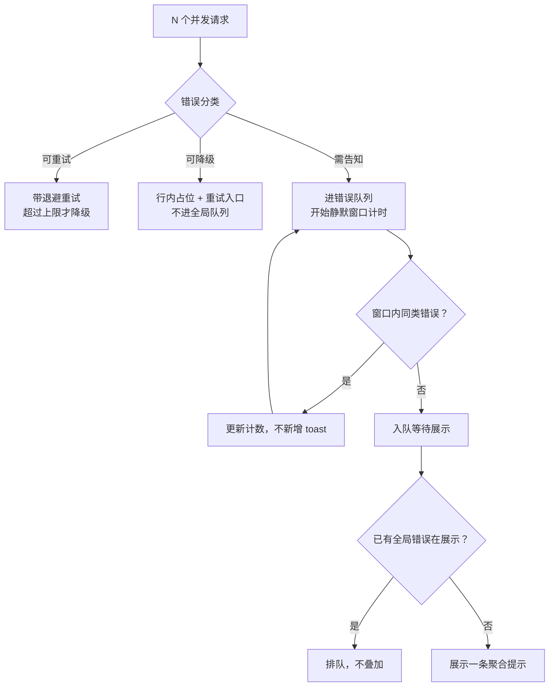

# 业务场景代码✅

## 统计前端请求耗时 {#p2-request-time-statistics}

<Answer>

| 方法类别 | 技术手段/工具 | 实现方式简述 | 代码示例/要点 | 优缺点说明 |
|---|---|---|---|---|
| 初级 | fetch + 时间戳 | 请求前后用 `performance.now()` 记录时间，计算差值即为耗时 | `const start = performance.now(); fetch(...).then(() => { const end = performance.now(); ... })` | 简单易用，受主线程阻塞影响，统计不一定准确 |
| 初级 | XMLHttpRequest + 时间戳 | 请求前后用 `performance.now()` 记录时间，事件回调中计算耗时 | `xhr.onload = function () { ... }` | 同上 |
| 初级 | axios 拦截器 | 请求拦截器记录开始时间，响应拦截器记录结束时间，计算耗时 | `axios.interceptors.request.use(...)` | 适合 axios 用户，易集成 |
| 进阶 | Performance API | 用 `performance.timing` 或 `performance.getEntriesByType('resource')` 获取详细性能数据 | `performance.timing.responseEnd - performance.timing.requestStart` | 能统计页面各阶段耗时，适合分析整体性能 |
| 高级 | Web Worker | 在 Worker 线程中发起请求并统计耗时，主线程不被阻塞 | Worker 文件中用 `performance.now()` 统计，主线程通过 `postMessage` 获取结果 | 不阻塞主线程，适合高并发或复杂场景 |

**说明：**  

- 初级手段适合简单场景，易于实现，但统计结果可能受主线程阻塞影响。  
- 进阶和高级手段能获得更准确或更详细的性能数据，适合对性能要求较高的业务场景。

</Answer>

## cookie 解析函数 {#p2-cookie-parser}

<Answer>

**核心概念**
HTTP Cookie 在前端通过 `document.cookie` 获取，表现为由分号和空格分隔的键值对字符串（如 `"user=john; token=abc%3D123; logged_in=true"`）：
1. **键值拆分**：按 `; ` 切分出各个独立的条目。
2. **解码处理**：Cookie 的键与值可能经过 URL 编码，必须使用 `decodeURIComponent` 正确解码。
3. **边界防御**：处理值中包含等号（如 Base64 编码的 token 包含 `=`）的情况，需只在第一个 `=` 处分割键与值。

**手写实现：**

```javascript
function parseCookie (cookieStr = document.cookie) {
  const result = {}
  if (!cookieStr || typeof cookieStr !== 'string') {
    return result
  }

  const pairs = cookieStr.split(';')
  for (const pair of pairs) {
    const trimmed = pair.trim()
    if (!trimmed) continue

    const equalIndex = trimmed.indexOf('=')
    if (equalIndex === -1) {
      // 只有 key 没有 value
      result[decodeURIComponent(trimmed)] = ''
    } else {
      const key = decodeURIComponent(trimmed.slice(0, equalIndex).trim())
      const val = decodeURIComponent(trimmed.slice(equalIndex + 1).trim())
      result[key] = val
    }
  }

  return result
}

// 验证
const rawCookie = 'username=Alice; token=xyz%3D%3D; theme=dark; empty_key'
console.log(parseCookie(rawCookie))
// 输出: { username: 'Alice', token: 'xyz==', theme: 'dark', empty_key: '' }
```

**面试官视角**
- 考查对真实业务边界的敏锐度：切勿简单使用 `item.split('=')`，否则 Base64 编码的 Cookie 值会被错误切碎。

</Answer>

## JS 执行 100 万个任务， 如何保证浏览器不卡顿？{#p2js-1m-task}

<Answer>

| 方法 | 实现方式简述 | 代码要点/示例 | 优缺点说明 |
|---|---|---|---|
| Web Worker | 将任务转移到 Worker 线程，主线程不阻塞 | `new Worker('worker.js')` | 彻底避免主线程卡顿，适合大量计算 |
| requestAnimationFrame | 将大任务分割为小块，每帧处理一部分，保持页面流畅 | `requestAnimationFrame(fn)` | 简单易用，适合与渲染相关的分步任务 |
| 动态 chunkSize | 动态调整每帧处理任务量，保证每帧耗时不超限 | 根据 `performance.now()` 动态调整 | 进一步优化不卡顿体验，适应不同设备性能 |
| requestIdleCallback | 在浏览器空闲时分批处理任务，避免影响主线程响应 | `requestIdleCallback(fn)` | 最大化利用空闲时间，兼容性需注意 |

- Web Worker 适合 CPU 密集型任务，完全不阻塞主线程。  
- requestAnimationFrame/requestIdleCallback 适合与 UI 相关或需分步处理的任务。  
- 动态 chunkSize 可进一步提升分块处理的平滑性。  
- 可根据业务场景组合使用上述方法。

</Answer>

## 如何封装一个请求，让其多次调用的时候，实际只发起一个请求的时候，返回同一份结果 {#p1-sigleton-request}

<Answer>

最优解：**利用 Promise 缓存，将请求结果复用，避免重复请求。**

实现思路如下：

- 用一个对象（如 Map）缓存每个请求的 Promise。
- 多次调用时，如果缓存中已有对应的 Promise，直接返回该 Promise。
- 只有第一次会真正发起请求，后续调用复用同一个 Promise，拿到同一份结果。

示例代码：

```js
const requestCache = new Map()

function singletonRequest (url, options) {
  const key = url + JSON.stringify(options || {})
  if (requestCache.has(key)) {
    return requestCache.get(key)
  }
  const reqPromise = fetch(url, options).then(res => res.json())
  requestCache.set(key, reqPromise)
  return reqPromise
}

// 用法
singletonRequest('/api/data').then(console.log)
singletonRequest('/api/data').then(console.log)
// 只会发起一次请求，所有调用拿到同一份结果
```

**说明：**  

- 这种方式简单高效，适合幂等请求（如 GET）。
- 若需支持请求失败重试或缓存失效，可在 Promise reject 时清理缓存或设置过期策略。
- 也可用闭包变量实现，无需全局变量。

</Answer>

## 使用 Promise 实现一个异步流量控制的函数(限制并发数) {#p0-async-control}

<Answer>

**核心概念**
异步流量控制（并发限制器 / Promise Pool）用于在需要批量执行大量异步请求时，将同时在飞（in-flight）的请求数量限制在指定阈值内，以避免压垮后端服务器或耗尽浏览器网络通道连接数（HTTP/1.1 同源最多 6 个 TCP 连接）：
1. **工作池机制**：同时保持最多 `limit` 个任务在运行。
2. **腾挪推进**：一旦某个任务执行完毕，立即从等待队列中取出下一个任务放入执行池，直到所有任务全部完成。
3. **保持返回顺序**：虽然完成时间可能有先有后，但最终返回的结果数组顺序必须严格与输入的任务数组顺序对齐。

**手写实现（Promise.all + 动态任务调度）：**

```javascript
/**
 * 异步并发控制器
 * @param {Array<() => Promise<any>>} tasks 返回 Promise 的任务函数数组
 * @param {number} limit 最大并发数
 * @returns {Promise<Array>} 与输入顺序一致的结果数组
 */
function asyncPool (tasks, limit = 3) {
  return new Promise((resolve, reject) => {
    const results = []
    let nextIndex = 0
    let finishedCount = 0
    let isRejected = false

    if (tasks.length === 0) {
      return resolve([])
    }

    function runNext () {
      if (nextIndex >= tasks.length || isRejected) {
        return
      }

      const currentIndex = nextIndex++
      const taskFn = tasks[currentIndex]

      Promise.resolve(taskFn())
        .then(res => {
          results[currentIndex] = res
          finishedCount++

          if (finishedCount === tasks.length) {
            resolve(results)
          } else {
            // 当前槽位空出，立即启动下一个
            runNext()
          }
        })
        .catch(err => {
          isRejected = true
          reject(err)
        })
    }

    // 初始启动 limit 个并发执行器
    const initialPoolSize = Math.min(limit, tasks.length)
    for (let i = 0; i < initialPoolSize; i++) {
      runNext()
    }
  })
}

// 验证
const createMockTask = (id, delay) => () =>
  new Promise(res => setTimeout(() => {
    console.log(`Task ${id} finished at ${Date.now() % 10000}ms`)
    res(`Result ${id}`)
  }, delay))

const mockTasks = [
  createMockTask(1, 1000),
  createMockTask(2, 500),
  createMockTask(3, 300),
  createMockTask(4, 400),
  createMockTask(5, 200)
]

asyncPool(mockTasks, 2).then(results => {
  console.log('全部完成，结果与任务顺序对齐:', results)
})
```

**面试官视角**
- 高频实战题目！重点考察对 Promise 状态推进时机、槽位复用逻辑以及结果索引保持一致的细致把控。

**延伸阅读**
- [p-limit 开源库实现机制](https://github.com/sindresorhus/p-limit)
- [tiny-async-pool 实现](https://github.com/rxaviers/async-pool)

</Answer>

## 集合运算 {#p0-set-operation}

<Answer>

可以使用 ES6 的 Set 数据结构来实现数组交集。

首先，将一个数组转化为 Set，然后遍历另一个数组，将数组中存在于 Set 中的元素存入结果数组中。

以下是一个示例代码：

```js
function intersection (nums1, nums2) {
  const set1 = new Set(nums1)
  const res = []

  for (const num of nums2) {
    if (set1.has(num)) {
      res.push(num)
    }
  }

  return res
}
```

使用示例：

```js
const nums1 = [1, 2, 2, 1]
const nums2 = [2, 2]

console.log(intersection(nums1, nums2)) // [2]
```

该算法的时间复杂度为 O(m+n)，其中 m 和 n 分别为两个数组的长度。

</Answer>

## 限制并发的 Promise

<Answer>

```TypeScript
async function promiseLimit<T> (
  promises: (() => Promise<T>)[],
  limit: number
): Promise<T[]> {
  const results: T[] = []
  const executing: Promise<void>[] = []

  for (const [index, promiseFunc] of promises.entries()) {
    const p = Promise.resolve()
      .then(() => promiseFunc())
      .then(result => {
        results[index] = result
      })
      .finally(() => {
        const i = executing.indexOf(p)
        if (i !== -1) executing.splice(i, 1)
      })

    executing.push(p)

    if (executing.length >= limit) {
      await Promise.race(executing)
    }
  }

  await Promise.all(executing)
  return results
}
```

</Answer>

## 列表页并发发了 N 个请求，部分失败了，怎么保证用户只看到一条聚合后的错误提示，而不是 N 个 Toast？ {#p1-batch-request-error-aggregation}

<Answer>

**核心结论:**

批量请求的错误处理要解决三个独立问题，混在一起做必然出 Toast 风暴：

1. **先分级的不是「成功/失败」，而是「这条失败该不该让用户知道」**。部分数据缺失可以降级展示（骨架屏、单条占位、灰字提示），根本不该进全局提示；只有「整体不可用」「关键数据缺失」「权限/鉴权失败」才值得弹一次全局提示。这一条定了，后面的聚合才有意义。
2. **聚合要「静默期 + 合并」**：进入错误队列后不立即弹，在一个静默窗口（如 300~800ms）内收集同期错误，到期合并成一条「N 项加载失败」；窗口期内同 key 的错误只更新计数，不新增提示。
3. **全局错误只允许同时存在一条**：用一个全局错误控制器（单例）持有当前展示中的 toast，同 key 错误到来时**更新计数与文案**，不同 key 则排队而不是叠加。绝大多数「弹了 N 次」的问题，根因就是每次失败都新建了一个 toast 实例。

**关键工程约束**：可重试错误（429 / 5xx / 网络超时）走**带退避的重试**，不进错误队列；不可重试错误（4xx 参数错误、401/403）才直接归入聚合。**否则 10 个失败请求会先各自重试 3 次，把提示问题放大成流量问题。**

---

**原理解析:**

**1. 错误分级决定去留**

| 错误类型 | 例子 | 是否进全局提示 | 展示策略 |
| :--- | :--- | :--- | :--- |
| 单条可降级 | 某条评论加载失败 | ❌ | 该条占位 + 行内「重试」 |
| 整页不可用 | 列表主数据 500 | ✅ | 聚合提示 + 空态重试按钮 |
| 鉴权/权限 | 401 / 403 | ✅ | 独立提示（引导登录/申请权限） |
| 可重试瞬时 | 429 / 5xx / 超时 | 先重试 | 重试耗尽后才归入聚合 |

**2. 聚合的时序**



**3. 为什么「最后一刻才提示」比「每次失败就提示」好**

逐次提示的问题不只是吵：它会让用户在**错误尚未收敛**时就看到中间态（比如「加载失败」紧接着又成功了），信任感直接受损。静默窗口的本质是**等错误集稳定了再报告**，最终态准确比反馈速度更重要。

**4. 提示必须可定位**

聚合提示要带上：失败了几条、失败原因归类、能否重试、是否可展开看明细。只弹一句「加载失败」而不给下一步动作，用户只能干瞪眼——这在面试里是常见的减分点。

---

**规范实现:**

```typescript
// batch-error-aggregator.ts
export type ErrorKind = 'retryable' | 'degradable' | 'fatal';

export interface BatchError {
  key: string;          // 归并键，同 key 合并计数
  kind: ErrorKind;
  message: string;
  count: number;
  retryable: boolean;
  detail?: string;      // 可展开的明细
}

export class BatchErrorAggregator {
  private queue = new Map<string, BatchError>();
  private timer: ReturnType<typeof setTimeout> | null = null;
  private showing = false;

  constructor(
    private readonly silenceMs = 500,
    private readonly onShow: (e: BatchError) => void = () => {}
  ) {}

  // 单条请求失败时调用：先分级，再决定是否进队列
  report(err: { key: string; kind: ErrorKind; message: string; retryable: boolean; detail?: string }): void {
    if (err.kind === 'degradable') return;          // 降级展示，不打扰用户
    const exist = this.queue.get(err.key);
    if (exist) {
      exist.count += 1;                              // 同 key 只更新计数
    } else {
      this.queue.set(err.key, { ...err, count: 1 });
    }
    this.scheduleFlush();
  }

  // 静默窗口：等错误集稳定后再报告
  private scheduleFlush(): void {
    if (this.timer) clearTimeout(this.timer);
    this.timer = setTimeout(() => this.flush(), this.silenceMs);
  }

  private flush(): void {
    this.timer = null;
    if (this.showing) return;                        // 已有提示在展示，等它结束再处理
    const list = [...this.queue.values()];
    this.queue.clear();
    if (list.length === 0) return;

    const total = list.reduce((s, e) => s + e.count, 0);
    const retryable = list.some(e => e.retryable);
    this.showing = true;
    this.onShow({
      key: 'batch',
      kind: 'fatal',
      message: `${total} 项加载失败${retryable ? '，可重试' : ''}`,
      count: total,
      retryable,
      detail: list.map(e => `${e.key}: ${e.message} ×${e.count}`).join('\n')
    });
  }
}

// 配套：请求层按错误分级，可重试的先退避重试
export async function withRetry<T>(fn: () => Promise<T>, max = 3): Promise<T> {
  let lastErr: unknown;
  for (let i = 0; i < max; i++) {
    try {
      return await fn();
    } catch (err) {
      lastErr = err;
      const kind = classify(err);
      if (kind !== 'retryable') throw err;           // 不可重试立刻上抛
      await new Promise(r => setTimeout(r, 200 * 2 ** i + Math.random() * 100));
    }
  }
  throw lastErr;
}
```

三个容易写错的地方：**`showing` 标志**决定同一时刻只展示一条（否则并发 flush 会叠多条）；**静默窗口每次新错误都要重置**（`clearTimeout` 再设），这样「错误还在陆续来」时会继续等待直到稳定；**降级类错误根本不进队列**（`report` 第一行就 return），这是防 Toast 风暴最省事也最有效的一刀。

---

**面试官视角:**

**考察意图:**
考察候选人是否处理过真实项目里的「错误提示风暴」，以及是否理解**错误分级 → 聚合 → 降噪**这条链路。高分回答必须先讲**分级**（不是所有失败都该弹窗），再讲**聚合时机**（静默窗口）和**互斥展示**（同一时刻只一条）。

**深度追问链:**
1. **追问 1**: 10 个接口并发，3 个返回 500，你怎么处理？
   - *答题切入点*: 500 属可重试，先带抖动退避重试，重试耗尽才归入错误队列；若这 3 条是列表中可缺失的次要数据（如「点赞数」），应降级为行内占位而不是全局提示——先问「这 3 条缺了会不会让页面不可用」。
2. **追问 2**: 为什么要等一会儿再弹，而不是失败就弹？
   - *答题切入点*: 错误集合会收敛。逐次提示会让用户看到中间态（先失败后成功），准确度差且吵；静默窗口等错误稳定后报最终态，并按 key 合并计数。
3. **追问 3**: 多个页面同时出错，怎么保证不会弹出好几条？
   - *答题切入点*: 用全局单例错误控制器持有「当前展示中」的提示，同 key 更新计数、不同 key 排队；不要每个请求各自 new 一个 toast 实例——这是最常见的根因。

---

**延伸阅读:**

- [MDN: Promise.allSettled（部分失败时的结果聚合语义）](https://developer.mozilla.org/zh-CN/docs/Web/JavaScript/Reference/Global_Objects/Promise/allSettled)
- [MDN: AbortController（批量请求的取消与超时控制）](https://developer.mozilla.org/zh-CN/docs/Web/API/AbortController)
- [AWS Builders' Library: Timeouts, retries, and backoff with jitter（退避与抖动的工程依据）](https://aws.amazon.com/builders-library/timeouts-retries-and-backoff-with-jitter/)

</Answer>
