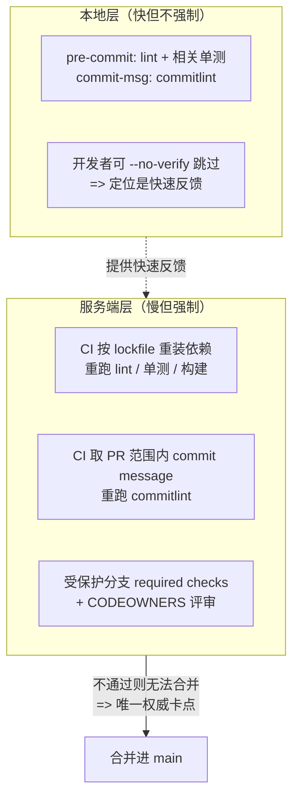
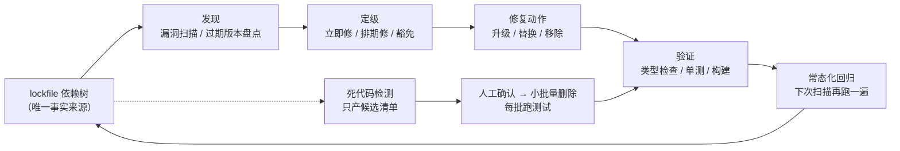

# 部署集成✅

## CI 和 CD 的区别 {#p0-ci-cd-difference}

<Answer>

**核心概念：**

| 类型 | 全称 | 作用 | 关键活动 |
|------|------|------|--------|
| **CI** | Continuous Integration（持续集成） | 自动化构建和测试代码变更 | 代码合并、自动构建、单元测试、代码质量检查 |
| **CD** | Continuous Deployment/Delivery（持续部署/交付） | 自动化发布和部署应用 | 自动部署、环境管理、版本发布、回滚策略 |

**主要差异：**

1. **阶段不同**：CI 侧重代码集成和质量保证，CD 侧重交付和部署
2. **目标不同**：CI 确保代码可构建和可测试，CD 确保应用可稳定部署
3. **触发机制**：CI 通常由代码提交触发，CD 可手动或自动触发

**面试官视角：**

- **要点**：能清晰区分两者的作用域和目标
- **加分项**：结合实际项目经验说明 CI/CD 流程设计
- **常见失误**：混淆两者概念，不理解具体实践

**延伸阅读**

- [CI/CD 最佳实践](https://about.gitlab.com/topics/ci-cd/)
- [Martin Fowler 论 CI](https://martinfowler.com/articles/continuousIntegration.html)

</Answer>

## 前端应用 CICD 有哪些方式实现 {#p1-frontend-ci-cd-ways}

<Answer>

前端应用的持续集成与持续部署（CI/CD）可以通过以下几种方式实现：

**一、使用 Jenkins**

1. 持续集成：

- Jenkins 可以监听代码仓库（如 Git）的变化，当有新的代码提交时，自动触发构建任务。
- 对于前端项目，可以配置 Jenkins 执行构建命令，如使用 npm 或 yarn 安装依赖、运行构建脚本等。
- 例如，可以创建一个自由风格的项目，配置源代码管理为你的 Git 仓库地址，并在构建步骤中添加“Execute shell”，输入构建命令，如`npm install && npm run build`。

2. 持续部署：

- 构建成功后，Jenkins 可以将构建生成的静态文件部署到目标服务器上。
- 可以使用插件（如 Publish Over SSH）将文件传输到远程服务器，并执行部署脚本。
- 例如，配置插件连接到目标服务器，设置部署目录，然后在构建后操作中选择“Send build artifacts over SSH”，指定要传输的文件和目标服务器信息。

**二、使用 GitLab CI/CD**

1. 持续集成：

- 在`.gitlab-ci.yml`文件中定义一系列的阶段（stages）和任务（jobs）。
- 当代码推送到 GitLab 仓库时，GitLab Runner 会自动执行这些任务。
- 对于前端项目，可以定义一个`build` job，在其中执行构建命令。
- 例如：

 ```yaml
 stages:
 - build

 build:
 stage: build
 script:
 - npm install
 - npm run build
 ```

2. 持续部署：

- 可以在`.gitlab-ci.yml`中定义`deploy` job，将构建生成的静态文件部署到服务器上。
- 可以使用 SSH 密钥或其他部署工具来实现部署。
- 例如：

 ```yaml
 stages:
 - build
 - deploy

 build:
 stage: build
 script:
 - npm install
 - npm run build

 deploy:
 stage: deploy
 script:
 - scp -r dist/* user@server:/path/to/deploy
 ```

**三、使用 GitHub Actions**

1. 持续集成：

- 在`.github/workflows`目录下创建一个 YAML 文件来定义工作流。
- 当代码推送到 GitHub 仓库时，GitHub Actions 会自动执行工作流中的任务。
- 对于前端项目，可以在工作流中执行构建命令。
- 例如：

 ```yaml
 name: CI/CD for Frontend App

 on:
 push:
 branches:
 - main

 jobs:
 build:
 runs-on: ubuntu-latest
 steps:
 - uses: actions/checkout@v2
 - name: Install dependencies
 run: npm install
 - name: Build
 run: npm run build
 ```

2. 持续部署：

- 可以在工作流中添加部署步骤，使用 SSH、FTP 等方式将静态文件部署到服务器上。
- 或者使用云服务提供商的部署服务，如 AWS Amplify、Netlify 等。
- 例如：

 ```yaml
 name: CI/CD for Frontend App

 on:
 push:
 branches:
 - main

 jobs:
 build:
 runs-on: ubuntu-latest
 steps:
 - uses: actions/checkout@v2
 - name: Install dependencies
 run: npm install
 - name: Build
 run: npm run build

 deploy:
 needs: build
 runs-on: ubuntu-latest
 steps:
 - name: Deploy to Server
 run: scp -r dist/* user@server:/path/to/deploy
 ```

**四、使用 Travis CI**

1. 持续集成：

- 在项目根目录下创建一个`.travis.yml`文件来定义构建配置。
- 当代码推送到支持的代码仓库（如 GitHub）时，Travis CI 会自动触发构建。
- 对于前端项目，可以在配置文件中指定构建命令。
- 例如：

 ```yaml
 language: node_js
 node_js:
 - 12

 script:
 - npm install
 - npm run build
 ```

2. 持续部署：

- 可以在构建成功后，使用部署工具或脚本将静态文件部署到服务器上。
- 例如，可以在`.travis.yml`中添加部署步骤，使用 SSH 或其他方式进行部署。

```yaml

 language: node_js
 node_js:

- 12

 script:

- npm install
- npm run build

 after_success:

- scp -r dist/* user@server:/path/to/deploy

 ```

**延伸阅读**

- [Jenkins 官方文档](https://www.jenkins.io/doc/)
- [GitLab CI/CD](https://docs.gitlab.com/ee/ci/)
- [GitHub Actions](https://docs.github.com/en/actions)
- [前端 CI/CD 最佳实践](https://web.dev/articles/vitals-tools)

</Answer>

## 应用如何做应用灰度发布 {#p3-grey}

<Answer>

这个是一个非常复杂的话题， 没法直接给出答案， 进提供一些实现的思路：

**什么是灰度**

灰度系统可以把流量划分成多份，一份走新版本代码，一份走老版本代码。

而且灰度系统支持设置流量的比例，比如可以把走新版本代码的流程设置为 5%，没啥问题再放到 10%，50%，最后放到 100% 全量。

这样可以把出现问题的影响降到最低。

而且灰度系统不止这一个用途，比如产品不确定某些改动是不是要的，就要做 AB 实验，也就是要把流量分成两份，一份走 A 版本代码，一份走 B 版本代码。

**实现思路**

1. 后端支持：灰度上线需要后端的支持，通过后端的灰度发布控制，可以将不同版本的前端应用分配给不同用户。

2. 搭建网关层： 支持一部分用户分发到 A 版本， 一部分用户分发到 B 版本 （通常使用 nginx 搭建）。

3. 版本管控机制： 使用版本控制系统（如Git、package.version、hash version 等）来管理不同版本的前端应用代码。在灰度上线时，可以根据需要切换到特定的版本。

4. 动态路由：通过动态路由配置，将用户请求导向不同版本的前端应用。例如，可以使用Nginx或其他反向代理服务器来实现动态路由。

5. 流量染色：使用Cookie或Session来控制用户的灰度版本访问。可以通过设置不同的Cookie值或Session标记，将用户分配到不同的灰度版本。

6. 更复杂的漏量配置： 例如要根据部门、权限、角色等方式来开放灰度；可以使用让用户访问应用的时候， 查询其权限和角色， 根据权限和角色来分发不同的页面路由。

**参考文档**

- [基于 Nginx 实现一个灰度上线系统](https://juejin.cn/post/7250914419579944997)

应用的灰度发布是将新版本逐步推出给有限的用户群体，以在完全发布之前监控其性能和搜集用户反馈的过程。这可以确保新版本的稳健性，减少因新版本可能引起的问题对所有用户的影响。以下是实现应用灰度发布的几种常见方法：

 1. 基于 HTTP 头或 Cookie 的路由

通过识别用户的 HTTP 请求头（如 User-Agent）或特定的 Cookie，决定用户请求被路由到新版本还是旧版本的应用。这种方法通常需要负载均衡器或网关支持特定路由规则。

 2. 使用服务网格（Service Mesh）

服务网格如 Istio 提供了复杂的流量管理能力，可以在微服务架构中实现灰度发布。通过定义路由规则，Istio 可以将特定比例或特定条件的流量导向新版本服务。

 3. 功能开关（Feature Toggles）

功能开关允许开发者在代码中嵌入开关，根据配置动态激活或关闭某些功能。这样，新版本的功能可以被隐藏，直到你决定通过更改配置为特定用户群体开放。

 4. DNS 路由

通过 DNS 管理，将部分用户的请求解析到部署了新版本应用的服务器上。这种方法简单，但切换和回退可能不如其他方法灵活。

 5. CDN 切换

对于前端应用或静态资源，可以通过 CDN 配置，将部分用户的请求路由到包含新版本资源的 CDN 上。通过调整 CDN 的缓存规则控制版本切换。

 6. A/B 测试平台

将灰度发布作为 A/B 测试的一部分，使用专门的 A/B 测试平台来控制哪些用户看到新版本。这种方法不仅可以实现灰度发布，还能搜集用户反馈和使用情况数据。

 7. 容器编排和管理

在支持容器编排（如 Kubernetes）的环境中，可以通过部署新版本的 Pod 副本，并逐步增加新版本副本的数量，同时减少旧版本副本的数量实现灰度发布。

在实施灰度发布时，应该配合监控和日志记录工具，以便快速识别并解决新版本可能引入的问题。同时，在决定完全推出新版本之前，逐渐增加访问新版本的用户比例，确保在所有阶段都能够保持应用的稳定性和高性能。

**延伸阅读**

- [灰度发布最佳实践](https://martinfowler.com/bliki/CanaryRelease.html)
- [基于 Nginx 实现灰度发布](https://nginx.org/en/docs/http/ngx_http_split_clients_module.html)
- [Kubernetes 灰度发布](https://kubernetes.io/docs/concepts/cluster-administration/manage-deployment/#canary-deployments)

</Answer>

## 团队的 ESLint 和 commitlint 都能被 `--no-verify` 跳过，代码质量门禁怎样才能真的卡得住？ {#p1-ci-gate-bypass-resistance}

<Answer>

**核心结论:**

门禁的「不可绕过性」来自**执行位置与强制力**，而不是来自工具本身有多强。

1. **本地钩子只提供快速反馈，不提供强制约束**。husky 的 pre-commit / commit-msg 跑在开发者机器上，开发者拥有最终控制权：`--no-verify` 可以跳过、可以直接改文件、CI 环境里往往根本没装钩子。本地钩子的正确定位是**把错误拦在开发者键盘前**，把反馈从「十分钟后」压缩到「十秒后」。
2. **唯一权威的卡点是「CI 流水线 + 仓库侧的合并策略」**。受保护分支（protected branch）把 CI 检查设为 **required status checks**：检查不通过，合并按钮在服务端就是灰的，客户端无从绕过。再叠加 CODEOWNERS 让关键目录必须由指定 owner 评审，强制力就锁死在服务端。
3. **服务端要把本地跳过的检查再执行一遍**。CI 从干净工作区按 lockfile 重装依赖后重跑 lint 与单测；**提交信息校验要在 CI 侧重新取 PR 范围内的 commit message 范围**去跑 commitlint，否则本地钩子一被跳过，提交规范就彻底无人检查。

---

**原理解析:**

**1. 三层门禁的分工**



**2. 为什么「CI 跑了」不等于「门禁卡住了」**

CI 红了只是**一条提示**，只有当它被设成 required check 时，红色才变成**服务端拒绝合并**。这两者差别极大：前者靠人自觉点「why are checks failing」，后者是物理上做不到。

**3. 提交信息校验为什么必须按「范围」重跑**

commitlint 既可以只校验最近一条提交（`--last`），也可以校验一段提交范围（`--from` / `--to`）。PR 场景必须用**范围**模式：只看最后一条提交，一个「前面五条都不规范、最后一条规范」的 PR 就能混过去。范围要取 PR 的 base 到 head 之间的全部提交。

**4. 规则本身也要可维护**

门禁规则要分层：可机器判定的（格式、类型、未使用变量）交给 lint / 类型检查；需要人理解的（架构约束、目录边界）交给 CODEOWNERS 与评审。规则堆到几千行、无法定位到具体条目时，「门禁卡住」就退化成「门禁挡路」，最终会被整体绕过。

---

**规范实现:**

服务端侧的落地形态（YAML 为 GitHub Actions 的真实语法，`${{ ... }}` 是其表达式）：

```yaml
# .github/workflows/quality-gate.yml
name: Quality Gate

on:
  pull_request:

permissions:
  contents: read

jobs:
  lint-and-test:
    runs-on: ubuntu-latest
    steps:
      - uses: actions/checkout@v4
        with:
          fetch-depth: 0        # 提交信息校验需要完整历史
      - uses: actions/setup-node@v4
        with:
          node-version: lts/*
      - name: Install by lockfile
        run: npm ci             # 严格按 lockfile 装，保证与本地同一棵依赖树
      - name: Lint
        run: npm run lint:all
      - name: Unit test
        run: npm test

  commitlint:
    runs-on: ubuntu-latest
    steps:
      - uses: actions/checkout@v4
        with:
          fetch-depth: 0
      - uses: actions/setup-node@v4
        with:
          node-version: lts/*
      - name: Install commitlint
        run: npm install -D @commitlint/cli @commitlint/config-conventional
      - name: Validate PR commit messages
        run: npx commitlint --from ${{ github.event.pull_request.base.sha }} --to ${{ github.event.pull_request.head.sha }} --verbose
```

配套的仓库侧设置（不在代码里，需在仓库设置中完成）：受保护分支上把 `lint-and-test` 与 `commitlint` 设为 required status checks，并配置 CODEOWNERS 要求关键目录评审。

---

**面试官视角:**

**考察意图:**
考察候选人是否理解「本地钩子 ≠ 门禁」这一分层，并能否说清**强制力来自服务端合并策略**而非工具强度。高分回答必须点名 required status checks、CODEOWNERS，以及「提交信息要按 PR 范围重跑」这个细节。

**深度追问链:**
1. **追问 1**: 开发者说「我本地钩子装坏了，先放行」，你怎么办？
   - *答题切入点*: 不争论。立即在 CI 侧把同一套检查补跑一遍并让它成为 required check；同时把本地钩子的安装纳入 `npm install` 的 postinstall 或 CI 的环境自检，避免「装坏了」长期存在。
2. **追问 2**: commitlint 在本地跑过了，为什么 CI 还要再跑一遍？
   - *答题切入点*: 因为本地可能被跳过，而且 PR 包含多条提交；CI 必须用 `--from`/`--to` 按 PR 范围校验全部提交消息，而不是只校验最后一条。
3. **追问 3**: 门禁加多了天天被卡，团队开始集体绕过，你怎么办？
   - *答题切入点*: 分层与分级——可机器判定的快规则直接进 lint，重量级检查（长测试、构建）走合并队列或按改动范围触发；同时统计「被卡次数 Top N 规则」，对误报率高的规则改写或下线。门禁的可持续性来自低误报率。

---

**延伸阅读:**

- [commitlint 官方 CI Setup 指南（PR 范围校验的真实用法）](https://commitlint.js.org/guides/ci-setup)
- [GitHub 文档：About protected branches（required status checks）](https://docs.github.com/repositories/configuring-branches-and-merges-in-your-repository/managing-protected-branches/about-protected-branches)
- [GitHub 文档：About code owners（CODEOWNERS 与评审强制）](https://docs.github.com/repositories/managing-your-repositorys-settings-and-features/customizing-your-repository/about-code-owners)

</Answer>

## 第三方依赖的漏洞、破坏性升级和死代码清理，团队该怎么组织成一条可持续的治理闭环？ {#p1-dependency-governance-lifecycle}

<Answer>

**核心结论:**

依赖治理要能持续跑下去，关键是把它做成**一条以 lockfile 为唯一事实来源的闭环流水线**，而不是靠人定期救火。

1. **事实来源唯一：lockfile**。漏洞判定、升级影响面、死代码判定都必须基于**锁文件解析出的真实依赖树**，而不是 `package.json` 里的 semver 范围。CI 用 `npm ci` 严格按 lockfile 安装，本地、CI、生产装出来的是同一棵依赖树，治理结论才可复现。
2. **发现要常态化，定级要分级**。漏洞扫描挂到 CI 的定时任务上持续跑，结果按「严重度 × 是否直接依赖 × 有无可用修复版本」分三档处置（立即修 / 排期修 / 记录豁免）。一条高危告警淹没几十条噪音，是门禁失效最常见的方式。
3. **破坏性升级必须分阶段**。主版本带 breaking change 不能一步到位：锁定当前可用版本 → 在独立分支改代码适配 → 测试与构建全绿 → 灰度放量 → 观察后合入。每一步都能独立回退。
4. **死代码清理是「工具出候选 + 人工确认 + 渐进删除」**。静态检测只产出候选清单，不能自动删——动态引用、运行时按字符串加载的模块、以及带副作用的 polyfill 导入，静态分析都判不出来。删除要小批量、每批跑测试、可回滚。

---

**原理解析:**

**1. 闭环的三段与共享主干**



**2. 为什么「发现」和「升级」不能割裂**

扫描报出的漏洞，其修复版本往往**就是一次 breaking change**。如果发现走一条流水线、升级走另一条，修复成本会被重复评估两次，且两边看到的依赖树可能不一致。两条流程共用同一份 lockfile 变更作为主干，才能保证「报出来的漏洞能落地修掉」。

**3. 死代码清理的三个误删来源**

- **动态引用**：运行时按字符串拼接路径加载的模块（微前端子应用、路由懒加载的动态表），静态分析完全看不见；
- **副作用型导入**：polyfill、埋点 SDK 这类「import 即生效」的模块，静态看是可删的死代码，实际删了线上直接报错；
- **构建期与运行期不一致**：Tree Shaking 只能在打包期删掉产物里的死代码，源码里的死代码仍然在，且可能被动态入口引用。

所以工具的正确角色是**候选生成器**，不是删除器。

**4. 升级为什么要灰度**

依赖升级属于**运行时行为变更**，不是编译期就能验完的类型变更。即使类型检查与单测全绿，也可能有依赖在特定运行时路径下行为不同。灰度让问题在可控流量里暴露，而不是全量后回滚。

---

**规范实现:**

把扫描结果汇总成可执行的处置报告（TypeScript）：

```typescript
// scripts/dependency-governance.ts
import { execFileSync } from 'node:child_process';

type Severity = 'critical' | 'high' | 'moderate' | 'low' | 'info';
type Action = 'block' | 'schedule' | 'accept';

export interface AuditVulnerability {
  name: string;
  severity: Severity;
  isDirect: boolean;
  range: string;
  fixAvailable: boolean | { name: string; version: string; isSemverMajor: boolean };
}

export interface AuditReport {
  vulnerabilities: Record<string, AuditVulnerability>;
}

export interface Policy {
  blockSeverities: Severity[];   // 命中即阻断合并
  blockOnlyDirect: boolean;      // 只阻断直接依赖
  acceptWhenNoFix: boolean;      // 无可用修复版本时降级为记录
}

export function decideAction(v: AuditVulnerability, policy: Policy): Action {
  if (!policy.blockSeverities.includes(v.severity)) return 'accept';
  if (policy.blockOnlyDirect && !v.isDirect) return 'schedule';
  if (policy.acceptWhenNoFix && v.fixAvailable === false) return 'schedule';
  return 'block';
}

export function runAudit(): AuditReport {
  // npm audit 的 JSON 输出结构：vulnerabilities 为按包名索引的条目集合
  const raw = execFileSync('npm', ['audit', '--json'], { encoding: 'utf8' });
  return JSON.parse(raw) as AuditReport;
}

export function buildGovernanceReport(policy: Policy): string {
  const report = runAudit();
  const rows = Object.entries(report.vulnerabilities).map(([name, v]) => ({
    name,
    severity: v.severity,
    direct: v.isDirect,
    action: decideAction(v, policy)
  }));
  const blocking = rows.filter(r => r.action === 'block');
  return [
    `已知漏洞：${rows.length} 条，其中需阻断合并 ${blocking.length} 条`,
    ...rows.map(r => `- ${r.name}（${r.severity}，${r.direct ? '直接依赖' : '间接依赖'}）-> ${r.action}`)
  ].join('\n');
}
```

配合的升级流程（保持每一步可回退）：

```bash
# 1) 基线：严格按 lockfile 复现当前依赖树并跑通全量检查
npm ci
npm run typecheck && npm test && npm run build

# 2) 破坏性主版本升级单独开分支，便于整体回退
git switch -c upgrade/<package>-major
npm install <package>@latest

# 3) 适配代码后再次全量验证，三件套全绿才允许合入
npm run typecheck && npm test && npm run build
```

死代码检测用各语言/工具链已有的静态能力即可（ESLint 的 `no-unused-vars`、TypeScript 的 `noUnusedLocals` 与 `noUnusedParameters`、构建期的 Tree Shaking、CSS 侧的 PurgeCSS 类工具），它们负责**产出候选清单**；删除动作必须走人工确认与分批回归。

---

**面试官视角:**

**考察意图:**
考察候选人是否把依赖治理当成**工程闭环**而不是一次性任务。高分回答必须点出「以 lockfile 为唯一事实来源」「分级处置避免告警疲劳」「破坏性升级分阶段可回退」「死代码工具只出候选不自动删」这四条。

**深度追问链:**
1. **追问 1**: 你们的依赖漏洞是定期人工扫还是自动跑？
   - *答题切入点*: 自动跑在 CI 定时任务上，按 lockfile 判定；结果分三档处置并可追踪。若答「人工定期跑」，追问「那新人引入的带漏洞依赖什么时候会被发现」通常就答不上来了。
2. **追问 2**: 升级一个主版本依赖，怎么保证不出事？
   - *答题切入点*: 独立分支 + 适配改动 + 类型/单测/构建三件套 + 灰度，每步可回退；并说明为什么「全量一次升」风险高（无法二分定位是哪个依赖引起的行为变化）。
3. **追问 3**: 死代码检测工具报了 200 个未引用文件，你敢直接删吗？
   - *答题切入点*: 不敢。工具只出候选；要先排除动态引用与副作用型导入，再分小批删除、每批跑测试，并保留可回退的提交粒度。

---

**延伸阅读:**

- [npm 官方文档：npm audit（基于 lockfile 的漏洞审计）](https://docs.npmjs.com/cli/v11/commands/npm-audit)
- [npm 官方文档：npm ci（严格按 lockfile 安装）](https://docs.npmjs.com/cli/v11/commands/npm-ci)
- [ESLint 官方文档：no-unused-vars](https://eslint.org/docs/latest/rules/no-unused-vars)
- [TypeScript 官方文档：noUnusedLocals / noUnusedParameters](https://www.typescriptlang.org/tsconfig/#noUnusedLocals)

</Answer>
