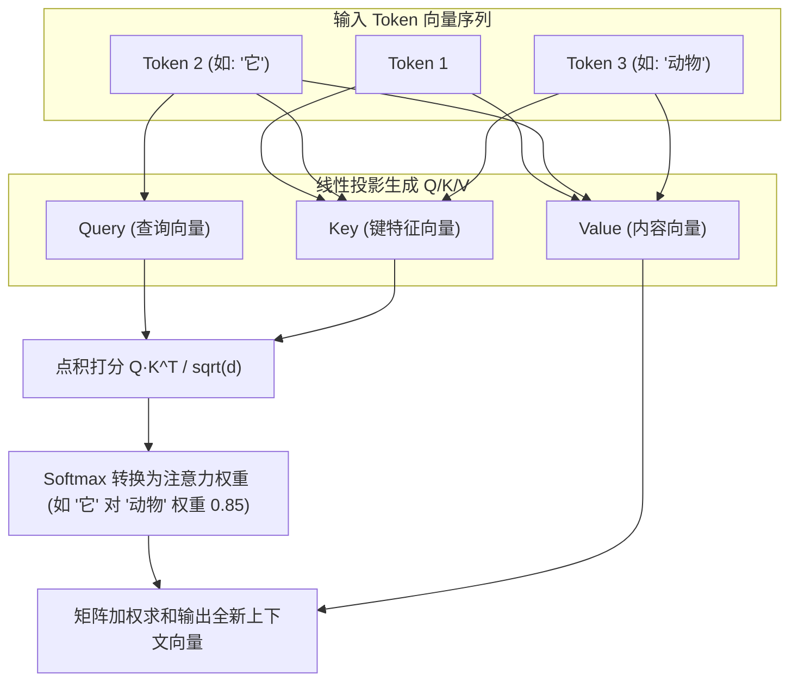
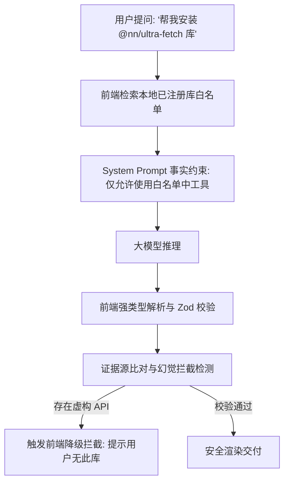
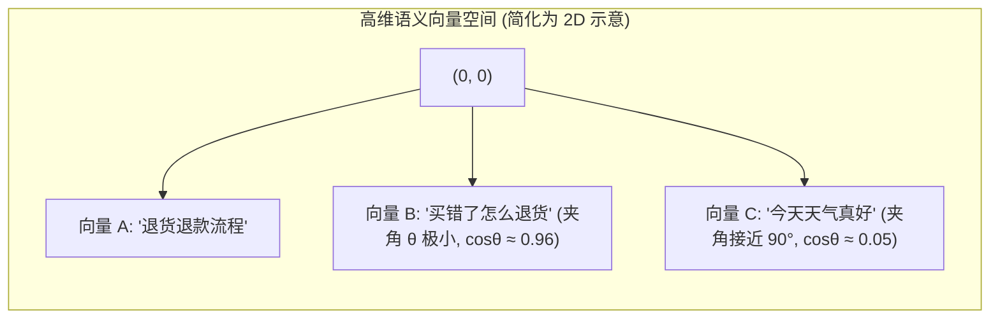
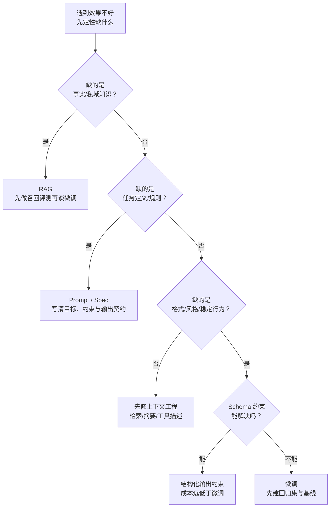
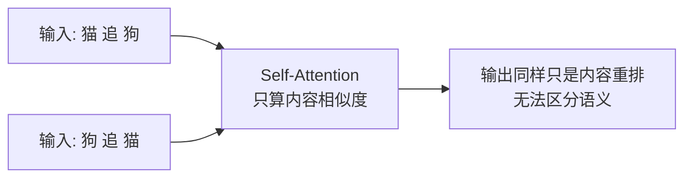
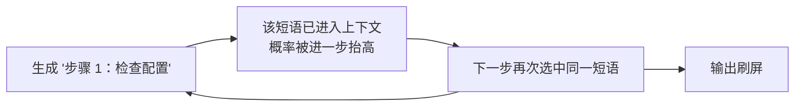
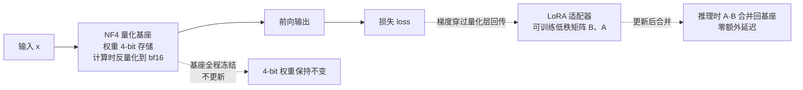
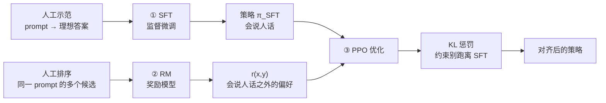

# 大模型原理与前端认知 (LLM Architecture & Mental Models)✅

本模块聚焦前端工程师必须建立的大模型底层机制认知：Transformer 架构的通俗机理、Self-Attention 自注意力与多头注意力、位置编码（RoPE / ALiBi）与长上下文外推原理、大模型幻觉成因与工程防御门禁、复读机等退化生成的诊断与分层干预、结构化输出（Structured Outputs）与模式契约，以及 Embedding 向量空间与余弦相似度计算，并延伸到参数高效微调（LoRA / QLoRA）的显存账本与量化前提。

---

## 前端工程师需要了解的 Transformer 架构：什么是 Self-Attention（自注意力机制）？多头注意力（Multi-Head Attention）解决了什么？ {#p0-transformer-self-attention-for-fe}

<Answer>

**核心结论:**

在现代 AI 技术栈中，Transformer 是当今几乎所有主流大模型（GPT-4、Claude、DeepSeek、Llama）的基础骨架架构。前端工程师无需深入推导反向传播偏导数，但必须深刻理解其**核心信息路由引擎——Self-Attention（自注意力机制）与 Multi-Head Attention（多头注意力机制）**：
1. **彻底终结 RNN 的时序串行依赖**：传统的循环神经网络（RNN）必须按字逐个串行计算，无法利用现代 GPU 进行大规模并行计算；Transformer 抛弃了循环连接，直接将整个上下文序列同时输入，通过**自注意力矩阵一次性并行计算序列中任意两个 Token 之间的关联权重**；
2. **Self-Attention 的本质（查询 Query、键 Key、值 Value 的动态路由）**：每个 Token 转化为 $Q$（我想找什么）、$K$（我有什么特征）、$V$（我的具体内容）。通过计算 $Q$ 与所有 $K$ 的点积内积并经 Softmax 归一化，得到注意力权重分数，最后对 $V$ 进行加权求和，实现上下文信息的动态聚合；
3. **多头注意力（Multi-Head Attention）的工程价值**：如同前端组件的多重观察者（View / State / Props），单个注意力头只能捕捉一种全局语义关系；多头机制通过将高维向量投影到多个独立的低维子空间（如 8 个或 32 个 Head），使模型能**同时在不同视角关注语法依赖、代词指代、长程逻辑因果与专业实体关联**。

---

**原理解析:**

**1. Self-Attention 核心数学原理通俗推导**

```text
Attention(Q, K, V) = Softmax((Q * K^T) / sqrt(d_k)) * V
```

- **点积打分 (`Q * K^T`)**：计算当前 Token 与上下文中所有其他 Token 的相似度矩阵；
- **缩放因子 (`sqrt(d_k)`)**：随着向量维度 $d_k$ 变大，点积结果方差增大，Softmax 容易进入梯度饱和区，因此除以 `sqrt(d_k)` 保持数值稳定；
- **Softmax 归一化**：将点积分数转化为和为 1 的概率分布（Attention Map 权重）；
- **加权求和 (`V`)**：根据权重把相关 Token 的信息融入当前 Token 的表示中。



**2. 前端为什么需要懂这个？**
- **长文本注意力稀释**：注意力矩阵大小为 $N \times N$（$O(N^2)$ 复杂度）。文本越长，注意力权重被摊得越薄，模型容易产生“迷失在中间（Lost in the middle）”现象，因此前端在构造 RAG 或 Agent Prompt 时，必须将核心约束置于开头（System）或结尾（最新指令）；
- **计算与显存开销直观感知**：理解了 $O(N^2)$ 就能理解为什么长上下文推理费用昂贵、首字延迟（TTFT）高，以及为什么端侧小模型难以直接跑 128K 超长上下文。

---

**规范代码实现:**

在 TypeScript 中纯数学模拟缩放点积自注意力的计算过程，直观展现注意力权重的生成与聚合：

```typescript
// utils/attention-demo.ts
export class ScaledDotProductAttention {
  // 计算单头自注意力
  public static compute(
    Q: number[][], // [seqLen, dK]
    K: number[][], // [seqLen, dK]
    V: number[][]  // [seqLen, dV]
  ): { output: number[][]; attentionWeights: number[][] } {
    const seqLen = Q.length;
    const dK = Q[0].length;
    const dV = V[0].length;
    const scale = Math.sqrt(dK);

    // 1. Q * K^T 计算点积得分矩阵 [seqLen, seqLen]
    const scores: number[][] = Array.from({ length: seqLen }, () => Array(seqLen).fill(0));
    for (let i = 0; i < seqLen; i++) {
      for (let j = 0; j < seqLen; j++) {
        let dot = 0;
        for (let k = 0; k < dK; k++) {
          dot += Q[i][k] * K[j][k];
        }
        scores[i][j] = dot / scale;
      }
    }

    // 2. 逐行应用 Softmax 得到注意力权重矩阵
    const attentionWeights: number[][] = scores.map(row => {
      const maxVal = Math.max(...row);
      const exps = row.map(val => Math.exp(val - maxVal));
      const sumExp = exps.reduce((acc, v) => acc + v, 0);
      return exps.map(v => v / sumExp);
    });

    // 3. AttentionWeights * V 加权求和输出 [seqLen, dV]
    const output: number[][] = Array.from({ length: seqLen }, () => Array(dV).fill(0));
    for (let i = 0; i < seqLen; i++) {
      for (let j = 0; j < dV; j++) {
        let sum = 0;
        for (let k = 0; k < seqLen; k++) {
          sum += attentionWeights[i][k] * V[k][j];
        }
        output[i][j] = sum;
      }
    }

    return { output, attentionWeights };
  }
}
```

---

**面试官视角:**

**考察意图:**
评估应试者是只停留在 API 搬运工，还是对底层基础科学模型有清晰的架构认知。能够通俗、准确讲清 Q/K/V 物理含义与多头注意力的前端工程师，在团队内对技术选型与性能边界有更深刻的判断力。

**深度追问链:**
1. **追问 1**: 传统 Transformer 的注意力是全向的（双向关注），为什么大语言模型（如 GPT/DeepSeek）大多是 Decoder-Only 架构？
   - *答题切入点*: 文本生成任务本质是自回归预测未来 Token，生成第 $i$ 个词时绝对不能看到第 $i+1$ 个词（否则作弊泄露答案）；因此通过下三角因果掩码（Causal Masking）把未来 Token 遮盖住，Decoder-Only 架构对自回归生成任务结构最精简、参数利用率最高。

---

**延伸阅读:**
- [Attention Is All You Need (Vaswani et al., 2017 原始论文)](https://arxiv.org/abs/1706.03762)
- [The Illustrated Transformer (Jay Alammar 经典图解)](https://jalammar.github.io/illustrated-transformer/)

</Answer>

---

## 为什么大模型会产生幻觉（Hallucination）？前端能从工程上做什么来防范和降低幻觉？ {#p0-llm-hallucination-mitigation}

<Answer>

**核心结论:**

大模型的“幻觉（Hallucination）”是指**模型生成的文本表面流畅合理、符合语法逻辑，但内容与事实严重相悖或完全虚构**（例如编造不存在的 npm 库、捏造不存在的 API 参数）。

大模型产生幻觉的本质原因：
1. **统计概率采样而非真实世界逻辑推理**：大模型本质是自回归条件概率预测器，它优化的是“哪个 Token 接下来出现最顺畅”，而非“这句话是否是客观真理”；
2. **知识过时与记忆压缩损耗**：训练数据截止后新发生的事件模型不可知；海量知识压缩在权重参数中，存在特征混淆与模式过度拟合；
3. **谄媚性（Sycophancy）与强行补全倾向**：模型倾向于迎合用户的预设立场，并在遇到不确定问题时“宁可编造也不承认不知道”。

**前端在工程防御层面的四大防线（Mitigation Strategies）**：
- **防线 1：RAG 事实注入（Grounding）**：不让模型凭空记忆，而是从可信私域数据检索真实上下文喂给模型；
- **防线 2：强制拒答协议（Fallback on Unknown）**：在 System Prompt 注入“当证据不足时，必须明确回答不知道，禁止推理虚构”；
- **防线 3：结构化模式约束与链式校验（Schema Validation & Citations）**：要求返回引用源（Source IDs），前端高亮比对并进行 JSON Schema 强类型断言；
- **防线 4：Human-in-the-Loop 门禁**：对高风险判断由人类介入复核。

---

**原理解析:**

**1. 幻觉防御全链路漏斗模型**



---

**规范代码实现:**

前端通过封装带有“证据来源溯源（Source Citation）”与自动置信度过滤的校验拦截器：

```typescript
// utils/hallucination-guard.ts
import { z } from 'zod';

// 定义带事实来源的强类型响应契约
export const FactualResponseSchema = z.object({
  answer: z.string().min(1),
  confidenceScore: z.number().min(0).max(1),
  citations: z.array(z.object({
    documentId: z.string(),
    snippet: z.string()
  })),
  hasSufficientContext: z.boolean()
});

export type FactualResponse = z.infer<typeof FactualResponseSchema>;

export class HallucinationGuard {
  public static validate(rawJson: unknown, trustedDocIds: Set<string>): {
    valid: boolean;
    data?: FactualResponse;
    warning?: string;
  } {
    const parseResult = FactualResponseSchema.safeParse(rawJson);
    if (!parseResult.success) {
      return { valid: false, warning: '响应数据不符合事实契约模式' };
    }

    const { data } = parseResult;
    
    // 检查模型是否承认上下文不足
    if (!data.hasSufficientContext) {
      return { valid: true, data, warning: '模型明确标记私域知识库不足以支撑结论' };
    }

    // 检查模型编造的引用 ID 是否在真实检索召回集内 (防编造假证据)
    const forgedCitations = data.citations.filter(c => !trustedDocIds.has(c.documentId));
    if (forgedCitations.length > 0) {
      return {
        valid: false,
        warning: `检测到严重幻觉：模型虚构了不存在的证据 ID [${forgedCitations.map(c => c.documentId).join(', ')}]`
      };
    }

    return { valid: true, data };
  }
}
```

---

**面试官视角:**

**考察意图:**
评估候选人是否具备生产级 AI 系统落地的防御性编程思维。AI 工业落地最大的阻碍就是幻觉导致业务不敢上线，懂得使用 RAG Grounding、模式约束与置信度熔断的前端工程师能够有效规避企业级合规风险。

**深度追问链:**
1. **追问 1**: 在大模型生成前端代码（如 React 组件）时，经常幻觉引入不存在的 UI 组件属性（Props），前端在工程流程上如何彻底拦截？
   - *答题切入点*: 结合 AST 静态分析与 TypeScript 编译（`tsc --noEmit` 或 SWC 内存编译）；前端或 CI 流程收到代码后立即在 Worker 内进行类型检查，若报错直接把 TS 错误回传给模型执行自动自我修复（Self-Correction Loop）。

---

**延伸阅读:**
- [Survey on Hallucination in Large Language Models (Ji et al., 2023)](https://arxiv.org/abs/2309.01219)
- [Anthropic: Reducing Hallucinations with Grounding and Citations](https://docs.anthropic.com/en/docs/build-with-claude/citations)

</Answer>

---

## 什么是结构化输出（Structured Outputs）？为什么基于 JSON Schema / Zod 约束比纯自然语言 Prompt 更可靠？ {#p0-structured-outputs-json-schema}

<Answer>

**核心结论:**

结构化输出（Structured Outputs）是大模型提供商（如 OpenAI、Anthropic、DeepSeek）在引擎推理层提供的能力：**保证模型返回的数据 100% 严格符合开发者提供的 JSON Schema，杜绝缺字段、键名拼写错误或额外无关废话**。

在传统 Prompt 中，开发者通常在 Prompt 里写“请返回纯 JSON，不要输出 Markdown 标记”。这种方式在工业界存在严重缺陷：
1. **Prompt 约束是脆弱的弱约束（Soft Constraint）**：大模型本质是概率采样，遇到特殊输入极易输出 ```json 前缀、截断逗号或在末尾附带解释性文字，导致前端 `JSON.parse()` 频繁崩溃；
2. **引擎级结构化输出是强约束（Grammar-Constrained Decoding / CFG）**：在 GPU 生成下一个 Token 时，推理引擎会根据 JSON Schema 动态构建上下文无关文法（Context-Free Grammar, CFG）状态机，**直接在 Logits 采样阶段把不符合语法规范的候选 Token 概率强制置为 0**，在物理层面杜绝了非法 Token 的生成；
3. **配合前端 Zod 强类型库打造端到端类型安全闭环**：通过 `z.infer<typeof Schema>` 实现 TypeScript 编译期类型推导与运行时数据校验的完美统一。

---

**原理解析:**

**1. 软约束 Prompt vs 语法掩码约束解码 (Grammar-Constrained Decoding)**

```mermaid
flowchart TD
    subgraph SoftPrompt["纯自然语言 Prompt 弱约束"]
        P1["Prompt: '请仅输出标准 JSON'"] --> P2["大模型自由概率采样"]
        P2 --> P3["输出: '好的，这是为您提取的 JSON: ```json {\"name\": ...'"]
        P3 --> P4["前端 JSON.parse() 发生 SyntaxError 崩溃"]
    end

    subgraph HardGrammar["引擎层结构化输出 (Grammar Masking)"]
        G1["传入 JSON Schema (如要求必须输出数字 key: age)"] --> G2["GPU 自回归采样阶段"]
        G2 --> G3["基于状态机动态计算当前合法 Token 掩码 (Logit Bias)"]
        G3 --> G4["只有符合 Schema 格式的 Token 才能被选中"]
        G4 --> G5["输出 100% 合法 JSON，零解析容灾成本"]
    end
```

---

**规范代码实现:**

在 TypeScript 前端工程中，使用 Zod 定义契约并通过标准适配器自动生成 JSON Schema，并实现全自动重试解析器：

```typescript
// services/structured-output.ts
import { z } from 'zod';
import { zodToJsonSchema } from 'zod-to-json-schema';

// 1. 定义业务所需的强类型 Schema
export const UserInsightCardSchema = z.object({
  title: z.string().describe('卡片主标题，控制在 15 字以内'),
  sentiment: z.enum(['positive', 'neutral', 'negative']).describe('用户情感极性'),
  tags: z.array(z.string()).max(5).describe('核心特征标签'),
  actionRequired: z.boolean().describe('是否需要运营跟进')
});

export type UserInsightCard = z.infer<typeof UserInsightCardSchema>;

// 2. 转换为 OpenAI / Anthropic 兼容的严格 JSON Schema
export function getModelStructuredSchema() {
  return {
    name: 'user_insight_card',
    strict: true,
    schema: zodToJsonSchema(UserInsightCardSchema, { target: 'openAi' })
  };
}

// 3. 前端安全解析器
export function parseModelOutput(rawText: string): UserInsightCard {
  try {
    // 若模型未开启严格语法模式，前端做自动剥离 Markdown 围栏兜底
    const cleaned = rawText.replace(/```json\s*|\s*```/g, '').trim();
    const json = JSON.parse(cleaned);
    return UserInsightCardSchema.parse(json);
  } catch (error) {
    console.error('[SchemaValidation] 结构化解析失败:', error);
    throw new Error('模型输出未能满足业务强契约');
  }
}
```

---

**面试官视角:**

**考察意图:**
评估应聘者是否了解大模型最新的工程化发展趋势。在 2026 年，如果还在用正则匹配大模型返回的 JSON、还在忍受频繁的 `JSON.parse` 报错，说明缺乏对现代大模型 Structured Outputs / Json Mode 与语法掩码特性的掌握。

**深度追问链:**
1. **追问 1**: 开启 Structured Outputs 之后，会影响大模型的推理速度或成本吗？
   - *答题切入点*: 第一次生成该 Schema 时，服务端引擎需要将 JSON Schema 编译为上下文无关文法（CFG）的有限状态机，可能产生短暂的首字延迟（编译开销）；但随后该状态机会被服务端缓存复用，不仅不会降低生成速度，甚至因为消除了 Markdown 样板废话输出，减少了总 Token 消耗与网络传输延迟。

---

**延伸阅读:**
- [OpenAI: Introducing Structured Outputs in the API](https://openai.com/index/introducing-structured-outputs-in-the-api/)
- [Zod 官方文档与 TypeScript 运行时类型推导](https://zod.dev/)

</Answer>

---

## 什么是 Embedding（向量嵌入）？向量空间与余弦相似度在前端语义搜索中是如何工作的？ {#p1-embedding-vector-search-basics}

<Answer>

**核心结论:**

在人工智能中，**Embedding（向量嵌入）是将高维离散的文本、代码或多媒体信息，映射为一个固定长度的连续浮点数密集向量（Dense Vector，如 384、768 或 1536 维）的数学转换过程**。

其核心价值与前端落地原理：
1. **将“字面匹配”升级为“语义匹配”**：传统前端模糊搜索（如正则、Levenshtein 编辑距离）只能匹配字符字面；而 Embedding 模型把语义相近的句子映射在多维向量空间中距离相近的区域（例如“如何退款”与“我想把买的东西退掉”即便无一字相同，其向量夹角依然极小）；
2. **余弦相似度（Cosine Similarity）是最高频的相似度度量公式**：通过计算两个向量夹角的余弦值（范围在 -1 到 1 之间，1 表示方向完全相同），消除了文本长度造成的向量范数绝对大小影响，只衡量语义方向契合度；
3. **端侧轻量向量计算的现实可行性**：随着 WebAssembly 与 Float32Array 在现代浏览器的极致优化，在前端进行千级向量的点积计算仅需数毫秒，使得完全不依赖云端向量库的纯本地轻量 RAG 与文档智能问答成为可能。

---

**原理解析:**

**1. 向量空间与余弦夹角几何直觉**



**2. 余弦相似度数学公式推导**

```text
CosineSimilarity(A, B) = (A · B) / (||A|| * ||B||) = sum(A_i * B_i) / (sqrt(sum(A_i^2)) * sqrt(sum(B_i^2)))
```

如果在将向量存入前端索引时预先进行了**L2 归一化（L2 Normalization，使得 $\|A\| = 1$）**，那么余弦相似度计算将直接退化为最极速的**两个 Float32Array 点积（Dot Product）**：

```text
CosineSimilarity_normalized(A, B) = A · B = sum(A_i * B_i)
```

---

**规范代码实现:**

以下展示在前端利用强类型 `Float32Array` 实现纳秒级余弦相似度检索器：

```typescript
// utils/vector-math.ts
export class VectorMath {
  // 1. L2 归一化：将向量长度缩放为 1
  public static normalize(vec: Float32Array): Float32Array {
    let sumSquares = 0;
    for (let i = 0; i < vec.length; i++) {
      sumSquares += vec[i] * vec[i];
    }
    const norm = Math.sqrt(sumSquares);
    if (norm === 0) return vec;
    
    const normalized = new Float32Array(vec.length);
    for (let i = 0; i < vec.length; i++) {
      normalized[i] = vec[i] / norm;
    }
    return normalized;
  }

  // 2. 归一化向量的点积即为余弦相似度 (极致性能)
  public static dotProduct(a: Float32Array, b: Float32Array): number {
    let dot = 0;
    const len = a.length;
    for (let i = 0; i < len; i++) {
      dot += a[i] * b[i];
    }
    return dot;
  }
}

export interface VectorDocument {
  id: string;
  content: string;
  embedding: Float32Array; // 归一化后的向量
}

export class ClientVectorStore {
  private docs: VectorDocument[] = [];

  public addDocument(doc: VectorDocument): void {
    this.docs.push({
      ...doc,
      embedding: VectorMath.normalize(doc.embedding)
    });
  }

  public searchTopK(queryEmbedding: Float32Array, k = 3): { doc: VectorDocument; score: number }[] {
    const normalizedQuery = VectorMath.normalize(queryEmbedding);
    
    const results = this.docs.map(doc => ({
      doc,
      score: VectorMath.dotProduct(normalizedQuery, doc.embedding)
    }));

    // 按相似度降序排序，取前 K 个
    return results.sort((a, b) => b.score - a.score).slice(0, k);
  }
}
```

---

**面试官视角:**

**考察意图:**
评估应试者是否理解现代 RAG、智能客服、语义搜索的核心底层算法。从纯 JavaScript/TypeScript 数据结构（如 Float32Array）的内存连续性到余弦相似度 L2 预归一化优化，能体现出候选人优良的计算性能直觉。

**深度追问链:**
1. **追问 1**: 在前端浏览器做千级文档向量检索时，使用 `Float32Array` 比纯 JavaScript 原生数组 `number[]` 性能好在哪里？
   - *答题切入点*: `Float32Array` 是连续的二进制内存缓冲区（TypedArray），无对象指针间接寻址开销，内存占用仅为原生的 1/4 到 1/8；且连续内存具有极高的 CPU L1/L2 缓存命中率，V8 引擎能自动对其循环进行 SIMD 向量指令优化，提升 5~10 倍点积计算速度。

---

**延伸阅读:**
- [HuggingFace: What are embeddings?](https://huggingface.co/blog/getting-started-with-embeddings)
- [Transformers.js: Run embeddings inside browser web workers](https://huggingface.co/docs/transformers.js)

</Answer>

---

## 为什么用微调做代码生成，而不是纯 prompt 或 spec coding？微调和 RAG 各适合什么场景？ {#p1-finetune-vs-rag-vs-prompt}

<Answer>

**核心结论:**

三条路线修的是**不同的东西**。选型不是「哪个更先进」，而是「缺的那块用最便宜的手段补」：

1. **Prompt / Spec 修「任务定义」**：模型不知道该做什么、该守什么规矩时用它。改一句话即刻生效、零训练成本，迭代周期以分钟计。
2. **RAG 修「知识」**：模型不知道最新的、内部的、私有的事实时用它。索引建好后知识更新即时生效，代价是检索质量的工程投入（分块、嵌入、重排、评测）。
3. **微调修「行为模式」**：模型知道要做什么，但不会用你要的那种格式、风格、流程去做时用它。代价最高——要准备数据、跑训练、建评测，迭代周期以天/周计。

**判断顺序**：先问「缺的是知识、是能力、还是格式与风格」——缺知识走 RAG，缺格式与稳定行为走微调，缺任务定义走 Prompt。三者常常叠加使用，但**先用最便宜的补上最缺的那块**。

**微调最大的隐性成本是验证**：模型变了，如果没有固定回归集与基线，就无法判断是「变好」还是「只是变了」。因此**先有评测集，再谈微调**；微调是一次模型级变更，评测是能拦住退化的那道门。

---

**原理解析:**

**1. 三条路线对照**

| 维度 | Prompt / Spec | RAG | 微调 |
| :--- | :--- | :--- | :--- |
| 修复对象 | 任务定义、规则、输出契约 | 事实与私域知识 | 格式、风格、稳定行为模式 |
| 成本结构 | 几乎为零，随手改 | 索引 + 分块 + 检索调优 | 数据准备 + 训练算力 + 流程建设 |
| 迭代速度 | 分钟级 | 小时/天级（数据更新） | 天/周级 |
| 知识时效 | 受限于模型权重 | 强，更新即可生效 | 弱，权重里的旧知识不会自己过期 |
| 典型失败模式 | 规则太长互相冲突、注意力稀释 | 召回错、召不回 | 能力提升了但回归没守住、难定位退化原因 |

**2. 决策路径**



**3. 为什么「先微调」是常见错误**

微调看起来最强，但它的**前置成本最高、验证周期最长、失败最难定位**。很多「格式总是不稳定」的问题，用结构化输出约束或更明确的输出契约就能解决；很多「模型不知道我们的接口」的问题，用 RAG 注入接口文档就能解决。先微调，等于用最贵的手段去解决本来用便宜手段就能解决的问题，还额外引入了「改不动、回不去、说不清哪里变差」的负担。

**4. 微调方法的通用共识表述**

- **SFT（监督微调）**：用「输入 - 理想输出」的样本继续训练，让模型学会特定的输入输出模式；
- **LoRA（低秩适配）**等参数高效微调方法：冻结主干权重、只训练少量低秩增量矩阵，显著降低训练资源与产物体积；
- **偏好对齐方法（如 DPO 等）**：在已有 SFT 模型上，用「哪个回答更好」的偏好数据继续优化，使模型更贴合偏好。

这些方法的定位是**行为与风格层面的塑形**，而不是往模型里灌事实——事实的正确来源是检索。

**5. 微调前后的验证成本**

- **基线**：用当前 Prompt 加 RAG 方案跑一遍固定评测集，得到可对比的数字；
- **回归集**：覆盖历史 bad case 的固定样本集，微调后必须全量跑一遍，任何一例退化都要能定位；
- **分层评测**：格式合规率、任务成功率、事实正确率与人工偏好分开看，避免用一个综合分掩盖某一项的崩塌。

**6. 事实纪律**

讨论微调收益时，不要引用无法核实的「某模型在某榜单超过某基线」式对比。可靠的引用只有两类：**官方文档**（PEFT、TRL 等方法库文档）与**论文主页**（LoRA 等方法的原始论文）。效果结论应表述为「在我们的回归集上，某项指标相对基线有提升」，而不是笼统地说「模型变强了」。

---

**规范实现:**

```typescript
// ai/finetune-rag-prompt-chooser.ts
export interface CapabilityGap {
  missingKnowledge: boolean;       // 缺事实 / 私域知识
  missingTaskDefinition: boolean;  // 缺规则与任务定义
  missingFormat: boolean;          // 缺格式 / 风格 / 稳定行为
  schemaConstraintViable: boolean; // 结构化输出能否兜住格式问题
}

export type Route = 'rag' | 'prompt' | 'schema-constraint' | 'finetune' | 'context-engineering';

export function chooseRoute(gap: CapabilityGap): Route {
  if (gap.missingKnowledge) return 'rag';                 // 事实缺口：检索而非训练
  if (gap.missingTaskDefinition) return 'prompt';         // 任务定义缺口：改提示词
  if (gap.missingFormat) {
    if (gap.schemaConstraintViable) return 'schema-constraint'; // 先用最便宜的约束
    return 'finetune';
  }
  return 'context-engineering';                            // 先修上下文，再谈训练
}

// 微调的前置条件：没有回归集就不允许进入训练流程
export interface EvalCase { id: string; input: unknown; expected: unknown; }

export interface EvalReport {
  passRate: number;
  regressions: string[];   // 基线通过、候选失败的样本 id
  improvements: string[];  // 基线失败、候选通过的样本 id
}

export function runRegression(
  baseline: Map<string, boolean>,
  candidate: Map<string, boolean>,
  cases: EvalCase[]
): EvalReport {
  const regressions: string[] = [];
  const improvements: string[] = [];
  let passed = 0;
  for (const c of cases) {
    const baseOk = baseline.get(c.id) === true;
    const candOk = candidate.get(c.id) === true;
    if (candOk) passed += 1;
    if (baseOk && !candOk) regressions.push(c.id);
    if (!baseOk && candOk) improvements.push(c.id);
  }
  return { passRate: cases.length ? passed / cases.length : 0, regressions, improvements };
}
```

**工程含义**：`chooseRoute` 把选型从「资深工程师的经验直觉」变成可评审的决策；`runRegression` 把微调从一个不可控的模型变更变成一个**带门禁的实验**——`regressions` 非空就说明这次微调不能上线。

---

**面试官视角:**

**考察意图:**
考察候选人是否具备**成本感与验证意识**。高分回答必须能按「缺知识 / 缺任务定义 / 缺格式」三条线做出判断，并指出**微调前必须先有评测集与基线**、**微调不解决事实问题**。把「先微调」视为顺序错误，是资深信号。

**深度追问链:**
1. **追问 1**: 什么情况下你才会真的去做微调？
   - *答题切入点*: 知识不缺、规则已写清、结构化输出也兜不住格式问题，且该行为模式高频、长期复用、量大到值得付出训练与维护成本；同时必须先有回归集与基线，否则无法判断微调是否真的带来收益。
2. **追问 2**: 微调完怎么知道它变好了？
   - *答题切入点*: 用固定回归集对比基线，输出通过率、回归样本与改善样本三组数字；重点看 regressions 而不是只看总分。没有基线的微调是盲改。
3. **追问 3**: 微调完模型学到新知识了吗？
   - *答题切入点*: 微调主要塑形行为与风格，不是可靠的知识注入通道；需要最新或私域事实仍要靠检索。把事实指望训练进权重，代价高且无法保证时效与准确。

---

**延伸阅读:**
- [Hugging Face PEFT 文档（LoRA 等参数高效微调方法）](https://huggingface.co/docs/peft/index)
- [LoRA: Low-Rank Adaptation of Large Language Models（论文主页）](https://arxiv.org/abs/2106.09685)
- [Hugging Face TRL 文档（监督微调与偏好对齐方法库）](https://huggingface.co/docs/trl/index)

</Answer>

---

## 大模型怎么区分「猫追狗」和「狗追猫」？RoPE 旋转位置编码的原理与长上下文外推是怎么回事？ {#p1-positional-encoding-rope}

<Answer>

**核心结论:**

1. **自注意力本身是「置换不变」的**：注意力权重只由内容相似度决定，把整句重排，输出也跟着重排，模型天然分不清语序。所以位置信息必须**显式注入**——这就是位置编码存在的唯一理由。

2. **三条主流路线**：
   - **绝对可学习位置编码**（BERT 式）：把位置当额外 embedding 与词向量相加，超出训练长度就没有对应参数；
   - **相对位置编码**：直接建模相对距离，天然可外推；
   - **RoPE（Rotary Position Embedding，旋转位置编码）**：当前开源大模型的事实标准。

3. **RoPE 的关键设计**：按维度把 Q、K 两两配对施加与位置成正比的二维旋转。旋转矩阵的正交性使得注意力内积 **只依赖相对距离，不依赖绝对位置**——这是它比绝对 PE 更适合长上下文外推的数学根源。

4. **ALiBi 是另一条思路**：给每个注意力头加一个与距离成正比的负偏置，只看距离不看内容。其论文标题《Train Short, Test Long》直译就是「短训长测」。

5. **但「支持外推」不等于「随便扩」**：RoPE 直接把窗口从 4K 拉到 32K 会退化——训练时没见过的相对距离把注意力分布推离训练分布。必须用**插值类方法**（位置插值、NTK-aware 缩放、YaRN 等）让高频维保持、低频维按比例插值。

6. **边界必须说清**：RoPE 与 ALiBi 的原始结论都来自特定任务与模型规模的实验。「RoPE 优于 ALiBi」是工程实践共识，**不是普适定理**——ALiBi 论文本身就是在质疑「位置必须以 embedding 形式注入」这一做法。

**原理解析:**

**1. 为什么位置信息必须显式注入**

自注意力权重为 `softmax(QKᵀ/√d)`，只依赖内容向量之间的相似度，不含任何位置信息。



**2. 三种方案对照**

| 方案 | 位置怎么进 | 外推能力 | 代表 |
| :--- | :--- | :--- | :--- |
| 绝对可学习 PE | 位置 embedding 与词向量相加 | 弱，超长无对应参数 | BERT |
| RoPE | Q/K 按位置做旋转 | 强，内积只依赖相对距离 | 主流开源 LLM |
| ALiBi | 注意力分数加线性距离偏置 | 强，纯距离项 | 《Train Short, Test Long》 |

**3. RoPE 的数学：绝对位置为什么能消掉**

把第 i 个 token 的查询向量按维度成对拆成二维向量，对每一对施加角度与位置成正比的旋转：

```
q_i = R(θ·i) · q
k_j = R(θ·j) · k
⟨q_i, k_j⟩ = ⟨R(θ·i)q, R(θ·j)k⟩ = ⟨q, R(θ·(j-i))k⟩
```

旋转矩阵满足 `R(a)ᵀR(b) = R(b-a)`，于是绝对位置 `i`、`j` **同时消掉**，只剩相对距离 `j - i`。工程上只需对 `position_ids` 算一遍 sin/cos 表，再对 Q、K 做逐对旋转。

**4. ALiBi 的数学**

不改输入，改注意力分数：`score = q·k/√d - m_h·(i-j)`，`m_h` 是每个头各自的斜率。不同头斜率不同，等价于让不同头关注不同的距离尺度。

**5. 外推为什么会崩，以及插值怎么救**

RoPE 训练时只见过 `[0, L)` 的距离分布。窗口直接扩到数倍后，模型要面对从未见过的相对距离，注意力 logits 分布被推离训练分布，输出开始退化。插值类做法的共同思路是**压缩位置步长**（把位置映射改成按比例缩小），YaRN 进一步**按维度频率分段**：高频维保持原样、低频维按比例插值，从而兼顾「短文本不掉点」与「长文本可用」。

**规范实现:**

下面是可直接运行的 RoPE 实现（半拆分布局与频率公式对齐主流实现），以及「内积只依赖相对距离」的验证：

```typescript
// rope.ts —— 二维成对旋转的 RoPE
export function ropeRotate(
  x: Float32Array, // 长度必须为偶数
  position: number,
  base = 10000
): Float32Array {
  const out = new Float32Array(x.length)
  const half = x.length / 2
  for (let d = 0; d < half; d++) {
    // 维度越靠前频率越高：invFreq = base^(-2d/dim)
    const invFreq = 1 / Math.pow(base, (2 * d) / x.length)
    const angle = position * invFreq
    const cos = Math.cos(angle)
    const sin = Math.sin(angle)
    const x0 = x[d]
    const x1 = x[d + half]
    out[d] = x0 * cos - x1 * sin
    out[d + half] = x0 * sin + x1 * cos
  }
  return out
}

export function attentionScore(q: Float32Array, k: Float32Array, gap: number) {
  const dot = (a: Float32Array, b: Float32Array) =>
    a.reduce((sum, v, i) => sum + v * b[i], 0)
  // 两个 token 整体平移 gap，相对距离不变
  const atZero = dot(ropeRotate(q, 0), ropeRotate(k, 0))
  const atGap = dot(ropeRotate(q, gap), ropeRotate(k, gap))
  return { atZero, atGap }
}
```

`atZero` 与 `atGap` 在浮点误差内相等，就验证了「注意力内积只依赖相对距离」这条核心性质。

**面试官视角:**

**考察意图:**
区分「知道有位置编码」与「理解位置编码为什么能外推」。初级能答出「因为要告诉模型顺序」即达标；高级必须能推到「旋转矩阵正交性 ⟹ 内积只剩相对距离」，并说清直接扩窗为什么会崩。

**评分 Rubric:**
- **必答**：自注意力置换不变 ⟹ 位置必须显式注入；说出至少两种方案并解释差异。
- **加分项**：写出 RoPE 的旋转形式与内积只剩相对距离的推导；解释直接扩窗为何失真并给出插值思路。
- **常见误区**：把 RoPE 说成「给词向量加位置 embedding」（那是 BERT 式绝对 PE）；认为「RoPE 原生支持任意长度外推」；把 ALiBi 也说成「一种位置 embedding」。

**深度追问链:**
1. **追问 1**：训练 4K、推理要 32K，最直接的改法是什么，会踩什么坑？
   - *答题切入点*：直接扩窗会让未训练过的相对距离进入注意力分布，输出退化；正解是位置插值或按频率分段缩放，并用长文本回归集定位退化断崖，而不是只看困惑度。
2. **追问 2**：ALiBi 和 RoPE 都能外推，工程上怎么选？
   - *答题切入点*：ALiBi 改动小、可与任意注意力核共存，但要为每个头设斜率超参；RoPE 与主流推理栈的注意力内核兼容性更好，是开源生态事实标准。看推理栈支持与训练配方，不是看论文。
3. **追问 3**：让你实现一个支持超长上下文的 RoPE 变体，先做什么？
   - *答题切入点*：先把外推失败复现出来并定位失真的距离区间，再谈插值比例与分段策略；两条硬约束必须同时满足——长文本可用且短文本不掉点。

**延伸阅读:**
- [arXiv:2104.09864 — RoFormer: Enhanced Transformer with Rotary Position Embedding（RoPE 原始论文，2021-04-20）](https://arxiv.org/abs/2104.09864)
- [arXiv:2108.12409 — Train Short, Test Long: Attention with Linear Biases Enables Input Length Extrapolation（ALiBi，2021-08-27）](https://arxiv.org/abs/2108.12409)
- [arXiv:2309.00071 — YaRN: Efficient Context Window Extension of Large Language Models（分频段缩放，2023-08-31）](https://arxiv.org/abs/2309.00071)

</Answer>

---

## 模型输出变成「复读机」，同一句话反复刷屏，怎么定位原因并修掉？ {#p1-llm-degenerate-repetition}

<Answer>

**核心结论:**

1. **复读机（degenerate repetition）是解码阶段的退化，不是模型「不会」**。生成器没有能力产出新内容时，会落回概率最高的那几个 token，于是高概率短语被反复选中——**输出端陷入局部最优闭环**。

2. **四类根因要分开排查**：
   - **采样过窄**：`temperature` 趋 0 或 `top_p` 极小，分布被削成单点；
   - **缺重复惩罚**：主流生成接口的 `repetition_penalty` **默认值 1.0 表示不做任何惩罚**，需要显式调大才有约束力；
   - **输入自带复读素材**：prompt 或历史轮次里已含重复片段，模型被「自举」进循环；
   - **长上下文效应**：上下文越长，模型越容易滑进已被自己写过的措辞。

3. **处置顺序不能反**：**先查输入**（prompt 与历史里有没有重复、诱导、工具返回的循环模板）→ **再调采样** → **再加惩罚与硬阻断** → 最后才考虑换解码算法。反过来做，等于用参数去盖输入缺陷。

4. **`no_repeat_ngram_size` 是硬约束，不是万能药**：它会**禁止**任何 n-gram 重复出现，而代码、JSON、表格、专有名词、协议报文**天然需要合法重复**。打开它往往修好复读、同时弄坏正常输出。所以它是最后手段。

5. **要分清三种「异常」**：复读是**输出层**的局部退化；幻觉是**事实层**的编造；上下文腐化是**长会话**的行为漂移。三者定位环节不同、修复手段不同，混为一谈是常见误诊。

**原理解析:**

**1. 复读是怎么形成的：自反馈闭环**



关键在于：**每生成一次，重复内容就进入上下文，反过来抬高了它下次被选中的概率**，形成正反馈。

**2. 三类异常对照**

| 现象 | 发生层 | 典型信号 | 首选动作 |
| :--- | :--- | :--- | :--- |
| 复读机 | 解码层 | 同一 n-gram 连续出现 | 查输入重复 + 调采样 + 加惩罚 |
| 幻觉 | 事实层 | 内容自信但与事实不符 | 检索增强 + 引用约束 + 降温度 |
| 上下文腐化 | 会话层 | 长任务中目标偏移 | 滑动压缩 + 目标重申 |

**3. 常用干预手段的作用点**

| 手段 | 作用点 | 特性 | 副作用 |
| :--- | :--- | :--- | :--- |
| `temperature` | 采样分布锐度 | 连续可调、温和 | 过高则发散失真 |
| `top_p` | 候选集截断 | 核采样，抑制长尾噪声 | 过小等价于贪心 |
| `repetition_penalty` | 已出现 token 的 logit 惩罚 | 默认 1.0 即无惩罚，需显式调大 | 惩罚过重会伤害必要的术语重复 |
| `no_repeat_ngram_size` | 硬性禁止 n-gram 重复 | 彻底断环 | **会破坏代码、JSON、报文等合法重复** |
| `encoder_repetition_penalty` | 只惩罚输入里没有的序列 | 避免误伤用户原文 | 力度需单独调 |

**规范实现:**

下面实现「先诊断、再干预」的两段式工具：先定位重复模式，再决定用软惩罚还是硬阻断。

```typescript
// repetition.ts —— 复读诊断与干预
export interface SamplingParams {
  temperature: number
  topP: number
  repetitionPenalty: number // 1.0 = 不惩罚
  noRepeatNgramSize: number // 0 = 不启用硬阻断
}

export function detectRepetition(
  tokens: string[],
  ngramSize = 3
): { repeated: boolean; hottestNgram: string | null; ratio: number } {
  if (tokens.length < ngramSize) {
    return { repeated: false, hottestNgram: null, ratio: 0 }
  }
  const counts = new Map<string, number>()
  for (let i = 0; i + ngramSize <= tokens.length; i++) {
    const key = tokens.slice(i, i + ngramSize).join(' ')
    counts.set(key, (counts.get(key) ?? 0) + 1)
  }
  let hottest: string | null = null
  let max = 1
  for (const [k, c] of counts) {
    if (c > max) { max = c; hottest = k }
  }
  const ratio = (max - 1) / Math.max(1, tokens.length - ngramSize)
  return { repeated: max >= 3 && ratio > 0.15, hottestNgram: hottest, ratio }
}

// 软惩罚：只对「已经出现过」的 token 降权，不阻断合法重复
export function applyRepetitionPenalty(
  logits: number[],
  generated: number[],
  penalty: number
): number[] {
  if (penalty === 1.0) return logits
  const seen = new Set(generated)
  return logits.map((v, i) => (seen.has(i) ? v / penalty : v))
}

// 硬阻断：仅在确认是复读时才启用，且优先放宽 n 值
export function shouldHardBlock(
  diag: { repeated: boolean },
  params: SamplingParams
): boolean {
  return diag.repeated && params.noRepeatNgramSize === 0
}
```

工程上注意两点：**软惩罚优先**（`repetition_penalty` 只降权不禁止）；**硬阻断要分级**（先试 4-gram 再试 3-gram，别一上来就 2-gram，否则几乎必然误伤正常文本）。

**面试官视角:**

**考察意图:**
区分「知道调 temperature」与「会系统定位复读的成因并按代价排序地处置」。这道题在 Agent 场景里出现频率很高——工具返回内容重复、Agent 总结时自我复读，都是同一类问题。

**评分 Rubric:**
- **必答**：说出复读是解码期退化；能列出至少三类成因；知道 `repetition_penalty` 默认 1.0 代表不惩罚。
- **加分项**：给出「查输入 → 调采样 → 加惩罚 → 换算法」的处置顺序；能指出 `no_repeat_ngram_size` 会破坏代码与结构化输出；能区分复读、幻觉、上下文腐化三类异常。
- **常见误区**：一上来就调 temperature；默认 `no_repeat_ngram_size` 该开着；把复读归因于「模型能力不足」。

**深度追问链:**
1. **追问 1**：线上 Agent 偶发复读，你的排查顺序是什么？
   - *答题切入点*：先看该轮的 prompt 与工具返回是否含重复模板（最常见），再看采样参数是否被上游改过，再看上下文长度是否逼近阈值；用诊断工具定位重复 n-gram 再决定干预强度。
2. **追问 2**：把 `no_repeat_ngram_size` 设为 3，代码生成结果坏了，为什么？
   - *答题切入点*：代码与 JSON 里存在大量合法重复（缩进、`});`、字段名、`"` 等），硬阻断不区分「复读」与「合法重复」，必然误伤；这类场景应改用软惩罚 + 上下文级去重，或按输出类型分流参数。
3. **追问 3**：如果复读只出现在长对话的后段，怎么和上下文腐化区分？
   - *答题切入点*：复读是**输出层**局部退化、目标仍然正确且反复说同一句；腐化是**行为层**漂移，输出看着通顺但目标偏移。判据是看重复片段是否同质、以及任务是否仍在推进。

**延伸阅读:**
- [Hugging Face 文本生成文档（`repetition_penalty` / `no_repeat_ngram_size` / `temperature` 等采样参数定义与默认值）](https://huggingface.co/docs/transformers/main/en/main_classes/text_generation)
- 本库关联考点：`00.concept.md` 的「采样参数（Temperature / Top-P）如何影响输出」——那一题讲参数本身的物理原理，本题讲它们在异常现象下的组合处置。

</Answer>

---

## LoRA 和 QLoRA 有什么区别？为什么 QLoRA 能在单张 48GB 显卡上微调 65B 模型？ {#p1-lora-vs-qlora}

<Answer>

**核心结论:**

1. **LoRA（arXiv:2106.09685，2021-06-17）**：冻结预训练权重，在 Transformer 每层的权重矩阵旁**注入可训练的低秩分解矩阵** `W + BA`（秩 `r` 远小于原维度）。论文给出的数字是：相比 GPT-3 175B 上用 Adam 做全量微调，**可训练参数量减少约 10000 倍、GPU 显存需求降低约 3 倍**，且效果持平或更好；因为低秩增量可**合并回原权重**，与 adapter 不同，**不引入额外推理延迟**。

2. **QLoRA（arXiv:2305.14314，2023-05-23）**：把 LoRA 的梯度**穿过一层 4-bit 量化后的冻结基座模型**回传。三个关键组件是：**NF4（4-bit NormalFloat）数据类型**、**双重量化（double quantization）**、**分页优化器（paged optimizers）**。论文报告：**单张 48GB 显卡即可微调 65B 参数模型，同时保持 16-bit 全量微调的任务表现**；其 Guanaco 模型在 Vicuna 基准上达到 ChatGPT 性能的 99.3%，且只用了单卡 24 小时微调（**均为论文给出的官方数字，需按自身负载与数据复现**）。

3. **两者是同一条思路的两个台阶**，不是互斥路线：QLoRA = **量化基座 + LoRA 适配器**，训练时基座不更新、梯度穿过量化权重，因此「省显存」与「省可训练参数」两项收益可以叠加。

4. **必须说清的边界**：
   - NF4 的设计前提是**权重近似服从正态分布**，这是它「信息论最优」的依据；对分布明显偏离正态的权重，收益会打折；
   - **4-bit 只省显存，不省算力**——前向/反向仍需把权重**反量化**到 bf16/fp16 计算，训练速度并不会因为量化而变快；
   - QLoRA 保住的是**任务表现**，不是「量化无损」；小数据集上仍需固定回归集验证；
   - 合并 LoRA 权重后无法再热插拔切换适配器，**多租户场景要保留未合并形态**。

**原理解析:**

**1. 显存账本：65B 为什么塞得进 48GB**

| 项 | 全量微调（bf16 + Adam） | LoRA（bf16 基座） | QLoRA（NF4 基座） |
| :--- | :--- | :--- | :--- |
| 基座权重 | 约 130 GB | 约 130 GB | 约 33 GB（4-bit + 分组缩放常数） |
| 梯度 | 全量，与参数量同阶 | 仅适配器 | 仅适配器 |
| 优化器状态 | Adam 两份，与参数量同阶 | 仅适配器 | 适配器 + 分页优化器 |
| 可训练参数量 | 65B | 通常在 百万级 ~ 千万级 量级 | 通常在 百万级 ~ 千万级 量级 |
| 激活值 | 全量 | 全量 | 全量（可用 checkpointing 换显存） |

关键在于：**适配器的参数量是 `r` 的函数，与基座规模几乎解耦**。取 `r` 为 8 时，每个注入矩阵只引入原矩阵极小一部分参数，梯度与优化器状态随之塌缩到可忽略的量级——**省下来的不是「训练精度」，而是「被训练的东西的数量」**。

**2. 为什么 4-bit 量化基座还能训出好效果**



量化引入的是**每个权重上的近似误差**。LoRA 适配器在量化之后才开始训练，恰好有自由度去**补偿这层量化噪声**——这正是「先量化、再叠加低秩补偿」比「先微调、再量化」更稳的原因。NF4 针对正态分布设计了一套信息论最优的分位量化值，比均匀的 4-bit 量化更少损失。

**3. QLoRA 的三件套各自解决什么**

| 组件 | 解决的问题 | 不解决什么 |
| :--- | :--- | :--- |
| NF4（4-bit NormalFloat） | 权重分布近似正态时的量化精度 | 分布偏斜的权重；不省算力 |
| 双重量化 | 量化常数本身占用的显存（按块存储会反向放大） | 基座主体显存；训练速度 |
| 分页优化器 | 训练中显存**尖峰**（长序列、变长 batch）导致的 OOM | 稳态显存占用 |

**规范实现:**

下面是「选择哪条微调路线」的判定逻辑骨架，工程上用于评审时把选型落到可讨论的量上：

```ts
type FinetuneRoute = 'prompt' | 'rag' | 'lora' | 'qlora'

interface ModelShape {
  paramsB: number          // 以十亿为单位的参数量
  availableGpuMemoryGB: number
  fp16WeightGB: number     // 约 paramsB * 2
  nf4WeightGB: number      // 约 paramsB * 0.5 加分组缩放常数开销
}

export function chooseRoute (m: ModelShape, opts: {
  needsNewKnowledge: boolean
  needsStableFormat: boolean
  adapterCount: number
}): { route: FinetuneRoute; reason: string } {
  const { needsNewKnowledge, needsStableFormat, adapterCount } = opts

  // 知识时效问题永远不是微调能解决的
  if (needsNewKnowledge) {
    return { route: 'rag', reason: '私域/时效事实走检索，微调不解决知识注入' }
  }
  if (!needsStableFormat) {
    return { route: 'prompt', reason: '缺的是任务定义与规则，先写 Prompt / Spec' }
  }
  // 需要热插拔多个适配器时，不能合并 LoRA 权重
  if (adapterCount > 1 && m.availableGpuMemoryGB >= m.fp16WeightGB) {
    return { route: 'lora', reason: '保留未合并的适配器形态以支持多租户热切换' }
  }
  if (m.availableGpuMemoryGB >= m.nf4WeightGB) {
    return { route: 'qlora', reason: '显存只够 4-bit 基座，用 NF4 + 低秩补偿' }
  }
  return { route: 'lora', reason: '显存不足，需配合梯度检查点与梯度累积' }
}
```

注意 `chooseRoute` 的第一条分支：**任何「模型不知道我们最新的内部事实」的诉求都不该走到微调**——微调改的是行为模式，不是知识时效。

**面试官视角:**

**考察意图:**
区分「知道 LoRA 这个名字」与「真的理解参数高效微调在做什么」。这题在算法/AI 基础设施岗常见，高分回答必须能说清**省的是可训练参数量与优化器状态、不是算力**，并能指出 **4-bit 量化的分布前提**与 **NF4 的三个组件各解决什么**。

**评分 Rubric:**
- **必答**：LoRA 冻结基座 + 注入低秩矩阵、可合并故无推理延迟；QLoRA 在其上叠加 4-bit 量化基座与 NF4 / 双重量化 / 分页优化器；能算清 65B 在 48GB 上的显存账本。
- **加分项**：能指出量化只省显存不省算力；知道 NF4 依赖正态分布假设；知道多租户场景要保留未合并适配器；能说清「先量化再叠加适配器」与「先微调再量化」的差别。
- **常见误区**：说「QLoRA 让训练快了很多」；把 LoRA 说成「只训练最后一层」；把 4-bit 说成「几乎无损」；认为微调能给模型灌入新事实。

**深度追问链:**
1. **追问 1**：你们的业务要同时服务几十个客户，每家一个专属风格，选哪种微调形态？
   - *答题切入点*：不合并适配器、保留可热插拔的 LoRA 形态；若要进一步降显存再考虑 QLoRA，并注意量化误差与风格稳定性之间的取舍。
2. **追问 2**：QLoRA 训练完发现效果不如全量微调，你先查什么？
   - *答题切入点*：先查数据量与分布（QLoRA 论文本身强调「小而精的高质量数据集」优于大规模脏数据）、再查秩 `r` 与目标模块覆盖范围、最后查量化分组大小；**用固定回归集对比基线**，不要靠感觉。
3. **追问 3**：如果让你在 24GB 显存的机器上微调一个 7B 模型，方案怎么定？
   - *答题切入点*：QLoRA + 梯度检查点 + 梯度累积（等效 batch）+ 序列长度分桶；训练前先固定回归集与基线，否则无法判断是否真的变好。

**延伸阅读:**
- [LoRA: Low-Rank Adaptation of Large Language Models（arXiv:2106.09685，2021-06-17）](https://arxiv.org/abs/2106.09685)
- [QLoRA: Efficient Finetuning of Quantized LLMs（arXiv:2305.14314，2023-05-23）](https://arxiv.org/abs/2305.14314)
- [Hugging Face PEFT 文档（LoRA / QLoRA 的工程实现与参数说明）](https://huggingface.co/docs/peft/index)
- [bitsandbytes 文档（NF4 与双重量化的实现说明）](https://huggingface.co/docs/bitsandbytes/index)

</Answer>

---

## ChatGPT 里的强化学习是怎么实现的？为什么不直接拿人写的答案继续微调？ {#p1-rlhf-reward-model-ppo}

<Answer>

**核心结论:**

ChatGPT 这一代模型的强化学习是**三段式**的 RLHF（Reinforcement Learning from Human Feedback，人类反馈驱动的强化学习），不是「直接拿人写好的答案继续训」：

1. **SFT（监督微调）**：用人工撰写的**示范答案（demonstrations）**做标准监督训练，得到一个「已经会按指令回答」的初始策略。这一步是**必需的起点**——因为纯 RL 的探索空间太大、奖励又极其稀疏，从零开始的策略几乎学不到任何东西。
2. **RM（奖励模型）**：让标注员对**同一个 prompt 的多个候选输出做排序**（pairwise ranking，而不是打绝对分），用这些排序数据训练一个标量奖励模型 `r(x, y)`。排序比打分稳定得多——人对「A 比 B 好」的判断远比「给 B 打 7 分」可靠。
3. **RL（策略优化，InstructGPT 用 PPO）**：在奖励模型的分数下用 PPO 优化策略，同时**加一项对 SFT 策略的 KL 散度惩罚**，防止策略为了刷高分而跑偏。

**为什么不能「直接拿人写的答案继续微调」**：SFT 学的是**模仿给定的正确路径**，它有两个硬伤——
- **只有正例，没有梯度信号告诉模型「哪种错法更接近对」**：SFT 的损失只惩罚「不像参考答案」，不区分「差一点点」和「完全跑偏」；
- **分布不匹配**：SFT 训完之后，模型实际推理时采样出来的轨迹会偏离训练分布，而**它从未在偏离后的轨迹上被纠正过**。RL 阶段解决的正是这个问题——**在模型自己产生的分布上做优化**，并且用奖励模型给出**稠密的方向性信号**。

**一句话概括分工：SFT 教「像人一样答」，RM 教「什么叫好」，RL 在模型自己的分布上把「好」兑现出来。**

**原理解析:**

**1. 三段式流程与各自要解决的问题**



| 阶段 | 训练信号 | 数据形态 | 解决的问题 |
| :--- | :--- | :--- | :--- |
| SFT | 交叉熵（参考答案） | 示范数据 | 指令跟随的基本能力 |
| RM | 排序损失（成对比较） | 偏好排序数据 | 「多个都对」时哪个更好 |
| PPO | 奖励 + KL 惩罚 | 在线采样 + RM 打分 | 在**模型自己的分布**上优化，且不偏离太远 |

**2. 为什么排序比打分好**

人类对绝对分数的判断方差极大（不同标注员给同一答案 6 分还是 8 分），但对**相对偏好**的判断稳定得多（99% 的人会选 A 而不是 B）。因此 RM 用的是**成对比较**的损失，而不是回归到某个绝对分数。这也解释了为什么 RM 训练完通常还要做一次**分数归一化**，把不同 prompt 的奖励尺度拉齐——否则长 prompt 的奖励会天然压过短 prompt 的。

**3. KL 惩罚项：为什么必须有**

PPO 在奖励模型上做优化，而奖励模型**只是一个代理**。没有约束时，策略会找到奖励模型的漏洞——这就是 **reward hacking（奖励黑客）**：输出变得又长又讨好、重复堆砌「作为 AI 我很高兴为您解答」这类高分模式，甚至为了骗高分而牺牲真实正确性。

KL 惩罚 `β·KL(π_θ ‖ π_SFT)` 的作用是**给策略留一条绳子**：允许它为了奖励偏离 SFT 分布，但偏离幅度要付代价。β 调得太大 → 学不到偏好（奖励被 KL 淹没）；调得太小 → 奖励黑客。所以 RLHF 的工程难点很大一部分在**这个 β 的调节和奖励模型的强度**。

**4. 为什么「拿人写的答案继续微调」不够：SFT 与 RL 的本质差异**

| 维度 | SFT（继续微调） | RLHF 的 RL 阶段 |
| :--- | :--- | :--- |
| 训练数据分布 | **人写答案**的分布 | **模型自己采样**的分布 |
| 信号密度 | 每 token 一个交叉熵，但只有正例 | **整条回复一个标量奖励**，方向性更强 |
| 能表达偏好 | 不能（无法表达「两个都对，A 更简洁」） | 能（排序数据正是偏好） |
| 负面修正 | 只能通过「不像参考答案」被动惩罚 | 显式地降低低偏好输出的概率 |

**关键洞察**：SFT 之后模型的自采样分布与训练分布**已经错位**，而 RL 阶段恰好在**错位后的分布上**做修正——这正是 SFT 单独做不到的部分。

**5. 后续演进：DPO 与 RFT**

- **DPO（Direct Preference Optimization）**：直接用偏好数据优化策略，**不需要单独训练奖励模型，也不需要显式的 RL 循环**。它把 RLHF 的目标改写成一个可以闭式求解的分类式损失，训练流程大幅简化——代价是它继承了 RM 的偏差（不再有独立的奖励模型做校验）。
- **RFT（Reinforcement Fine-Tuning）**：厂商侧提供的另一条路，用**可自动验证的信号（grader / 验证器）**代替人工偏好——适合有确定答案的任务（如代码能跑通、SQL 结果集正确），不必为每个 prompt 做人排。

**规范实现:**

```ts
// 概念骨架：三段式的工程形态（示意，非真实训练代码）
interface Demo { prompt: string; answer: string }                 // 阶段一：示范
interface Pairwise { prompt: string; chosen: string; rejected: string } // 阶段二：排序

interface RewardModel {
  score: (prompt: string, completion: string) => number
}

// 阶段三：PPO 的目标函数（简化版，展示 KL 惩罚的位置与作用）
function ppoObjective (
  logProbNew: number,   // 当前策略在生成 token 上的 log 概率
  logProbOld: number,   // 上一版策略的 log 概率（用于 ratio）
  reward: number,       // 奖励模型给整条回复打的分
  klToSft: number,      // 当前策略与 SFT 策略的 KL
  beta: number          // KL 惩罚系数
): { policyLoss: number; total: number } {
  const ratio = Math.exp(logProbNew - logProbOld)
  const clipped = Math.min(ratio, 1.2)          // PPO 的裁剪目标
  const policyLoss = -Math.min(ratio * reward, clipped * reward)
  // 奖励被放大（奖励是整条回复的标量），KL 把策略拉回 SFT 附近
  const total = policyLoss + beta * klToSft
  return { policyLoss, total }
}

// 训练时的数据流骨架
export function trainRLHF (
  demos: Demo[],
  pairs: Pairwise[],
  rm: RewardModel,
  beta: number
) {
  // 1) SFT：从示范学出初始策略
  const policy = trainSFT(demos)

  // 2) RM：用排序对训练奖励模型（成对比较，而非绝对回归）
  const rewardModel = trainRewardModel(pairs)

  // 3) RL：模型自己采样 -> RM 打分 -> PPO 更新（带 KL 约束）
  for (let step = 0; step < NUM_STEPS; step++) {
    const completions = policy.sample(batchOfPrompts())     // 在自己的分布上采样
    const rewards = completions.map(c => rm.score(c.prompt, c.text))
    const kl = klDivergence(policy, sftPolicy, completions)
    const loss = ppoObjective(
      policy.logProb(completions), policy.oldLogProb(completions),
      rewards, kl, beta
    )
    policy.apply(loss)
  }
  return { policy, rewardModel }
}
```

**面试官视角:**

**考察意图:**
这题在考候选人**是否理解现代大模型「对齐」这件事的机制骨架**，以及能不能讲清**为什么必须分三段、每段各自解决什么**。它是 AI 岗的高频题，也是最容易答成「就是拿 RL 训了一下」的题。满分回答必须能讲出**排序 vs 打分**、**KL 惩罚的作用**、**SFT 与 RL 的分布错位**这三层。

**评分 Rubric:**
- **必答**：说清三段（SFT → RM → PPO/策略优化）各自的目的与数据形态；解释**为什么用成对排序而不是绝对打分**；指出**必须有 KL 惩罚**并说明它防的是什么（奖励黑客 / 跑偏）；解释**为什么不能只做 SFT**（无偏好信号、分布错位）。
- **加分项**：能讲出**奖励模型只是代理**、因此 RL 阶段本质上是在**优化一个会出错的度量**；能说出**奖励尺度归一化**的必要性；能提到 **DPO 省掉了独立 RM 与显式 RL 循环**、**RFT 用可自动验证的信号替代人工偏好**；能区分**RLHF 解决偏好对齐**与**能力提升**（后者主要来自预训练与 SFT）；能指出**奖励模型自身带标注偏见、会被策略利用**。
- **常见误区**：把 RLHF 说成「用 RL 直接训模型」；认为人工偏好可以直接当 reward 喂进 RL；忽略 KL 惩罚；把 SFT 的正例监督与 RL 的标量奖励混为一谈；认为 RLHF 提升了模型的基础智能（它主要对齐偏好与可读性）；说「排序比打分更客观」却说不出为什么。

**深度追问链:**
1. **追问 1**：如果只有绝对打分数据，能不能做 RM？
   - *答题切入点*：能做，但要先**处理标注员的打分偏置**——不同标注员有各自的尺度（有人普遍给 8 分，有人给 6 分），要做**标注员归一化**（减去均值/除以标准差），再转成偏好对（同一 prompt 内两两比较），最后用成对损失训练。**关键是说清「绝对打分要先归一化再转成排序，否则等于把标注员的个体尺度当成了质量信号」**。
2. **追问 2**：KL 惩罚的 β 怎么调？调大调小分别会发生什么？
   - *答题切入点*：β 是**在「学到偏好」和「不偏离 SFT」之间的旋钮**。β 过大 → KL 项主导，奖励被淹没，输出停留在 SFT 水平（对齐没学到）；β 过小 → 策略可以自由冲奖励，出现**奖励黑客**（变啰嗦、堆砌讨好话术、牺牲正确性换高分）。工程上要同时看**奖励分上升**与**独立评测的正确率/人工胜率**两条线，**只看奖励分会误判**——奖励上升但胜率不涨，就是奖励黑客。
3. **追问 3**：Agent 场景能直接用这套吗？
   - *答题切入点*：不能照搬。Agent 的最终结果**太稀疏**（一整条轨迹才有一个成败信号），而且**难以人工排序**（两条十几步的轨迹谁更好？）。所以 Agent 场景更常用**过程奖励（PRM，对中间步骤打分）+ 可自动验证的信号**（代码能否编译、测试是否通过、SQL 结果是否匹配）来构造稠密奖励。这正好呼应「奖励模型的输出需要稠密信号」，也解释了为什么**可验证的任务域更适合 RL**。
4. **追问 4**：DPO 既然更简单，为什么没有取代 RLHF？
   - *答题切入点*：DPO 直接用偏好对优化策略，**省掉了独立训练 RM 这一步**，训练更简单更稳定；代价是**继承了偏好数据与参考模型的全部偏差**——没有独立的奖励模型作为「裁判」，也就**失去了用独立评测发现奖励黑客的抓手**；此外 DPO 对偏好数据质量更敏感（数据偏一点，策略就偏一点）。**这是一个「效率 vs 可验证性」的权衡**，不是简单的「新方案更好」。

**延伸阅读:**
- [InstructGPT 论文：Training language models to follow instructions with human feedback（RLHF 三段式的原始来源）](https://arxiv.org/abs/2203.02155)
- [DPO 论文：Direct Preference Optimization（去掉奖励模型与显式 RL 循环的改写）](https://arxiv.org/abs/2305.18290)
- [OpenAI 官方文档：Reinforcement fine-tuning（用可自动验证信号做强化微调）](https://platform.openai.com/docs/guides/reinforcement-fine-tuning)

</Answer>
