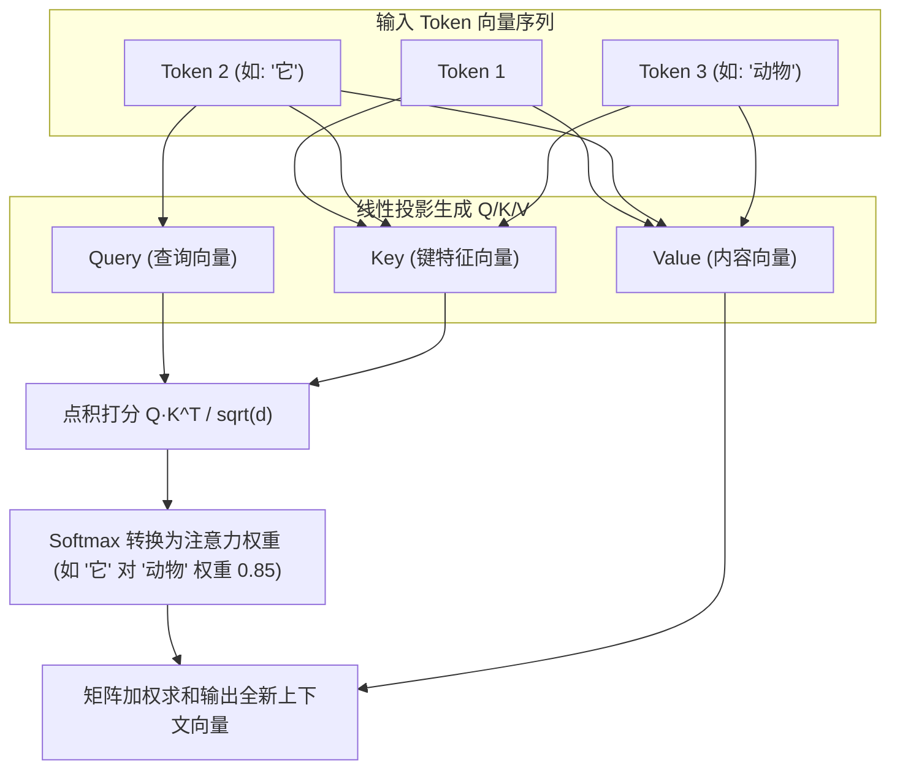
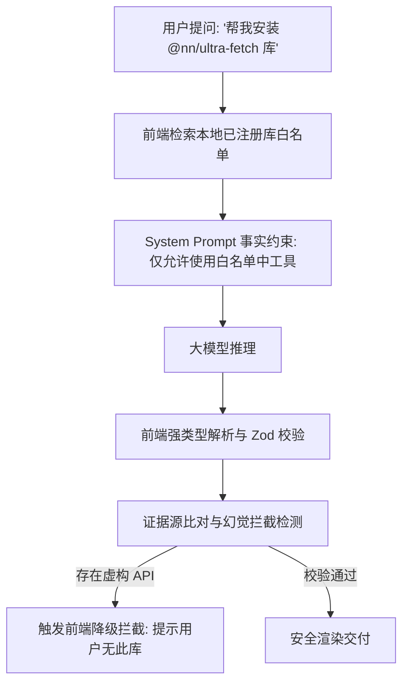
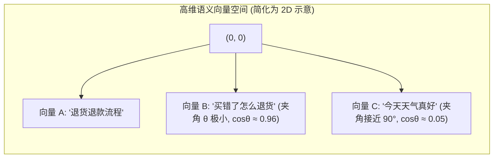
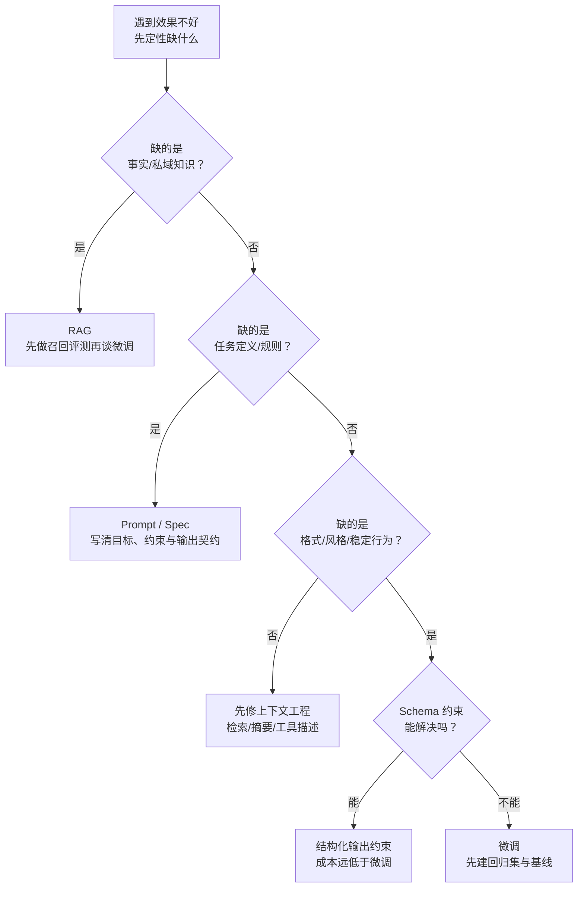
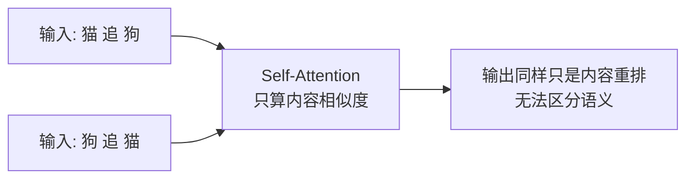
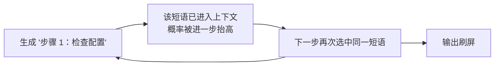
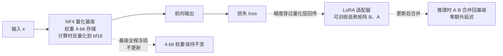
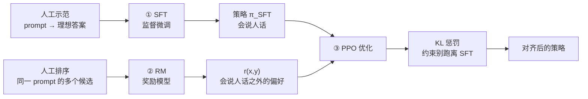
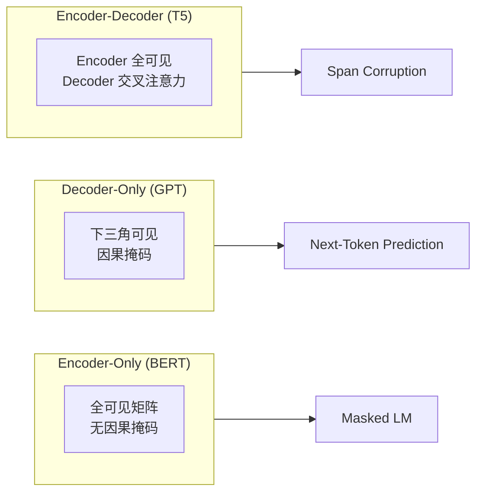

# 大模型原理与前端认知 (LLM Architecture & Mental Models)✅

本模块聚焦前端工程师必须建立的大模型底层机制认知：Transformer 架构的通俗机理、Self-Attention 自注意力与多头注意力、位置编码（RoPE / ALiBi）与长上下文外推原理、大模型幻觉成因与工程防御门禁、复读机等退化生成的诊断与分层干预、结构化输出（Structured Outputs）与模式契约，以及 Embedding 向量空间与余弦相似度计算，并延伸到参数高效微调（LoRA / QLoRA）的显存账本与量化前提，以及 MHA / MQA / GQA 三种注意力变体的 KV Cache 体积账、混合专家模型（MoE）的稀疏路由与负载均衡、Scaling Law 给出的算力最优「模型规模—训练数据」配比。在此之上，本模块进一步补齐**架构范式与任务选型**（Encoder-Only / Decoder-Only / Encoder-Decoder 的掩码与训练目标差异）、**能力涌现的度量争议**（emergent abilities 及其非线性指标假象）、**微调侧的能力保持**（灾难性遗忘与 EWC / LwF / 重放）、**SFT 数据集工程**（质量优先于数量与构建流水线）、**现代训练配置的稳定性配方**（Pre-norm + RMSNorm），以及**状态空间模型路线**（SSM / Mamba 的取舍与「为何主流仍是 Decoder-Only Transformer」），**策略优化器的演进**（GRPO 如何用组内相对基线省掉 PPO 的 critic，以及代价转移到哪里），以及**开放权重的代际基线**（LLaMA 1/2/3 在尺寸、上下文长度、训练 token 量与 GQA 引入时点上的对照）。

---

## 前端工程师需要了解的 Transformer 架构：什么是 Self-Attention（自注意力机制）？多头注意力（Multi-Head Attention）解决了什么？ {#p0-transformer-self-attention-for-fe}

<Answer>

**核心结论:**

在现代 AI 技术栈中，Transformer 是当今几乎所有主流大模型（GPT-4、Claude、DeepSeek、Llama）的基础骨架架构。前端工程师无需深入推导反向传播偏导数，但必须深刻理解其**核心信息路由引擎——Self-Attention（自注意力机制）与 Multi-Head Attention（多头注意力机制）**：
1. **彻底终结 RNN 的时序串行依赖**：传统的循环神经网络（RNN）必须按字逐个串行计算，无法利用现代 GPU 进行大规模并行计算；Transformer 抛弃了循环连接，直接将整个上下文序列同时输入，通过**自注意力矩阵一次性并行计算序列中任意两个 Token 之间的关联权重**；
2. **Self-Attention 的本质（查询 Query、键 Key、值 Value 的动态路由）**：每个 Token 转化为 $Q$（我想找什么）、$K$（我有什么特征）、$V$（我的具体内容）。通过计算 $Q$ 与所有 $K$ 的点积内积并经 Softmax 归一化，得到注意力权重分数，最后对 $V$ 进行加权求和，实现上下文信息的动态聚合；
3. **多头注意力（Multi-Head Attention）的工程价值**：如同前端组件的多重观察者（View / State / Props），单个注意力头只能捕捉一种全局语义关系；多头机制通过将高维向量投影到多个独立的低维子空间（如 8 个或 32 个 Head），使模型能**同时在不同视角关注语法依赖、代词指代、长程逻辑因果与专业实体关联**。

---

**原理解析:**

**1. Self-Attention 核心数学原理通俗推导**

```text
Attention(Q, K, V) = Softmax((Q * K^T) / sqrt(d_k)) * V
```

- **点积打分 (`Q * K^T`)**：计算当前 Token 与上下文中所有其他 Token 的相似度矩阵；
- **缩放因子 (`sqrt(d_k)`)**：随着向量维度 $d_k$ 变大，点积结果方差增大，Softmax 容易进入梯度饱和区，因此除以 `sqrt(d_k)` 保持数值稳定；
- **Softmax 归一化**：将点积分数转化为和为 1 的概率分布（Attention Map 权重）；
- **加权求和 (`V`)**：根据权重把相关 Token 的信息融入当前 Token 的表示中。



**2. 前端为什么需要懂这个？**
- **长文本注意力稀释**：注意力矩阵大小为 $N \times N$（$O(N^2)$ 复杂度）。文本越长，注意力权重被摊得越薄，模型容易产生“迷失在中间（Lost in the middle）”现象，因此前端在构造 RAG 或 Agent Prompt 时，必须将核心约束置于开头（System）或结尾（最新指令）；
- **计算与显存开销直观感知**：理解了 $O(N^2)$ 就能理解为什么长上下文推理费用昂贵、首字延迟（TTFT）高，以及为什么端侧小模型难以直接跑 128K 超长上下文。

---

**规范代码实现:**

在 TypeScript 中纯数学模拟缩放点积自注意力的计算过程，直观展现注意力权重的生成与聚合：

```typescript
// utils/attention-demo.ts
export class ScaledDotProductAttention {
  // 计算单头自注意力
  public static compute(
    Q: number[][], // [seqLen, dK]
    K: number[][], // [seqLen, dK]
    V: number[][]  // [seqLen, dV]
  ): { output: number[][]; attentionWeights: number[][] } {
    const seqLen = Q.length;
    const dK = Q[0].length;
    const dV = V[0].length;
    const scale = Math.sqrt(dK);

    // 1. Q * K^T 计算点积得分矩阵 [seqLen, seqLen]
    const scores: number[][] = Array.from({ length: seqLen }, () => Array(seqLen).fill(0));
    for (let i = 0; i < seqLen; i++) {
      for (let j = 0; j < seqLen; j++) {
        let dot = 0;
        for (let k = 0; k < dK; k++) {
          dot += Q[i][k] * K[j][k];
        }
        scores[i][j] = dot / scale;
      }
    }

    // 2. 逐行应用 Softmax 得到注意力权重矩阵
    const attentionWeights: number[][] = scores.map(row => {
      const maxVal = Math.max(...row);
      const exps = row.map(val => Math.exp(val - maxVal));
      const sumExp = exps.reduce((acc, v) => acc + v, 0);
      return exps.map(v => v / sumExp);
    });

    // 3. AttentionWeights * V 加权求和输出 [seqLen, dV]
    const output: number[][] = Array.from({ length: seqLen }, () => Array(dV).fill(0));
    for (let i = 0; i < seqLen; i++) {
      for (let j = 0; j < dV; j++) {
        let sum = 0;
        for (let k = 0; k < seqLen; k++) {
          sum += attentionWeights[i][k] * V[k][j];
        }
        output[i][j] = sum;
      }
    }

    return { output, attentionWeights };
  }
}
```

---

**面试官视角:**

**考察意图:**
评估应试者是只停留在 API 搬运工，还是对底层基础科学模型有清晰的架构认知。能够通俗、准确讲清 Q/K/V 物理含义与多头注意力的前端工程师，在团队内对技术选型与性能边界有更深刻的判断力。

**深度追问链:**
1. **追问 1**: 传统 Transformer 的注意力是全向的（双向关注），为什么大语言模型（如 GPT/DeepSeek）大多是 Decoder-Only 架构？
   - *答题切入点*: 文本生成任务本质是自回归预测未来 Token，生成第 $i$ 个词时绝对不能看到第 $i+1$ 个词（否则作弊泄露答案）；因此通过下三角因果掩码（Causal Masking）把未来 Token 遮盖住，Decoder-Only 架构对自回归生成任务结构最精简、参数利用率最高。

---

**延伸阅读:**
- [Attention Is All You Need (Vaswani et al., 2017 原始论文)](https://arxiv.org/abs/1706.03762)
- [The Illustrated Transformer (Jay Alammar 经典图解)](https://jalammar.github.io/illustrated-transformer/)

</Answer>

---

## 为什么大模型会产生幻觉（Hallucination）？前端能从工程上做什么来防范和降低幻觉？ {#p0-llm-hallucination-mitigation}

<Answer>

**核心结论:**

大模型的“幻觉（Hallucination）”是指**模型生成的文本表面流畅合理、符合语法逻辑，但内容与事实严重相悖或完全虚构**（例如编造不存在的 npm 库、捏造不存在的 API 参数）。

大模型产生幻觉的本质原因：
1. **统计概率采样而非真实世界逻辑推理**：大模型本质是自回归条件概率预测器，它优化的是“哪个 Token 接下来出现最顺畅”，而非“这句话是否是客观真理”；
2. **知识过时与记忆压缩损耗**：训练数据截止后新发生的事件模型不可知；海量知识压缩在权重参数中，存在特征混淆与模式过度拟合；
3. **谄媚性（Sycophancy）与强行补全倾向**：模型倾向于迎合用户的预设立场，并在遇到不确定问题时“宁可编造也不承认不知道”。

**前端在工程防御层面的四大防线（Mitigation Strategies）**：
- **防线 1：RAG 事实注入（Grounding）**：不让模型凭空记忆，而是从可信私域数据检索真实上下文喂给模型；
- **防线 2：强制拒答协议（Fallback on Unknown）**：在 System Prompt 注入“当证据不足时，必须明确回答不知道，禁止推理虚构”；
- **防线 3：结构化模式约束与链式校验（Schema Validation & Citations）**：要求返回引用源（Source IDs），前端高亮比对并进行 JSON Schema 强类型断言；
- **防线 4：Human-in-the-Loop 门禁**：对高风险判断由人类介入复核。

---

**原理解析:**

**1. 幻觉防御全链路漏斗模型**



---

**规范代码实现:**

前端通过封装带有“证据来源溯源（Source Citation）”与自动置信度过滤的校验拦截器：

```typescript
// utils/hallucination-guard.ts
import { z } from 'zod';

// 定义带事实来源的强类型响应契约
export const FactualResponseSchema = z.object({
  answer: z.string().min(1),
  confidenceScore: z.number().min(0).max(1),
  citations: z.array(z.object({
    documentId: z.string(),
    snippet: z.string()
  })),
  hasSufficientContext: z.boolean()
});

export type FactualResponse = z.infer<typeof FactualResponseSchema>;

export class HallucinationGuard {
  public static validate(rawJson: unknown, trustedDocIds: Set<string>): {
    valid: boolean;
    data?: FactualResponse;
    warning?: string;
  } {
    const parseResult = FactualResponseSchema.safeParse(rawJson);
    if (!parseResult.success) {
      return { valid: false, warning: '响应数据不符合事实契约模式' };
    }

    const { data } = parseResult;
    
    // 检查模型是否承认上下文不足
    if (!data.hasSufficientContext) {
      return { valid: true, data, warning: '模型明确标记私域知识库不足以支撑结论' };
    }

    // 检查模型编造的引用 ID 是否在真实检索召回集内 (防编造假证据)
    const forgedCitations = data.citations.filter(c => !trustedDocIds.has(c.documentId));
    if (forgedCitations.length > 0) {
      return {
        valid: false,
        warning: `检测到严重幻觉：模型虚构了不存在的证据 ID [${forgedCitations.map(c => c.documentId).join(', ')}]`
      };
    }

    return { valid: true, data };
  }
}
```

---

**面试官视角:**

**考察意图:**
评估候选人是否具备生产级 AI 系统落地的防御性编程思维。AI 工业落地最大的阻碍就是幻觉导致业务不敢上线，懂得使用 RAG Grounding、模式约束与置信度熔断的前端工程师能够有效规避企业级合规风险。

**深度追问链:**
1. **追问 1**: 在大模型生成前端代码（如 React 组件）时，经常幻觉引入不存在的 UI 组件属性（Props），前端在工程流程上如何彻底拦截？
   - *答题切入点*: 结合 AST 静态分析与 TypeScript 编译（`tsc --noEmit` 或 SWC 内存编译）；前端或 CI 流程收到代码后立即在 Worker 内进行类型检查，若报错直接把 TS 错误回传给模型执行自动自我修复（Self-Correction Loop）。

---

**延伸阅读:**
- [Survey on Hallucination in Large Language Models (Ji et al., 2023)](https://arxiv.org/abs/2309.01219)
- [Anthropic: Reducing Hallucinations with Grounding and Citations](https://docs.anthropic.com/en/docs/build-with-claude/citations)

</Answer>

---

## 什么是结构化输出（Structured Outputs）？为什么基于 JSON Schema / Zod 约束比纯自然语言 Prompt 更可靠？ {#p0-structured-outputs-json-schema}

<Answer>

**核心结论:**

结构化输出（Structured Outputs）是大模型提供商（如 OpenAI、Anthropic、DeepSeek）在引擎推理层提供的能力：**保证模型返回的数据 100% 严格符合开发者提供的 JSON Schema，杜绝缺字段、键名拼写错误或额外无关废话**。

在传统 Prompt 中，开发者通常在 Prompt 里写“请返回纯 JSON，不要输出 Markdown 标记”。这种方式在工业界存在严重缺陷：
1. **Prompt 约束是脆弱的弱约束（Soft Constraint）**：大模型本质是概率采样，遇到特殊输入极易输出 ```json 前缀、截断逗号或在末尾附带解释性文字，导致前端 `JSON.parse()` 频繁崩溃；
2. **引擎级结构化输出是强约束（Grammar-Constrained Decoding / CFG）**：在 GPU 生成下一个 Token 时，推理引擎会根据 JSON Schema 动态构建上下文无关文法（Context-Free Grammar, CFG）状态机，**直接在 Logits 采样阶段把不符合语法规范的候选 Token 概率强制置为 0**，在物理层面杜绝了非法 Token 的生成；
3. **配合前端 Zod 强类型库打造端到端类型安全闭环**：通过 `z.infer<typeof Schema>` 实现 TypeScript 编译期类型推导与运行时数据校验的完美统一。

---

**原理解析:**

**1. 软约束 Prompt vs 语法掩码约束解码 (Grammar-Constrained Decoding)**

```mermaid
flowchart TD
    subgraph SoftPrompt["纯自然语言 Prompt 弱约束"]
        P1["Prompt: '请仅输出标准 JSON'"] --> P2["大模型自由概率采样"]
        P2 --> P3["输出: '好的，这是为您提取的 JSON: ```json {\"name\": ...'"]
        P3 --> P4["前端 JSON.parse() 发生 SyntaxError 崩溃"]
    end

    subgraph HardGrammar["引擎层结构化输出 (Grammar Masking)"]
        G1["传入 JSON Schema (如要求必须输出数字 key: age)"] --> G2["GPU 自回归采样阶段"]
        G2 --> G3["基于状态机动态计算当前合法 Token 掩码 (Logit Bias)"]
        G3 --> G4["只有符合 Schema 格式的 Token 才能被选中"]
        G4 --> G5["输出 100% 合法 JSON，零解析容灾成本"]
    end
```

---

**规范代码实现:**

在 TypeScript 前端工程中，使用 Zod 定义契约并通过标准适配器自动生成 JSON Schema，并实现全自动重试解析器：

```typescript
// services/structured-output.ts
import { z } from 'zod';
import { zodToJsonSchema } from 'zod-to-json-schema';

// 1. 定义业务所需的强类型 Schema
export const UserInsightCardSchema = z.object({
  title: z.string().describe('卡片主标题，控制在 15 字以内'),
  sentiment: z.enum(['positive', 'neutral', 'negative']).describe('用户情感极性'),
  tags: z.array(z.string()).max(5).describe('核心特征标签'),
  actionRequired: z.boolean().describe('是否需要运营跟进')
});

export type UserInsightCard = z.infer<typeof UserInsightCardSchema>;

// 2. 转换为 OpenAI / Anthropic 兼容的严格 JSON Schema
export function getModelStructuredSchema() {
  return {
    name: 'user_insight_card',
    strict: true,
    schema: zodToJsonSchema(UserInsightCardSchema, { target: 'openAi' })
  };
}

// 3. 前端安全解析器
export function parseModelOutput(rawText: string): UserInsightCard {
  try {
    // 若模型未开启严格语法模式，前端做自动剥离 Markdown 围栏兜底
    const cleaned = rawText.replace(/```json\s*|\s*```/g, '').trim();
    const json = JSON.parse(cleaned);
    return UserInsightCardSchema.parse(json);
  } catch (error) {
    console.error('[SchemaValidation] 结构化解析失败:', error);
    throw new Error('模型输出未能满足业务强契约');
  }
}
```

---

**面试官视角:**

**考察意图:**
评估应聘者是否了解大模型最新的工程化发展趋势。在 2026 年，如果还在用正则匹配大模型返回的 JSON、还在忍受频繁的 `JSON.parse` 报错，说明缺乏对现代大模型 Structured Outputs / Json Mode 与语法掩码特性的掌握。

**深度追问链:**
1. **追问 1**: 开启 Structured Outputs 之后，会影响大模型的推理速度或成本吗？
   - *答题切入点*: 第一次生成该 Schema 时，服务端引擎需要将 JSON Schema 编译为上下文无关文法（CFG）的有限状态机，可能产生短暂的首字延迟（编译开销）；但随后该状态机会被服务端缓存复用，不仅不会降低生成速度，甚至因为消除了 Markdown 样板废话输出，减少了总 Token 消耗与网络传输延迟。

---

**延伸阅读:**
- [OpenAI: Introducing Structured Outputs in the API](https://openai.com/index/introducing-structured-outputs-in-the-api/)
- [Zod 官方文档与 TypeScript 运行时类型推导](https://zod.dev/)

</Answer>

---

## 什么是 Embedding（向量嵌入）？向量空间与余弦相似度在前端语义搜索中是如何工作的？ {#p1-embedding-vector-search-basics}

<Answer>

**核心结论:**

在人工智能中，**Embedding（向量嵌入）是将高维离散的文本、代码或多媒体信息，映射为一个固定长度的连续浮点数密集向量（Dense Vector，如 384、768 或 1536 维）的数学转换过程**。

其核心价值与前端落地原理：
1. **将“字面匹配”升级为“语义匹配”**：传统前端模糊搜索（如正则、Levenshtein 编辑距离）只能匹配字符字面；而 Embedding 模型把语义相近的句子映射在多维向量空间中距离相近的区域（例如“如何退款”与“我想把买的东西退掉”即便无一字相同，其向量夹角依然极小）；
2. **余弦相似度（Cosine Similarity）是最高频的相似度度量公式**：通过计算两个向量夹角的余弦值（范围在 -1 到 1 之间，1 表示方向完全相同），消除了文本长度造成的向量范数绝对大小影响，只衡量语义方向契合度；
3. **端侧轻量向量计算的现实可行性**：随着 WebAssembly 与 Float32Array 在现代浏览器的极致优化，在前端进行千级向量的点积计算仅需数毫秒，使得完全不依赖云端向量库的纯本地轻量 RAG 与文档智能问答成为可能。

---

**原理解析:**

**1. 向量空间与余弦夹角几何直觉**



**2. 余弦相似度数学公式推导**

```text
CosineSimilarity(A, B) = (A · B) / (||A|| * ||B||) = sum(A_i * B_i) / (sqrt(sum(A_i^2)) * sqrt(sum(B_i^2)))
```

如果在将向量存入前端索引时预先进行了**L2 归一化（L2 Normalization，使得 $\|A\| = 1$）**，那么余弦相似度计算将直接退化为最极速的**两个 Float32Array 点积（Dot Product）**：

```text
CosineSimilarity_normalized(A, B) = A · B = sum(A_i * B_i)
```

---

**规范代码实现:**

以下展示在前端利用强类型 `Float32Array` 实现纳秒级余弦相似度检索器：

```typescript
// utils/vector-math.ts
export class VectorMath {
  // 1. L2 归一化：将向量长度缩放为 1
  public static normalize(vec: Float32Array): Float32Array {
    let sumSquares = 0;
    for (let i = 0; i < vec.length; i++) {
      sumSquares += vec[i] * vec[i];
    }
    const norm = Math.sqrt(sumSquares);
    if (norm === 0) return vec;
    
    const normalized = new Float32Array(vec.length);
    for (let i = 0; i < vec.length; i++) {
      normalized[i] = vec[i] / norm;
    }
    return normalized;
  }

  // 2. 归一化向量的点积即为余弦相似度 (极致性能)
  public static dotProduct(a: Float32Array, b: Float32Array): number {
    let dot = 0;
    const len = a.length;
    for (let i = 0; i < len; i++) {
      dot += a[i] * b[i];
    }
    return dot;
  }
}

export interface VectorDocument {
  id: string;
  content: string;
  embedding: Float32Array; // 归一化后的向量
}

export class ClientVectorStore {
  private docs: VectorDocument[] = [];

  public addDocument(doc: VectorDocument): void {
    this.docs.push({
      ...doc,
      embedding: VectorMath.normalize(doc.embedding)
    });
  }

  public searchTopK(queryEmbedding: Float32Array, k = 3): { doc: VectorDocument; score: number }[] {
    const normalizedQuery = VectorMath.normalize(queryEmbedding);
    
    const results = this.docs.map(doc => ({
      doc,
      score: VectorMath.dotProduct(normalizedQuery, doc.embedding)
    }));

    // 按相似度降序排序，取前 K 个
    return results.sort((a, b) => b.score - a.score).slice(0, k);
  }
}
```

---

**面试官视角:**

**考察意图:**
评估应试者是否理解现代 RAG、智能客服、语义搜索的核心底层算法。从纯 JavaScript/TypeScript 数据结构（如 Float32Array）的内存连续性到余弦相似度 L2 预归一化优化，能体现出候选人优良的计算性能直觉。

**深度追问链:**
1. **追问 1**: 在前端浏览器做千级文档向量检索时，使用 `Float32Array` 比纯 JavaScript 原生数组 `number[]` 性能好在哪里？
   - *答题切入点*: `Float32Array` 是连续的二进制内存缓冲区（TypedArray），无对象指针间接寻址开销，内存占用仅为原生的 1/4 到 1/8；且连续内存具有极高的 CPU L1/L2 缓存命中率，V8 引擎能自动对其循环进行 SIMD 向量指令优化，提升 5~10 倍点积计算速度。

---

**延伸阅读:**
- [HuggingFace: What are embeddings?](https://huggingface.co/blog/getting-started-with-embeddings)
- [Transformers.js: Run embeddings inside browser web workers](https://huggingface.co/docs/transformers.js)

</Answer>

---

## 为什么用微调做代码生成，而不是纯 prompt 或 spec coding？微调和 RAG 各适合什么场景？ {#p1-finetune-vs-rag-vs-prompt}

<Answer>

**核心结论:**

三条路线修的是**不同的东西**。选型不是「哪个更先进」，而是「缺的那块用最便宜的手段补」：

1. **Prompt / Spec 修「任务定义」**：模型不知道该做什么、该守什么规矩时用它。改一句话即刻生效、零训练成本，迭代周期以分钟计。
2. **RAG 修「知识」**：模型不知道最新的、内部的、私有的事实时用它。索引建好后知识更新即时生效，代价是检索质量的工程投入（分块、嵌入、重排、评测）。
3. **微调修「行为模式」**：模型知道要做什么，但不会用你要的那种格式、风格、流程去做时用它。代价最高——要准备数据、跑训练、建评测，迭代周期以天/周计。

**判断顺序**：先问「缺的是知识、是能力、还是格式与风格」——缺知识走 RAG，缺格式与稳定行为走微调，缺任务定义走 Prompt。三者常常叠加使用，但**先用最便宜的补上最缺的那块**。

**微调最大的隐性成本是验证**：模型变了，如果没有固定回归集与基线，就无法判断是「变好」还是「只是变了」。因此**先有评测集，再谈微调**；微调是一次模型级变更，评测是能拦住退化的那道门。

---

**原理解析:**

**1. 三条路线对照**

| 维度 | Prompt / Spec | RAG | 微调 |
| :--- | :--- | :--- | :--- |
| 修复对象 | 任务定义、规则、输出契约 | 事实与私域知识 | 格式、风格、稳定行为模式 |
| 成本结构 | 几乎为零，随手改 | 索引 + 分块 + 检索调优 | 数据准备 + 训练算力 + 流程建设 |
| 迭代速度 | 分钟级 | 小时/天级（数据更新） | 天/周级 |
| 知识时效 | 受限于模型权重 | 强，更新即可生效 | 弱，权重里的旧知识不会自己过期 |
| 典型失败模式 | 规则太长互相冲突、注意力稀释 | 召回错、召不回 | 能力提升了但回归没守住、难定位退化原因 |

**2. 决策路径**



**3. 为什么「先微调」是常见错误**

微调看起来最强，但它的**前置成本最高、验证周期最长、失败最难定位**。很多「格式总是不稳定」的问题，用结构化输出约束或更明确的输出契约就能解决；很多「模型不知道我们的接口」的问题，用 RAG 注入接口文档就能解决。先微调，等于用最贵的手段去解决本来用便宜手段就能解决的问题，还额外引入了「改不动、回不去、说不清哪里变差」的负担。

**4. 微调方法的通用共识表述**

- **SFT（监督微调）**：用「输入 - 理想输出」的样本继续训练，让模型学会特定的输入输出模式；
- **LoRA（低秩适配）**等参数高效微调方法：冻结主干权重、只训练少量低秩增量矩阵，显著降低训练资源与产物体积；
- **偏好对齐方法（如 DPO 等）**：在已有 SFT 模型上，用「哪个回答更好」的偏好数据继续优化，使模型更贴合偏好。

这些方法的定位是**行为与风格层面的塑形**，而不是往模型里灌事实——事实的正确来源是检索。

**5. 微调前后的验证成本**

- **基线**：用当前 Prompt 加 RAG 方案跑一遍固定评测集，得到可对比的数字；
- **回归集**：覆盖历史 bad case 的固定样本集，微调后必须全量跑一遍，任何一例退化都要能定位；
- **分层评测**：格式合规率、任务成功率、事实正确率与人工偏好分开看，避免用一个综合分掩盖某一项的崩塌。

**6. 事实纪律**

讨论微调收益时，不要引用无法核实的「某模型在某榜单超过某基线」式对比。可靠的引用只有两类：**官方文档**（PEFT、TRL 等方法库文档）与**论文主页**（LoRA 等方法的原始论文）。效果结论应表述为「在我们的回归集上，某项指标相对基线有提升」，而不是笼统地说「模型变强了」。

---

**规范实现:**

```typescript
// ai/finetune-rag-prompt-chooser.ts
export interface CapabilityGap {
  missingKnowledge: boolean;       // 缺事实 / 私域知识
  missingTaskDefinition: boolean;  // 缺规则与任务定义
  missingFormat: boolean;          // 缺格式 / 风格 / 稳定行为
  schemaConstraintViable: boolean; // 结构化输出能否兜住格式问题
}

export type Route = 'rag' | 'prompt' | 'schema-constraint' | 'finetune' | 'context-engineering';

export function chooseRoute(gap: CapabilityGap): Route {
  if (gap.missingKnowledge) return 'rag';                 // 事实缺口：检索而非训练
  if (gap.missingTaskDefinition) return 'prompt';         // 任务定义缺口：改提示词
  if (gap.missingFormat) {
    if (gap.schemaConstraintViable) return 'schema-constraint'; // 先用最便宜的约束
    return 'finetune';
  }
  return 'context-engineering';                            // 先修上下文，再谈训练
}

// 微调的前置条件：没有回归集就不允许进入训练流程
export interface EvalCase { id: string; input: unknown; expected: unknown; }

export interface EvalReport {
  passRate: number;
  regressions: string[];   // 基线通过、候选失败的样本 id
  improvements: string[];  // 基线失败、候选通过的样本 id
}

export function runRegression(
  baseline: Map<string, boolean>,
  candidate: Map<string, boolean>,
  cases: EvalCase[]
): EvalReport {
  const regressions: string[] = [];
  const improvements: string[] = [];
  let passed = 0;
  for (const c of cases) {
    const baseOk = baseline.get(c.id) === true;
    const candOk = candidate.get(c.id) === true;
    if (candOk) passed += 1;
    if (baseOk && !candOk) regressions.push(c.id);
    if (!baseOk && candOk) improvements.push(c.id);
  }
  return { passRate: cases.length ? passed / cases.length : 0, regressions, improvements };
}
```

**工程含义**：`chooseRoute` 把选型从「资深工程师的经验直觉」变成可评审的决策；`runRegression` 把微调从一个不可控的模型变更变成一个**带门禁的实验**——`regressions` 非空就说明这次微调不能上线。

---

**面试官视角:**

**考察意图:**
考察候选人是否具备**成本感与验证意识**。高分回答必须能按「缺知识 / 缺任务定义 / 缺格式」三条线做出判断，并指出**微调前必须先有评测集与基线**、**微调不解决事实问题**。把「先微调」视为顺序错误，是资深信号。

**深度追问链:**
1. **追问 1**: 什么情况下你才会真的去做微调？
   - *答题切入点*: 知识不缺、规则已写清、结构化输出也兜不住格式问题，且该行为模式高频、长期复用、量大到值得付出训练与维护成本；同时必须先有回归集与基线，否则无法判断微调是否真的带来收益。
2. **追问 2**: 微调完怎么知道它变好了？
   - *答题切入点*: 用固定回归集对比基线，输出通过率、回归样本与改善样本三组数字；重点看 regressions 而不是只看总分。没有基线的微调是盲改。
3. **追问 3**: 微调完模型学到新知识了吗？
   - *答题切入点*: 微调主要塑形行为与风格，不是可靠的知识注入通道；需要最新或私域事实仍要靠检索。把事实指望训练进权重，代价高且无法保证时效与准确。

---

**延伸阅读:**
- [Hugging Face PEFT 文档（LoRA 等参数高效微调方法）](https://huggingface.co/docs/peft/index)
- [LoRA: Low-Rank Adaptation of Large Language Models（论文主页）](https://arxiv.org/abs/2106.09685)
- [Hugging Face TRL 文档（监督微调与偏好对齐方法库）](https://huggingface.co/docs/trl/index)

</Answer>

---

## 大模型怎么区分「猫追狗」和「狗追猫」？RoPE 旋转位置编码的原理与长上下文外推是怎么回事？ {#p1-positional-encoding-rope}

<Answer>

**核心结论:**

1. **自注意力本身是「置换不变」的**：注意力权重只由内容相似度决定，把整句重排，输出也跟着重排，模型天然分不清语序。所以位置信息必须**显式注入**——这就是位置编码存在的唯一理由。

2. **三条主流路线**：
   - **绝对可学习位置编码**（BERT 式）：把位置当额外 embedding 与词向量相加，超出训练长度就没有对应参数；
   - **相对位置编码**：直接建模相对距离，天然可外推；
   - **RoPE（Rotary Position Embedding，旋转位置编码）**：当前开源大模型的事实标准。

3. **RoPE 的关键设计**：按维度把 Q、K 两两配对施加与位置成正比的二维旋转。旋转矩阵的正交性使得注意力内积 **只依赖相对距离，不依赖绝对位置**——这是它比绝对 PE 更适合长上下文外推的数学根源。

4. **ALiBi 是另一条思路**：给每个注意力头加一个与距离成正比的负偏置，只看距离不看内容。其论文标题《Train Short, Test Long》直译就是「短训长测」。

5. **但「支持外推」不等于「随便扩」**：RoPE 直接把窗口从 4K 拉到 32K 会退化——训练时没见过的相对距离把注意力分布推离训练分布。必须用**插值类方法**（位置插值、NTK-aware 缩放、YaRN 等）让高频维保持、低频维按比例插值。

6. **边界必须说清**：RoPE 与 ALiBi 的原始结论都来自特定任务与模型规模的实验。「RoPE 优于 ALiBi」是工程实践共识，**不是普适定理**——ALiBi 论文本身就是在质疑「位置必须以 embedding 形式注入」这一做法。

**原理解析:**

**1. 为什么位置信息必须显式注入**

自注意力权重为 `softmax(QKᵀ/√d)`，只依赖内容向量之间的相似度，不含任何位置信息。



**2. 三种方案对照**

| 方案 | 位置怎么进 | 外推能力 | 代表 |
| :--- | :--- | :--- | :--- |
| 绝对可学习 PE | 位置 embedding 与词向量相加 | 弱，超长无对应参数 | BERT |
| RoPE | Q/K 按位置做旋转 | 强，内积只依赖相对距离 | 主流开源 LLM |
| ALiBi | 注意力分数加线性距离偏置 | 强，纯距离项 | 《Train Short, Test Long》 |

**3. RoPE 的数学：绝对位置为什么能消掉**

把第 i 个 token 的查询向量按维度成对拆成二维向量，对每一对施加角度与位置成正比的旋转：

```
q_i = R(θ·i) · q
k_j = R(θ·j) · k
⟨q_i, k_j⟩ = ⟨R(θ·i)q, R(θ·j)k⟩ = ⟨q, R(θ·(j-i))k⟩
```

旋转矩阵满足 `R(a)ᵀR(b) = R(b-a)`，于是绝对位置 `i`、`j` **同时消掉**，只剩相对距离 `j - i`。工程上只需对 `position_ids` 算一遍 sin/cos 表，再对 Q、K 做逐对旋转。

**4. ALiBi 的数学**

不改输入，改注意力分数：`score = q·k/√d - m_h·(i-j)`，`m_h` 是每个头各自的斜率。不同头斜率不同，等价于让不同头关注不同的距离尺度。

**5. 外推为什么会崩，以及插值怎么救**

RoPE 训练时只见过 `[0, L)` 的距离分布。窗口直接扩到数倍后，模型要面对从未见过的相对距离，注意力 logits 分布被推离训练分布，输出开始退化。插值类做法的共同思路是**压缩位置步长**（把位置映射改成按比例缩小），YaRN 进一步**按维度频率分段**：高频维保持原样、低频维按比例插值，从而兼顾「短文本不掉点」与「长文本可用」。

**规范实现:**

下面是可直接运行的 RoPE 实现（半拆分布局与频率公式对齐主流实现），以及「内积只依赖相对距离」的验证：

```typescript
// rope.ts —— 二维成对旋转的 RoPE
export function ropeRotate(
  x: Float32Array, // 长度必须为偶数
  position: number,
  base = 10000
): Float32Array {
  const out = new Float32Array(x.length)
  const half = x.length / 2
  for (let d = 0; d < half; d++) {
    // 维度越靠前频率越高：invFreq = base^(-2d/dim)
    const invFreq = 1 / Math.pow(base, (2 * d) / x.length)
    const angle = position * invFreq
    const cos = Math.cos(angle)
    const sin = Math.sin(angle)
    const x0 = x[d]
    const x1 = x[d + half]
    out[d] = x0 * cos - x1 * sin
    out[d + half] = x0 * sin + x1 * cos
  }
  return out
}

export function attentionScore(q: Float32Array, k: Float32Array, gap: number) {
  const dot = (a: Float32Array, b: Float32Array) =>
    a.reduce((sum, v, i) => sum + v * b[i], 0)
  // 两个 token 整体平移 gap，相对距离不变
  const atZero = dot(ropeRotate(q, 0), ropeRotate(k, 0))
  const atGap = dot(ropeRotate(q, gap), ropeRotate(k, gap))
  return { atZero, atGap }
}
```

`atZero` 与 `atGap` 在浮点误差内相等，就验证了「注意力内积只依赖相对距离」这条核心性质。

**面试官视角:**

**考察意图:**
区分「知道有位置编码」与「理解位置编码为什么能外推」。初级能答出「因为要告诉模型顺序」即达标；高级必须能推到「旋转矩阵正交性 ⟹ 内积只剩相对距离」，并说清直接扩窗为什么会崩。

**评分 Rubric:**
- **必答**：自注意力置换不变 ⟹ 位置必须显式注入；说出至少两种方案并解释差异。
- **加分项**：写出 RoPE 的旋转形式与内积只剩相对距离的推导；解释直接扩窗为何失真并给出插值思路。
- **常见误区**：把 RoPE 说成「给词向量加位置 embedding」（那是 BERT 式绝对 PE）；认为「RoPE 原生支持任意长度外推」；把 ALiBi 也说成「一种位置 embedding」。

**深度追问链:**
1. **追问 1**：训练 4K、推理要 32K，最直接的改法是什么，会踩什么坑？
   - *答题切入点*：直接扩窗会让未训练过的相对距离进入注意力分布，输出退化；正解是位置插值或按频率分段缩放，并用长文本回归集定位退化断崖，而不是只看困惑度。
2. **追问 2**：ALiBi 和 RoPE 都能外推，工程上怎么选？
   - *答题切入点*：ALiBi 改动小、可与任意注意力核共存，但要为每个头设斜率超参；RoPE 与主流推理栈的注意力内核兼容性更好，是开源生态事实标准。看推理栈支持与训练配方，不是看论文。
3. **追问 3**：让你实现一个支持超长上下文的 RoPE 变体，先做什么？
   - *答题切入点*：先把外推失败复现出来并定位失真的距离区间，再谈插值比例与分段策略；两条硬约束必须同时满足——长文本可用且短文本不掉点。

**延伸阅读:**
- [arXiv:2104.09864 — RoFormer: Enhanced Transformer with Rotary Position Embedding（RoPE 原始论文，2021-04-20）](https://arxiv.org/abs/2104.09864)
- [arXiv:2108.12409 — Train Short, Test Long: Attention with Linear Biases Enables Input Length Extrapolation（ALiBi，2021-08-27）](https://arxiv.org/abs/2108.12409)
- [arXiv:2309.00071 — YaRN: Efficient Context Window Extension of Large Language Models（分频段缩放，2023-08-31）](https://arxiv.org/abs/2309.00071)

</Answer>

---

## 模型输出变成「复读机」，同一句话反复刷屏，怎么定位原因并修掉？ {#p1-llm-degenerate-repetition}

<Answer>

**核心结论:**

1. **复读机（degenerate repetition）是解码阶段的退化，不是模型「不会」**。生成器没有能力产出新内容时，会落回概率最高的那几个 token，于是高概率短语被反复选中——**输出端陷入局部最优闭环**。

2. **四类根因要分开排查**：
   - **采样过窄**：`temperature` 趋 0 或 `top_p` 极小，分布被削成单点；
   - **缺重复惩罚**：主流生成接口的 `repetition_penalty` **默认值 1.0 表示不做任何惩罚**，需要显式调大才有约束力；
   - **输入自带复读素材**：prompt 或历史轮次里已含重复片段，模型被「自举」进循环；
   - **长上下文效应**：上下文越长，模型越容易滑进已被自己写过的措辞。

3. **处置顺序不能反**：**先查输入**（prompt 与历史里有没有重复、诱导、工具返回的循环模板）→ **再调采样** → **再加惩罚与硬阻断** → 最后才考虑换解码算法。反过来做，等于用参数去盖输入缺陷。

4. **`no_repeat_ngram_size` 是硬约束，不是万能药**：它会**禁止**任何 n-gram 重复出现，而代码、JSON、表格、专有名词、协议报文**天然需要合法重复**。打开它往往修好复读、同时弄坏正常输出。所以它是最后手段。

5. **要分清三种「异常」**：复读是**输出层**的局部退化；幻觉是**事实层**的编造；上下文腐化是**长会话**的行为漂移。三者定位环节不同、修复手段不同，混为一谈是常见误诊。

**原理解析:**

**1. 复读是怎么形成的：自反馈闭环**



关键在于：**每生成一次，重复内容就进入上下文，反过来抬高了它下次被选中的概率**，形成正反馈。

**2. 三类异常对照**

| 现象 | 发生层 | 典型信号 | 首选动作 |
| :--- | :--- | :--- | :--- |
| 复读机 | 解码层 | 同一 n-gram 连续出现 | 查输入重复 + 调采样 + 加惩罚 |
| 幻觉 | 事实层 | 内容自信但与事实不符 | 检索增强 + 引用约束 + 降温度 |
| 上下文腐化 | 会话层 | 长任务中目标偏移 | 滑动压缩 + 目标重申 |

**3. 常用干预手段的作用点**

| 手段 | 作用点 | 特性 | 副作用 |
| :--- | :--- | :--- | :--- |
| `temperature` | 采样分布锐度 | 连续可调、温和 | 过高则发散失真 |
| `top_p` | 候选集截断 | 核采样，抑制长尾噪声 | 过小等价于贪心 |
| `repetition_penalty` | 已出现 token 的 logit 惩罚 | 默认 1.0 即无惩罚，需显式调大 | 惩罚过重会伤害必要的术语重复 |
| `no_repeat_ngram_size` | 硬性禁止 n-gram 重复 | 彻底断环 | **会破坏代码、JSON、报文等合法重复** |
| `encoder_repetition_penalty` | 只惩罚输入里没有的序列 | 避免误伤用户原文 | 力度需单独调 |

**规范实现:**

下面实现「先诊断、再干预」的两段式工具：先定位重复模式，再决定用软惩罚还是硬阻断。

```typescript
// repetition.ts —— 复读诊断与干预
export interface SamplingParams {
  temperature: number
  topP: number
  repetitionPenalty: number // 1.0 = 不惩罚
  noRepeatNgramSize: number // 0 = 不启用硬阻断
}

export function detectRepetition(
  tokens: string[],
  ngramSize = 3
): { repeated: boolean; hottestNgram: string | null; ratio: number } {
  if (tokens.length < ngramSize) {
    return { repeated: false, hottestNgram: null, ratio: 0 }
  }
  const counts = new Map<string, number>()
  for (let i = 0; i + ngramSize <= tokens.length; i++) {
    const key = tokens.slice(i, i + ngramSize).join(' ')
    counts.set(key, (counts.get(key) ?? 0) + 1)
  }
  let hottest: string | null = null
  let max = 1
  for (const [k, c] of counts) {
    if (c > max) { max = c; hottest = k }
  }
  const ratio = (max - 1) / Math.max(1, tokens.length - ngramSize)
  return { repeated: max >= 3 && ratio > 0.15, hottestNgram: hottest, ratio }
}

// 软惩罚：只对「已经出现过」的 token 降权，不阻断合法重复
export function applyRepetitionPenalty(
  logits: number[],
  generated: number[],
  penalty: number
): number[] {
  if (penalty === 1.0) return logits
  const seen = new Set(generated)
  return logits.map((v, i) => (seen.has(i) ? v / penalty : v))
}

// 硬阻断：仅在确认是复读时才启用，且优先放宽 n 值
export function shouldHardBlock(
  diag: { repeated: boolean },
  params: SamplingParams
): boolean {
  return diag.repeated && params.noRepeatNgramSize === 0
}
```

工程上注意两点：**软惩罚优先**（`repetition_penalty` 只降权不禁止）；**硬阻断要分级**（先试 4-gram 再试 3-gram，别一上来就 2-gram，否则几乎必然误伤正常文本）。

**面试官视角:**

**考察意图:**
区分「知道调 temperature」与「会系统定位复读的成因并按代价排序地处置」。这道题在 Agent 场景里出现频率很高——工具返回内容重复、Agent 总结时自我复读，都是同一类问题。

**评分 Rubric:**
- **必答**：说出复读是解码期退化；能列出至少三类成因；知道 `repetition_penalty` 默认 1.0 代表不惩罚。
- **加分项**：给出「查输入 → 调采样 → 加惩罚 → 换算法」的处置顺序；能指出 `no_repeat_ngram_size` 会破坏代码与结构化输出；能区分复读、幻觉、上下文腐化三类异常。
- **常见误区**：一上来就调 temperature；默认 `no_repeat_ngram_size` 该开着；把复读归因于「模型能力不足」。

**深度追问链:**
1. **追问 1**：线上 Agent 偶发复读，你的排查顺序是什么？
   - *答题切入点*：先看该轮的 prompt 与工具返回是否含重复模板（最常见），再看采样参数是否被上游改过，再看上下文长度是否逼近阈值；用诊断工具定位重复 n-gram 再决定干预强度。
2. **追问 2**：把 `no_repeat_ngram_size` 设为 3，代码生成结果坏了，为什么？
   - *答题切入点*：代码与 JSON 里存在大量合法重复（缩进、`});`、字段名、`"` 等），硬阻断不区分「复读」与「合法重复」，必然误伤；这类场景应改用软惩罚 + 上下文级去重，或按输出类型分流参数。
3. **追问 3**：如果复读只出现在长对话的后段，怎么和上下文腐化区分？
   - *答题切入点*：复读是**输出层**局部退化、目标仍然正确且反复说同一句；腐化是**行为层**漂移，输出看着通顺但目标偏移。判据是看重复片段是否同质、以及任务是否仍在推进。

**延伸阅读:**
- [Hugging Face 文本生成文档（`repetition_penalty` / `no_repeat_ngram_size` / `temperature` 等采样参数定义与默认值）](https://huggingface.co/docs/transformers/main/en/main_classes/text_generation)
- 本库关联考点：`00.concept.md` 的「采样参数（Temperature / Top-P）如何影响输出」——那一题讲参数本身的物理原理，本题讲它们在异常现象下的组合处置。

</Answer>

---

## LoRA 和 QLoRA 有什么区别？为什么 QLoRA 能在单张 48GB 显卡上微调 65B 模型？ {#p1-lora-vs-qlora}

<Answer>

**核心结论:**

1. **LoRA（arXiv:2106.09685，2021-06-17）**：冻结预训练权重，在 Transformer 每层的权重矩阵旁**注入可训练的低秩分解矩阵** `W + BA`（秩 `r` 远小于原维度）。论文给出的数字是：相比 GPT-3 175B 上用 Adam 做全量微调，**可训练参数量减少约 10000 倍、GPU 显存需求降低约 3 倍**，且效果持平或更好；因为低秩增量可**合并回原权重**，与 adapter 不同，**不引入额外推理延迟**。

2. **QLoRA（arXiv:2305.14314，2023-05-23）**：把 LoRA 的梯度**穿过一层 4-bit 量化后的冻结基座模型**回传。三个关键组件是：**NF4（4-bit NormalFloat）数据类型**、**双重量化（double quantization）**、**分页优化器（paged optimizers）**。论文报告：**单张 48GB 显卡即可微调 65B 参数模型，同时保持 16-bit 全量微调的任务表现**；其 Guanaco 模型在 Vicuna 基准上达到 ChatGPT 性能的 99.3%，且只用了单卡 24 小时微调（**均为论文给出的官方数字，需按自身负载与数据复现**）。

3. **两者是同一条思路的两个台阶**，不是互斥路线：QLoRA = **量化基座 + LoRA 适配器**，训练时基座不更新、梯度穿过量化权重，因此「省显存」与「省可训练参数」两项收益可以叠加。

4. **必须说清的边界**：
   - NF4 的设计前提是**权重近似服从正态分布**，这是它「信息论最优」的依据；对分布明显偏离正态的权重，收益会打折；
   - **4-bit 只省显存，不省算力**——前向/反向仍需把权重**反量化**到 bf16/fp16 计算，训练速度并不会因为量化而变快；
   - QLoRA 保住的是**任务表现**，不是「量化无损」；小数据集上仍需固定回归集验证；
   - 合并 LoRA 权重后无法再热插拔切换适配器，**多租户场景要保留未合并形态**。

**原理解析:**

**1. 显存账本：65B 为什么塞得进 48GB**

| 项 | 全量微调（bf16 + Adam） | LoRA（bf16 基座） | QLoRA（NF4 基座） |
| :--- | :--- | :--- | :--- |
| 基座权重 | 约 130 GB | 约 130 GB | 约 33 GB（4-bit + 分组缩放常数） |
| 梯度 | 全量，与参数量同阶 | 仅适配器 | 仅适配器 |
| 优化器状态 | Adam 两份，与参数量同阶 | 仅适配器 | 适配器 + 分页优化器 |
| 可训练参数量 | 65B | 通常在 百万级 ~ 千万级 量级 | 通常在 百万级 ~ 千万级 量级 |
| 激活值 | 全量 | 全量 | 全量（可用 checkpointing 换显存） |

关键在于：**适配器的参数量是 `r` 的函数，与基座规模几乎解耦**。取 `r` 为 8 时，每个注入矩阵只引入原矩阵极小一部分参数，梯度与优化器状态随之塌缩到可忽略的量级——**省下来的不是「训练精度」，而是「被训练的东西的数量」**。

**2. 为什么 4-bit 量化基座还能训出好效果**



量化引入的是**每个权重上的近似误差**。LoRA 适配器在量化之后才开始训练，恰好有自由度去**补偿这层量化噪声**——这正是「先量化、再叠加低秩补偿」比「先微调、再量化」更稳的原因。NF4 针对正态分布设计了一套信息论最优的分位量化值，比均匀的 4-bit 量化更少损失。

**3. QLoRA 的三件套各自解决什么**

| 组件 | 解决的问题 | 不解决什么 |
| :--- | :--- | :--- |
| NF4（4-bit NormalFloat） | 权重分布近似正态时的量化精度 | 分布偏斜的权重；不省算力 |
| 双重量化 | 量化常数本身占用的显存（按块存储会反向放大） | 基座主体显存；训练速度 |
| 分页优化器 | 训练中显存**尖峰**（长序列、变长 batch）导致的 OOM | 稳态显存占用 |

**规范实现:**

下面是「选择哪条微调路线」的判定逻辑骨架，工程上用于评审时把选型落到可讨论的量上：

```ts
type FinetuneRoute = 'prompt' | 'rag' | 'lora' | 'qlora'

interface ModelShape {
  paramsB: number          // 以十亿为单位的参数量
  availableGpuMemoryGB: number
  fp16WeightGB: number     // 约 paramsB * 2
  nf4WeightGB: number      // 约 paramsB * 0.5 加分组缩放常数开销
}

export function chooseRoute (m: ModelShape, opts: {
  needsNewKnowledge: boolean
  needsStableFormat: boolean
  adapterCount: number
}): { route: FinetuneRoute; reason: string } {
  const { needsNewKnowledge, needsStableFormat, adapterCount } = opts

  // 知识时效问题永远不是微调能解决的
  if (needsNewKnowledge) {
    return { route: 'rag', reason: '私域/时效事实走检索，微调不解决知识注入' }
  }
  if (!needsStableFormat) {
    return { route: 'prompt', reason: '缺的是任务定义与规则，先写 Prompt / Spec' }
  }
  // 需要热插拔多个适配器时，不能合并 LoRA 权重
  if (adapterCount > 1 && m.availableGpuMemoryGB >= m.fp16WeightGB) {
    return { route: 'lora', reason: '保留未合并的适配器形态以支持多租户热切换' }
  }
  if (m.availableGpuMemoryGB >= m.nf4WeightGB) {
    return { route: 'qlora', reason: '显存只够 4-bit 基座，用 NF4 + 低秩补偿' }
  }
  return { route: 'lora', reason: '显存不足，需配合梯度检查点与梯度累积' }
}
```

注意 `chooseRoute` 的第一条分支：**任何「模型不知道我们最新的内部事实」的诉求都不该走到微调**——微调改的是行为模式，不是知识时效。

**面试官视角:**

**考察意图:**
区分「知道 LoRA 这个名字」与「真的理解参数高效微调在做什么」。这题在算法/AI 基础设施岗常见，高分回答必须能说清**省的是可训练参数量与优化器状态、不是算力**，并能指出 **4-bit 量化的分布前提**与 **NF4 的三个组件各解决什么**。

**评分 Rubric:**
- **必答**：LoRA 冻结基座 + 注入低秩矩阵、可合并故无推理延迟；QLoRA 在其上叠加 4-bit 量化基座与 NF4 / 双重量化 / 分页优化器；能算清 65B 在 48GB 上的显存账本。
- **加分项**：能指出量化只省显存不省算力；知道 NF4 依赖正态分布假设；知道多租户场景要保留未合并适配器；能说清「先量化再叠加适配器」与「先微调再量化」的差别。
- **常见误区**：说「QLoRA 让训练快了很多」；把 LoRA 说成「只训练最后一层」；把 4-bit 说成「几乎无损」；认为微调能给模型灌入新事实。

**深度追问链:**
1. **追问 1**：你们的业务要同时服务几十个客户，每家一个专属风格，选哪种微调形态？
   - *答题切入点*：不合并适配器、保留可热插拔的 LoRA 形态；若要进一步降显存再考虑 QLoRA，并注意量化误差与风格稳定性之间的取舍。
2. **追问 2**：QLoRA 训练完发现效果不如全量微调，你先查什么？
   - *答题切入点*：先查数据量与分布（QLoRA 论文本身强调「小而精的高质量数据集」优于大规模脏数据）、再查秩 `r` 与目标模块覆盖范围、最后查量化分组大小；**用固定回归集对比基线**，不要靠感觉。
3. **追问 3**：如果让你在 24GB 显存的机器上微调一个 7B 模型，方案怎么定？
   - *答题切入点*：QLoRA + 梯度检查点 + 梯度累积（等效 batch）+ 序列长度分桶；训练前先固定回归集与基线，否则无法判断是否真的变好。

**延伸阅读:**
- [LoRA: Low-Rank Adaptation of Large Language Models（arXiv:2106.09685，2021-06-17）](https://arxiv.org/abs/2106.09685)
- [QLoRA: Efficient Finetuning of Quantized LLMs（arXiv:2305.14314，2023-05-23）](https://arxiv.org/abs/2305.14314)
- [Hugging Face PEFT 文档（LoRA / QLoRA 的工程实现与参数说明）](https://huggingface.co/docs/peft/index)
- [bitsandbytes 文档（NF4 与双重量化的实现说明）](https://huggingface.co/docs/bitsandbytes/index)

</Answer>

---

## ChatGPT 里的强化学习是怎么实现的？为什么不直接拿人写的答案继续微调？ {#p1-rlhf-reward-model-ppo}

<Answer>

**核心结论:**

ChatGPT 这一代模型的强化学习是**三段式**的 RLHF（Reinforcement Learning from Human Feedback，人类反馈驱动的强化学习），不是「直接拿人写好的答案继续训」：

1. **SFT（监督微调）**：用人工撰写的**示范答案（demonstrations）**做标准监督训练，得到一个「已经会按指令回答」的初始策略。这一步是**必需的起点**——因为纯 RL 的探索空间太大、奖励又极其稀疏，从零开始的策略几乎学不到任何东西。
2. **RM（奖励模型）**：让标注员对**同一个 prompt 的多个候选输出做排序**（pairwise ranking，而不是打绝对分），用这些排序数据训练一个标量奖励模型 `r(x, y)`。排序比打分稳定得多——人对「A 比 B 好」的判断远比「给 B 打 7 分」可靠。
3. **RL（策略优化，InstructGPT 用 PPO）**：在奖励模型的分数下用 PPO 优化策略，同时**加一项对 SFT 策略的 KL 散度惩罚**，防止策略为了刷高分而跑偏。

**为什么不能「直接拿人写的答案继续微调」**：SFT 学的是**模仿给定的正确路径**，它有两个硬伤——
- **只有正例，没有梯度信号告诉模型「哪种错法更接近对」**：SFT 的损失只惩罚「不像参考答案」，不区分「差一点点」和「完全跑偏」；
- **分布不匹配**：SFT 训完之后，模型实际推理时采样出来的轨迹会偏离训练分布，而**它从未在偏离后的轨迹上被纠正过**。RL 阶段解决的正是这个问题——**在模型自己产生的分布上做优化**，并且用奖励模型给出**稠密的方向性信号**。

**一句话概括分工：SFT 教「像人一样答」，RM 教「什么叫好」，RL 在模型自己的分布上把「好」兑现出来。**

**原理解析:**

**1. 三段式流程与各自要解决的问题**



| 阶段 | 训练信号 | 数据形态 | 解决的问题 |
| :--- | :--- | :--- | :--- |
| SFT | 交叉熵（参考答案） | 示范数据 | 指令跟随的基本能力 |
| RM | 排序损失（成对比较） | 偏好排序数据 | 「多个都对」时哪个更好 |
| PPO | 奖励 + KL 惩罚 | 在线采样 + RM 打分 | 在**模型自己的分布**上优化，且不偏离太远 |

**2. 为什么排序比打分好**

人类对绝对分数的判断方差极大（不同标注员给同一答案 6 分还是 8 分），但对**相对偏好**的判断稳定得多（99% 的人会选 A 而不是 B）。因此 RM 用的是**成对比较**的损失，而不是回归到某个绝对分数。这也解释了为什么 RM 训练完通常还要做一次**分数归一化**，把不同 prompt 的奖励尺度拉齐——否则长 prompt 的奖励会天然压过短 prompt 的。

**3. KL 惩罚项：为什么必须有**

PPO 在奖励模型上做优化，而奖励模型**只是一个代理**。没有约束时，策略会找到奖励模型的漏洞——这就是 **reward hacking（奖励黑客）**：输出变得又长又讨好、重复堆砌「作为 AI 我很高兴为您解答」这类高分模式，甚至为了骗高分而牺牲真实正确性。

KL 惩罚 `β·KL(π_θ ‖ π_SFT)` 的作用是**给策略留一条绳子**：允许它为了奖励偏离 SFT 分布，但偏离幅度要付代价。β 调得太大 → 学不到偏好（奖励被 KL 淹没）；调得太小 → 奖励黑客。所以 RLHF 的工程难点很大一部分在**这个 β 的调节和奖励模型的强度**。

**4. 为什么「拿人写的答案继续微调」不够：SFT 与 RL 的本质差异**

| 维度 | SFT（继续微调） | RLHF 的 RL 阶段 |
| :--- | :--- | :--- |
| 训练数据分布 | **人写答案**的分布 | **模型自己采样**的分布 |
| 信号密度 | 每 token 一个交叉熵，但只有正例 | **整条回复一个标量奖励**，方向性更强 |
| 能表达偏好 | 不能（无法表达「两个都对，A 更简洁」） | 能（排序数据正是偏好） |
| 负面修正 | 只能通过「不像参考答案」被动惩罚 | 显式地降低低偏好输出的概率 |

**关键洞察**：SFT 之后模型的自采样分布与训练分布**已经错位**，而 RL 阶段恰好在**错位后的分布上**做修正——这正是 SFT 单独做不到的部分。

**5. 后续演进：DPO 与 RFT**

- **DPO（Direct Preference Optimization）**：直接用偏好数据优化策略，**不需要单独训练奖励模型，也不需要显式的 RL 循环**。它把 RLHF 的目标改写成一个可以闭式求解的分类式损失，训练流程大幅简化——代价是它继承了 RM 的偏差（不再有独立的奖励模型做校验）。
- **RFT（Reinforcement Fine-Tuning）**：厂商侧提供的另一条路，用**可自动验证的信号（grader / 验证器）**代替人工偏好——适合有确定答案的任务（如代码能跑通、SQL 结果集正确），不必为每个 prompt 做人排。

**规范实现:**

```ts
// 概念骨架：三段式的工程形态（示意，非真实训练代码）
interface Demo { prompt: string; answer: string }                 // 阶段一：示范
interface Pairwise { prompt: string; chosen: string; rejected: string } // 阶段二：排序

interface RewardModel {
  score: (prompt: string, completion: string) => number
}

// 阶段三：PPO 的目标函数（简化版，展示 KL 惩罚的位置与作用）
function ppoObjective (
  logProbNew: number,   // 当前策略在生成 token 上的 log 概率
  logProbOld: number,   // 上一版策略的 log 概率（用于 ratio）
  reward: number,       // 奖励模型给整条回复打的分
  klToSft: number,      // 当前策略与 SFT 策略的 KL
  beta: number          // KL 惩罚系数
): { policyLoss: number; total: number } {
  const ratio = Math.exp(logProbNew - logProbOld)
  const clipped = Math.min(ratio, 1.2)          // PPO 的裁剪目标
  const policyLoss = -Math.min(ratio * reward, clipped * reward)
  // 奖励被放大（奖励是整条回复的标量），KL 把策略拉回 SFT 附近
  const total = policyLoss + beta * klToSft
  return { policyLoss, total }
}

// 训练时的数据流骨架
export function trainRLHF (
  demos: Demo[],
  pairs: Pairwise[],
  rm: RewardModel,
  beta: number
) {
  // 1) SFT：从示范学出初始策略
  const policy = trainSFT(demos)

  // 2) RM：用排序对训练奖励模型（成对比较，而非绝对回归）
  const rewardModel = trainRewardModel(pairs)

  // 3) RL：模型自己采样 -> RM 打分 -> PPO 更新（带 KL 约束）
  for (let step = 0; step < NUM_STEPS; step++) {
    const completions = policy.sample(batchOfPrompts())     // 在自己的分布上采样
    const rewards = completions.map(c => rm.score(c.prompt, c.text))
    const kl = klDivergence(policy, sftPolicy, completions)
    const loss = ppoObjective(
      policy.logProb(completions), policy.oldLogProb(completions),
      rewards, kl, beta
    )
    policy.apply(loss)
  }
  return { policy, rewardModel }
}
```

**面试官视角:**

**考察意图:**
这题在考候选人**是否理解现代大模型「对齐」这件事的机制骨架**，以及能不能讲清**为什么必须分三段、每段各自解决什么**。它是 AI 岗的高频题，也是最容易答成「就是拿 RL 训了一下」的题。满分回答必须能讲出**排序 vs 打分**、**KL 惩罚的作用**、**SFT 与 RL 的分布错位**这三层。

**评分 Rubric:**
- **必答**：说清三段（SFT → RM → PPO/策略优化）各自的目的与数据形态；解释**为什么用成对排序而不是绝对打分**；指出**必须有 KL 惩罚**并说明它防的是什么（奖励黑客 / 跑偏）；解释**为什么不能只做 SFT**（无偏好信号、分布错位）。
- **加分项**：能讲出**奖励模型只是代理**、因此 RL 阶段本质上是在**优化一个会出错的度量**；能说出**奖励尺度归一化**的必要性；能提到 **DPO 省掉了独立 RM 与显式 RL 循环**、**RFT 用可自动验证的信号替代人工偏好**；能区分**RLHF 解决偏好对齐**与**能力提升**（后者主要来自预训练与 SFT）；能指出**奖励模型自身带标注偏见、会被策略利用**。
- **常见误区**：把 RLHF 说成「用 RL 直接训模型」；认为人工偏好可以直接当 reward 喂进 RL；忽略 KL 惩罚；把 SFT 的正例监督与 RL 的标量奖励混为一谈；认为 RLHF 提升了模型的基础智能（它主要对齐偏好与可读性）；说「排序比打分更客观」却说不出为什么。

**深度追问链:**
1. **追问 1**：如果只有绝对打分数据，能不能做 RM？
   - *答题切入点*：能做，但要先**处理标注员的打分偏置**——不同标注员有各自的尺度（有人普遍给 8 分，有人给 6 分），要做**标注员归一化**（减去均值/除以标准差），再转成偏好对（同一 prompt 内两两比较），最后用成对损失训练。**关键是说清「绝对打分要先归一化再转成排序，否则等于把标注员的个体尺度当成了质量信号」**。
2. **追问 2**：KL 惩罚的 β 怎么调？调大调小分别会发生什么？
   - *答题切入点*：β 是**在「学到偏好」和「不偏离 SFT」之间的旋钮**。β 过大 → KL 项主导，奖励被淹没，输出停留在 SFT 水平（对齐没学到）；β 过小 → 策略可以自由冲奖励，出现**奖励黑客**（变啰嗦、堆砌讨好话术、牺牲正确性换高分）。工程上要同时看**奖励分上升**与**独立评测的正确率/人工胜率**两条线，**只看奖励分会误判**——奖励上升但胜率不涨，就是奖励黑客。
3. **追问 3**：Agent 场景能直接用这套吗？
   - *答题切入点*：不能照搬。Agent 的最终结果**太稀疏**（一整条轨迹才有一个成败信号），而且**难以人工排序**（两条十几步的轨迹谁更好？）。所以 Agent 场景更常用**过程奖励（PRM，对中间步骤打分）+ 可自动验证的信号**（代码能否编译、测试是否通过、SQL 结果是否匹配）来构造稠密奖励。这正好呼应「奖励模型的输出需要稠密信号」，也解释了为什么**可验证的任务域更适合 RL**。
4. **追问 4**：DPO 既然更简单，为什么没有取代 RLHF？
   - *答题切入点*：DPO 直接用偏好对优化策略，**省掉了独立训练 RM 这一步**，训练更简单更稳定；代价是**继承了偏好数据与参考模型的全部偏差**——没有独立的奖励模型作为「裁判」，也就**失去了用独立评测发现奖励黑客的抓手**；此外 DPO 对偏好数据质量更敏感（数据偏一点，策略就偏一点）。**这是一个「效率 vs 可验证性」的权衡**，不是简单的「新方案更好」。

**延伸阅读:**
- [InstructGPT 论文：Training language models to follow instructions with human feedback（RLHF 三段式的原始来源）](https://arxiv.org/abs/2203.02155)
- [DPO 论文：Direct Preference Optimization（去掉奖励模型与显式 RL 循环的改写）](https://arxiv.org/abs/2305.18290)
- [OpenAI 官方文档：Reinforcement fine-tuning（用可自动验证信号做强化微调）](https://platform.openai.com/docs/guides/reinforcement-fine-tuning)

</Answer>

---

## PPO 要额外训一个价值模型，DeepSeek 的 GRPO 怎么把它省掉？ {#p1-grpo-group-relative-policy-optimization}

<Answer>

**核心结论:**

1. **PPO 的成本痛点是 critic**：PPO 需要一个 **critic（value model）** 来估计「当前状态有多好」，从而构造 advantage。这意味着**一边训 policy、一边训一个规模相当的 value 网络**，显存与算力接近翻倍，而且 value 网络自身的拟合误差会直接污染 advantage 估计。
2. **GRPO（Group Relative Policy Optimization）的做法**：对同一个 prompt **采样一组（group）回答**，用**组内标准化**的相对奖励当基线，直接算出每个回答的 advantage——**因此不再需要单独的 value 网络**。
   - 组内相对 advantage 的直觉：`advantage_i ≈ (r_i − 组内均值) / 组内标准差`。同一组里比平均好的回答被鼓励，比平均差的被抑制。
   - 基线由**同组其它样本自己提供**，而不是由一个额外训练的回归网络提供。
3. **出处与定位**：**DeepSeekMath**（arXiv:2402.03300，2024-02-05）首次提出，论文原文把它称为 "a variant of Proximal Policy Optimization (PPO), that enhances mathematical reasoning abilities while concurrently optimizing the memory usage of PPO"；**DeepSeek-R1**（arXiv:2501.12948，2025-01-22）进一步用**纯强化学习**（GRPO）激发推理能力，**不需要人工标注的推理轨迹**。
4. **边界声明（重要）**：GRPO 的策略梯度推导属于**算法岗深水区**。AI 工程岗该答的是三件事——**工程动机**（省掉 critic 的显存账）、**机制直觉**（组内相对基线）、**代价**（组内采样量 G 越大基线越稳，但采样成本随 G 线性上升）。

**原理解析:**

**1. 两条路线省掉了什么**

| 维度 | PPO | GRPO |
| :--- | :--- | :--- |
| 额外模型 | **critic / value model**（规模与 policy 同量级） | **无** |
| 基线来源 | value 网络对状态价值的估计 | **同一 prompt 采样组的组内统计量** |
| 显存代价 | policy + critic，约翻倍 | 只有 policy |
| 主要风险 | value 网络拟合误差 → advantage 偏差 | **组内样本太少时基线噪声大** |
| 采样成本 | 每步采样一条（配 critic 前向） | 每步采样 **G 条** |

**2. 为什么"组内相对"能替代 critic**

critic 干的事本质是**提供一个与当前样本无关的比较基准**——有了它，"这个回答比平均水平好多少"才有定义。GRPO 的替换很聪明：**同一个 prompt 采样出的 G 个回答，天然就是一组可比的样本**，它们的平均奖励就是最贴合该 prompt 的基线。相比之下，critic 还要跨 prompt 外推一个价值，误差更大。

**3. 工程上真正的账**

省掉 critic 省下的是**一整个同规模网络的训练显存与优化器状态**，这在训练大模型时是决定性的。但代价被转移到了**采样端**：为了得到稳定基线，组大小 G 不能太小，**每个 prompt 要采样 G 条完整回答**——推理侧的算力直接乘以 G。所以 GRPO 是在"训练显存"和"采样算力"之间换位置，不是凭空变便宜。

**4. 与本库既有考点的边界**

- **RLHF 三段式题**（`{#p1-rlhf-reward-model-ppo}`）讲的是**对齐流水线的全貌**：SFT → 奖励模型 → PPO 策略优化，以及为什么 KL 惩罚必须存在。
- **本题**只锁定一个点：**策略优化器本身怎么换**。两者不冲突：GRPO 替换的是流水线第三步里的 PPO 实现，**前面两步（SFT、奖励模型）在 DeepSeekMath 里照旧**。

**规范实现:**

```typescript
// 概念骨架：把 GRPO 的"组内相对优势"写成可读的工程形态（非真实训练代码）
interface GroupSample {
  completion: string;
  reward: number;        // 来自奖励模型或可自动验证的打分器
  logProbs: number[];    // 每个 token 的 log 概率
}

/** 组内标准化：把绝对奖励转成"比同组平均好多少" */
function groupRelativeAdvantage(samples: GroupSample[]): number[] {
  const rewards = samples.map(s => s.reward);
  const mean = rewards.reduce((a, b) => a + b, 0) / rewards.length;
  const variance =
    rewards.reduce((acc, r) => acc + (r - mean) ** 2, 0) / rewards.length;
  const std = Math.sqrt(variance) || 1; // 组内奖励全相同时 std=0，需要兜底
  return rewards.map(r => (r - mean) / std);
}

/** GRPO 目标：优势加权的策略梯度 + KL 约束（不再有 value model 参与） */
function grpoLoss(
  samples: GroupSample[],
  advantages: number[],
  klToReference: number,
  beta: number
): { policyLoss: number; total: number } {
  let policyLoss = 0;
  samples.forEach((s, i) => {
    // 逐 token 累加：advantage 为正则鼓励该 token 的 log 概率上升
    policyLoss += advantages[i] * s.logProbs.reduce((a, b) => a + b, 0);
  });
  policyLoss /= samples.length;
  return { policyLoss, total: policyLoss + beta * klToReference };
}
```

**面试官视角:**

- **必答**：① 说清 PPO 需要 critic（value model）及其显存代价；② 说清 GRPO 用**同 prompt 采样组**的组内统计量当基线，**因此去掉 critic**；③ 说清 GRPO 出自 DeepSeekMath、被 DeepSeek-R1 用于纯 RL 激发推理能力；④ 说出代价：**采样成本随组大小线性上升**。
- **加分项**：能指出组内奖励全相同时标准差为 0 需要兜底（否则 advantage 变成 NaN）；能说清 GRPO **没有改变 RLHF 的前两步**；能指出 DPO 走的是另一条路——不用显式 RL 循环也不用奖励模型。
- **常见误区**：把 GRPO 说成"不需要奖励模型"（**它照样要奖励模型或打分器**，省掉的是 critic）；把它说成"用 Critic-free 的 DPO"（两者机制完全不同）；说它"完全没有采样成本"（G 倍采样是实打实的账）；把 advantage 公式里的基线说成"组内最差的那个回答"。

**延伸阅读:**

- [DeepSeekMath: Pushing the Limits of Mathematical Reasoning in Open Language Models（GRPO 的首次提出，arXiv:2402.03300，2024-02-05）](https://arxiv.org/abs/2402.03300)
- [DeepSeek-R1: Incentivizing Reasoning Capability in LLMs via Reinforcement Learning（纯 RL 激发推理能力，arXiv:2501.12948，2025-01-22）](https://arxiv.org/abs/2501.12948)

</Answer>

---

## 多头注意力的 MHA、MQA、GQA 三种变体有什么区别？为什么 GQA 能让 KV Cache 显著变小？ {#p1-mha-mqa-gqa-kv-cache}

<Answer>

**核心结论:**

1. **三者只改一件事：多少组 query head 共享同一组 K/V**。MHA 每个 query head 独占一组 K/V；MQA 把所有 query head 压到**同一组** K/V；GQA 折中——query head 分成 G 组，**组内共享** K/V。
2. **KV Cache 体积只与「KV head 数」成正比**，与 query head 数无关。所以 KV head 数从 H 降到 H/G，缓存就降到原来的 `1/G`（MQA 是 `1/H`）。
3. **MQA 省得最狠但会掉质量**（论文明确说 MQA 可能导致质量退化，且通常不值得为它单独训一个模型）；GQA 是当前主流折中。
4. 官方 GQA 论文给了两条工程结论：MHA checkpoint 可以用**约 5% 预训练算力** uptraining 成 MQA；而 GQA 只需在已有 MHA checkpoint 上做同样的 uptraining 即可。

**原理解析:**

自回归 decode 阶段每生成一个 token 都要把**全部已生成 token 的 K/V 读一遍**。这一步是 **memory-bound**（搬权重和 KV 的时间远大于矩阵乘的浮点运算），所以**推理时延基本由「KV Cache 有多大」决定**，而不是由参数量决定。KV Cache 字节数：

```
2 (K 与 V 各一份) × 层数 × KV head 数 × head 维 × 序列长度 × 每元素字节数
```

自注意力里 query head 数 H 决定的是**计算量**，KV head 数决定的是**缓存量**——这两个数被解耦，正是 GQA 的全部意义所在。

**官方事实核对（不要凭记忆写）：**

- **GQA 论文**（arXiv:2305.13245，2023-05-22，Google Research / USC）定义清楚：MQA 只用**单个** KV head；GQA 用**介于 1 与 query head 数之间**的 KV head 数，是 MQA 的推广。
- **Llama 2 论文**（arXiv:2307.09288，2023-07-18）Table 1 有一列专门标 GQA：Llama 2 的 **34B 与 70B 用 GQA**，**7B 与 13B 不用**；论文原文写明这么做是为了「for improved inference scalability」。
- **Mixtral 8x7B** 的 `config.json` 是可机读的实证：`num_attention_heads = 32`、`num_key_value_heads = 8` —— 即 G=4，每 4 个 query head 共享一组 K/V。

**规范实现:**

```typescript
// utils/kv-cache-budget.ts
export interface AttentionShape {
  numLayers: number;
  numQueryHeads: number;
  numKVHeads: number;   // MHA = numQueryHeads；MQA = 1；GQA = 组数
  headDim: number;
  dtypeBytes: number;   // fp16 / bf16 = 2，fp32 = 4
}

/** 单条序列的 KV Cache 字节数 */
export function kvCacheBytes(shape: AttentionShape, tokens: number): number {
  const { numLayers, numKVHeads, headDim, dtypeBytes } = shape;
  return 2 * numLayers * numKVHeads * headDim * tokens * dtypeBytes;
}

/** 每个 KV head 被多少个 query head 共享；MHA 返回 1，GQA 返回组大小 */
export function groupSize(shape: AttentionShape): number {
  const { numQueryHeads, numKVHeads } = shape;
  if (numKVHeads < 1 || numQueryHeads % numKVHeads !== 0) {
    throw new Error('numQueryHeads 必须能被 numKVHeads 整除');
  }
  return numQueryHeads / numKVHeads;
}

/** 同一模型从 MHA 换成 GQA 后，KV Cache 降到原来的几分之一 */
export function cacheRatio(mhaHeads: number, gqaKVHeads: number): number {
  return gqaKVHeads / mhaHeads;
}
```

**面试官视角:**

- **必答**：说出三者的 K/V 共享粒度差异；指出 KV Cache 只和 KV head 数相关；解释 decode 是 memory-bound。
- **加分项**：能报出 Llama 2 只有 34B/70B 用 GQA 这个细节，并说明「uptraining 而非从头训练」是 GQA 能被广泛采用的关键成本原因。
- **常见误区**：把 GQA 说成「减少了参数量」（它一个参数都没减）；把 MQA 说成「无损」（论文明确说可能掉质量）；把 KV Cache 省下来的收益说成「计算量下降」（计算量基本没变）。

**延伸阅读:**

- [GQA 论文：GQA: Training Generalized Multi-Query Transformer Models from Multi-Head Checkpoints（arXiv:2305.13245，2023-05-22）](https://arxiv.org/abs/2305.13245)
- [Llama 2 论文：Llama 2: Open Foundation and Fine-Tuned Chat Models（Table 1 标注 34B/70B 采用 GQA）](https://arxiv.org/abs/2307.09288)
- [Mixtral 8x7B 模型配置（config.json 中 num_key_value_heads 与 num_attention_heads 可直接核对）](https://huggingface.co/mistralai/Mixtral-8x7B-v0.1/blob/main/config.json)

</Answer>

---

## 混合专家模型（MoE）是怎么做到「总参数量很大、单次推理只激活一小部分」的？专家之间负载不均怎么办？ {#p1-moe-sparse-expert-routing}

<Answer>

**核心结论:**

1. **MoE 只替换 FFN 这一层**：把每层的一个 FFN 换成 **N 个并行的「专家」FFN + 一个 router**，注意力层完全不变。
2. **每个 token 只走 top-k 个专家**。于是**算力按「激活参数量」计费，显存却按「总参数量」计费**——这是 MoE 性价比的全部来源，也是它的全部代价。
3. **两种负载均衡路线**：早期用 auxiliary loss 惩罚专家不均；DeepSeek-V3 改为**无辅助损失的偏置调整**，避免「均衡损失反过来伤害模型质量」。
4. 面试里最容易被问穿的一点：**MoE 省的是推理算力，不是显存**——所有专家的权重都还得在显存里躺着。

**原理解析:**

**官方事实核对（不要凭记忆写）：**

- **Mixtral 8x7B**（arXiv:2401.04088，2024-01-08）：架构与 Mistral 7B 相同，差别是**每层由 8 个前馈块（即专家）组成**，**router 为每个 token、每层选出 2 个专家**并把输出合并；论文写明「每个 token 能访问 47B 参数，但推理时只有 **13B 激活参数**」，上下文 32k。
- Mixtral 的 `config.json` 可直接核对：`num_local_experts = 8`、`num_experts_per_tok = 2`、`num_attention_heads = 32`、`num_key_value_heads = 8`。
- **DeepSeek-V3**（arXiv:2412.19437，2024-12-27）：**671B 总参数、每 token 激活 37B**；论文原文写明**每个 MoE 层由 1 个共享专家 + 256 个路由专家组成，路由专家中每个 token 激活 8 个**，且每个 token 最多被送到 4 个节点；采用 **auxiliary-loss-free** 的负载均衡策略。

**负载不均为什么会疼：** router 是学出来的，会自发形成「专家马太效应」——某个专家在训练数据上表现好，就更容易被选中，进一步变好。结果是**热门专家排队**（单请求尾部时延被拉长）而**冷门专家闲置**（已经付了显存和预填充的算力却没用上）。三条常见应对：

1. **Auxiliary loss**：在主损失上加一项惩罚专家负载方差的项，强迫 router 铺开。缺点是这项损失和任务目标竞争，会拉低模型质量。
2. **偏置调整（无辅助损失路线）**：给每个专家维护一个偏置项，按其历史负载动态加减，用**不进入梯度**的方式把负载推平。DeepSeek-V3 走的就是这条。
3. **Capacity factor / 专家容量上限**：限制单个专家每批处理的 token 数，超出的 token 走丢弃或旁路。工程上容易落地，但会引入「有 token 被丢」的额外误差。

**规范实现:**

```typescript
// utils/moe-router.ts
export interface MoEConfig {
  numExperts: number;
  topK: number;
  capacityFactor?: number;
}

export interface RouterResult {
  assignments: number[][];   // 每个 token 被分到的专家 id
  droppedTokens: number;      // 超出容量被丢弃的 token 数
  loadPerExpert: number[];    // 每个专家实际承载的 token 数
}

/** 简化的 top-k 路由 + 容量约束；真实实现里 router 是可训练的小线性层 */
export function routeTokens(
  logits: number[][],           // [numTokens][numExperts]
  cfg: MoEConfig
): RouterResult {
  const { numExperts, topK, capacityFactor = 1.25 } = cfg;
  const numTokens = logits.length;
  const capacity = Math.ceil(capacityFactor * (numTokens * topK) / numExperts);
  const loadPerExpert = new Array(numExperts).fill(0);
  const assignments: number[][] = [];
  let droppedTokens = 0;

  for (const row of logits) {
    const picked = row
      .map((score, id) => ({ id, score }))
      .sort((a, b) => b.score - a.score)
      .slice(0, topK)
      .map((x) => x.id);
    const kept = picked.filter((id) => loadPerExpert[id] < capacity);
    droppedTokens += picked.length - kept.length;
    kept.forEach((id) => { loadPerExpert[id] += 1; });
    assignments.push(kept);
  }

  return { assignments, droppedTokens, loadPerExpert };
}
```

**面试官视角:**

- **必答**：router + top-k 的结构；「算力按激活参数、显存按总参数」；能举出 Mixtral 8 选 2 / 13B 激活、DeepSeek-V3 671B 总参 37B 激活这两个官方数字。
- **加分项**：讲清 auxiliary loss 与 auxiliary-loss-free 的取舍；指出「专家马太效应」是负载不均的根因，而不是「随机不均」。
- **常见误区**：说 MoE「减少了参数量」；说 MoE「省显存」；把 Mixtral 说成「每个 token 激活 8 个专家」；把 DeepSeek-V3 的 256 说成「激活 256 个」。

**延伸阅读:**

- [Mixtral 论文：Mixtral of Experts（arXiv:2401.04088，2024-01-08，8 选 2、13B 激活）](https://arxiv.org/abs/2401.04088)
- [DeepSeek-V3 技术报告（arXiv:2412.19437，2024-12-27，1 共享专家 + 256 路由专家、每 token 激活 8 个）](https://arxiv.org/abs/2412.19437)
- [Mixtral 8x7B 模型配置（num_local_experts / num_experts_per_tok 可直接核对）](https://huggingface.co/mistralai/Mixtral-8x7B-v0.1/blob/main/config.json)

</Answer>

## Scaling Law 揭示了什么？为什么「模型越大越好」在算力预算固定时不成立？ {#p1-scaling-laws-compute-optimal}

<Answer>

**核心结论:**

1. **Scaling Law 说损失随模型规模 N、训练数据量 D、算力 C 呈幂律下降**——这是经验规律，不是定理。
2. **Chinchilla 的关键修正是「等比例扩展」**：在固定算力预算下，模型规模与训练 token 数应**同步翻倍**。此前的大模型普遍**欠训练**（堆了参数却没喂够数据）。
3. **所以「算力固定时把模型做大」是错的**——必须同时决定 N 与 D 的配比，而不是无脑选最大模型。
4. **落地到工程选型**：自部署场景里，真正决定推理账单的是**激活参数量**（这就是 MoE 的意义），而决定训练预算的才是总参数量。

**原理解析:**

**官方事实核对（不要凭记忆写）：**

- **Kaplan et al.**（arXiv:2001.08361，**2020-01-23**，《Scaling Laws for Neural Language Models》）首次系统给出 N、D、C 三个变量与损失之间的幂律关系。
- **Hoffmann et al.**（arXiv:2203.15556，**2022-03-29**，《Training Compute-Optimal Large Language Models》）即 Chinchilla 论文。摘要写明：训练了**400 个语言模型**，参数从 70M 到 160 亿以上、token 从 50 亿到 5000 亿；结论是「**compute-optimal 训练时，模型大小与训练 token 数应当等比例扩展——模型规模每翻倍，训练 token 数也应翻倍**」；并用同算力预算的 **Chinchilla（70B）** 显著胜过 Gopher（280B）、GPT-3（175B）等更大模型。

**为什么这个结论重要：** 在 Chinchilla 之前，业界默认「算力投在参数量上更划算」，于是 GPT-3 这类模型参数量远超其数据量所能支撑的水平。Chinchilla 用等算力对照实验说明：同样的钱，一半给参数、一半给数据，效果更好。这直接改变了后续模型的训练配比策略。

**它对前端/应用工程师有什么用：**

- 看到「某模型 70B」不要直接推断推理成本，要看**激活参数量**与**量化后的实际字节数**；
- 选型时先问「我的场景是**训练**吃紧还是**推理**吃紧」——训练吃紧看 Scaling Law 配比，推理吃紧看激活参数与量化；
- 有一条**偏离定律的工程实践**需要单独说明：小模型**过量训练**（用远超算力最优的数据量训一个更小的模型）在推理成本敏感的场景更划算——这是业界实践观察，**不是定律本身**，答题时要区分开。

**规范实现:**

```typescript
// utils/scaling-law-budget.ts
export interface ScalingBudget {
  computeBudget: number;  // 单位：FLOP（或以 token 数 × 参数数近似）
  alpha: number;          // 模型规模指数：N ∝ C^alpha
  beta: number;           // 数据量指数：D ∝ C^beta
}

/**
 * 给定算力预算求出算力最优的模型规模与训练 token 数。
 * Chinchilla 式等比例扩展时 alpha + beta = 1。
 */
export function computeOptimalSplit(budget: ScalingBudget) {
  const { computeBudget, alpha, beta } = budget;
  if (computeBudget <= 0) throw new Error('computeBudget 必须为正数');
  return {
    modelParams: Math.pow(computeBudget, alpha),
    trainTokens: Math.pow(computeBudget, beta),
  };
}

/** 训练大致的 FLOPs：前向约 2ND，反向约 4ND，合计约 6ND */
export function trainingFlops(modelParams: number, trainTokens: number): number {
  return 6 * modelParams * trainTokens;
}
```

**面试官视角:**

- **必答**：说清「等比例扩展」这个结论；能区分 Kaplan（2020-01）与 Chinchilla（2022-03）两个时间点；说明「欠训练」这个含义。
- **加分项**：能指出这是**经验规律**而非定理，并主动区分「定律本身」与「小模型过量训练」的工程实践。
- **常见误区**：把 Scaling Law 说成「参数越多一定越好」；把 Chinchilla 的结论说成「数据越多越好」（是**在固定算力下**的配比结论）；把两个论文的年份写反。

**延伸阅读:**

- [Kaplan et al.：Scaling Laws for Neural Language Models（arXiv:2001.08361，2020-01-23）](https://arxiv.org/abs/2001.08361)
- [Hoffmann et al.：Training Compute-Optimal Large Language Models（arXiv:2203.15556，2022-03-29，即 Chinchilla）](https://arxiv.org/abs/2203.15556)

</Answer>

---

## BERT、GPT、T5 都基于 Transformer，三种架构范式的注意力掩码与训练目标有何本质区别？各自适合什么任务？ {#p0-transformer-architecture-paradigms}

<Answer>

**核心结论:**

1. **三种范式不是三种网络，而是同一套 Transformer 骨架的三种拼装方式**。决定性变量只有两个：**注意力能看见谁（掩码形态）** 与 **训练时让模型预测什么（训练目标）**。二者是**强耦合**的——要让模型学会「双向理解」，训练时就必须遮住待预测 token，否则标签会泄漏给模型。
2. **Encoder-Only（BERT）**：注意力**双向可见**（无因果掩码）+ **Masked LM** 目标（随机遮盖若干 token 让模型补全）。适合理解类任务：分类、NER、句对相似度，以及今天大量 RAG 系统的**向量化**与**重排**底座。
3. **Decoder-Only（GPT / Llama / Qwen / DeepSeek）**：注意力**只看左侧**（因果掩码）+ **Next-Token Prediction** 目标。适合生成类任务；更妙的是它能把理解类任务也改写成文本生成，从而**统一范式**——这是它成为默认的根因。
4. **Encoder-Decoder（T5 / BART）**：Encoder 双向编码输入，Decoder 通过**交叉注意力**读取编码结果。适合输入与输出**不对称**的序列到序列任务：翻译、摘要。
5. **2026 年的主流模型几乎全是 Decoder-Only**。已核 2026 主流模型仓的 `config.json`：`Qwen/Qwen3-235B-A22B`（`Qwen3MoeForCausalLM`）、`deepseek-ai/DeepSeek-V3.2-Exp`（`DeepseekV32ForCausalLM`）、`zai-org/GLM-4.6`（`Glm4MoeForCausalLM`）、`moonshotai/Kimi-K2-Instruct`、`MiniMaxAI/MiniMax-M2` 的 `architectures` **全部是 `*ForCausalLM` 注意力架构**，无一例外。

**原理解析:**

**1. 掩码形态是分水岭**



- **双向注意力**：每个 token 都能看到全序列，表征更「厚」，但**没有自回归生成能力**（不知道该往下写什么）。
- **因果掩码**：生成第 i 个 token 时只能看到**编号不大于 i** 的内容，保证「预测未来」这件事在训练与推理时一致——这也是 `{#p0-transformer-self-attention-for-fe}` 追问 1 讲的那层机制，本文补的是「三种范式怎么选」。
- **交叉注意力**：Decoder 的 Query 来自自身解码序列，Key/Value 来自 Encoder 输出，两侧的信息流是**单向**的，这给了它「输入可并行编码、输出自回归解码」的双重好处。

**2. 训练目标与掩码的耦合关系**

| 范式 | 注意力可见范围 | 训练目标 | 典型任务 | 已核 `config.json` |
| :--- | :--- | :--- | :--- | :--- |
| Encoder-Only | 全序列双向 | Masked LM（遮住若干 token 预测） | 分类 / NER / 句对相似度 / 向量化 | `BertForMaskedLM` |
| Decoder-Only | 下三角因果 | Next-Token Prediction | 生成 / 统一承接理解任务 | `GPT2LMHeadModel` |
| Encoder-Decoder | Encoder 全见 + Decoder 交叉注意力 | Span Corruption（降级为预训练 + 指令微调两段） | 翻译 / 摘要 / seq2seq | `T5ForConditionalGeneration` |

**3. 为什么 Decoder-Only 成了默认**

- **统一范式**：分类可以写成「输出 `LABEL_POSITIVE` 这个 token」，抽取可以写成「输出 JSON」。所有任务都是「给定前缀、续写 token」，训练栈、推理栈、工具链全部统一。
- **扩展性经验**：当前关于规模与数据的**经验规律（Scaling Law）几乎都是在 Decoder-Only 上拟合出来的**，换范式意味着这些结论要重新验证。
- **上下文学习能力**：Decoder-Only 的「前缀即提示」结构天然支持 in-context learning。
- **成本侧的现实**：主流推理生态（vLLM、KV Cache 量化、GQA/MQA、投机解码）都是围绕注意力式 Decoder-Only 建的。

**4. 两个必须澄清的误解**

- **「Encoder-Only 已过时」是错的**。BERT 类模型在**检索向量化与重排**上仍是主力，本库 `{#p1-embedding-vector-search-basics}` 与 `{#p0-rag-recall-quality-rerank}` 讨论的工程链路，底座多在 Encoder 系一侧。
- **「Encoder-Decoder 已被淘汰」也是错的**。T5 在翻译、摘要等输入输出不对称的任务上仍然很强；它被替代的只是「作为通用 LLM 的底座」这一件事。

**规范实现:**

三种范式在模型配置层的差异，可以直接从 `config.json` 的 `architectures` 与 `is_decoder` 读出来——这是判断一个预训练权重「属于哪一类」最省事、最不易出错的一手入口：

```bash
# 取任意模型仓的架构声明
for m in "google-bert/bert-base-uncased" \
         "openai-community/gpt2" \
         "google-t5/t5-small"; do
  printf '%-38s ' "$m"
  curl -sL "https://huggingface.co/$m/raw/main/config.json" \
    | python3 -c "import json,sys; c=json.load(sys.stdin); print(c.get('model_type'), (c.get('architectures') or ['?'])[0])"
done
```

实测输出依次为 `bert BertForMaskedLM`、`gpt2 GPT2LMHeadModel`、`t5 T5ForConditionalGeneration`——与上表一一对应。

**面试官视角:**

- **必答**：说清「掩码 + 目标」这两条线是耦合的；能分别写出三种范式的注意力可见范围与训练目标；说得出 Decoder-Only 成为默认的**统一范式**这一条核心理由。
- **加分项**：能举出 2026 年具体模型名并说明其 `architectures` 是 `*ForCausalLM`；知道 BERT 类在向量检索链路仍是主力；能区分「作为 LLM 底座被替代」与「在特定任务上被淘汰」两件事。
- **常见误区**：把三种范式说成「三种不同架构」；说「双向注意力有 bug」；说 Decoder-Only 是因为「Transformer 原论文设计得不好」；把 T5 的 seq2seq 能力一并否定。

**延伸阅读:**

- [Devlin et al.：BERT: Pre-training of Deep Bidirectional Transformers for Language Understanding（arXiv:1810.04805，2018-10-11）](https://arxiv.org/abs/1810.04805)
- [Raffel et al.：Exploring the Limits of Transfer Learning with a Unified Text-to-Text Transformer（T5，arXiv:1910.10683，2019-10-23）](https://arxiv.org/abs/1910.10683)
- [Brown et al.：Language Models are Few-Shot Learners（GPT-3，arXiv:2005.14165，2020-05-28）](https://arxiv.org/abs/2005.14165)

</Answer>

---

## 大模型的「涌现能力」是真的吗？为什么有研究认为它只是度量方式造成的假象？ {#p0-llm-emergent-abilities-mirage}

<Answer>

**核心结论:**

1. **原始定义**（Wei et al., arXiv:2206.07682，2022-06-15）：某项能力**在小模型上不存在、在大模型上出现**，且**无法通过小模型的性能外推来预测**。论文把这个现象称为「涌现能力」，并指出它对规模扩展的规划意义——如果能力确实不可预测，那么追加算力就可能打开全新的能力维度。
2. **争议不在「模型有没有变强」，而在「从无到有的陡峭曲线是不是模型的真实行为」**。Schaeffer et al.（arXiv:2304.15004，2023-04-28，BIG-bench 团队）给出替代解释：在**固定模型输出**的评测设定下，**非线性或不连续的指标**会把一条平滑的性能曲线渲染成「突然出现」；换成**线性或连续指标**，性能随规模就是**平滑、连续、可预测**地变化。
3. **结论必须分层，不能一刀切**。「涌现是度量假象」**不等于**「模型能力没有提升」——那篇论文否定的只是「不连续的性能跃升」这一**表象**，不是规模带来的能力增长本身；反过来，说「涌现全是假的」也是过度断言，因为论文自身的结论有明确边界（特定任务家族、特定模型家族、且依赖「固定模型输出」这一评测设定）。
4. **工程上真正的结论是：不要把「跨过某个规模门槛」当成能力保证**。产品与架构决策应该基于**你自己任务上的实测曲线**，而不是公共 benchmark 上的「涌现点」。
5. 面试里能讲清「原始定义 → 反方机制 → 分层结论 → 我自己的立场」，就远胜于背一句「涌现是真的」。

**原理解析:**

**1. 原始论文说了什么**

Wei et al. 在多个任务基准上观察到**阈值型跃迁**：模型在某个规模之前几乎做不对（接近随机），跨过某个规模后突然大幅变好，且这个规模点事先无法从更小模型外推。论文举的例子包括多步算术、单词去乱序等。关键论断是：**涌现能力不能靠小模型性能外推预测**，因此扩大规模可能带来「预测之外」的能力扩展。

**2. 反方论文的核心机制**

Schaeffer et al. 的论证分三步：

1. **数学模型**：先构造一个「能力其实随规模连续增长」的简化模型，再叠加一个**非连续指标**——比如「答案完全正确才算对」这种离散判定。指标的非线性会把连续的能力曲线在阈值处「剪」成阶跃。
2. **三个可检验的预测**：他们从该机制推出对指标选择的若干预测，然后去证伪。
3. **在真实模型上验证**：在 **InstructGPT / GPT-3 家族**上，用连续型指标重画曲线，跃迁变得平滑。

**3. 与 Scaling Law 的关系（这是最容易答错的一层）**

两者**不矛盾**：Scaling Law 描述的是**整体平均趋势**上的幂律平滑下降；涌现描述的是**某个阈值点上**的表观跃升。**平滑趋势 + 非连续指标 = 表观涌现**。所以「有 Scaling Law」和「有涌现」可以同时成立。

**4. 怎么自己验证（面试官很爱追问）**

拿同一批规模序列的模型输出，**只换评测指标**（例如从「完全正确率」换成「token 级准确率」或连续打分），重画曲线：如果跃迁变平滑，说明「涌现」里至少有相当一部分是指标的产物。这个动作成本很低，但能让你从「引用结论」升级到「会验证」。

**5. 反面证据与尚未解决的部分**

- 该论文的结论**有边界**：它针对的是特定任务与模型家族，且前提是「对固定输出做离线评测」。论文本身并未声称所有表观涌现都被解释掉——某些任务上的跃迁可能确实是真实的。
- 因此**不能说**「涌现已被证伪」，也**不能说**「涌现已被证实」。
- 面试中更稳的措辞：「涌现的**表观形态**高度依赖指标选择，这是已被严肃质疑的；但能力随规模增长本身是 Scaling Law 反复验证的，不受此质疑影响。」

**规范实现:**

自查「涌现是不是度量产物」的最短路径——同一批模型，只换指标，重画曲线：

```python
# 概念示意：两条曲线来自同一批模型输出，只是指标不同
import numpy as np

scale = np.array([1e8, 3e8, 1e9, 3e9, 1e10])      # 参数量
true_ability = 0.15 + 0.35 * (np.log10(scale) - 8)  # 真实能力：平滑连续增长
threshold = 0.5

binary_metric = (true_ability >= threshold).astype(float)  # 非连续指标：只看是否跨过阈值
continuous_metric = true_ability                          # 连续指标：直接读能力

print("binary   :", binary_metric)        # 看起来像 0 -> 1 的突然跃升
print("continuous:", np.round(continuous_metric, 3))  # 看起来是平滑爬升
# 结论：同一批模型、同一批输出，换个指标就换了一种"涌现"叙事
```

**面试官视角:**

- **必答**：给准原始定义（不在小模型、在大模型、不可外推）；说清反方论文的核心机制是**指标选择**而非模型行为突变；给出分层结论（不连续表象被质疑 ≠ 能力增长被否定）。
- **加分项**：主动指出「涌现」与 Scaling Law **不矛盾**（平滑趋势叠加非连续指标）；能说出「换个连续指标重画曲线」这个自查动作；能说清反方论文的**边界条件**（固定输出、特定任务与模型家族），而不是把它当成全盘否定。
- **常见误区**：直接下结论「涌现是假的」；把它说成「模型其实没有变强」；把反方论文说成出自 BIG-bench 团队但不提其作者与 BIG-bench 的关系；引用具体任务时把论文结论范围扩大。

**延伸阅读:**

- [Wei et al.：Emergent Abilities of Large Language Models（arXiv:2206.07682，2022-06-15）](https://arxiv.org/abs/2206.07682)
- [Schaeffer et al.：Are Emergent Abilities of Large Language Models a Mirage?（arXiv:2304.15004，2023-04-28）](https://arxiv.org/abs/2304.15004)

</Answer>

---

## 微调后模型「原有能力退化」，怎么诊断和缓解？EWC、LwF、重放三种做法的原理分别是什么？ {#p1-finetune-catastrophic-forgetting}

<Answer>

**核心结论:**

1. **症状**：模型在新领域/新任务上学会后，在旧任务或通用能力上明显退化——通用问答变差、输出格式不稳定、原有的风格与拒答边界被冲淡。这是**灾难性遗忘（catastrophic forgetting）**在微调场景的典型表现。
2. **机制**：梯度下降对共享参数是**无差别**的。新任务的高梯度方向会直接覆盖旧任务所依赖的参数配置；当模型容量有限时，新分布会挤占旧分布。**遗忘发生在共享参数上，而不是发生在「任务」上**——这一句决定了所有缓解手段的设计方向。
3. **三条经典路线（论文口径）**：
   - **EWC**（Elastic Weight Consolidation，arXiv:1612.00796，2016-12-02）：用 **Fisher 信息矩阵的对角**近似「参数对旧任务有多重要」，对重要参数加**二次惩罚**，把参数「弹性地」拉回旧解附近。论文原文把这个约束类比为**弹簧锚定**。
   - **LwF**（Learning without Forgetting，arXiv:1606.09282，2016-06-29）：**只用新任务数据**训练，同时让**旧模型**在新任务的输入上给出输出，把这些输出当作**软标签做知识蒸馏**，从而在「不需要旧数据」的前提下保住旧行为。论文明确把自己的方法定位为 **Distillation Networks 与 fine-tuning 的组合**。
   - **重放（Replay）**：训练新任务时**混入旧任务样本**。实践变体包括生成式重放（用旧模型造数据）、参数正则化等。
4. **工程上的主力解法其实是参数高效微调**：LoRA / QLoRA **冻结基座、只训练低秩增量**，把「改写共享参数」变成「外挂一个小增量」，从结构上大幅缓解遗忘——这也是本库 `{#p1-lora-vs-qlora}` 那题反复强调 LoRA 工程价值的原因之一。
5. **选型口径**：需要**严格不遗忘**（合规要求、已上线能力不能退）→ 优先 replay / 蒸馏类，并配回归评测；只是担心通用能力退化 → LoRA + 少量高质量数据 + 回归集兜底。

**原理解析:**

**1. EWC 的机制**

把参数的后验近似为高斯分布：**均值**落在旧任务的最优解 `θ*_A`，**精度（precision）**用 Fisher 信息矩阵 `F` 的对角近似。随后在损失里加一项二次惩罚，把重要参数拽住不跑。论文原文两句关键表述：其一，「we approximate the posterior as a Gaussian distribution with mean given by the parameters `θ*_A` and a diagonal precision given by the diagonal of the Fisher information matrix `F`」；其二，「This constraint is implemented as a quadratic penalty, and can therefore be imagined as a spring anchoring the parameters to the previous solution, hence the name elastic」。

**2. LwF 的机制**

它的约束条件很苛刻：**旧任务数据不可得**（存储与隐私都不允许）。解法是把旧模型固定为教师，在**新任务的输入**上让旧模型产出输出，新模型同时拟合真实标签与旧模型的输出（蒸馏）。这样「旧能力」以**函数行为**而非「参数」的形式被继承下来。

**3. 重放的机制与代价**

直接混入旧数据最有效，但代价是**存储成本、隐私合规风险，以及新旧数据分布的配比调参**。折中做法是保留少量高价值旧样本，或用旧模型生成合成样本回放。

**4. 诊断口径：先分清「遗忘」还是「过拟合」**

两者症状相似（都表现为在某个评测集上变差），但处理方式相反：

- **遗忘**：加旧数据/加约束后能恢复，且**旧能力与新能力此消彼长**。
- **过拟合或分布偏移**：调数据配比、调学习率、延长训练就能恢复，与旧任务无关。

工程上应该做的是：拿**同一套通用能力基准 + 旧任务回归集**，做微调前后的**逐项对比**，而不是靠主观体感判断。

**5. 面试官可能追问：为什么 EWC 要用 Fisher 而不是梯度平方**

Fisher 信息近似的是**参数后验的精度**，它对**损失曲面的曲率**敏感，能区分「同一个参数变化量落在平坦方向还是陡峭方向」；梯度平方只是曲率的一个粗糙代理，无法刻画方向性。这也是为什么 EWC 的惩罚项按参数重要性加权，而不是全局统一衰减。

**规范实现:**

最省事的工程解法是把「缓解遗忘」直接写进训练配置——冻结基座、只训增量：

```yaml
# PEFT / LoRA 配置：基座完全冻结，只训练低秩增量
# 这是成本最低的「缓解灾难性遗忘」手段
lora:
  r: 16                    # 秩：任务越复杂、数据越多可适当增大
  alpha: 32                # 缩放因子 alpha / r
  target_modules:          # 只注入注意力层，FFN 与 embedding 不动
    - q_proj
    - k_proj
    - v_proj
    - o_proj
  modules_to_save: []      # 不动 embed_tokens / lm_head，进一步保住通用词表与输出头
  bias: "none"
train:
  # 仍建议配一条"旧能力回归集"作为门禁，而不是只盯新任务指标
  eval_regression_set: "./eval/general_capability.jsonl"
```

**面试官视角:**

- **必答**：说出「共享参数被新任务梯度覆盖」这一机制；准确区分 **EWC（Fisher + 二次惩罚）/ LwF（旧模型蒸馏，不需要旧数据）/ 重放（混入旧数据）** 三者原理；指出 LoRA 冻结基座是工程主线。
- **加分项**：能给出可执行的诊断流程（回归集逐项对比，并区分遗忘与过拟合）；知道 EWC 的「弹性」来自二次惩罚这个比喻；知道 EWC 保存的是 Fisher 信息而不是旧权重；知道 replay 有存储与隐私代价。
- **常见误区**：把遗忘说成「过拟合」；以为 LoRA 完全不会遗忘；说 LwF「也需要旧数据」；把 EWC 说成「保存旧模型副本」；把 Fisher 说成「梯度平方」。

**延伸阅读:**

- [Kirkpatrick et al.：Overcoming catastrophic forgetting in neural networks（EWC，arXiv:1612.00796，2016-12-02）](https://arxiv.org/abs/1612.00796)
- [Li & Hoiem：Learning without Forgetting（LwF，arXiv:1606.09282，2016-06-29）](https://arxiv.org/abs/1606.09282)
- [Hu et al.：LoRA: Low-Rank Adaptation of Large Language Models（arXiv:2106.09685，2021-06-17）](https://arxiv.org/abs/2106.09685)

</Answer>

---

## SFT 训练数据是越多越好吗？「1000 条高质量数据就够用」的说法成立吗？数据集该怎么构建？ {#p1-sft-data-curation-quality}

<Answer>

**核心结论:**

1. **「质量优先于数量」是对齐阶段（SFT / RLHF）的共识，但绝不是「条数不重要」**。这两句话经常被混成一句，然后被拿来当「只要 1000 条就够」的许可证。
2. **LIMA（arXiv:2305.11206，2023-05-18）** 是这个论点的原始实验：65B 的 LLaMA **只用标准监督损失、只用 1000 条精心策划（carefully curated）的 prompt 与 response、不做任何强化学习与偏好建模**，就展现出很强的指令跟随与格式泛化能力。论文结论是：LLM 的绝大部分知识在**预训练**阶段就已学到，**有限的**指令微调数据就足以教会模型产出高质量回答。
3. **「1000 条就够」有四条硬边界**：① 实验对象是 **65B 规模**，**小模型需要更多数据**；② 数据是「精心策划」的，不是随便 1000 条；③ 结论限定在**指令跟随与风格对齐**，**不含向模型注入新知识**；④ 论文中「7B LIMA 与 GPT-4 相当」是**论文自己的官方声称**，未见第三方复现，**不能当事实写**。
4. **数据集构建的实操流水线**：定义任务类型与输出契约 → 人工写种子样本 → 合成扩增（Self-Instruct / Evol-Instruct） → **质量过滤**（去重、去毒、难度分级、剔除过短或低信息回复） → **多样性校验**（意图、领域、难度分布） → 切分训练/验证/测试并做**泄漏检查**。
5. **规模该定多少，靠曲线不靠直觉**：固定质量，把数据量翻倍看验证集指标是否还在涨；涨不动就换质量或补任务覆盖，而不是继续堆量。

**原理解析:**

**1. 为什么预训练与 SFT 的数据结论完全不同**

预训练靠**自监督**从海量语料里学语言分布，**规模是根本**——数据量决定覆盖度；SFT 靠**监督信号**学「以这种格式回答」，信号密度极高、行为空间小，**条数少也能覆盖**。这就是同一个「数据质量 vs 数量」问题在两个阶段答案相反的原因。

**2. 三类数据来源与各自的代价**

| 来源 | 质量 | 成本 | 典型风险 |
| :--- | :--- | :--- | :--- |
| 人工标注 | 最高 | 高、难扩 | 覆盖度受限于人力，容易偏向标注者口味 |
| 开源数据集 | 中 | 低 | 需清洗；可能与评测集**泄漏** |
| 合成数据（Self-Instruct / Evol-Instruct） | 中高 | 低、可快速扩量 | **分布收窄**：模型生成的指令向模型自身能力分布收敛 |

合成数据这一条最容易被忽略：**Self-Instruct** 让模型自生成指令，**WizardLM / Evol-Instruct** 让模型把种子指令逐步加难度改写——效率极高，但**多样性要靠人工种子 + 难度分级策略去保住**，否则训出来的是一个「只会像自己」的数据集。

**3. 去重为什么是必做项**

语料里的重复样本会让模型过拟合重复模式，这与本库 `{#p1-llm-degenerate-repetition}` 讲的**复读机退化**在数据侧是同一枚硬币的两面——解码侧的重复倾向常常有训练侧的重复数据作因。MinHash / SimHash 是常用的近似去重手段。

**4. 质量与数量的权衡区间**

- **数据少而脏**：引入噪声、学到错误模式，能力反而退化。
- **数据多而重复**：强化偏差、浪费算力。
- **数据多而多样但质量低**：学得快，错得也快。
- **真正的杠杆是「难度分布 + 多样性」**，不是总量。

**5. 怎么回答「到底要多少条」**

诚实的答案是**没有通用答案**——取决于任务覆盖度、基座模型规模与基座能力。给方法（画验证集曲线、找拐点）比给一个数字值钱得多。

**规范实现:**

数据集构建的质量门禁，可以直接落成一份可执行的检查清单：

```yaml
# SFT 数据集质检清单（每一项都应有对应的脚本化校验）
dataset:
  sources: ["human_seed", "open_source", "synthetic"]
  target_size: 5000            # 由验证集曲线决定，不是拍脑袋

quality_gates:
  dedup:
    method: "minhash"         # 近似去重，近似重复也要去掉
    threshold: 0.8
  filter:
    min_response_chars: 64     # 剔除过短、信息量不足的回复
    drop_toxic: true           # 去毒
    drop_truncated: true       # 截断样本通常是标注事故
  difficulty:
    require_mixed_levels: true # 难度分级：简单/中等/困难必须有配比，避免全是最易样本
  diversity:
    cluster_by_intent: true    # 对指令做嵌入聚类，检查意图覆盖是否有空洞
    max_cluster_ratio: 0.15    # 单一意图占比上限，防止分布收窄
  leakage:
    check_against_eval_set: true   # 与评测集去重，杜绝泄漏
```

**面试官视角:**

- **必答**：说清「质量优先于数量」**并**指出 LIMA 的边界条件（65B 规模 / 精心策划 / 不含知识注入 / 论文自称）；说出至少四步构建流水线；知道去重、去毒、难度分级是必做项。
- **加分项**：能解释自监督规模与监督对齐规模为何结论相反；能讲合成数据的**分布收窄**风险；会用验证曲线而不是拍脑袋定数据量；知道 LIMA 的「媲美 GPT-4」是论文自称而非事实。
- **常见误区**：把 LIMA 的 1000 条当通用处方；把「质量 > 数量」说成「数据量无关」；把合成数据说成免费无风险；忽略训练/评测集泄漏检查；把「少而精」误解为「只写 100 条」。

**延伸阅读:**

- [Zhou et al.：LIMA: Less Is More for Alignment（arXiv:2305.11206，2023-05-18）](https://arxiv.org/abs/2305.11206)
- [Wang et al.：Self-Instruct: Aligning Language Models with Self-Generated Instructions（arXiv:2212.10560，2022-12-20）](https://arxiv.org/abs/2212.10560)
- [Xu et al.：WizardLM: Empowering Large Pre-Trained Language Models to Follow Complex Instructions（arXiv:2304.12244，2023-04-24）](https://arxiv.org/abs/2304.12244)

</Answer>

---

## 原始 Transformer 用的是 Post-norm + LayerNorm，为什么现代大模型几乎都换成了 Pre-norm + RMSNorm？ {#p1-prenorm-rmsnorm-training-stability}

<Answer>

**核心结论:**

1. **Pre-norm** 把归一化放在残差分支**之前**（`x = x + F(Norm(x))`）；**Post-norm** 放在残差**之后**（`x = Norm(x + F(x))`）。原始 Transformer 论文（Vaswani et al., 2017）用的是 **Post-norm + LayerNorm**。
2. **Pre-norm 赢在训练稳定性**：残差流上始终保留一条**不被归一化参数改写的恒等通路**，梯度可以直接回传到浅层，不必逐层穿过 LayerNorm 的雅可比；Post-norm 堆深时容易梯度不稳，因此普遍需要 **learning-rate warmup** 来「热」起来。
3. **RMSNorm**（Zhang & Sennrich, arXiv:1910.07467，2019-10-16）去掉了 LayerNorm 的**均值中心化**这一步，只保留均方根缩放：`y = x / sqrt(mean(x²) + ε) * g`。参数与算力都更省，实践中质量基本无损。
4. **Llama 2 论文明确写明**它相对原始 Transformer 采用「**pre-normalization using RMSNorm**、SwiGLU 激活函数、RoPE 位置编码」这一整套现代配置——这已是主流开源模型的**默认配方**。
5. 记忆点：**Post-norm 是原始论文的做法，Pre-norm + RMSNorm 是现代实践**。被追问「为什么现在都不这么写」，答案要落在**梯度通路**与**训练稳定性**上，而不是「新就是好」。

**原理解析:**

**1. 两条残差通路的差别**

- Post-norm：`x[l+1] = LN(x[l] + F(x[l]))` —— 每层输出都被重新归一化，残差流的方差被逐层改写。
- Pre-norm：`x[l+1] = x[l] + F(LN(x[l]))` —— 残差流是**加法累积**，方差沿深度增长，但**梯度通路干净**。

**2. 稳定性从哪里来**

Pre-norm 下，第 L 层（深层）对第 l 层（浅层）的梯度近似包含一条**不衰减的直连项**，深层更新能有效回传到浅层；Post-norm 下每层都要乘一个 LayerNorm 的雅可比，深堆时这些连乘会让有效步长失控，这正是 warmup 存在的理由。**所以「要不要 warmup」不是调参偏好，而是架构选择的直接后果**——这是面试官最想听到的一句。

**3. RMSNorm 到底改了什么**

```text
LayerNorm : y = (x - mean(x)) / sqrt(var(x) + ε) * g + b
RMSNorm   : y = x                  / sqrt(mean(x²) + ε) * g
                     ↑ 去掉了均值中心化（以及 bias b）
```

- 省掉一次均值归约与一次减法；参数上省掉 bias（逐通道缩放 `g` 仍保留）。
- 直觉：LayerNorm 假设特征分布**中心化**有意义；RMSNorm 认为「只控制尺度、不过问中心」就够用，而这个假设在大模型上被反复验证成立。

**4. 一个容易漏掉的工程细节**

Pre-norm 让残差流方差沿深度增长，因此**网络最后通常还要补一次归一化**——Llama 2 就是这么做的（`norm` 在最后的 `lm_head` 之前）。复现架构或加载他人权重时漏掉这个末尾 Norm，输出会明显跑偏。

**5. 「现代配置清单」**

Llama 2 论文在对比原始 Transformer 时一次性列出了这一组替换：**Pre-norm + RMSNorm + SwiGLU + RoPE**。把这四项当成一个整体来记，比零散背「谁用了什么」更稳——它们分别对应**稳定性、激活函数、位置编码**三个维度。

**规范实现:**

两种残差写法的对照，以及 RMSNorm 的最小实现：

```python
import torch
import torch.nn as nn

class RMSNorm(nn.Module):
    def __init__(self, dim: int, eps: float = 1e-6):
        super().__init__()
        self.eps = eps
        self.weight = nn.Parameter(torch.ones(dim))   # 逐通道缩放 g，保留；无 bias

    def forward(self, x: torch.Tensor) -> torch.Tensor:
        # 注意：只做均方根缩放，不减均值 —— 这正是与 LayerNorm 的唯一差别
        normed = x * torch.rsqrt(x.pow(2).mean(-1, keepdim=True) + self.eps)
        return self.weight * normed


class Block(nn.Module):
    """pre_norm=True 走 Pre-norm，False 走 Post-norm。"""

    def __init__(self, dim: int, pre_norm: bool = True):
        super().__init__()
        self.pre_norm = pre_norm
        self.norm = RMSNorm(dim)
        self.attn = nn.Linear(dim, dim)   # 真实实现里是 Multi-Head Attention
        self.ffn = nn.Linear(dim, dim)

    def forward(self, x: torch.Tensor) -> torch.Tensor:
        if self.pre_norm:
            x = x + self.attn(self.norm(x))
            x = x + self.ffn(self.norm(x))
        else:
            x = self.norm(x + self.attn(x))
            x = self.norm(x + self.ffn(x))
        return x


# Pre-norm 模型的网络末尾通常还要补一次归一化（残差流方差沿深度增长）
model = nn.Sequential(Block(512, pre_norm=True), Block(512, pre_norm=True), RMSNorm(512))
```

**面试官视角:**

- **必答**：写出两条公式并指出归一化位置的差别；说出 Pre-norm 的**梯度通路**优势；说清 RMSNorm 去掉的是**均值中心化**（以及 bias），而不是「近似版 LayerNorm」。
- **加分项**：能解释 **warmup 与 Post-norm 的因果关系**（架构选择直接决定是否必须 warmup）；知道 Pre-norm 末尾要补一次 Norm；能把 **Pre-norm + RMSNorm + SwiGLU + RoPE** 当成一张「现代 LLM 配置清单」讲出来。
- **常见误区**：说 Pre-norm「只是把 LN 挪了位置、不影响训练」；说 RMSNorm 是「LayerNorm 的近似」；说 Post-norm「已被淘汰、不能用」；漏掉末尾的 Norm；把 SwiGLU 当成一种归一化。

**延伸阅读:**

- [Touvron et al.：Llama 2: Open Foundation and Fine-Tuned Chat Models（arXiv:2307.09288，2023-07-18，正文列明 pre-normalization using RMSNorm / SwiGLU / RoPE）](https://arxiv.org/abs/2307.09288)
- [Zhang & Sennrich：Root Mean Square Layer Normalization（arXiv:1910.07467，2019-10-16）](https://arxiv.org/abs/1910.07467)
- [Shazeer：GLU Variants Improve Transformer（SwiGLU，arXiv:2002.05202，2020-02-12）](https://arxiv.org/abs/2002.05202)

</Answer>

---

## SSM / Mamba 号称要取代 Transformer，它到底解决了什么问题、牺牲了什么？为什么主流 LLM 至今仍是 Decoder-Only Transformer？ {#p1-ssm-mamba-vs-transformer}

<Answer>

**核心结论:**

1. **Mamba 要解决的是注意力的两个成本**：注意力矩阵的 **`O(n²)` 计算**，以及随序列长度线性增长的 **KV Cache**。Mamba 用**状态空间模型（SSM）**把序列建模改成线性复杂度、**恒定大小的递归状态**；论文原话是在序列长度上「线性扩展」的同时保持 Transformer 的建模能力。
2. **关键创新是「选择性（selection）」机制**：让 SSM 的参数（Δ, A, B, C）**依赖输入**。原始 S4 类 SSM 的参数跨时间步固定、状态更新是「时间不变的线性系统」，无法按内容过滤；Mamba 把它们参数化为输入的函数，于是模型能**选择性地关注或忽略**特定输入——这正是注意力擅长而原始 SSM 缺的。
3. **代价是归纳偏置被换掉了**：注意力有直接的、**内容寻址**的检索能力（induction heads），「把上文第 k 个 token 原样取回来」对它非常自然；SSM 的递归状态是**按顺序压缩**的历史摘要，同类检索任务天生更弱。Mamba-3 论文自己也点破了这一点：近年的线性模型「为了算法效率而在模型质量与能力上做交易，**在状态跟踪（state tracking）这类任务上失败**」。
4. **现实是混合架构，不是替代**：把 SSM 层与注意力层交替，兼顾长上下文的线性成本与注意力的质量/检索能力（Samba，arXiv:2406.07522，2024-06-11，即属此类）。
5. **可核验的现状（2026-10）**：Mamba-3 论文已发布（arXiv:2603.15569，2026-03-16，作者含 Tri Dao、Albert Gu），但已核 2026 主流模型仓的 `config.json`——Qwen3-235B-A22B、DeepSeek-V3.2、GLM-4.6、Kimi-K2、MiniMax-M2 的 `architectures` **全部仍是注意力式 `*ForCausalLM`**，**没有任何一个把 SSM 作为主干**。所以「取代」目前**没有发生**。

**原理解析:**

**1. 复杂度账**

自注意力在 decode 阶段每一步都要读全部历史的 KV：显存与时间随长度线性增长，但**常数极大**；训练阶段还要显式构造 n × n 的注意力矩阵。SSM 用固定维度的状态 `h_t` 递归更新，**历史被压缩进状态里**，因此显存是常数、计算是线性。

**2. 训练与推理的取舍**

注意力的训练是**完全并行**的；SSM 的递归天然串行，训练必须靠**硬件感知的选择性扫描（selective scan）**做并行化——Mamba 论文里的 hardware-aware algorithm 正是为此而生。这也意味着 SSM 路线对 **kernel 工程**的依赖比 Transformer 更重。

**3. 「选择」为什么是关键**

原始 SSM 的（Δ, A, B, C）跨时间步固定，状态转移是时间不变的线性系统；Mamba 把它们参数化为输入的函数，得到「输入依赖」的状态转移，从而具备**选择性复制**与**上下文过滤**能力。Mamba-3 在此基础上又做了三件事：① 从 SSM 离散化推出**更有表达力的递推**；② 引入**复数域状态更新**以支持更丰富的状态跟踪；③ 采用 **MIMO（多输入多输出）**形式，在不增加 decode 延迟的前提下提升性能。

**4. 生态现实——这是「为什么还没换」最强的解释**

vLLM、FlashAttention、KV Cache 量化、GQA/MQA、投机解码——**整套推理侧工具链都是围绕注意力式 Transformer 建的**；推理模型（test-time compute 路线）也全部基于 Transformer。基础设施与人才结构的惯性，本身就是一条被低估的竞争壁垒。

**5. 论文自己给出的反面证据**

Mamba-3 摘要里有两句必须一起讲的诚实表述：其一，「many recent linear models trade off model quality and capability for algorithmic efficiency, **failing on tasks such as state tracking**」；其二，「their theoretically linear inference remains **hardware-inefficient in practice**」。也就是说——**「线性」在纸面上成立，不等于在真实硬件上更快**；**「省显存」不等于「不丢能力」**。

**6. 诚实的前瞻口径**

- **可以说**：SSM 在超长上下文（百万级 token）与流式/在线推理上有结构性成本优势，值得持续跟踪；混合架构是当前更现实的落点。
- **不可以说**：「Mamba 已经取代了 Transformer」；「SSM 全面优于注意力」；「线性复杂度就一定更快」。

**规范实现:**

状态空间模型与注意力在**记忆与计算**上的根本差异，可以用一个表看清：

```text
注意力（Attention）                       状态空间模型（SSM）
─────────────────────────────────         ─────────────────────────────────
历史以 KV 矩阵形式**显式保存**             历史以固定维度状态 h_t **压缩保存**
显存 ~ O(n * d)  随长度线性增长             显存 ~ O(1)              恒定
训练：完全并行                            训练：递归串行，需硬件感知扫描并行化
每步计算 ~ O(n * d)                       每步计算 ~ O(d)          与长度无关
检索：内容寻址，天然擅长                  检索：按序压缩，state tracking 是短板
归纳偏置：显式两两比较                    归纳偏置：固定维度的循环状态
```

对同一个「从上文取回第 k 个 token」的任务，注意力是**寻址**，SSM 是**回忆**——这是两者能力差异的根源，也是混合架构要交替堆叠两种层的原因。

**面试官视角:**

- **必答**：说清 SSM 解决的是 **`O(n²)` 计算与 KV Cache**；说清 Mamba 的选择性机制本质是「让 SSM 参数依赖输入」；说清注意力在**内容寻址/检索**上的优势正是 SSM 的短板；说清**截至 2026 年主流模型仍是注意力式 Decoder-Only**（能举出已核的模型名）。
- **加分项**：能讲混合架构（Samba）；知道 Mamba-3 的时间线与三项改进；能引用论文自己的反面证据（state tracking 失败、线性推理实际硬件低效）；区分「架构潜力」与「生态落地」。
- **常见误区**：说「Mamba 已在生产取代 Transformer」；把 SSM 说成「没有状态的简化注意力」；把线性复杂度说成「所有维度都更快」；忽略 kernel 实现对实际速度的决定性影响；把「省显存」说成「不损能力」。

**延伸阅读:**

- [Gu & Dao：Mamba: Linear-Time Sequence Modeling with Selective State Spaces（arXiv:2312.00752，2023-12-01）](https://arxiv.org/abs/2312.00752)
- [Dao & Gu：Transformers are SSMs: Generalized Models and Efficient Algorithms Through Structured State Space Duality（Mamba-2，arXiv:2405.21060，2024-05-31）](https://arxiv.org/abs/2405.21060)
- [Samba: Simple Hybrid State Space Models for Efficient Unlimited Context Language Modeling（arXiv:2406.07522，2024-06-11）](https://arxiv.org/abs/2406.07522)
- [Lahoti et al.：Mamba-3: Improved Sequence Modeling using State Space Principles（arXiv:2603.15569，2026-03-16）](https://arxiv.org/abs/2603.15569)

</Answer>

---

## LLaMA 1、LLaMA 2、LLaMA 3 三代到底差在哪？为什么参数量总是 7B、13B、70B 这种数字？ {#p1-llama-1-2-3-generations-evolution}

<Answer>

**核心结论:**

1. **LLaMA 1**（arXiv:2302.13971，**2023-02-27**）：7B / 13B / 33B / 65B，上下文 **2K**，训练 token 为 **1.0T**（33B 与 65B 为 1.4T），**没有 GQA**，纯研究用途、非商用许可。最出名的结论是 "LLaMA-13B outperforms GPT-3 (175B) on most benchmarks"——注意这是**论文自己的官方声称**，未见第三方复现。
2. **LLaMA 2**（arXiv:2307.09288，**2023-07-18**）：发布 **7B / 13B / 70B** 三个尺寸——**34B 训练了但因红队测试不足暂不发布**；上下文 **4K**，训练 **2T tokens**，**首次引入 GQA**（论文 Table 1 明确标注 34B 与 70B 用 GQA、7B 与 13B 不用），并做了 RLHF 得到 Llama 2-Chat。
3. **LLaMA 3**（Meta 官方博客，**2024-04-18**，**没有对应论文**）：**8B 与 70B** 两个尺寸，上下文拉到 **128K**，训练 **15T+ tokens**，沿用 GQA。
4. **为什么是 7B / 13B / 70B 这种数字**：这不是拍脑袋，而是**按训练算力预算反推的数据-参数配比**。Llama 2 论文明确说选 2T tokens 是为了 "a good performance-cost trade-off"。模型选型本质是：在「参数量与数据量同比例扩张」的规律曲线上，**按预算挑点**——所以尺寸落在 7B / 13B / 70B 这种**整数感很强**的档位上（便于切分与并行切分）。

**原理解析:**

**1. 三代的关键差异对照**

| 维度 | LLaMA 1 | LLaMA 2 | LLaMA 3 |
| :--- | :--- | :--- | :--- |
| 发布时间 | 2023-02-27 | 2023-07-18 | 2024-04-18 |
| 发布尺寸 | 7B / 13B / 33B / 65B | 7B / 13B / 70B（34B 未发布） | 8B / 70B |
| 上下文长度 | 2K | 4K | 128K |
| 训练 token | 1.0T / 1.4T | 2T | 15T+ |
| 注意力 | 无 GQA | **引入 GQA**（34B / 70B） | 沿用 GQA |
| 对齐 | 仅预训练 | **RLHF → Llama 2-Chat** | 后训练与指令遵循强化 |

**2. 一条容易被忽略的工程事实**

LLaMA 2 论文里有两个细节值得单独记：

- **34B 训了但没发**——论文脚注写明是 "delaying the release of the 34B model due to a lack of time to sufficiently red team"。**能训出来 ≠ 能安全发布**，这是红队流程对模型发布节奏的硬约束。
- **GQA 不是全尺寸启用**——Table 1 里 34B / 70B 标 GQA、7B / 13B 不标。原因与成本直接相关：**大模型推理的 KV Cache 才是瓶颈**，小模型即使做 GQA 省下的显存也不值得付出 uptraining 的代价。GQA 论文本身就是从 MHA checkpoint **uptraining** 而来，这也是它能被广泛采用的关键——不必从头训练。

**3. 版本基线的时效性提醒**

LLaMA 3 有官方的 **405B** 版本（2024-07-23 发布，对应后续的 Llama 3.1 系列）。面试里若被追问"最新一代是哪一代"，只答到 LLaMA 3 的 8B / 70B 并注明"2024-04-18 发布、无对应论文"是稳妥的；**不要凭记忆写具体数字**。

**4. 与本库既有考点的边界**

- **MHA / MQA / GQA 题**讲的是**注意力变体本身的机制**与 KV Cache 体积账；本题讲的是**模型代际的版本基线**——GQA 在这里只是"哪一代开始用"的证据，不是考点主体。
- **Scaling Law 题**讲的是**规律本身**（为什么模型越大越好不成立）；本题讲的是**具体某代模型的配置事实**。

**规范实现:**

```typescript
// 概念骨架：把"版本基线"做成一份可核对、可更新的事实表
interface ModelGeneration {
  family: string;
  version: string;
  releasedAt: string;        // ISO 日期
  source: 'paper' | 'official-blog';
  sizes: string[];           // 实际发布的尺寸
  contextLength: number;
  trainingTokens: string;    // '1.0T' | '2T' | '15T+'
  usesGQA: boolean;
  note?: string;             // 未发布尺寸等需要交代的细节
}

const LLAMA_GENERATIONS: ModelGeneration[] = [
  {
    family: 'Llama',
    version: 'LLaMA 1',
    releasedAt: '2023-02-27',
    source: 'paper',          // arXiv:2302.13971
    sizes: ['7B', '13B', '33B', '65B'],
    contextLength: 2048,
    trainingTokens: '1.0T / 1.4T',
    usesGQA: false
  },
  {
    family: 'Llama',
    version: 'LLaMA 2',
    releasedAt: '2023-07-18',
    source: 'paper',          // arXiv:2307.09288
    sizes: ['7B', '13B', '70B'],
    contextLength: 4096,
    trainingTokens: '2T',
    usesGQA: true,
    note: '34B 已训练但因红队不足暂未发布'
  },
  {
    family: 'Llama',
    version: 'LLaMA 3',
    releasedAt: '2024-04-18',
    source: 'official-blog',  // 无对应论文
    sizes: ['8B', '70B'],
    contextLength: 131072,
    trainingTokens: '15T+',
    usesGQA: true
  }
];

// 用它做"事实自检"：答任何版本问题前先查这张表，而不是凭印象
function describeGeneration(family: string, version: string): ModelGeneration | undefined {
  return LLAMA_GENERATIONS.find(g => g.version === version);
}
```

**面试官视角:**

- **必答**：① 说清三代的**时间线与核心差异**（GQA 引入、上下文从 2K 到 4K 再到 128K、训练 token 1T→2T→15T+）；② 说清 Llama 2 的 34B 训了但没发、且原因是红队不足；③ 说清**为什么尺寸落在 7B / 13B / 70B**（算力预算下的参数-数据配比反推，不是随手取整）。
- **加分项**：能指出 Llama 2 Table 1 里 **GQA 只标在 34B / 70B 上**、并能解释这是 uptraining 成本与推理收益的权衡；能主动声明"论文声称 13B 超过 175B 的 GPT-3"属官方声称、未见第三方复现；能指出 LLaMA 3 **没有对应论文**、只能引官方博客。
- **常见误区**：把 LLaMA 3 说成有 arXiv 论文；把 LLaMA 1 说成 4K 上下文；说 LLaMA 2 全尺寸都用 GQA；把"参数量是特殊数字"解释成"为了凑整数好切分"（**主因是算力预算下的最优配比**，不是切分美观）；把 LLaMA 3 的 405B 说成 2024-04-18 就发布（**405B 是后续版本**）。

**延伸阅读:**

- [LLaMA: Open and Efficient Foundation Language Models（arXiv:2302.13971，2023-02-27）](https://arxiv.org/abs/2302.13971)
- [Llama 2: Open Foundation and Fine-Tuned Chat Models（arXiv:2307.09288，2023-07-18；Table 1 含 GQA 与上下文长度对照）](https://arxiv.org/abs/2307.09288)
- [Meta 官方博客：Llama 3（2024-04-18 发布，8B / 70B、128K 上下文、15T+ tokens）](https://ai.meta.com/blog/meta-llama-3/)

</Answer>

---

## Chain-of-Thought 提示法是怎么让模型分步推理的？为什么小模型用 CoT 反而更差？ {#p1-chain-of-thought-scale-threshold}

<Answer>

**核心结论:**

1. **CoT 的机制是「把中间推理步骤写进示例」，不是「加一句让我们一步步想」**。Chain-of-Thought 论文（arXiv:2201.11903）的做法是在 few-shot 示例里**同时给出问题、推理链和答案**，让模型在解码时有机会沿着前一步的条件继续往下推。论文的口径是 **8 个 CoT 示例**（eight chain-of-thought exemplars）。
2. **CoT 是「随模型规模涌现」的能力，这是最反直觉的一点**。论文原文写明：CoT「**does not positively impact performance for small models, and only yields performance gains when used with models of ~100B parameters**」；并且定性观察到「models of smaller scale produced **fluent but illogical chains of thought**, leading to lower performance than standard prompting」。
3. **官方数字（论文报告，需按自身负载复现）**：PaLM 540B 在 GSM8K 上，standard prompting **17.9** → chain of thought **56.9（+39.0）**，八个 CoT 示例，论文称这是当时的 SOTA，甚至超过带 verifier 的 finetuned GPT-3。但同一张表里 **LaMDA 420M 是 2.6 → 0.4**（反而掉了），**UL2 20B 是 4.1 → 4.4**（几乎没动）。
4. **收益结构不是「全面提升」**：CoT 的收益集中在**多步算术 / 常识 / 符号推理**；论文 Table 3 明确说明，对一步两步就能解出的简单题（MAWPS 分层），「**performance gains are minimal**」。
5. **追问方向——Self-Consistency（自洽性）**：它不改提示词，而是**采样多条推理路径后把路径「边缘化」掉**，取最一致的答案。论文口径是每次运行**独立采样 40 条**、结果对 **10 次运行取平均**；PaLM-540B 在 GSM8K 上 CoT-prompting **56.5** → Self-consistency **74.4（+17.9）**。论文还专门有一节叫「**Self-Consistency Helps When Chain-of-Thought Hurts Performance**」——它能修复 CoT 反而掉分的场景。

**原理解析:**

**1. 为什么「写出来」就变强**

| 维度 | standard prompting | chain-of-thought prompting |
| :--- | :--- | :--- |
| 示例里给什么 | 问题 → 答案 | 问题 → **中间推理步骤** → 答案 |
| 解码时的行为 | 直接逼近答案分布 | 先产出可被外部检查的中间步骤，再据此条件化后续生成 |
| 错误在哪暴露 | 只在最终答案上 | 在**每一步**上，可以定位、可以重试 |
| 适用任务 | 已饱和或近因任务 | **多步**算术 / 常识 / 符号推理 |

关键机制在于：自回归解码时，模型只能对**已经落在上下文里的 token** 做条件化。CoT 把中间步骤变成了上下文的一部分，于是「算错了」变成一个**在中间层可被发现**的问题，而不必等答案出来才判对错。

**2. 规模门槛为什么存在**

论文把原因写得很直接：小模型会生成**「流畅但不成立的」推理链（fluent but illogical chains of thought）**。CoT 对小模型不是「没效果」，而是**把错误前移并放大**——一个不成立的中间步骤会被后续步骤当成前提继续推理，最终答案比 standard prompting 更差。所以「CoT 是免费的提升」是错的，**它是一个有规模前提的技巧**。

**3. Self-Consistency 补的是哪一块**

Self-Consistency 的做法是 **sample-and-marginalize**：不从解码器里贪心地取一条最优推理路径，而是**采出一组多样的推理路径**，每条路径可能落到不同答案，再把「路径」这一层**边缘化（marginalize）**，在最终答案集合里挑最一致的那个。论文的直觉表述是：一个复杂推理问题通常有多条不同的思考方式通向同一个正确答案，若多条路径都收敛到同一答案，就更值得相信。

| 聚合方式 | GSM8K (PaLM-540B) |
| :--- | :--- |
| CoT-prompting（贪心解码基线） | 56.5 |
| Self-consistency · 加权求和（归一化） | 74.1 |
| Self-consistency · 无权重多数投票 | **74.4** |
| Self-consistency · 三组不同提示词（稳健性） | 74.4 / 72.1 / 70.4 |

**边界要说清**：Self-Consistency **提升的是采样聚合的鲁棒性，不是模型本身的能力**——它把单次解码的方差用多次采样摊平，代价是**推理成本按采样条数线性放大**（论文一次运行采样 40 条）。在延迟敏感或成本敏感的场景，需要拿「单次成本 × N」和「一次更贵的模型」做取舍。

**规范实现:**

```typescript
// Self-Consistency：采样 N 条推理路径 -> 抽取最终答案 -> 多数投票
type ScResult = {
  answer: string;
  votes: Map<string, number>;   // 最终答案 -> 票数
  paths: number;                // 实际采样的路径数
};

async function selfConsistency(
  ask: (prompt: string, temperature: number) => Promise<string>,
  prompt: string,
  opts: { samples?: number; temperature?: number } = {}
): Promise<ScResult> {
  const samples = opts.samples ?? 40;      // 论文口径：一次运行采样 40 条
  const temperature = opts.temperature ?? 0.7;

  // 1) 并行采样多条推理路径（注意：这是成本放大点，不是免费操作）
  const rawPaths = await Promise.all(
    Array.from({ length: samples }, () => ask(prompt, temperature))
  );

  // 2) 从每条路径里抽取最终答案（抽取本身也可能出错，需要单独评估）
  const answers = rawPaths.map(extractFinalAnswer);

  // 3) 归一化后投票（字符串相等是脆弱的，实践中要做归一化 / 数值化）
  const votes = new Map<string, number>();
  for (const a of answers) {
    const key = normalizeAnswer(a);
    votes.set(key, (votes.get(key) ?? 0) + 1);
  }

  // 4) 取票数最高者；平票时回退到第一条路径的答案（确定性优先）
  let best = answers[0];
  let bestVotes = -1;
  for (const [key, count] of votes) {
    if (count > bestVotes) {
      bestVotes = count;
      best = key;
    }
  }
  return { answer: best, votes, paths: samples };
}
```

**面试官视角:**

- **必答**：① 说清 CoT 的关键是**示例里带推理链**；② 指出**规模门槛**（约 100B 参数级别才有稳定收益，小模型会「fluent but illogical」而掉分）；③ 能报出 PaLM 540B 在 GSM8K 上 17.9 → 56.9 这一对数字，并说明它是**论文报告**；④ 说清 Self-Consistency 是 **sample-and-marginalize**，代价是采样成本放大。
- **加分项**：能说出 Self-Consistency 专门有一节讲「在 CoT 反而掉分时它能救回来」；能对比加权求和（74.1）与无权重多数投票（74.4）几乎等价，说明**简单多数投票已经够用**；能指出 MAWPS 分层实验说明**简单题上 CoT 收益有限**。
- **常见误区**：把 CoT 说成「在 prompt 里加一句 let's think step by step 就行」（那是 Zero-shot-CoT，见「Plan-and-Solve」一题）；认为 CoT 对所有模型都提升；把 Self-Consistency 说成「把 temperature 调低」或「多次调用取第一个」（它是**采样 + 投票聚合**）；把 Self-Consistency 说成提升了模型能力（它提升的是**采样聚合的鲁棒性**）；把「论文报告的数字」直接当成自己系统的实测结论。

**延伸阅读:**

- [Chain-of-Thought Prompting Elicits Reasoning in Large Language Models（arXiv:2201.11903，2022-01-28；Table 2 / Table 3 与规模门槛结论）](https://arxiv.org/abs/2201.11903)
- [Self-Consistency Improves Chain of Thought Reasoning in Language Models（arXiv:2203.11171，2022-03-21；sample-and-marginalize 机制与 3.3 节）](https://arxiv.org/abs/2203.11171)

</Answer>
