# 智能体工程与前端载体 (Agent Engineering & Frontend Harness)✅

本模块系统性梳理大模型智能体（Agent）在前端与全栈领域的全套工业级技能栈：Agent 四大核心要素、业界主流 Agent 框架与产品横向选型对比、扩展手段（Tools、MCP、Skills、Subagents）、前端 Agent Harness 宿主与思考链可视化、Human-in-the-Loop (HITL) 授权门禁，以及大型可视化 DAG 工作流编排画布。

---

## 什么是智能体（Agent）？Agent 的四大核心要素（LLM 大脑、规划 Planning、记忆 Memory、工具 Tools）是什么？ {#p0-what-is-agent-core-elements}

<Answer>

**核心结论:**

在现代 AI 工程体系中，**智能体（Autonomous Agent）是基于大语言模型作为核心控制器、具备感知环境、自主规划目标、调用工具行动并根据反馈持续迭代的自主计算系统**。

传统的大模型交互是“一问一答的被动生成（Passive Completion）”，而 Agent 则是“自主达成目标的闭环行动（Goal-Driven Autonomous Action）”。现代 Agent 架构公认由**四大核心要素（Four Pillars）**构成：
1. **大脑（Brain / LLM）**：负责全局语义理解、意图识别、复杂推理与下一步行动决断的核心大模型；
2. **规划系统（Planning）**：将复杂总目标分解为可执行子任务链的能力（如 Sub-goal Decomposition、ReAct 思考-行动-观察循环、反思与自我纠错 Reflexion）；
3. **记忆系统（Memory）**：涵盖会话短期工作记忆（Short-term Working Memory）与外部向量库/知识图谱长期记忆（Long-term Episodic Memory）；
4. **工具体系（Tools / Actuators）**：Agent 与物理世界及业务系统交互的“手和脚”（如浏览器控制、文件读写、API 请求、代码执行沙箱）。

---

**原理解析:**

**1. 智能体经典认知架构模型（Lilian Weng 经典拓扑）**

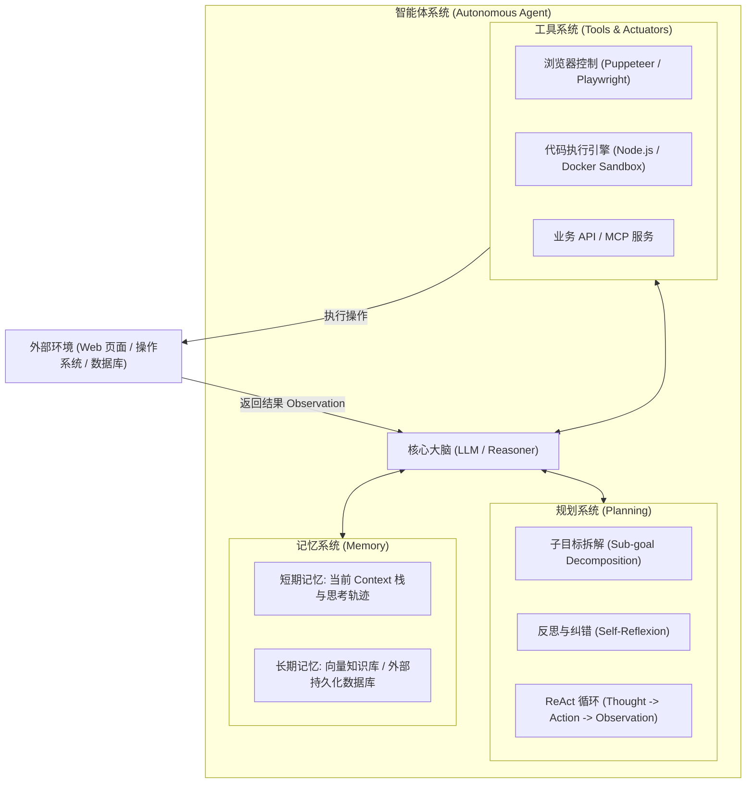

---

**规范代码实现:**

在 TypeScript 中定义标准工业级 Agent 认知状态机构型：

```typescript
// types/agent-architecture.ts
export interface AgentMemory {
  shortTermHistory: Array<{ role: 'user' | 'assistant' | 'tool'; content: string }>;
  workingScratchpad: string; // 当前推理草稿纸
  queryLongTermMemory: (query: string) => Promise<string[]>;
}

export interface AgentTool {
  name: string;
  description: string;
  parametersSchema: Record<string, unknown>; // JSON Schema
  execute: (args: Record<string, unknown>) => Promise<unknown>;
}

export interface AgentAction {
  toolName: string;
  args: Record<string, unknown>;
  thought: string;
}

export interface AgentStepResult {
  thought: string;
  action?: AgentAction;
  observation?: unknown;
  finalAnswer?: string;
  isComplete: boolean;
}
```

---

**面试官视角:**

**考察意图:**
评估候选人是否理解从“Chat Completion”向“Agent”演进的范式转移。能够清晰背书 Agent 四大要素并指出每个要素在工程实现中的卡点（如 Planning 的死循环、Memory 的窗口超限、Tools 的执行超时），展现出成熟的系统性架构视野。

**深度追问链:**
1. **追问 1**: 在规划（Planning）过程中，如果大模型陷入了反复调用同一个失败工具的死循环，架构上如何防范？
   - *答题切入点*: 引入最大重试步数（`maxSteps` 阈值熔断）、循环调用指纹检测（Hash 检查连续 N 次调用的 Tool+Args 是否完全相同）、引入批评者（Critic / Evaluator）自我反思机制，强制模型重新规划路线。

---

**延伸阅读:**
- [Lilian Weng: LLM Powered Autonomous Agents (OpenAI 经典博客)](https://lilianweng.github.io/posts/2023-06-23-agent/)
- [ReAct: Synergizing Reasoning and Acting in Language Models (Yao et al., 2022)](https://arxiv.org/abs/2210.03629)

</Answer>

---

## 业界主流的 Agent 产品与框架有哪些（Cursor / Claude Code / AutoGen / LangGraph / CrewAI）？它们的架构选型与适用场景是什么？ {#p0-mainstream-agents-comparison}

<Answer>

**核心结论:**

随着 Agent 技术的爆发，业界在**“编码助手垂直 Agent（Vertical Coding Agents）”**与**“通用应用编排框架（General Orchestration Frameworks）”**两个阵营涌现出代表性方案。前端与全栈架构师必须根据业务复杂度与控制力需求精准选型：
- **编码与生产力 Agent（端到端产品级）**：
  - **Cursor**：深度结合 VS Code 客户端 Fork 与本地 LSP（Language Server Protocol），将代码库 AST 索引、本地向量检索与模型推理极致融合，擅长即时上下文补全与多文件原子编辑；
  - **Claude Code (Anthropic)**：以命令行终端（CLI / REPL）为载体、以系统原生工具（Bash、Read/Write、Grep）为原语的极简自主代理，采用无虚拟层的宿主系统直接交互，代表了“Bash is all you need”的强效能终端哲学；
- **Agent 开发与编排框架（底层 SDK 级）**：
  - **LangGraph (LangChain 体系)**：基于**有向图（Graph）、循环状态机（StateGraph）与持久化检查点（Checkpointer）**设计，支持人类在环（HITL）与时光旅行，是目前构建复杂确定性生产 Agent 的事实标准；
  - **AutoGen (Microsoft)**：以**多智能体对话（Multi-Agent Conversation）与角色扮演（Role-Playing）**为核心哲学，擅长头脑风暴、代码生成与交叉评审；
  - **CrewAI**：基于任务分工角色扮演的高层封装框架，上手极快，适合轻量级任务流自动化。

---

**原理解析:**

**1. 主流 Agent 框架与产品核心架构选型全景矩阵**

| 框架 / 产品 | 核心设计哲学 | 控制流模型 | 状态持久化机制 | 前端结合度与适用场景 |
| :--- | :--- | :--- | :--- | :--- |
| **LangGraph** | 图与状态机 (Cycles & Branches) | 显式有向图 (StateGraph)，支持条件分支与并发 | 原生 Checkpointer 数据库，支持时光旅行 | **极高**。前端可直接将 Graph 状态映射为可视化画布与分支状态机 |
| **AutoGen** | 多智能体对话总线 (Conversational) | 隐式对话传递 (GroupChat / RoundRobin) | 会话消息日志持久化 | **中**。适合多模型会话互审，但复杂分支确定性控制力较弱 |
| **CrewAI** | 职能团队分工 (Role / Crew / Process) | 顺序式或层次式任务分派 (Sequential / Hierarchical) | 内存状态与简单 Hook | **中**。快速搭建概念验证（PoC）与固定业务审批流 |
| **Claude Code** | 终端极简原生行动 (CLI / Bash Native) | Agentic Loop + 原生系统工具执行 | 会话上下文文件日志 | **极高 (研发效能)**。前端工程资产化（Skills/Commands）与 CLI 自动化演进标杆 |
| **Cursor** | IDE 深度集成 (LSP + AST + Context) | 混合式 Agent (Tab 补全 + Composer 多文件) | 本地 SQLite 向量与文件快照 | **极高 (开发者体验)**。前端业务代码实时编写与架构重构 |

**2. 状态机图驱动 (LangGraph) vs 自由多智能体对话 (AutoGen)**

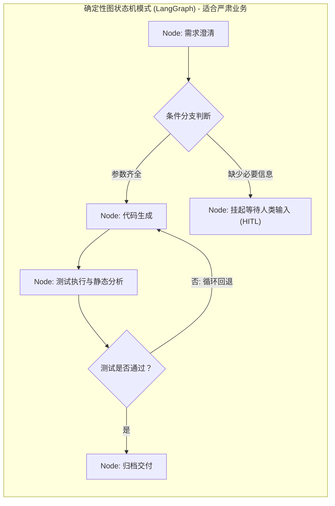

---

**规范代码实现:**

在 TypeScript 中展示如何借鉴 LangGraph 的状态图思想，实现一个具备确定性状态流转与检查点回滚的极简图执行引擎：

```typescript
// engine/state-graph.ts
export interface GraphState {
  messages: Array<{ role: string; content: string }>;
  currentStep: string;
  retryCount: number;
  isCompleted: boolean;
}

export type StateNodeHandler = (state: GraphState) => Promise<Partial<GraphState>>;

export class MinimalStateGraph {
  private nodes: Map<string, StateNodeHandler> = new Map();
  private edges: Map<string, (state: GraphState) => string> = new Map();
  private entryPoint: string = '';

  public addNode(name: string, handler: StateNodeHandler): this {
    this.nodes.set(name, handler);
    return this;
  }

  public addConditionalEdge(fromNode: string, router: (state: GraphState) => string): this {
    this.edges.set(fromNode, router);
    return this;
  }

  public setEntryPoint(nodeName: string): this {
    this.entryPoint = nodeName;
    return this;
  }

  public async run(initialState: GraphState): Promise<GraphState> {
    let state = { ...initialState };
    let currentNode = this.entryPoint;

    while (currentNode && !state.isCompleted) {
      console.log(`[StateGraph] 执行节点: ${currentNode}`);
      const handler = this.nodes.get(currentNode);
      if (!handler) break;

      const patch = await handler(state);
      state = { ...state, ...patch, currentStep: currentNode };

      const router = this.edges.get(currentNode);
      if (!router) break;
      currentNode = router(state);
    }

    return state;
  }
}
```

---

**面试官视角:**

**考察意图:**
评估应试者是否真正沉浸在当前大模型前沿技术生态中。初级应聘者仅知道“调用 ChatGPT 写个 prompt”，而高级架构师能够清晰对比不同 Agent 框架的设计哲学（图状态机 vs 多角色对话），并能为企业选择最合适的技术路线。

**深度追问链:**
1. **追问 1**: 为什么在严肃企业生产场景（如银行审批、工单流转）中，工业界更推崇 LangGraph 这种图状态机，而不是让多个 Agent 自由自由对话的 AutoGen？
   - *答题切入点*: 自由多智能体对话存在“不可控的死循环、话题漂移、执行路径不可预测”的严重风险；而 LangGraph 提供了明确的状态转换约束、检查点持久化、确定性回滚以及严格的条件判断，符合企业软件高可靠、可审计的合规要求。

---

**延伸阅读:**
- [LangChain: LangGraph Documentation](https://langchain-ai.github.io/langgraph/)
- [Microsoft AutoGen: Multi-agent Conversation Framework](https://microsoft.github.io/autogen/)
- [Anthropic: Claude Code Architecture & Philosophy](https://docs.anthropic.com/en/docs/claude-code)

</Answer>

---

## Agent 主要的扩展手段有哪些？除了 Function Calling / Tool Use，MCP 协议、Skills 机制与 Subagent 多智能体协作是如何扩展 Agent 能力的？ {#p0-agent-extension-mechanisms}

<Answer>

**核心结论:**

大语言模型的能力边界受限于其预训练权重中的静态参数知识。为了让 Agent 能够操作企业内部系统、调用私有 API、甚至自我进化，业界发展出了四大层次分明的**Agent 扩展手段（Extension Mechanisms）**：
1. **第一代基石扩展：Function Calling / Tool Use（单点工具调用）**：
   - 开发者在请求中提供工具的 JSON Schema，模型根据意图决定调用哪个函数并返回结构化参数；本质是**点对点的硬编码接入**，新增工具必须修改客户端代码；
2. **协议化生态扩展：Model Context Protocol (MCP，模型上下文协议)**：
   - Anthropic 推出的开放标准。将工具（Tools）、数据源（Resources）和提示词模板（Prompts）抽象为跨语言、跨进程的标准化 Client-Server 协议，实现**工具解耦与即插即用（USB-C 标准）**；
3. **经验与规约沉淀：Skills 机制（技能化演进）**：
   - 将专业领域工作流规范、排查步骤、前置依赖与最佳实践以结构化文档或脚本集合封装（如 `SKILL.md` + 辅助脚本）；Agent 按需加载技能，避免将所有 Prompt 塞入上下文导致注意力崩溃；
4. **横向能力倍增：Subagents 多智能体编排协作（Multi-Agent System）**：
   - 主智能体（Parent Agent）作为指挥官，将复杂任务拆解并派发给专注垂直领域的子智能体（如 Research Agent、Code Review Agent），子智能体独立运行并只汇报最终结论，实现**上下文窗口物理隔离与算力并发**。

---

**原理解析:**

**1. 四大 Agent 扩展机制演进对比矩阵**

| 扩展机制 | 耦合度 | 上下文消耗 | 动态扩展能力 | 核心适用场景 |
| :--- | :--- | :--- | :--- | :--- |
| **Function Calling** | 强耦合（客户端硬编码工具定义） | 随工具数量线性暴增 | 差（需发版修改调用代码） | 单一系统内部 2~5 个高频核心业务 API |
| **MCP 协议** | **完全解耦（标准化 Client-Server RPC）** | 支持动态发现与按需挂载 | **极高（配置 JSON 即可接入第三方工具）** | 跨部门系统互联、IDE 与桌面端工具打通 |
| **Skills 机制** | 低耦合（轻量文本元数据索引） | 渐进式披露（按需检索加载正文） | 高（只需添加规范 Markdown/脚本） | 沉淀工程经验、特定库最佳实践、复杂排错 SOP |
| **Subagents 编排** | 完全隔离（独立会话上下文） | **零污染（子 Agent 上下文独立闭环）** | 极高（可并发分发、递归派生） | 复杂大型工程战役、跨模块并行重构、深度调研 |

**2. 四大扩展机制协同工作全景拓扑**

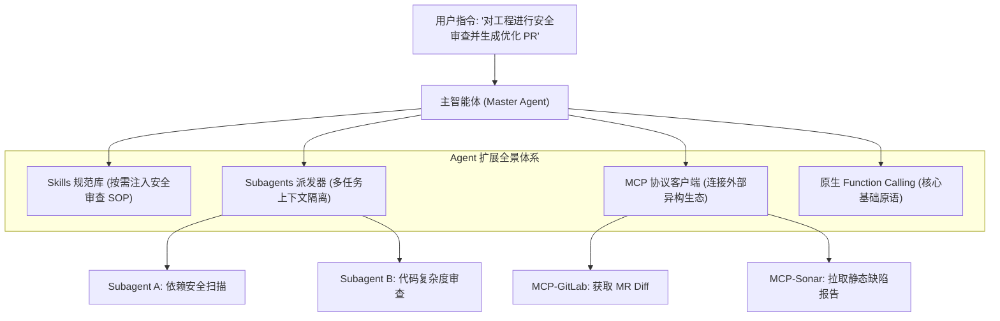

---

**规范代码实现:**

在 TypeScript 中实现支持 Skills 按需加载与 Subagent 上下文隔离派发的模块化 Agent 扩展调度器：

```typescript
// core/agent-extension-dispatcher.ts
export interface AgentSkill {
  name: string;
  description: string;
  loadInstruction: () => Promise<string>;
}

export interface SubagentConfig {
  role: string;
  prompt: string;
  tools: string[];
}

export class AgentExtensionDispatcher {
  private skills: Map<string, AgentSkill> = new Map();

  public registerSkill(skill: AgentSkill): void {
    this.skills.set(skill.name, skill);
  }

  // 1. 技能渐进式披露：主 Agent 仅需在 Prompt 里注入技能清单与一句话描述
  public getSkillsIndexPrompt(): string {
    const list = Array.from(this.skills.values())
      .map(s => `- ${s.name}: ${s.description}`)
      .join('\n');
    return `当前可用专业技能库 (根据任务需要可申请加载具体技能):\n${list}`;
  }

  // 2. 派发隔离的子智能体执行 (Subagent Context Isolation)
  public async dispatchSubagent(config: SubagentConfig): Promise<string> {
    console.log(`[Subagent] 派发独立工作单元: ${config.role}`);
    // 独立实例化一个没有历史杂质的新会话上下文
    const isolatedMessages = [
      { role: 'system', content: `你是 ${config.role}。独立专注完成以下任务，只输出最终结论。` },
      { role: 'user', content: config.prompt }
    ];
    
    // 执行完成后销毁中间状态，只将最终结果作为 Observation 汇入主 Agent
    const result = await fakeExecuteLlm(isolatedMessages);
    return `[Subagent: ${config.role} 报告]: ${result}`;
  }
}

async function fakeExecuteLlm(messages: any[]): Promise<string> {
  return '子任务执行完毕，无安全隐患。';
}
```

---

**面试官视角:**

**考察意图:**
评估候选人对构建复杂 Agent 系统的扩展能力与演化路径认知。只有做过真实复杂 Agent 的工程师，才深刻明白把几十个工具硬编码进 System Prompt 会导致注意力彻底崩溃，必须依靠“MCP 协议标准接入 + Skills 渐进披露 + Subagent 物理隔离”来实现大规模工业落地。

**深度追问链:**
1. **追问 1**: 为什么在长周期开发任务中，单 Agent 往往越做越慢甚至胡言乱语，而采用 Subagent 派发后成功率大幅提高？
   - *答题切入点*: 单 Agent 随着任务推进，历史日志中充斥着海量的中间输出与工具错误，上下文被大量噪声污染（Context Rotting）；Subagent 独立开辟干净的上下文执行专注子任务，完成后只回传高密度的结构化总结，彻底保护了主 Agent 的注意力黄金带宽。

---

**延伸阅读:**
- [Anthropic: Model Context Protocol (MCP) Official Spec](https://modelcontextprotocol.io/)
- [OpenAI: Swarm & Multi-Agent Orchestration Patterns](https://github.com/openai/swarm)

</Answer>

---

## 前端如何架构大模型 Agent 交互界面（Agent Harness）？ReAct 规划决策轨迹与思考链流式可视化？ {#p0-agent-frontend-harness}

<Answer>

**核心结论:**

在现代 AI 应用中，前端不再是一个简单的聊天窗口，而是**智能体（Agent）运行与人机协作的物理宿主环境（Agent Harness）**。

前端承接 Agent 交互必须解决三大核心诉求：
1. **ReAct 认知生命周期状态机（Reasoning and Acting State Machine）**：精确建模并流式响应 Agent 的思考（Thought）、行动（Action/Tool Call）、观察（Observation/Tool Result）与终态输出（Answer）；
2. **思考链（Chain-of-Thought）与工具调用的防抖排版与折叠**：区分“面向机器的中间思考/工具日志”与“面向用户的最终交互内容”；默认将推理链与工具调用折叠为紧凑卡片，支持用户展开查看细节；
3. **全双工事件驱动总线**：通过标准化协议事件（如 `thought_delta`、`tool_call_start`、`tool_result`）驱动视图细粒度增量更新，杜绝全屏刷新。

---

**原理解析:**

**1. ReAct 决策循环与前端视图状态流转**

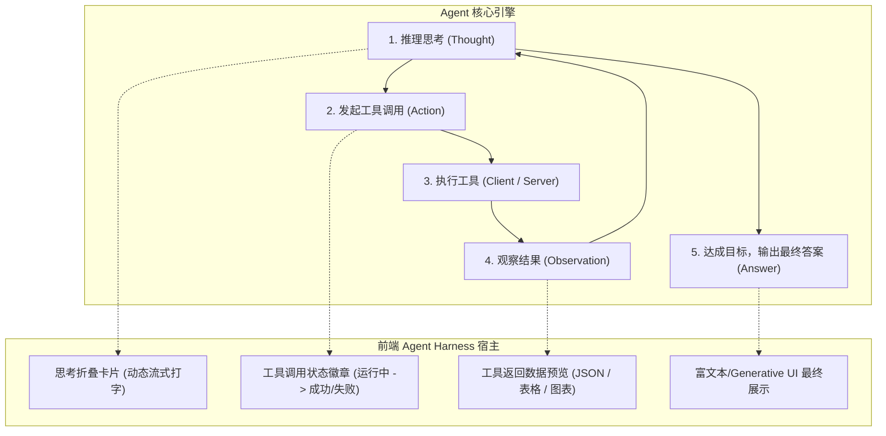

---

**规范代码实现:**

在 TypeScript/React 中实现标准 ReAct 轨迹时间轴组件，支持流式思考与工具结果插槽展示：

```typescript
// components/agent-trajectory-viewer.tsx
import React, { FC, useState } from 'react';

export interface TrajectoryStep {
  id: string;
  thought?: string;
  toolCall?: {
    name: string;
    args: Record<string, unknown>;
    status: 'running' | 'success' | 'failed';
    result?: unknown;
  };
  answer?: string;
}

export const AgentTrajectoryViewer: FC<{ steps: TrajectoryStep[] }> = ({ steps }) => {
  const [expandedIds, setExpandedIds] = useState<Record<string, boolean>>({});

  const toggleExpand = (id: string) => {
    setExpandedIds(prev => ({ ...prev, [id]: !prev[id] }));
  };

  return (
    <div className="agent-harness-timeline space-y-4 p-4">
      {steps.map((step, idx) => (
        <div key={step.id} className="border-l-2 border-indigo-500 pl-4 space-y-2">
          {/* 1. 思考链展示 */}
          {step.thought && (
            <div className="text-sm text-gray-500 italic bg-gray-50 p-2 rounded">
              <span className="font-semibold text-indigo-600 mr-2">💭 思考 #{idx + 1}:</span>
              {step.thought}
            </div>
          )}

          {/* 2. 工具调用轨迹与状态徽章 */}
          {step.toolCall && (
            <div className="tool-call-box p-3 bg-white border rounded shadow-sm">
              <div className="flex items-center justify-between cursor-pointer" onClick={() => toggleExpand(step.id)}>
                <span className="font-mono text-sm font-bold text-gray-800">
                  🛠️ 工具调用: {step.toolCall.name}
                </span>
                <span className={`text-xs px-2 py-1 rounded font-bold ${
                  step.toolCall.status === 'running' ? 'bg-blue-100 text-blue-700 animate-pulse' :
                  step.toolCall.status === 'success' ? 'bg-green-100 text-green-700' : 'bg-red-100 text-red-700'
                }`}>
                  {step.toolCall.status}
                </span>
              </div>

              {expandedIds[step.id] && (
                <div className="mt-2 space-y-2 text-xs font-mono">
                  <pre className="bg-gray-100 p-2 rounded overflow-x-auto">
                    参数: {JSON.stringify(step.toolCall.args, null, 2)}
                  </pre>
                  {step.toolCall.result && (
                    <pre className="bg-emerald-50 p-2 rounded text-emerald-800 overflow-x-auto">
                      返回值: {JSON.stringify(step.toolCall.result, null, 2)}
                    </pre>
                  )}
                </div>
              )}
            </div>
          )}

          {/* 3. 最终答案输出 */}
          {step.answer && (
            <div className="final-answer text-gray-900 bg-emerald-50 p-4 border border-emerald-200 rounded">
              {step.answer}
            </div>
          )}
        </div>
      ))}
    </div>
  );
};
```

---

**面试官视角:**

**考察意图:**
评估候选人设计复杂人机协作界面的架构功底。许多开发者停留在“聊天对话框”级别，缺乏处理长时间运行（几十步工具调用）、中间执行失败重试、中间过程排版折叠的工业级 Agent 前端架构能力。

**深度追问链:**
1. **追问 1**: 在 Agent 执行了 20 步工具调用、生成了极其冗长的 DOM 节点时，前端如何保证页面滚动和性能不卡顿？
   - *答题切入点*: 采用虚拟列表（Virtual List / React Window）对历史步骤按窗口渲染；已完成的历史步骤仅保留折叠概要，展开时动态加载；将工具调用的高频 JSON 解码与状态计算放入 Web Worker。

---

**延伸阅读:**
- [Vercel AI SDK: Tool Calling & UI Components](https://sdk.vercel.ai/docs/ai-sdk-ui/chatbot-tool-usage)
- [Anthropic: Building Systems with Claude (Agent Pattern)](https://www.anthropic.com/research/building-effective-agents)

</Answer>

---

## Agent 执行高风险工具（如删除文件、对外转账）时，前端如何设计 Human-in-the-Loop (HITL) 动态授权拦截门禁？ {#p0-agent-hitl-guardrail}

<Answer>

**核心结论:**

在智能体拥有执行真实操作权限的时代，**人类在环（Human-in-the-Loop, HITL）是防止大模型发生灾难性破坏、确保企业资产安全的生死底线**。

当 Agent 意图执行可能造成不可逆破坏的危险工具（如 `delete_database_records`、`execute_shell_rm`、`transfer_funds`）时，前端与运行时架构必须实施**异步授权拦截门禁（Asynchronous Action Interceptor）**：
1. **工具风险等级分级矩阵（Risk Tiering）**：分为只读级（Safe Read，免审批自动执行）、普通写（Low-Risk Write，被动记录日志）与高危破坏级（High-Risk Mutating，强制挂起审批）；
2. **基于 Promise 控制反转的状态机挂起（Suspension via Inverted Promise）**：Agent 循环在触发高危工具时立即暂停推理，向前端派发 `awaiting_approval` 事件并呈现实时差异对比（Diff）与操作上下文；
3. **超时保护与上下文隔离**：若用户超过限定时间未批准，默认触发超时拒绝（Safe Default: Reject on Timeout），防止模型上下文无限期挂起引发连接泄漏。

---

**原理解析:**

**1. HITL 动态授权时序与控制反转流**

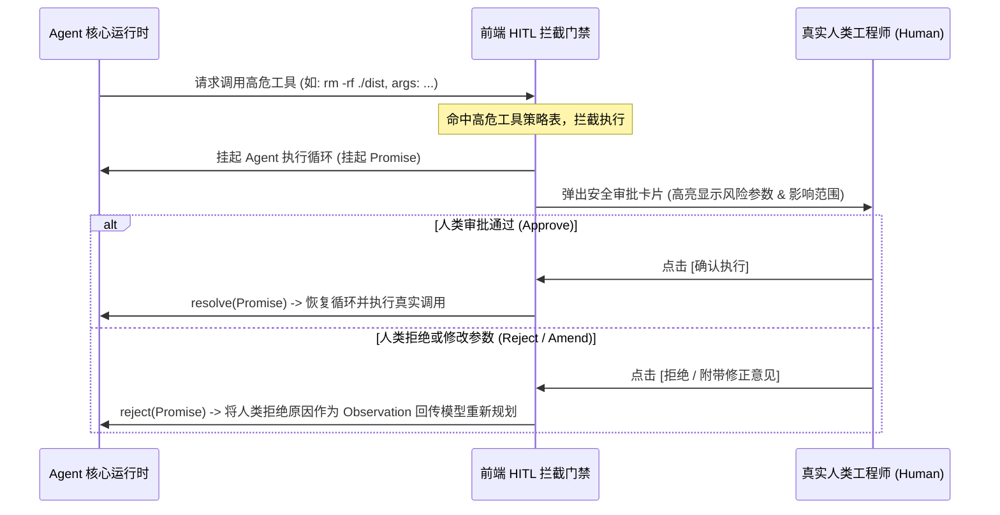

---

**规范代码实现:**

在 TypeScript 中实现可取消、带超时熔断的通用 Human-in-the-Loop 异步安全拦截器：

```typescript
// security/hitl-interceptor.ts
export interface DangerousActionRequest {
  id: string;
  toolName: string;
  parameters: Record<string, unknown>;
  dangerLevel: 'CRITICAL' | 'HIGH';
  description: string;
}

export type ApprovalDecision = 
  | { approved: true; modifiedParams?: Record<string, unknown> }
  | { approved: false; reason: string };

export class HitlActionInterceptor {
  private pendingResolvers: Map<string, (decision: ApprovalDecision) => void> = new Map();
  private readonly defaultTimeoutMs = 120000; // 2 分钟未响应自动拒绝

  // 1. Agent 引擎调用此方法：若为高危操作则异步挂起，等待前端用户点击
  public async interceptAction(request: DangerousActionRequest): Promise<ApprovalDecision> {
    return new Promise<ApprovalDecision>((resolve) => {
      // 超时安全兜底：防止悬挂
      const timer = setTimeout(() => {
        if (this.pendingResolvers.has(request.id)) {
          this.pendingResolvers.delete(request.id);
          resolve({ approved: false, reason: '用户审批超时，系统已自动拦截操作' });
        }
      }, this.defaultTimeoutMs);

      this.pendingResolvers.set(request.id, (decision) => {
        clearTimeout(timer);
        resolve(decision);
      });

      // 触发前端 UI 弹窗挂起
      window.dispatchEvent(new CustomEvent('ai:hitl_requested', { detail: request }));
    });
  }

  // 2. 前端弹窗组件中的“同意/拒绝”按钮回调此方法
  public submitDecision(requestId: string, decision: ApprovalDecision): void {
    const resolver = this.pendingResolvers.get(requestId);
    if (resolver) {
      resolver(decision);
      this.pendingResolvers.delete(requestId);
    }
  }
}
```

---

**面试官视角:**

**考察意图:**
评估候选人对企业级安全生产与权限控制的敬畏之心。让大模型直接在生产环境“跑命令、改数据”是极不负责的架构设计；懂得使用 HITL 门禁、风险分级、超时自动熔断的工程师才具备主导企业核心系统的资质。

**深度追问链:**
1. **追问 1**: 用户点击“拒绝”后，如何把拒绝理由传回给大模型，让大模型不报错并懂得“换一种方式实现”？
   - *答题切入点*: 将拦截视为一次特殊的工具执行结果（Tool Result），内容为“操作已被操作员拒绝，理由是：权限不足，请采用只读方案重新规划”，大模型读取此 Observation 后会自动进入下一次 ReAct 思考，实现业务优雅自愈。

---

**延伸阅读:**
- [LangChain: Human-in-the-loop with LangGraph](https://langchain-ai.github.io/langgraph/how-tos/human-in-the-loop/)
- [OWASP Top 10 for Large Language Model Applications: Excessive Agency](https://owasp.org/www-project-top-10-for-large-language-model-applications/)

</Answer>

---

## 如何设计类似 Dify / Coze 的可视化 DAG 工作流编排画布？拓扑排序与流式执行调试如何落地？ {#p0-ai-workflow-dag-canvas}

<Answer>

**核心结论:**

在复杂大模型与自主智能体（Agent）产品中，**基于有向无环图（DAG, Directed Acyclic Graph）的可视化工作流编排画布（如 Dify、Coze、LangFlow）已成为取代单一聊天框的战略级交互形态**：
- **混合渲染架构**：千万级坐标系与视口平移缩放（Pan & Zoom）下，纯 DOM/React 组件会导致严重重绘重排；工业界采用**“底层 Canvas / SVG 绘制连线与网格背景 + 顶层 HTML/DOM 挂载交互节点（Node UI）”的混合分层架构**，兼顾渲染性能与表单交互能力；
- **确定性执行调度（Topological Scheduling）**：编排数据结构本质是邻接表（Adjacency List）；执行前必须通过 **Kahn 算法或深度优先搜索（DFS）进行环路检测与拓扑排序**，确保上游依赖节点先于下游节点执行；
- **分步流式观察与断点调试**：每个工作流节点作为独立的有限状态机（`idle | running | streaming | success | failed`），支持流式 Token 实时打字输出与局部单步重试（In-place Retry）。

---

**原理解析:**

**1. DAG 工作流节点依赖拓扑与执行生命周期**

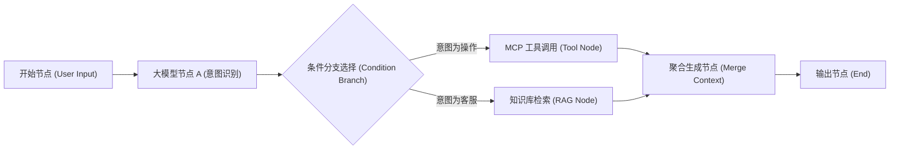

---

**规范代码实现:**

在 TypeScript 中实现工业级 DAG 拓扑排序算法与依赖环路检测引擎：

```typescript
// engine/dag-scheduler.ts
export interface WorkflowNode {
  id: string;
  name: string;
  execute: (inputs: Record<string, unknown>) => Promise<Record<string, unknown>>;
}

export interface WorkflowEdge {
  from: string; // 上游节点 ID
  to: string;   // 下游节点 ID
}

export class DagWorkflowEngine {
  // Kahn 算法拓扑排序与有向环检测
  public static getExecutionPlan(nodes: WorkflowNode[], edges: WorkflowEdge[]): string[][] {
    const inDegree = new Map<string, number>();
    const graph = new Map<string, string[]>();

    nodes.forEach(n => {
      inDegree.set(n.id, 0);
      graph.set(n.id, []);
    });

    edges.forEach(e => {
      inDegree.set(e.to, (inDegree.get(e.to) || 0) + 1);
      graph.get(e.from)!.push(e.to);
    });

    const executionStages: string[][] = [];
    let readyNodes = nodes.filter(n => inDegree.get(n.id) === 0).map(n => n.id);

    let visitedCount = 0;

    while (readyNodes.length > 0) {
      executionStages.push([...readyNodes]);
      visitedCount += readyNodes.length;

      const nextBatch: string[] = [];
      for (const nodeId of readyNodes) {
        for (const neighbor of graph.get(nodeId) || []) {
          const currentDeg = inDegree.get(neighbor)! - 1;
          inDegree.set(neighbor, currentDeg);
          if (currentDeg === 0) {
            nextBatch.push(neighbor);
          }
        }
      }
      readyNodes = nextBatch;
    }

    if (visitedCount !== nodes.length) {
      throw new Error('[DAG-Scheduler] 流程图存在循环依赖环路（Cycle detected），无法执行！');
    }

    return executionStages;
  }
}
```

---

**面试官视角:**

**考察意图:**
评估应试者是否具备大型图形学、复合数据流引擎与前端高性能可视化的跨界实战力。在大模型时代，AI 应用工程师如果不仅会做 Chat，还能独立架构 DAG 工作流画布与调度器，是极具溢价的核心竞争力。

**深度追问链:**
1. **追问 1**: 在节点并发合流场景（如两个平行分支同时输出结果输入给下一个节点），状态如何在前端实时汇聚并保证流式渲染？
   - *答题切入点*: 采用集中式状态总线（Node Output Bus），下游节点通过响应式监听器等待所有前置依赖的 `status === 'success'`，当所有上游就绪后自动启动触发，数据通过输入映射管道精准注入。

---

**延伸阅读:**
- [React Flow: Building Node-Based UIs](https://reactflow.dev/)
- [Dify: Open-Source LLM App Development Platform](https://dify.ai/)

</Answer>

---

## Agent = Model + Harness 这个等式怎么理解？Harness 到底决定了 Agent 的什么？ {#p0-agent-model-harness-equation}

<Answer>

**核心结论:**

在企业落地语境里，Agent 的实际能力并不由模型单独决定，而是由 **Model（模型智力）× Harness（运行载体工程）** 共同决定。一个可用的企业级 Harness 承担六件事：

1. **上下文装配（Context Assembly）**：决定每一轮把什么放进窗口、什么外置、什么按需检索；
2. **工具接入与权限（Tool & Permission）**：工具注册、参数校验、风险分级与人工放行；
3. **执行循环与停止条件（Loop & Termination）**：步数预算、无进展检测、循环指纹熔断；
4. **状态与记忆持久化（State & Memory）**：断点续跑、会话摘要、长期记忆的读写边界；
5. **可观测与干预（Observability & Intervention）**：全链路 Trace、失败归因、人工接管与回滚；
6. **评测与回归（Eval & Replay）**：把线上真实失败沉淀为可重放的回归用例。

**工程杠杆的关键判断：换模型是把「天花板」上移，改 Harness 是把「已有模型的利用率」从 40% 抬到 85%。** 在模型能力短期不可控时，后者的收益往往更大、也更可落地。

---

**原理解析:**

**1. 为什么同一个模型在不同 Agent 产品里表现差出两倍**

差异几乎全部来自 Harness，而不是模型。模型决定「单步推理好不好」，Harness 决定「这单步推理放在什么上下文里、拿到什么工具、错了能不能被发现、能不能重试」。

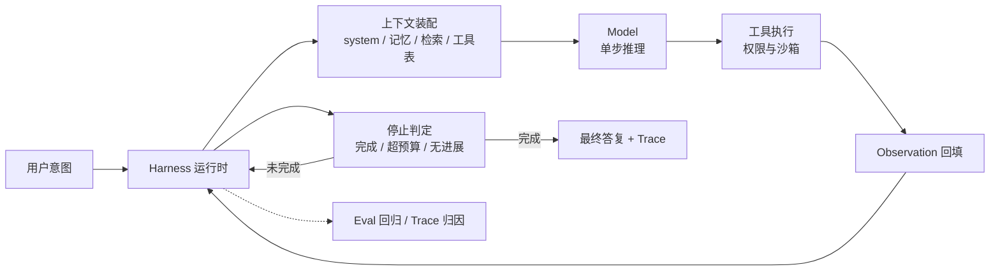

**2. 能力归属对照表**

| 能力项 | 属于 Model | 属于 Harness | 说明 |
| :--- | :--- | :--- | :--- |
| 语义理解与推理质量 | ✅ | — | 换模型直接改变 |
| 工具选择准确率 | 部分 | ✅ | 工具描述质量、工具数量、命名空间隔离都由 Harness 决定 |
| 复杂任务完成率 | 部分 | ✅ | 步数预算、失败重规划、上下文新鲜度是 Harness 变量 |
| 稳定性与可控性 | — | ✅ | 循环检测、熔断、降级、人工门禁全在 Harness |
| 成本与时延 | 部分 | ✅ | 上下文裁剪、缓存前缀对齐、模型分级路由由 Harness 决定 |
| 可审计与合规 | — | ✅ | 工具调用全量留痕、权限分级、人工审批点在 Harness |

**3. 常见误判**

- **误判一：把 Harness 当模型的一部分**。结果是把「上下文没装好导致模型选错工具」当成「模型不够强」去换模型，成本花光、问题还在。
- **误判二：只堆工具不治理工具**。工具从 5 个涨到 80 个后，模型选择准确率反而下降——因为工具表本身占上下文，且互相语义重叠。
- **误判三：没有 Trace 就没有 Harness**。没有全链路轨迹，任何「效果变差」都只能靠猜。

---

**规范实现:**

一个可插拔的最小 Harness 骨架（TypeScript），把六个能力收敛成可替换的策略接口：

```typescript
// harness/types.ts
export interface HarnessPolicy {
  assembleContext(input: TurnInput): Promise<ContextBlock[]>;
  dispatch(toolCall: ToolCall): Promise<ToolOutcome>;
  shouldStop(state: RunState): StopDecision;
  onError(state: RunState, err: unknown): RecoveryAction;
}

export type StopDecision =
  | { kind: 'done' }
  | { kind: 'budget-exhausted'; spent: number; limit: number }
  | { kind: 'no-progress'; fingerprint: string };

export type RecoveryAction =
  | { kind: 'retry'; backoffMs: number }
  | { kind: 'replan'; hint: string }
  | { kind: 'escalate'; to: 'human' | 'operator' };

export interface RunState {
  steps: number;
  toolCallFingerprints: string[]; // 连续相同 Tool+Args 检测死循环
  lastMeaningfulChangeAt: number; // 无进展检测
  budget: { steps: number; tokens: number };
}
```

工程上真正决定效果的是三处策略选择：**上下文装配顺序**（把最关键的约束放在离生成最近的位置）、**停止条件**（步数预算 + 指纹去重 + 无进展检测三者缺一不可）、**错误分级**（可重试 / 需重规划 / 需人工，三类走不同路径，混在一起重试是线上雪崩的常见根因）。

---

**面试官视角:**

**考察意图:**
本考点在 2026 年的 Agent 岗面试中已是高频「大局观」题，回答质量直接区分「用过 Agent 工具」与「搭过 Agent 系统」。评分重点不在于能否背出 Model/Harness 术语，而在于能否说清 **哪些能力属于 Harness、如何定位一次失败到底怪模型还是怪 Harness**。

**深度追问链:**
1. **追问 1**: 线上发现 Agent 成功率下降，你怎么判断是模型换代的锅还是 Harness 的锅？
   - *答题切入点*: 先看分层指标——工具选择准确率（纯 Harness 变量，模型换代一般不降）、单步推理正确率（模型变量）、步数分布（上下文/Harness 变量）。用同一批 Golden Case 在新旧模型上跑 A/B，工具选择率不变而单步正确率下降则指向模型；反之指向 Harness。
2. **追问 2**: Harness 工具从 20 个扩到 100 个后效果反而变差，你怎么排查？
   - *答题切入点*: 工具表本身占用上下文且语义互相污染——按领域做命名空间隔离、只把当前子域的工具注入、把工具描述当 Prompt 资产做版本管理与回归。
3. **追问 3**: 让你把公司现有系统改造成 Agent 形态，Harness 层你打算先做哪三件事？
   - *答题切入点*: 先做可观测（Trace 全链路），再做停止条件与失败分级，最后做上下文装配策略；直接上自主规划是风险最高的选择。

---

**延伸阅读:**
- [Model Context Protocol 规范（工具与能力声明的标准载体）](https://modelcontextprotocol.io/)
- [OpenAI Agents SDK（Harness 能力边界与工具契约参考）](https://openai.github.io/openai-agents-python/)
- [Anthropic: Building Effective Agents（工作流与自主性的分级实践）](https://www.anthropic.com/research/building-effective-agents)

</Answer>

---

## 什么场景该做成一个专职 Agent，什么场景只需要一个 Skill？两者对上下文窗口的占用差多少？ {#p0-agent-vs-skill-boundary}

<Answer>

**核心结论:**

判据不是「任务看起来复杂不复杂」，而是三条硬标准：

1. **是否需要独立的目标（Goal）**：Skill 没有自己的目标，只执行被触发的既定步骤；Agent 有自己的目标与任务边界。
2. **是否需要独立的状态与终止条件**：Skill 的执行流由宿主控制、步数固定；Agent 自己决定下一步、并自己判断何时结束。
3. **是否需要根据现场信息改变步骤**：步骤可枚举、可预编排的，用 Skill；分支依赖运行时观测结果的，才用 Agent。

**上下文成本差着量级**：Skill 以「摘要 + 工具契约」的形式常驻（通常几十到数百 Token），Agent 需要携带完整轨迹（起步几千、复杂任务可达数万 Token），并且随步数线性膨胀。

**演进路径的正确顺序是先 Skill、后 Agent**：先按 Skill 做，观测到「步骤必须依现场调整」再升级为 Agent；反之把固定流程做成 Agent，是把可预测性白白换成不确定性和审计成本。

---

**原理解析:**

**1. 决策判据**

| 判据 | 用 Skill | 用 Agent |
| :--- | :--- | :--- |
| 步骤序列 | 固定、可枚举 | 运行时才确定 |
| 终止条件 | 宿主已知（跑完 N 步） | Agent 自行判定（完成/放弃/超预算） |
| 失败处理 | 固定重试或直接报错 | 需要重规划、换工具、拆子任务 |
| 上下文占用 | 摘要常驻，Token 量级 10² | 全轨迹携带，Token 量级 10³~10⁴ |
| 结果确定性 | 高（可回归） | 低（需 Eval 守护） |
| 权限面 | 小，工具白名单固定 | 大，动态触达的工具面更宽 |

**2. 上下文占用的量级差**

以一个典型研发助手为例：

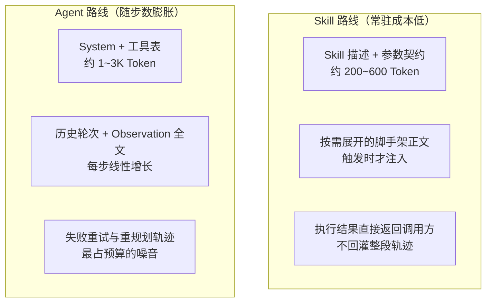

结论很直接：**Agent 的上下文不是「更多知识」，而是「更多过程」**，过程恰恰是最容易挤爆预算、也最容易稀释关键约束的部分。这也是长任务里模型表现衰减的主因之一。

**3. 两个反模式**

- **过度自主（Over-Autonomy）**：把「拉取仓库 → 跑测试 → 提 PR」这种完全确定的流程做成 Agent。代价是每次结果不同、失败原因难归因、且每次都要烧掉大量 Token。
- **能力不足（Under-Autonomy）**：把「根据报错定位并选择合适的修复策略」这种本质需要判断的环节写成 Skill。结果是 Skill 覆盖不全，宿主被迫把所有分支都塞进提示词，Skill 反而比 Agent 更臃肿。

---

**规范实现:**

用可判定的条件把「选 Skill 还是选 Agent」编码成团队约定，避免每次靠直觉：

```typescript
// skill-vs-agent.ts
export type Granularity = 'skill' | 'agent';

export interface TaskShape {
  stepsAreDeterministic: boolean;      // 步骤是否可枚举且顺序固定
  branchDependsOnRuntimeObservation: boolean; // 分支是否依赖运行时观测
  needsOwnGoal: boolean;                // 是否有独立目标与完成定义
  needsOwnTermination: boolean;         // 是否需要自主终止判定
  steps: number;
  expectedFailureModes: number;         // 失败模式是否可枚举
}

export function chooseGranularity(t: TaskShape): Granularity {
  const deterministic = t.stepsAreDeterministic && !t.branchDependsOnRuntimeObservation;
  const enumerableFailures = t.expectedFailureModes <= 2;
  // 步骤确定 + 失败可枚举 => 编排为 Skill；否则升级为 Agent
  return deterministic && enumerableFailures && !t.needsOwnTermination ? 'skill' : 'agent';
}
```

配套的团队规约（写进 SDD 规则库，而不是靠口头约定）：

- 同一能力**先落 Skill**，连续两次出现「因为现场情况不同导致 Skill 走不通」才升级为 Agent；
- 升级时必须同时补齐：停止条件、失败分级、Trace 埋点、Eval 用例；
- Agent 只在**收益可度量**时引入——同一任务成功率提升不足以覆盖 Token 与时延成本，就退回 Skill。

---

**面试官视角:**

**考察意图:**
这是 2026 年 Agent 应用岗的经典分水岭题：候选人是否理解「自主性是一种要被主动约束的成本，而不是能力越高越好的指标」。高分回答必须同时给出**判据**、**上下文成本量级**和**演进顺序**三层。

**深度追问链:**
1. **追问 1**: 你们的 Skill 和 Agent 现在分别有多少个？有没有统计过各自的 Token 成本与成功率？
   - *答题切入点*: 给出以「调用量 × 平均上下文长度 × 步数」为口径的成本台账；实践中 Skill 单位调用成本通常低一个数量级，但覆盖率不足会导致宿主堆提示词，隐性成本上升。
2. **追问 2**: MCP 和 Skill 都能扩展能力，两者对上下文窗口的占用谁更大？
   - *答题切入点*: Skill 需要把执行步骤与约束注入上下文，占用随 Skill 复杂度线性增长；MCP 侧工具是「声明 + 按需发现 + 按需调用」，声明部分常驻、结果按需注入，通常更省。但若一次性把几十个工具的完整 schema 塞进上下文，MCP 反而更贵——真正贵的是**工具表的语义冗余**，不是协议本身。
3. **追问 3**: 什么时候你会把一个已经上线的 Agent 降级回 Skill？
   - *答题切入点*: 步骤方差收敛、失败模式可枚举、成功率瓶颈已不在自主性而在工具可靠性，且 Token 成本与 P99 时延不达标时降级。

---

**延伸阅读:**
- [Model Context Protocol 规范（Tools / Resources / Prompts 的上下文成本模型）](https://modelcontextprotocol.io/)
- [Anthropic: Building Effective Agents（简单组合优先于复杂自治）](https://www.anthropic.com/research/building-effective-agents)
- [Anthropic: Agent Skills 官方说明（Skill 的渐进式披露机制）](https://docs.anthropic.com/en/docs/agents-and-tools/agent-skills/overview)

</Answer>

---

## Agent 该完全自主决策，还是用固定 Workflow 编排？出现什么信号说明该切换？ {#p0-agent-autonomy-vs-workflow-orchestration}

<Answer>

**核心结论:**

自主性不是越高越好。真正决定选型的是三个量：**可预测性要求、失败半径、审计成本**。

工业界可落地的做法是三档自主度，并按任务逐个定档：

- **确定性编排（Workflow）**：步骤与分支完全预定义，模型只负责节点内的局部生成（写文案、抽字段、生成 SQL）。适合高频、可枚举、错误可容忍的任务。
- **受控自主（ReAct + 关键节点约束）**：模型自己决定下一步，但步数预算、工具白名单、关键节点人工门禁由编排器强制。适合步骤分叉多、但失败可回滚的任务。
- **完全自主（仅限离线探索与评测场景）**：不承载生产承诺，允许长时探索。

**可观测的切换信号（不要凭感觉）**：
- 步骤方差大、同一意图反复走出不同路径 → 升自主；
- 重复任务的步骤方差收敛、失败可枚举 → 降自主（编排化更便宜也更稳）；
- 成功率随步数呈指数衰减，或异常分支占比高 → 升自主前先补失败分级，不要直接放开。

**工程落点是「骨架固定、血肉生成」**：把关键决策点从模型手里收回到编排器手里，模型只负责节点内的生成与局部判断。

---

**原理解析:**

**1. 自主度分级与失败半径**

| 自主度 | 决策权归属 | 失败半径 | 审计成本 | 适用任务 |
| :--- | :--- | :--- | :--- | :--- |
| 确定性编排 | 编排器 | 单节点，可重放 | 低（固定路径） | 表单抽取、分类、格式化、批量改写 |
| 受控自主 | 模型 + 编排器约束 | 步数级，可熔断 | 中（Trace 完整） | 排障定位、代码修改、跨系统取数 |
| 完全自主 | 模型 | 全局，难回滚 | 高 | 离线研究、评测探针、批量实验 |

**2. 混合编排的拓扑**

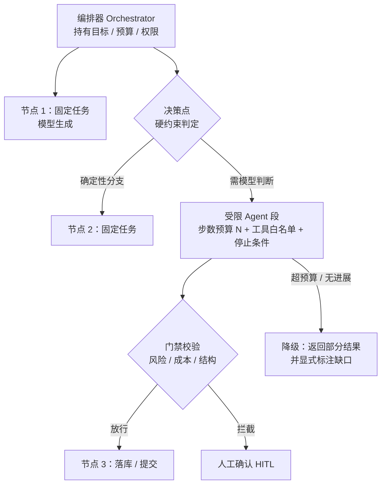

**3. 失败半径决定权限，而非模型强弱**

同一个模型在「生成一段文案」和「改线上代码」上的风险完全不同。选型的第一原则是：**能回滚的放开，不可回滚的收紧**。高风险节点（删除、转账、发消息、改权限）必须落到编排器手里做硬约束或人工确认，不能只靠模型自觉。

---

**规范实现:**

把「骨架固定、血肉生成」落成可执行的编排器骨架：

```typescript
// orchestrator.ts
export interface OrchestrateOptions {
  goal: string;
  maxSteps: number;              // 受限 Agent 段的步数预算
  toolAllowlist: string[];       // 工具白名单
  requireApproval: (tool: string, args: unknown) => boolean; // 硬门禁
  onPartial: (result: PartialResult) => void;               // 降级出口
}

export async function orchestrate(node: WorkflowNode, opts: OrchestrateOptions) {
  const state = { steps: 0, spent: 0 };
  for (const step of node.steps) {
    if (state.steps >= opts.maxSteps) {
      // 超预算：返回部分结果并显式标注缺口，而不是静默截断
      opts.onPartial({ done: false, reason: 'budget-exhausted', state });
      return { done: false };
    }
    const call = await step.plan(state);
    if (opts.requireApproval(call.tool, call.args)) {
      const ok = await humanGate(call);           // 人工确认点
      if (!ok) { opts.onPartial({ done: false, reason: 'rejected' }); return { done: false }; }
    }
    const out = await step.execute(call, state);
    state.steps += 1;
    if (out.stop) return { done: true, result: out.result };
  }
  return { done: true };
}
```

编排器与模型的职责边界要写死在代码结构里，而不是写在提示词里：**模型只产出「动作意图」，动作是否合法由编排器判定**。这样即使模型被提示注入诱导，权限边界仍在代码层。

---

**面试官视角:**

**考察意图:**
考察候选人是否具备「把不确定性关进笼子里」的工程判断力。高分回答必须能给出**可观测的切换信号**和**失败半径**两条硬依据，而不是泛泛地讲「看场景」。

**深度追问链:**
1. **追问 1**: 你的项目里 Agent 说要自主决策，实际却用了固定 Workflow 编排，这个矛盾怎么解释？
   - *答题切入点*: 承认这是刻意的设计取舍——自主性用在「步骤分叉不可枚举」的节点，固定编排用在「可枚举且高频」的节点；同时给出当时的判据（失败可枚举性、失败半径）与观测数据（编排化后成功率与成本的变化）。
2. **追问 2**: 怎么让模型在编排里不越权？
   - *答题切入点*: 权限判定放在编排器代码层而非提示词；工具白名单 + 参数 schema 校验 + 风险分级 + 人工门禁；模型输出只作为「意图」，由宿主校验后执行。
3. **追问 3**: 受限 Agent 段应该给多少步数预算？
   - *答题切入点*: 由「单步成功率」推算——若单步成功率为 p，则 n 步全对概率约 p的n 次方；据此反推在目标成功率（如 0.8）下允许的最大步数，并配合无进展检测提前熔断，而不是拍一个固定值。

---

**延伸阅读:**
- [Anthropic: Building Effective Agents（工作流与自主性的权衡）](https://www.anthropic.com/research/building-effective-agents)
- [OpenAI Agents SDK（Guardrails / Handoffs / 步数控制）](https://openai.github.io/openai-agents-python/)
- [Google: Agent2Agent 协议（多 Agent 交接与委派语义）](https://a2a-protocol.org/latest/)

</Answer>

---

## 多个 Agent 并发协作时，如何处理调度冲突、输出冲突和子 Agent 失败？ {#p0-multi-agent-conflict-resolution}

<Answer>

**核心结论:**

三类冲突必须用三套不同机制解决，混为一谈是线上事故的主要来源：

1. **调度冲突（多个 Agent 同时争用同一资源/文件）** → **互斥与租约**。优先用**乐观并发**（版本号 / ETag / 文件哈希 + 冲突后重算），只有当操作不可重放或代价极高时才上**悲观锁**（分布式锁 + 租约超时 + 续期）。
2. **输出冲突（多个 Agent 对同一结论给出不同答案）** → **证据优先 + 仲裁**。每个结论必须携带可回溯的证据引用（文件路径 + 行号、接口返回、检索片段），仲裁者在证据上判优，**绝不能「最后写入者胜」或「多数票」了事**。
3. **失败传播（子 Agent 挂掉 / 超时 / 返回空）** → **超时 + 熔断 + 降级**。部分结果可用的场景返回部分结果并**显式标注缺口**，让上游知道哪些结论没有证据支撑。

**分布式锁不是万能解**：锁粒度过大就退化成串行，租约过期会脑裂，时钟漂移会误判。「能用版本号解决就不要用锁」是这条考点最想听到的判断。

---

**原理解析:**

**1. 三类冲突的判定与处理**

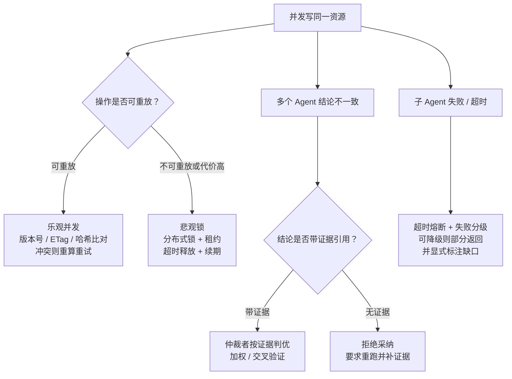

**2. 乐观并发 vs 悲观锁**

| 维度 | 乐观并发（版本号） | 悲观锁（分布式锁） |
| :--- | :--- | :--- |
| 冲突假设 | 冲突少，撞上再重算 | 冲突多，需串行化 |
| 吞吐 | 高，无锁开销 | 低，锁成为串行点 |
| 失败模式 | 重试次数失控 | 租约过期脑裂、锁泄漏 |
| 适合 | 文本/代码编辑、配置合并 | 支付扣减、库存扣减、独占资源 |
| 关键配套 | 重试上限 + 指数退避 | 唯一持有者确认 + 续期 + 兜底释放 |

**3. 输出冲突为什么必须以证据为准**

多数投票在 Agent 场景下有个致命前提：多个 Agent 共享同一份上下文和同一类错误倾向时，**它们会一起错**——多数票会稳定地收敛到错误答案。所以仲裁的依据必须是**彼此独立的证据**（不同数据源、不同的检索路径、确定性校验如类型检查/单测/Schema 校验），而不是「几个 Agent 都这么说」。

**4. 失败传播的常见错误**

- 用同一个重试策略对待所有失败：可重试（网络抖动）与不可重试（参数非法）混在一起，重试风暴会拖垮整个 Agent 集群。
- 失败后静默返回空结果：上游无法区分「确实没有」和「执行失败了」，错误会在链路里被放大。

---

**规范实现:**

以「多个 Agent 并发改同一份代码」为最小场景，实现乐观并发 + 证据仲裁 + 失败降级：

```typescript
// multi-agent-coordination.ts
export interface AgentClaim {
  agentId: string;
  conclusion: string;
  evidence: Array<{ uri: string; range?: [number, number]; excerpt: string }>;
}

export interface Verdict {
  winner: AgentClaim | null;
  reason: string;
  gapNotice?: string; // 降级时显式标注的证据缺口
}

export async function arbitrate(claims: AgentClaim[], verify: (c: AgentClaim) => Promise<boolean>): Promise<Verdict> {
  // 1) 过滤掉没有证据的结论：无证据不得参与仲裁
  const withEvidence = claims.filter(c => c.evidence.length > 0);
  if (withEvidence.length === 0) {
    return { winner: null, reason: 'no-evidence', gapNotice: '所有候选结论均缺少可回溯证据，需重跑并补齐引用' };
  }
  // 2) 确定性校验优先：能用规则判定的，不要交给模型判
  const verified: AgentClaim[] = [];
  for (const c of withEvidence) {
    if (await verify(c)) verified.push(c);
  }
  if (verified.length === 1) return { winner: verified[0], reason: 'only-verified-candidate' };
  if (verified.length === 0) {
    return { winner: null, reason: 'verification-failed', gapNotice: '全部候选未通过确定性校验' };
  }
  // 3) 仍有多解时，交由仲裁者基于证据裁决，并保留分歧
  const winner = verified[0];
  return { winner, reason: 'evidence-based-arbitration', gapNotice: `存在 ${verified.length} 个通过校验的候选，需人工复核` };
}

export async function editWithOptimisticLock(
  fileUri: string,
  expectedVersion: string,
  apply: (content: string) => string,
  maxRetry = 3
): Promise<{ ok: boolean; version?: string; content?: string }> {
  for (let attempt = 0; attempt < maxRetry; attempt++) {
    const current = await readFileWithVersion(fileUri); // { version, content }
    if (current.version !== expectedVersion) {
      return { ok: false }; // 版本冲突：交由上层重算，交给锁之前先重读
    }
    const next = apply(current.content);
    const committed = await writeFileIfVersionUnchanged(fileUri, current.version, next);
    if (committed) return { ok: true, version: committed, content: next };
    // 提交失败说明期间有他人写入：重新读取并重算，而非加锁
  }
  return { ok: false };
}
```

配套规约：**结论必须带证据引用**（这既是仲裁的前提，也是人工复核的入口）；**失败必须分三级**（可重试 / 需重规划 / 需人工），三级走三条不同的恢复路径。

---

**面试官视角:**

**考察意图:**
这是多 Agent 协作方向的经典深水区题，考察候选人是否真正处理过并发写入与冲突消解，还是只停留在「主 Agent 调子 Agent」的串行心智模型。评分重点在**是否会区分三类冲突**，以及**能否说清乐观并发与分布式锁的适用边界**。

**深度追问链:**
1. **追问 1**: 多个 Agent 同时改同一个文件，你第一反应是上分布式锁吗？
   - *答题切入点*: 不。先判断操作是否可重放——代码/文本编辑通常可重放，用版本号 + 冲突重算更划算（无锁开销、冲突少时吞吐更高）；只有扣减类不可逆操作才考虑悲观锁，并补齐租约续期与脑裂兜底。
2. **追问 2**: 三个 Agent 给出三个不同答案，票数是 2 比 1，你采信多数吗？
   - *答题切入点*: 不一定。多数票的前提是错误彼此独立，若三者是同一模型、同一上下文、同一类提示词，它们会一起错；应先做确定性校验（Schema / 单测 / 规则），校验后仍多解才仲裁，且仲裁依据必须是独立证据而非一致性。
3. **追问 3**: 子 Agent 超时了，你返回什么？
   - *答题切入点*: 按失败分级处理——可重试走带抖动的指数退避且设上限，不可重试立刻失败上报；能降级则返回部分结果，但必须在结果里显式标注哪些结论缺失证据，绝不静默返回空。

---

**延伸阅读:**
- [Google: Agent2Agent 协议（委派与任务状态语义）](https://a2a-protocol.org/latest/)
- [Model Context Protocol 规范（工具调用与错误码约定）](https://modelcontextprotocol.io/)
- [Martin Kleppmann《Designing Data-Intensive Applications》分布式锁与脑裂章节](https://dataintensive.net/)

</Answer>

---

## 让两个 Agent 互相挑错来提升准确性，怎么设计才不是「互相附和」？ {#p0-debate-agent-verification}

<Answer>

**核心结论:**

辩论要有价值，必须满足**信息不对称**。两个 Agent 若共享同一份上下文、用同一个模型、同一条检索路径，它们不会互相纠错，只会**互相强化同一个错误**——这是把辩论当正确性保障时最危险的误区。

三个必要设计点：

1. **角色不对称**：一方是「提出者」（构造主张），一方是「证伪者」（只负责找反例，不负责给结论）；
2. **证据不对称**：证伪方必须基于**不同的证据来源**（不同检索库、不同文件、不同数据源）去攻击，不能只是复述对方的论证；
3. **收敛判据可证伪**：证伪方必须给出**可复现的反例**才能判定驳回；拿不出反例只能记「未证伪」，**不能默认通过**。

**关键工程细节**：必须**并行独立生成**后再交换意见。串行辩论会让后一个 Agent 被前一个的结论锚定（anchoring），收敛速度快了，但准确率反而下降。

---

**原理解析:**

**1. 为什么串行辩论会退化**

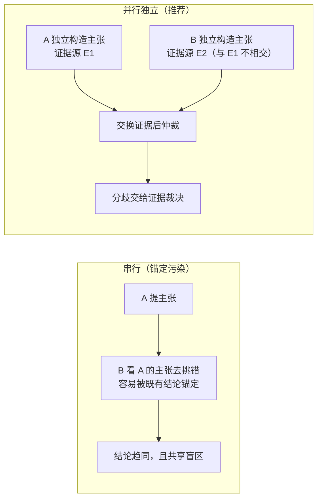

**2. 信息不对称的三个来源**

| 不对称维度 | 做法 | 目的 |
| :--- | :--- | :--- |
| 证据源 | 不同检索库 / 不同文件 / 不同数据源 | 避免共享同一错误 |
| 角色 | 提出者 vs 证伪者（证伪者不负责给结论） | 避免锚定与折中 |
| 模型 | 尽量不同模型或不同温度 | 避免同一偏好系统性偏移 |

**3. 收敛判据必须可证伪**

「未找到反例」和「确认正确」是两件不同的事。工程上必须区分三种终态：

- **已驳回**：证伪方给出可复现的反例（反例输入 + 实际输出 + 期望输出）；
- **未证伪**：证伪方在给定的证据源与预算内没找到反例——**不等于正确**，只代表「本轮未被推翻」；
- **待人工**：双方证据冲突且无法自动裁决。

把「未证伪」直接当成「通过」，是辩论机制最容易被绕过的地方。

**4. 成本与适用范围**

辩论把 Token 成本乘以轮数（双方 × 轮次），且时延同步放大。因此它应当是**分层策略的一层**：

- 低风险 + 有确定性校验（类型、Schema、单测）→ 不辩论，直接用确定性校验，成本近乎为零；
- 中风险 + 证据可查 → 单 Agent + 事后抽检；
- 高风险 + 事实性结论 → 才走辩论，且限定轮数与预算。

---

**规范实现:**

```typescript
// debate.ts
export interface DebateRound {
  claim: string;
  evidence: Array<{ source: string; locator: string; excerpt: string }>;
  counterExample?: { input: string; actual: string; expected: string }; // 可复现反例
}

export type VerdictKind = 'rejected' | 'not-falsified' | 'needs-human';

export async function debate(
  claim: string,
  finder: (c: string) => Promise<DebateRound[]>,
  reproduce: (ce: DebateRound['counterExample']) => Promise<boolean>,
  budget: { maxRounds: number; maxSources: number }
): Promise<{ kind: VerdictKind; reason: string }> {
  const rounds = await finder(claim);
  for (const r of rounds) {
    if (!r.counterExample) continue;
    // 反例必须可复现，才算真正驳回
    if (await reproduce(r.counterExample)) {
      return { kind: 'rejected', reason: `反例可复现：${r.counterExample.input}` };
    }
  }
  if (rounds.length >= budget.maxRounds) {
    return { kind: 'needs-human', reason: '达到轮次预算且未产出可复现反例' };
  }
  // 关键：未找到反例 != 正确
  return { kind: 'not-falsified', reason: `在 ${rounds.length} 个证据源内未找到可复现反例，不代表结论正确` };
}
```

调度上的两个硬约束：**生成阶段并行、交换阶段串行**；以及**证伪方的证据源集合与提出方不相交**——这个约束需要由编排器强制，而不是靠提示词请求。

---

**面试官视角:**

**考察意图:**
考察候选人是否理解「多 Agent 不等于更强的正确性」。高分回答必须点破**共享上下文 + 同模型 = 互相强化错误**这一机制，并给出**信息不对称**与**可证伪收敛判据**两条设计原则。

**深度追问链:**
1. **追问 1**: 两个 Agent 用同一个模型、同一份文档，辩论还有意义吗？
   - *答题切入点*: 意义有限。共享输入时它们的错误高度相关，多数票会稳定收敛到错误答案；最多能提高表述清晰度，不能提高事实正确率。要提升正确率必须引入独立证据源或独立模型。
2. **追问 2**: 证伪方怎么证明它真的找过，而不是随便说「没找到问题」？
   - *答题切入点*: 要求证伪方输出**可复现的反例三元组**（输入 + 实际输出 + 期望输出）并由独立执行器复现验证；拿不出反例只能记「未证伪」，与「通过」严格区分。
3. **追问 3**: 辩论的 Token 成本怎么控制？
   - *答题切入点*: 分层策略——能用确定性校验（类型/Schema/单测）就不辩论；低风险走单 Agent + 抽检；只对高风险事实性结论走辩论，并设轮次与证据源预算，超预算转人工。

---

**延伸阅读:**
- [Model Context Protocol 规范（工具与资源为独立证据源的扩展方式）](https://modelcontextprotocol.io/)
- [Google: Agent2Agent 协议（Agent 间任务委派与状态同步）](https://a2a-protocol.org/latest/)
- [Anthropic: Building Effective Agents（组合模式与校验环节）](https://www.anthropic.com/research/building-effective-agents)

</Answer>

---

## 要同时跑上千个 Agent 沙箱实例，资源池和调度怎么设计？沙箱怎么选型？ {#p0-agent-sandbox-pool-scheduling}

<Answer>

**核心结论:**

**1. 沙箱选型看三件事**：是否执行不可信代码、是否需要强隔离、启动延迟预算。

| 隔离层级 | 机制 | 隔离强度 | 冷启动 | 适用 |
| :--- | :--- | :--- | :--- | :--- |
| 进程级 | 子进程 + seccomp / namespace | 弱（逃逸风险高） | 毫秒 | 自有可信代码、纯计算 |
| 容器级 | 容器 + cgroup + capability | 中 | 十~百毫秒 | 受控代码、一般工具执行 |
| microVM 级 | Firecracker / gVisor | 强（硬件级隔离） | 百毫秒~秒 | **不可信代码、第三方插件、公开执行服务** |

Agent 场景默认要执行模型生成的代码，因此**至少容器级，公开服务应上 microVM**。

**2. 资源池要按「形状」切分，而不是平均分配**：CPU 密集（编译、跑测试）、IO 密集（等待外部 API）、内存密集（大上下文、长时任务）三类负载的瓶颈完全不同，混在一个池里必然出现「IO 任务占着 CPU 配额空转」。

**3. 调度的真正瓶颈是冷启动，不是算力**：每次任务现拉镜像，现宿主机会让 P99 时延完全失控。必须做 **warm pool 预热 + 快照恢复 + 抢占式回收**。

**4. 沙箱状态不可信**：沙箱内的文件、进程、内存都不能作为续跑依据；断点续跑必须把状态外置到编排器侧。

---

**原理解析:**

**1. 调度器拓扑**

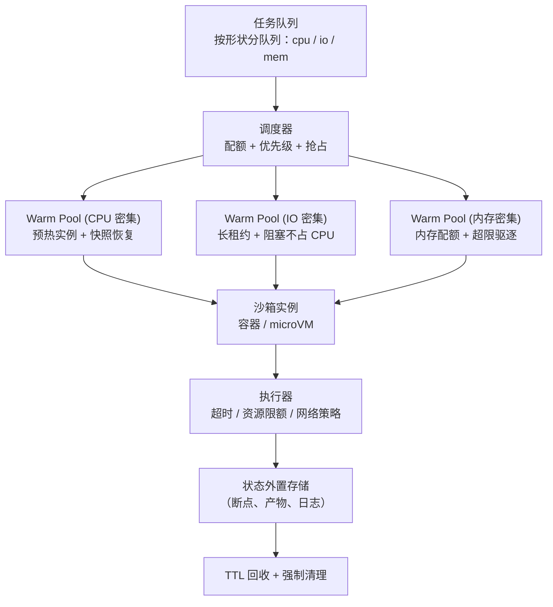

**2. 为什么「平均分配」必然失败**

一个池里既有「跑 30 秒编译」的任务，也有「等外部 API 返回 10 分钟」的任务。固定配额下，等待型任务会长时间占着内存与 CPU 配额而不产生计算，表现为**整体 P99 变差但 CPU 利用率不高**。因此隔离维度必须对应**瓶颈资源**：等待型单独排队、计算型按核数分配、内存型按内存配额分配。

**3. 冷启动的量级问题**

现拉镜像的启动开销通常是数十到数百毫秒，一旦并发上千，镜像仓库限流、存储 IO 与网络都会成为新的瓶颈，成为真正的 P99 杀手。工程手段是 **warm pool 预热 + 快照（snapshot/restore）+ 按形状预留实例**。

**4. 安全基线（沙箱必须默认不可信）**

- 默认**禁网**，只放通白名单出口（模型 API、必要的包仓库）；
- 禁挂载宿主机敏感路径，只挂临时工作目录；
- 每次任务结束销毁实例，状态全部外置；
- 设置 CPU / 内存 / 墙钟时间三重限额，任一超限即终止并回收。

---

**规范实现:**

```typescript
// sandbox-scheduler.ts
export type WorkloadShape = 'cpu' | 'io' | 'mem';

export interface SandboxSpec {
  shape: WorkloadShape;
  cpuMillicores: number;
  memoryMb: number;
  wallClockMs: number;
  networkEgress: string[];   // 白名单出口，默认空
  image: string;
}

export interface SandboxHandle {
  id: string;
  run<T>(cmd: string[], opts?: { timeoutMs?: number }): Promise<{ exitCode: number; stdout: string; stderr: string }>;
  destroy(): Promise<void>;
}

export interface Scheduler {
  acquire(spec: SandboxSpec): Promise<SandboxHandle>;
}

export function createScheduler(pools: Record<WorkloadShape, SandboxHandle[]>, limits: {
  maxPerShape: Record<WorkloadShape, number>;
  warmTarget: number;
}): Scheduler {
  return {
    async acquire(spec) {
      const pool = pools[spec.shape];
      // 1) 优先复用 warm 实例（快照恢复，避免冷启动）
      const reusable = pool.find(s => !s.busy);
      if (reusable) {
        reusable.busy = true;
        await reusable.restore();          // 快照恢复，而非重新拉镜像
        return wrapWithLimits(reusable, spec);
      }
      // 2) 池空则受限新建；新建失败不无限重试，转排队
      if (pool.length < limits.maxPerShape[spec.shape]) {
        const fresh = await createSandbox(spec.image);
        pool.push(fresh);
        return wrapWithLimits(fresh, spec);
      }
      // 3) 超出配额：排队等待并施加背压，而不是无限创建
      await backoff(spec.shape);
      return createScheduler(pools, limits).acquire(spec);
    }
  };
}

// 三重限额：任一超限立即终止并回收
function wrapWithLimits(handle: SandboxHandle, spec: SandboxSpec): SandboxHandle {
  return {
    id: handle.id,
    run: (cmd, opts) => handle.run(cmd, { timeoutMs: opts?.timeoutMs ?? spec.wallClockMs }),
    destroy: async () => { await handle.destroy(); handle.busy = false; }
  };
}
```

**关键约定：状态必须外置。** 沙箱实例在任务之间可被销毁重建，续跑所需的中间产物、对话状态、任务进度一律写入外部存储（对象存储 / KV），由编排器在恢复时重新注入沙箱。

---

**面试官视角:**

**考察意图:**
考察候选人是否具备「把 Agent 当生产系统来运维」的意识。高分回答必须区分**隔离层级**（进程/容器/microVM）并说明选择依据，同时指出**冷启动与资源形状**才是规模化调度的真正难点。

**深度追问链:**
1. **追问 1**: 用户上传的代码让 Agent 执行，沙箱选什么隔离级别？
   - *答题切入点*: 至少容器级并默认禁网、只放通白名单出口；面向多租户公开服务时上 microVM（Firecracker / gVisor）；同时说明进程级隔离对不可信代码不够的原因（逃逸面与内核共享）。
2. **追问 2**: 并发从 100 涨到 1000，延迟先崩了，你会先查什么？
   - *答题切入点*: 先看冷启动占比（镜像拉取、存储 IO、镜像仓库限流）而不是先看 CPU；再看资源形状是否混池导致等待型任务占用配额；措施是 warm pool + 快照恢复 + 按形状分池。
3. **追问 3**: 任务执行到一半机器挂了，怎么续跑？
   - *答题切入点*: 沙箱状态不可信，不能指望实例自愈；必须把断点、产物、日志外置到编排器侧，实例重建后由编排器重新注入状态；同时用幂等设计保证重放安全。

---

**延伸阅读:**
- [Firecracker（microVM 隔离）官方文档](https://firecracker-microvm.github.io/)
- [gVisor 官方文档（用户态内核沙箱）](https://gvisor.dev/docs/)
- [Model Context Protocol 规范（代码执行类工具的权限与审计约定）](https://modelcontextprotocol.io/)

</Answer>

---

## Agent 跑了 20 分钟还没结束，用户等不及了怎么停？超时该怎么设？ {#p0-agent-timeout-and-user-interrupt}

<Answer>

**核心结论:**

「超时」不是给整条链路配一个数字，而是**三层预算**；「停止」也不是简单地杀掉进程，而是**先落盘再停**。四个要点：

1. **三层超时预算**：**单步超时**（一次工具调用，防止单个挂死调用拖垮全链）、**阶段超时**（一段规划或一个阶段的墙钟）、**整体墙钟超时**（整个任务的 deadline）。用户感知的是第三层，但它必须由上往下分配而来。
2. **预算自上而下切分**：整体预算先切给各阶段，阶段再切给单步；子级预算之和不得超过父级，并且要预留模型思考与断点落盘的时间——预算耗尽时如果没时间写状态，续跑能力就废了。
3. **渐进式提醒，而不是到点就砍**：先用软提示（「还需要约 3 分钟，继续吗？」）征询用户，用户明确取消再硬中断；硬中断**必须先落盘 checkpoint** 再停，否则「停止」等于「丢失」。
4. **用户取消与系统超时语义不同**：用户取消是主动意图——立即停、保留部分结果、明确告知「已完成到哪一步、产物在哪」；系统超时是兜底——先落盘、标记为可续跑，等下次机会接上。
5. **挂起时间不计入预算**：等待人工审批（HITL）时任务处于挂起态，这段时间**不应消耗墙钟预算**，否则人下班去审批，任务就被误判超时杀掉；审批本身另有 SLA。

---

**原理解析:**

**1. 三层预算的层级关系**

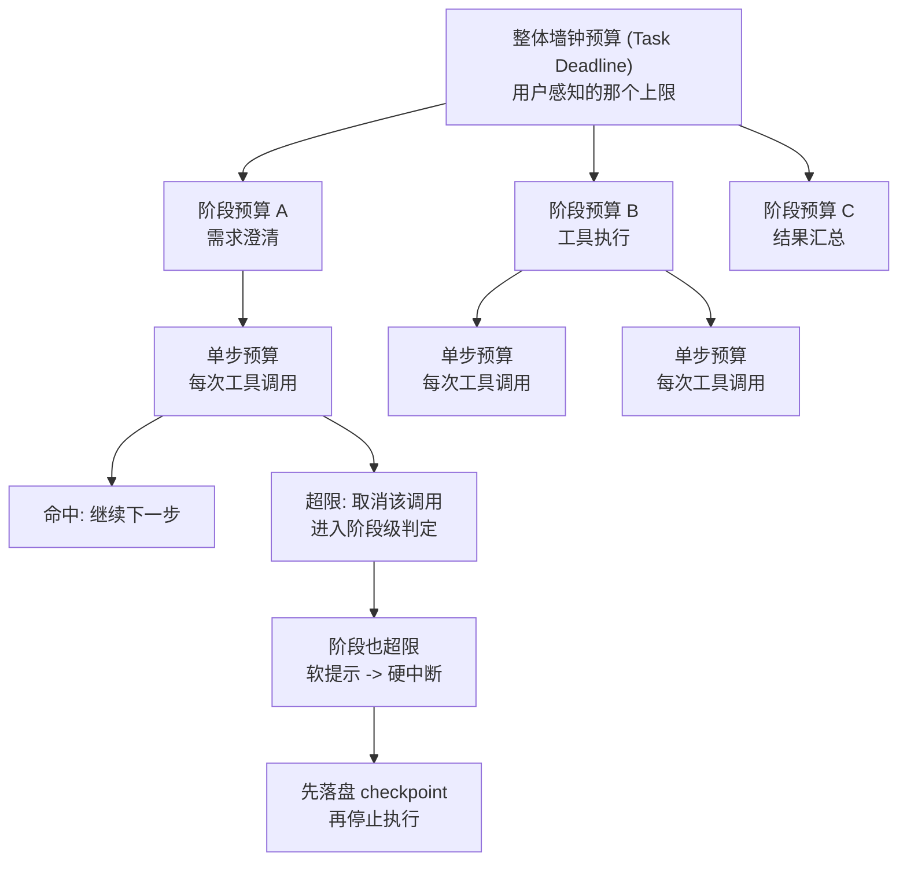

**2. 为什么一个总超时不够**

单一超时值无法回答「时间到底浪费在哪」。三层预算让超时变成**可定位的信号**：单步超时说明某个工具挂死了（多半是下游问题）；阶段超时说明这个阶段的计划太大或卡在某个环节；整体超时说明任务规模本身超出预期，该考虑拆任务或改异步模式。把三者混成一个数，出问题时只知道「超时了」，不知道该修哪里。

**3. 取消信号的传播路径**

用户点了「停止」，这个意图必须**穿透整条链路**才能真正停下：前端取消按钮 → 编排器（收到 `AbortSignal`）→ 正在执行的工具调用（中断 HTTP 请求或终止进程）→ 沙箱实例（销毁或归还资源池）→ 已挂起的 HITL 审批（撤销 pending 请求）。只在前端停止接收流式输出，任务其实还在后台跑——这是最常见的「假取消」。

**4. 挂起时钟的暂停与恢复**

HITL 审批是「等人」，不是「在算」。工程做法是把任务状态机显式建模为 `running / suspended / cancelled / finished` 四个状态之一：进入 `suspended` 时**暂停**墙钟计时与预算扣减，恢复时按暂停时长回补预算。否则一个「等人审批 4 小时」的任务，会在人回来之前就被超时杀掉。

**5. 与「重试风暴」的边界**

重试风暴处理的是**下游错误**（失败后怎么重试、怎么退避、怎么熔断）；本题处理的是**任务生命周期与用户意图**（谁来终止、什么时候终止、终止时留下什么）。两者的交点是：重试消耗的预算必须计入同一套预算，否则一个卡死的下游能把整个任务耗到超时。

---

**规范实现:**

```typescript
// agent/timeout-budget.ts
export type RunPhase = 'running' | 'suspended' | 'cancelled' | 'finished';

export interface Budget {
  taskDeadlineMs: number;
  phaseDeadlineMs: number;
  stepDeadlineMs: number;
}

export class TimeoutBudget {
  private startedAt = Date.now();
  private pausedAt?: number;
  private pausedTotalMs = 0;

  constructor(private budget: Budget) {}

  // 挂起期间不计入墙钟（等待人工审批不算超时）
  public suspend(): void { this.pausedAt = Date.now(); }
  public resume(): void {
    if (this.pausedAt) { this.pausedTotalMs += Date.now() - this.pausedAt; this.pausedAt = undefined; }
  }

  public elapsedMs(): number { return Date.now() - this.startedAt - this.pausedTotalMs; }
  public taskExpired(): boolean { return this.elapsedMs() > this.budget.taskDeadlineMs; }
  public phaseExpired(phaseStartedAt: number): boolean {
    return Date.now() - phaseStartedAt > this.budget.phaseDeadlineMs;
  }
  public stepExpired(stepStartedAt: number): boolean {
    return Date.now() - stepStartedAt > this.budget.stepDeadlineMs;
  }
}

// 取消信号从编排器穿透到工具与沙箱
export class CancellableRunner {
  private controller = new AbortController();
  private phase: RunPhase = 'running';

  constructor(private budget: TimeoutBudget, private onCheckpoint: (reason: string) => Promise<void>) {}

  public get signal(): AbortSignal { return this.controller.signal; }
  public get currentPhase(): RunPhase { return this.phase; }

  // 用户主动取消：先落盘再停，保留部分结果
  public async cancelByUser(partialResult: string): Promise<void> {
    this.phase = 'cancelled';
    await this.onCheckpoint('user-cancel');   // 先落盘
    this.controller.abort();                   // 再中断
    void partialResult;                         // 部分结果由调用方带回给用户
  }

  // 系统超时：同样先落盘，但标记为可续跑
  public async cancelByTimeout(): Promise<void> {
    this.phase = 'cancelled';
    await this.onCheckpoint('timeout');
    this.controller.abort();
  }

  // HITL 挂起：暂停计时，不消耗预算
  public async waitForApproval(approval: Promise<void>): Promise<void> {
    this.phase = 'suspended';
    this.budget.suspend();
    try {
      await approval;
    } finally {
      this.budget.resume();
      this.phase = 'running';
    }
  }
}
```

**前端侧的配合**：取消按钮必须区分「停止生成」（仅停止流式输出）与「终止任务」（真正取消后端任务，并提供「保留部分结果」的选项）。两者在 UI 上不要用同一个按钮，否则用户会以为任务停了，其实还在后台烧 Token 与算力。

---

**面试官视角:**

**考察意图:**
考察候选人是否理解**长任务的生命周期管理**。高分回答必须能拆出**三层预算**、区分**用户取消与系统超时**、指出**挂起时间不计入预算**，并强调**取消信号要穿透到工具与沙箱**（而不是只在前端停流）。

**深度追问链:**
1. **追问 1**: 超时时间你打算怎么定？
   - *答题切入点*: 不要拍脑袋定一个数；从历史真实分布（各阶段 P95/P99 时延）出发自上而下分配并留余量；单步预算要覆盖正常长尾调用，阶段预算要防止单个阶段吃掉全部时间。
2. **追问 2**: 用户点了停止，后端任务真的停了吗？
   - *答题切入点*: 需要 `AbortSignal` 从编排器穿透到工具调用与沙箱销毁，并且先落盘 checkpoint 再 abort；只停前端流式输出是「假取消」，任务仍在消耗 Token 与算力。
3. **追问 3**: 任务挂在等人工审批，这时要不要计入超时？
   - *答题切入点*: 不计入——挂起态要显式建模并暂停墙钟计时，审批另设 SLA；否则人不在的时候任务会被误杀。同时取消动作要能撤销 pending 的审批请求。

---

**延伸阅读:**
- [MDN: AbortController（取消信号的原生机制）](https://developer.mozilla.org/en-US/docs/Web/API/AbortController)
- [AWS Builders' Library: Timeouts, retries, and backoff with jitter（超时的设计权衡）](https://aws.amazon.com/builders-library/timeouts-retries-and-backoff-with-jitter/)
- [Temporal 官方文档（工作流超时、取消与挂起语义）](https://docs.temporal.io/)

</Answer>

---

## 让 Agent 多次执行同一个任务，结果时好时坏，怎么度量稳定性、定位漂移来源？ {#p0-multi-agent-stability-evaluation}

<Answer>

**核心结论:**

「能跑通」和「稳定」是两件事。一次成功只说明能力够用，**稳定性是多次执行之间的结果方差**。要把它度量出来，先做一次分类：

1. **先分清三种失败**：能力不足（重试就会好）、不稳定（重试结果不一致）、确定性失败（每次都一样地错）。三者的修法完全不同：能力不足要补能力，确定性失败要修 bug/提示词，**不稳定要定位漂移源**。
2. **度量口径要三个维度**，只看成功率会被平均分掩盖：
   - **任务级成功率**：多次执行的通过比例；
   - **结果一致率**：同一输入的多次输出在关键字段上是否等价（不是逐字相同，是语义等价）；
   - **过程方差**：步数、Token 数、工具调用序列的波动。
3. **测稳定性之前必须先固定变量**：把 temperature 降到 0、锁定模型版本与路由、锁定检索快照与工具返回值。**若固定后仍然抖动，才是系统性问题**；否则你测的是采样随机性，不是 Agent 稳定性。
4. **Agent 的不稳定源比普通服务多一层——轨迹分叉**：同样的任务走了不同的工具顺序、不同的记忆写入、不同的重试路径，最终输出就不同。所以定位要靠**轨迹对比（trace diff）**，不能只对比最终答案。

**门禁要卡最差分位**：同一 Golden Case 跑 N 次（如 5 次），要求成功率 ≥ X **且**关键字段一致率 ≥ Y。平均值掩盖波动——「5 次里 4 次对」的平均分是 80%，但用户每 5 次就撞一次。

---

**原理解析:**

**1. 漂移来源的分层排查**

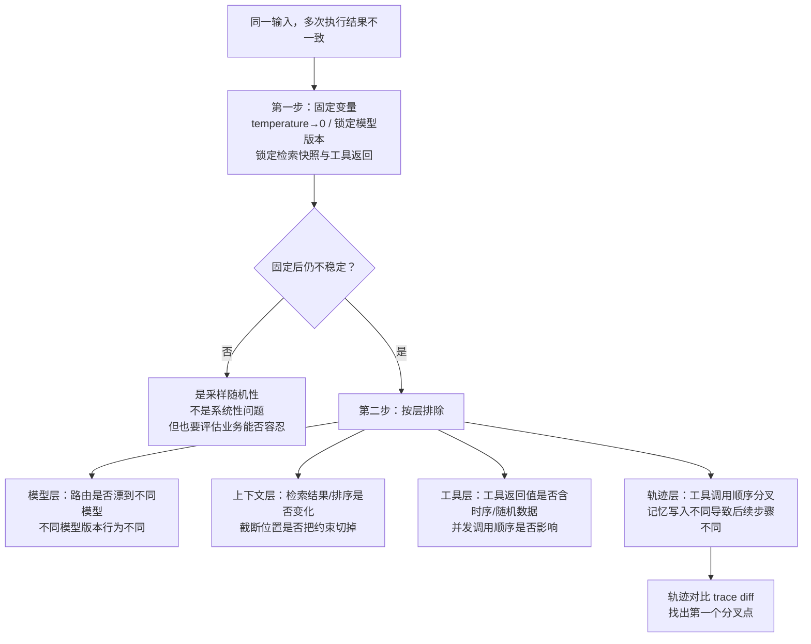

**2. 为什么「固定变量」这一步不能省**

Agent 系统的默认配置就带随机性：采样参数、检索排序的并列打破、工具返回的时间戳与分页游标、并发请求的到达顺序。不固定这些就直接测，你量到的是**这些随机源的方差**，而不是 Agent 决策的稳定性。真实工程里常见的结论是「把 temperature 设 0 后稳定性从 70% 提到 95%」——那说明瓶颈从来不在模型能力，而在配置。

**3. 一致性的判定要比「逐字相同」宽松**

Agent 的自然语言输出逐字不同的概率很高，用字符串相等判一致会得到「几乎不稳定」的荒谬结论。正确的判据是**关键字段/关键结论的等价性**：结构化输出比字段、引用的事实是否一致、是否命中了必需的步骤。关键字段可以事先在用例里声明（`must_match` / `must_not_match` / `must_call_tools`）。

**4. 不稳定和「过度稳定」都要警惕**

输出完全一致但**每次都错**，是确定性失败（更危险，因为成功率 100% 会掩盖它）。所以稳定性门禁必须与**正确性**门禁并存：一致率高但正确率低，说明它稳定地错；正确率高但一致率低，说明它靠运气。

---

**规范实现:**

```typescript
// agent-stability.ts
export interface StabilityCase {
  id: string;
  input: string;
  mustMatch?: string[];        // 关键结论必须出现
  mustNotMatch?: string[];     // 关键结论禁止出现
  mustCallTools?: string[];    // 必须调用过的工具
  expectedFields?: Record<string, unknown>; // 结构化字段的期望值
}

export interface RunResult {
  ok: boolean;
  output: string;
  fields?: Record<string, unknown>;
  toolsCalled: string[];
  steps: number;
  tokens: number;
}

export interface StabilityReport {
  caseId: string;
  runs: number;
  successRate: number;         // 任务级成功率
  consistencyRate: number;     // 关键字段一致率
  stepSpread: number;          // 步数方差
  firstDivergenceStep?: number; // 轨迹首个分叉点
}

// 1) 判定单次结果是否符合期望
export function judge(c: StabilityCase, r: RunResult): boolean {
  if (!r.ok) return false;
  for (const m of c.mustMatch ?? []) if (!r.output.includes(m)) return false;
  for (const m of c.mustNotMatch ?? []) if (r.output.includes(m)) return false;
  for (const t of c.mustCallTools ?? []) if (!r.toolsCalled.includes(t)) return false;
  for (const [k, v] of Object.entries(c.expectedFields ?? {})) {
    if (JSON.stringify(r.fields?.[k]) !== JSON.stringify(v)) return false;
  }
  return true;
}

// 2) 关键字段一致率：以多数结果为基准（语义等价，而非逐字相同）
export function consistency(results: RunResult[]): number {
  if (results.length < 2) return 1;
  const sig = (r: RunResult) => JSON.stringify(r.fields ?? { text: r.output.trim() });
  const counts = new Map<string, number>();
  for (const r of results) counts.set(sig(r), (counts.get(sig(r)) ?? 0) + 1);
  const top = Math.max(...counts.values());
  return top / results.length;
}

// 3) 跑 N 次并出稳定性报告
export async function evaluateStability(
  c: StabilityCase,
  run: (input: string) => Promise<RunResult>,
  n = 5
): Promise<StabilityReport> {
  const results: RunResult[] = [];
  for (let i = 0; i < n; i++) results.push(await run(c.input));
  const passed = results.filter(r => judge(c, r));
  const steps = results.map(r => r.steps);
  const mean = steps.reduce((s, v) => s + v, 0) / (steps.length || 1);
  const variance = steps.reduce((s, v) => s + (v - mean) ** 2, 0) / (steps.length || 1);
  return {
    caseId: c.id,
    runs: n,
    successRate: passed.length / n,
    consistencyRate: consistency(results),
    stepSpread: Math.sqrt(variance)
  };
}

// 4) 门禁：卡最差分位，不用平均值
export function gate(reports: StabilityReport[], minSuccess = 0.8, minConsistency = 0.8): boolean {
  return reports.every(r =>
    r.successRate >= minSuccess && r.consistencyRate >= minConsistency
  );
}
```

**轨迹对比（找第一个分叉点）**的实现要点：把两次执行的工具调用序列按序对齐，找出第一个不同的位置——那一步就是漂移源，而不是把差异平均到全程：

```typescript
export function firstDivergence(a: RunResult, b: RunResult): number | undefined {
  const n = Math.min(a.toolsCalled.length, b.toolsCalled.length);
  for (let i = 0; i < n; i++) {
    if (a.toolsCalled[i] !== b.toolsCalled[i]) return i;
  }
  return a.toolsCalled.length !== b.toolsCalled.length ? n : undefined;
}
```

---

**面试官视角:**

**考察意图:**
考察候选人是否理解**「可用」与「稳定」是两个维度**，以及是否会用**方差与一致率**而不是单次成功率来描述 Agent 质量。高分回答必须包含「先固定变量再测」这一步，以及「定位漂移要看轨迹分叉而非只看最终答案」。

**深度追问链:**
1. **追问 1**: 你的 Agent 上线后成功率 85%，但用户反馈「同一个问题每次答案不一样」，你怎么查？
   - *答题切入点*: 先固定变量（temperature 降到 0、锁模型版本与路由、锁检索快照与工具返回），再重测；若仍不一致，按模型/上下文/工具/轨迹四层排除，并用轨迹对比找第一个分叉点。关键是**先确认抖动来自决策还是来自采样**。
2. **追问 2**: 一致率要卡多少？成功率 100% 就说明稳定吗？
   - *答题切入点*: 一致率与正确率必须并存。成功率 100% 也可能是「稳定地错」——那更危险，会掩盖缺陷。门禁要同时卡成功率与关键字段一致率，且用**多次执行的最差表现**判定，不用平均值。
3. **追问 3**: 稳定性测试要跑多少次才够？
   - *答题切入点*: 次数取决于「允许的失败概率」与「观测到的成功率」。用统计口径反推：在成功率 p 下跑 n 次仍没暴露问题的概率是 (1-p)^n；要把它压到可接受阈值以下，n 才能定下来。实践上关键用例跑 5 次、抽样用例更多次。

---

**延伸阅读:**

- [Model Context Protocol 规范（工具发现与调用契约对轨迹确定性的影响）](https://modelcontextprotocol.io/)
- [OpenAI Agents SDK（Harness 层可复现性与追踪）](https://openai.github.io/openai-agents-python/)
- [Google SRE Book：Handling Overload（错误预算与稳定性目标）](https://sre.google/sre-book/handling-overload/)

</Answer>
