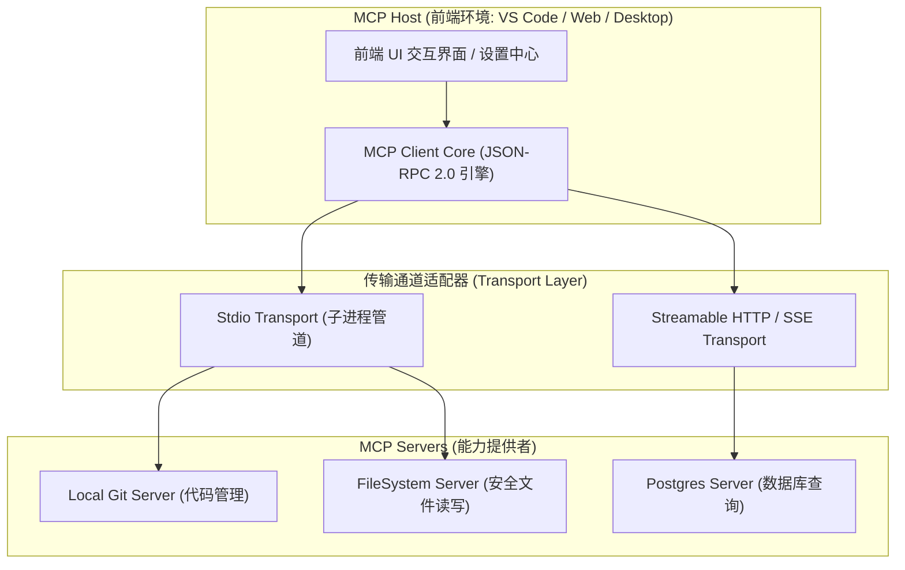
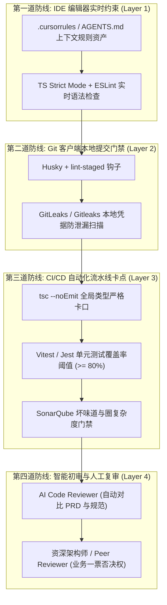
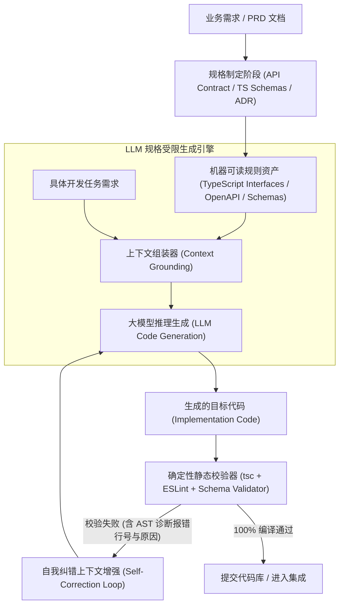
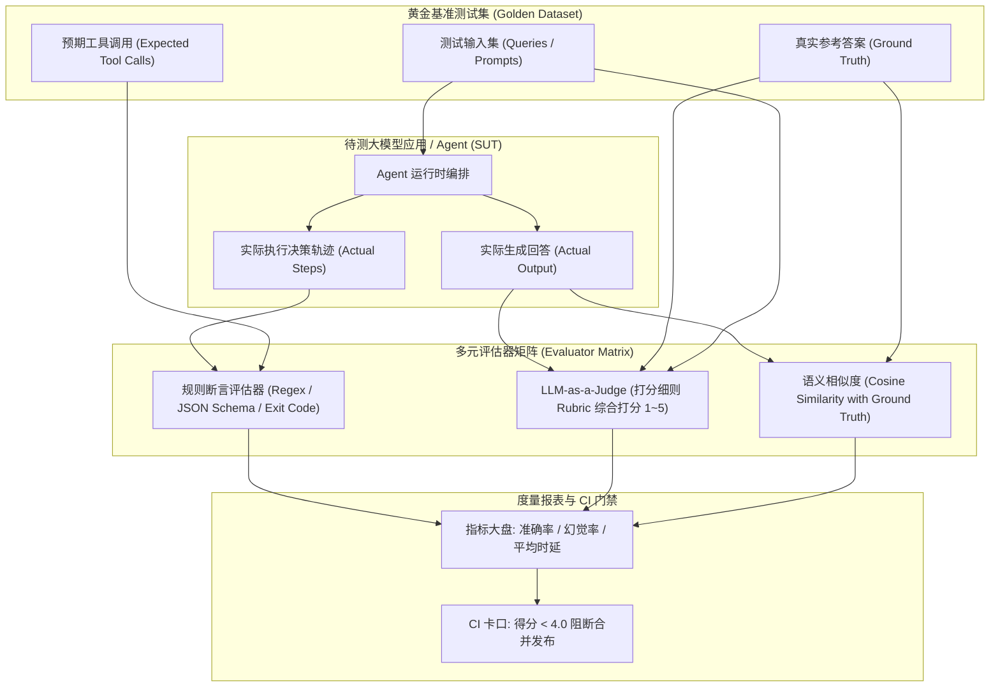
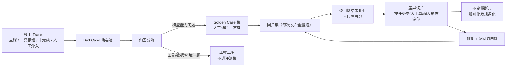
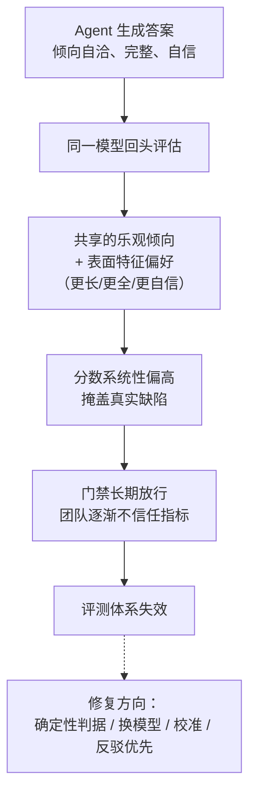
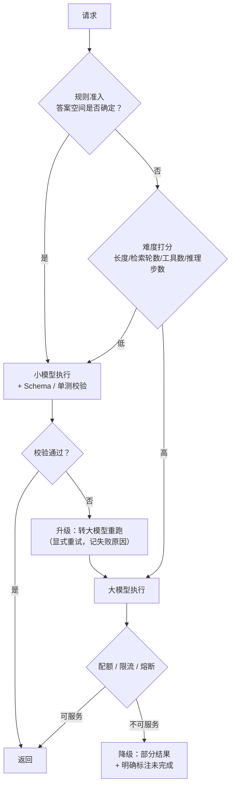
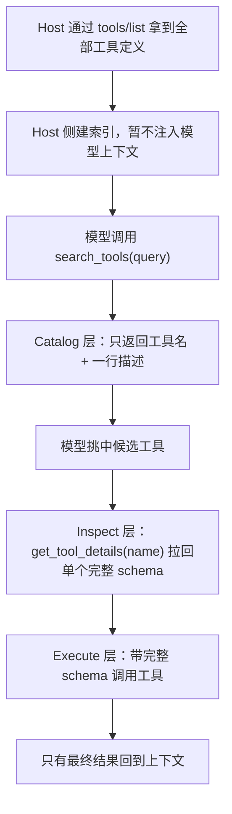
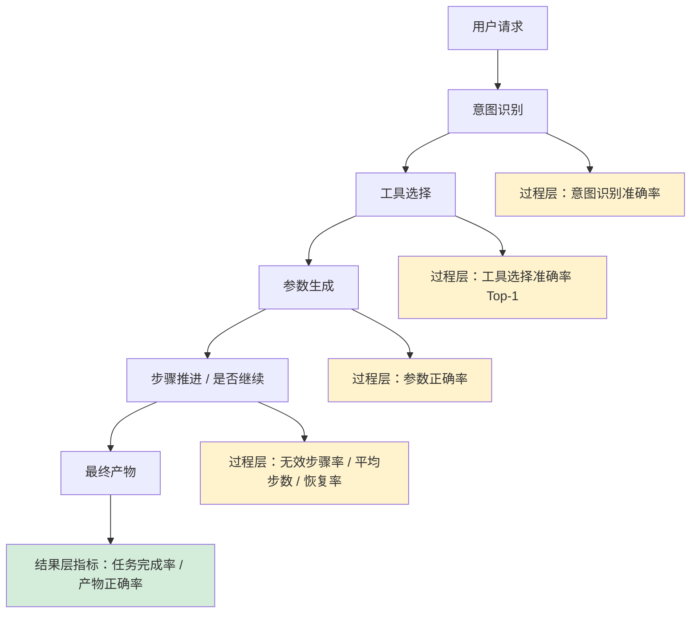
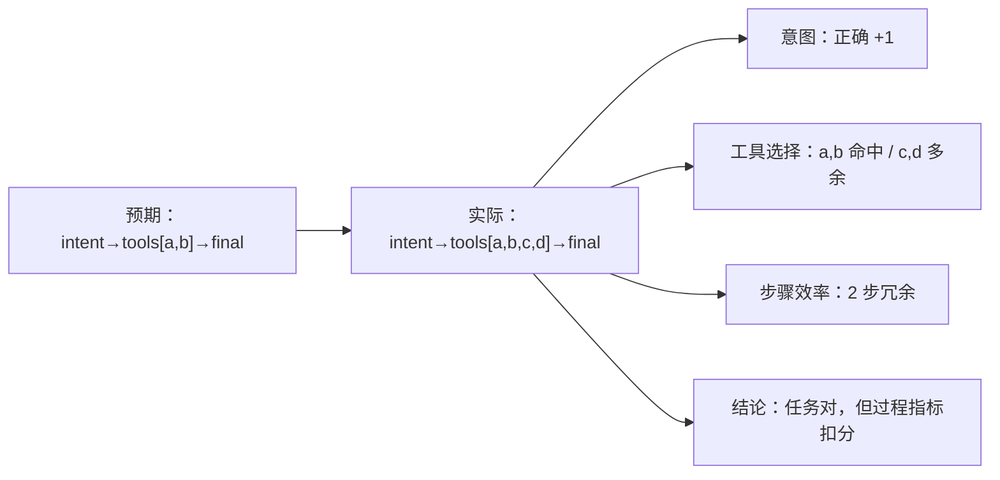

# 协议生态与质量工程 (Protocols & Ecosystem) ✅

本模块系统性梳理大模型前端工程生态链、开放协议与质量治理体系：跨工具通用标准协议 Model Context Protocol (MCP)、AI 辅助编程代码质量门禁与防幻觉机制、规格驱动开发（Spec-Driven Development, SDD）架构闭环以及大模型与 Agent 自动化量化评测体系（Eval Benchmark）。

---

## Model Context Protocol (MCP) 协议在前端是如何工作的？它与传统 Function Calling 有什么区别？ {#p0-mcp-protocol-frontend}

<Answer>

**核心结论:**

**Model Context Protocol (MCP)** 是由 Anthropic 牵头开源的大模型上下文开放协议标准，旨在**终结过去不同大模型平台私有 Function Calling（工具调用）硬编码生态割裂的局面**，成为大模型时代的“USB-C 接口”：
- **解耦模型与工具**：传统 Function Calling 需要宿主将所有可用工具的 JSON Schema 硬编码写死在单次请求的 Payload 中，模型每换一个平台或工具更新就需要改动核心代码；MCP 抽象出标准的 **Host（宿主）- Client（客户端）- Server（能力服务端）** 三层架构；
- **核心能力三要素**：MCP 统一规范了三大基准能力：
  1. **Tools（工具）**：具有副作用的动作执行器（Actionable Functions），支持动态发现与参数校验；
  2. **Resources（上下文资源）**：只读数据文件/知识文档（如本地文件、数据库记录、API Schema），供模型挂载检索；
  3. **Prompts（提示词模板）**：预设的工作流模板与角色指导；
- **前端定位**：在桌面前端（Electron / Tauri / VS Code 插件）或 Web 浏览器中，前端通常作为 **MCP Host** 运行 MCP Client 实例，通过 `stdio`（子进程）或 `SSE / Streamable HTTP`（远程网络服务）与本地/云端各类 MCP Server 建立动态双向 RPC 通信。

---

**原理解析:**

**1. 传统 Function Calling vs MCP 架构对比**

| 对比维度 | 传统 Function Calling (如 OpenAI Tools) | Model Context Protocol (MCP) |
| :--- | :--- | :--- |
| **架构耦合度** | 强耦合。前端需硬编码定义全部工具 Schema 并注入请求体 | **解耦。客户端动态向 MCP Server 发现（`tools/list`）并注册** |
| **生态扩展性** | 每新增一个工具需重新部署核心业务代码 | **即插即用。用户添加 MCP Server 配置即可无缝扩充能力** |
| **通信协议** | 无独立协议，依赖各大厂商各自私有的 REST API 规范 | **标准 JSON-RPC 2.0 协议规范**（跨语言、跨传输层统一） |
| **支持能力范围** | 仅支持可执行函数（Tool Execution） | **涵盖 Tools（调用）、Resources（数据）与 Prompts（模版）** |
| **传输通道** | 仅限 HTTP POST Payload | **支持 Local Stdio（进程输入输出）、SSE、WebSockets 等** |
| **权限与安全隔离** | 权限由后端集中托管，前端感知弱 | **支持细粒度的 Client 授权批准门禁与本地进程沙箱隔离** |

**2. MCP 客户端-服务端协议调用拓扑**



**3. 前端集成 MCP 的核心工作流（以 2026-07-28 规范为准）**

1. **能力发现（Discovery）**：Client 可先调用 `server/discover` 一次性拿到 Server 支持的协议版本、Capabilities 与身份信息；随后用 `tools/list` 与 `resources/list` 动态获取工具清单及对应 JSON Schema；
2. **无状态请求（Stateless）**：**2026-07-28 起取消了 `initialize` / `notifications/initialized` 握手**，每个请求都要在 `_meta` 中携带 `io.modelcontextprotocol/protocolVersion` 与 `io.modelcontextprotocol/clientCapabilities`；
3. **动态 Schema 注入**：前端将发现的 MCP 工具 Schema 转换为大模型支持的 Tool 格式，注入对话上下文；
4. **模型决策与 RPC 派发**：模型触发工具调用时，MCP Client 拦截请求，解析出目标 MCP Server 名称及工具参数，发起 `tools/call` RPC 请求；
5. **执行与安全门禁**：若工具标注为危险操作，MCP Client 挂起执行，唤起前端授权弹窗；获批后将真实调用结果回传给大模型；
6. **多轮往返（MRTR）**：当 Server 需要客户端补充信息（如授权确认）时，返回 `resultType: "input_required"` 的中间结果并携带 `inputRequests`，客户端在**重试原请求**时用 `inputResponses` 回填——这取代了旧版由服务端主动发起 `elicitation/create` 的写法。

> **版本要点（易错）**：MCP 协议版本历史为 `2024-11-05 → 2025-03-26 → 2025-06-18 → 2025-11-25 → 2026-07-28`，当前生效版本为 **2026-07-28**。该版本移除协议级 session 与 `Mcp-Session-Id`、移除握手、移除 `ping` / `logging/setLevel`，并把 **Roots / Sampling / Logging 标记为 Deprecated**（最早移除时间为 2027-07-28 之后的首个修订）；`tasks` 也从核心协议移出，改为官方扩展 `io.modelcontextprotocol/tasks`。新实现不应再使用「客户端通过 `sampling/createMessage` 向服务端请求补全」这类旧写法。


---

**规范代码实现:**

以下为前端基于 TypeScript 实现的轻量标准 MCP 客户端核心（JSON-RPC 2.0 消息抽象与工具调用协议调度）：

```typescript
// mcp/types.ts
export interface JsonRpcRequest<T = Record<string, unknown>> {
  jsonrpc: '2.0';
  id: string | number;
  method: string;
  params?: T;
}

export interface JsonRpcResponse<T = unknown> {
  jsonrpc: '2.0';
  id: string | number;
  result?: T;
  error?: {
    code: number;
    message: string;
    data?: unknown;
  };
}

export interface McpToolSchema {
  name: string;
  description?: string;
  inputSchema: {
    type: 'object';
    properties: Record<string, unknown>;
    required?: string[];
  };
}

// mcp/client.ts
export interface IMcpTransport {
  send(message: JsonRpcRequest): Promise<void>;
  onMessage(handler: (message: JsonRpcResponse) => void): void;
  close(): Promise<void>;
}

export class McpClient {
  private transport: IMcpTransport;
  private pendingRequests = new Map<string | number, {
    resolve: (value: unknown) => void;
    reject: (reason: unknown) => void;
  }>();
  private requestId = 0;
  private cachedTools: McpToolSchema[] = [];

  constructor(transport: IMcpTransport) {
    this.transport = transport;
    this.transport.onMessage(this.handleIncomingMessage.bind(this));
  }

  private handleIncomingMessage(res: JsonRpcResponse): void {
    const handler = this.pendingRequests.get(res.id);
    if (!handler) return;

    this.pendingRequests.delete(res.id);
    if (res.error) {
      handler.reject(new Error(`MCP RPC Error [${res.error.code}]: ${res.error.message}`));
    } else {
      handler.resolve(res.result);
    }
  }

  private sendRpc<T>(
    method: string,
    params?: Record<string, unknown>,
    opts?: { meta?: Record<string, unknown> }
  ): Promise<T> {
    const id = ++this.requestId;
    const request: JsonRpcRequest = {
      jsonrpc: '2.0',
      id,
      method,
      params: opts?.meta ? { ...params, _meta: opts.meta } : params,
    };

    return new Promise((resolve, reject) => {
      this.pendingRequests.set(id, { resolve: resolve as (v: unknown) => void, reject });
      this.transport.send(request).catch(reject);
    });
  }

  // 1. 无状态请求元信息（2026-07-28 起取代 initialize 握手）
  // 协议版本历史（以 modelcontextprotocol/specification 仓的 schema 目录为准）：
  //   2024-11-05 -> 2025-03-26 -> 2025-06-18 -> 2025-11-25 -> 2026-07-28
  // 2026-07-28 关键变更：移除 initialize 握手与协议级 session；
  // Roots / Sampling / Logging 标记 Deprecated；
  // tasks 移出核心协议，改为官方扩展 io.modelcontextprotocol/tasks；
  // 服务端发起请求改为 MRTR（多轮往返）模式。
  private buildMeta(): Record<string, unknown> {
    return {
      'io.modelcontextprotocol/protocolVersion': '2026-07-28',
      'io.modelcontextprotocol/clientCapabilities': {
        extensions: {}, // 2026-07-28 新增：声明对官方扩展的支持
      },
      'io.modelcontextprotocol/clientInfo': {
        name: 'web-interview-mcp-client',
        version: '1.0.0',
      },
    };
  }

  // 2. 能力发现：Server MUST 实现 server/discover
  public async discover(): Promise<{ protocolVersions: string[]; capabilities: Record<string, unknown> }> {
    return await this.sendRpc('server/discover', {}, { meta: this.buildMeta() });
  }

  // 3. 动态发现工具清单（2026-07-28 要求确定性返回顺序，以利 Prompt Cache 命中）
  public async listTools(): Promise<McpToolSchema[]> {
    const response = await this.sendRpc<{ tools: McpToolSchema[] }>('tools/list', {}, { meta: this.buildMeta() });
    this.cachedTools = response.tools;
    return this.cachedTools;
  }

  // 4. 执行特定工具；结果必带 resultType（complete / input_required）
  public async callTool(toolName: string, args: Record<string, unknown>): Promise<unknown> {
    return await this.sendRpc('tools/call', { name: toolName, arguments: args }, { meta: this.buildMeta() });
  }
}
```

> **MRTR 的处理方式**：当 `resultType` 为 `input_required` 时，服务端会在 `inputRequests` 里带上它需要的信息（例如授权确认）。客户端完成交互后，**重试原请求**并在 `inputResponses` 中回填，而不是让服务端主动发起 `elicitation/create`。


---

**面试官视角:**

- **考察深度**:
  1. 候选人是否紧跟 2025-2026 年大模型体系最前沿的标准演进（Anthropic MCP 协议对整个行业标准格局的统一推动）；
  2. 能否从本质原理上讲清楚“为什么硬编码 Function Calling 会让复杂多工具系统难以维护”，以及 MCP 如何通过三层解耦解决问题；
  3. 对 JSON-RPC 2.0、基于流的传输通道（stdio / SSE）、客户端动态能力发现有无深入理解。
- **下探追问链**:
  - *追问 1*：在 Web 纯浏览器环境中，由于浏览器沙箱限制，前端无法直接派生子进程开启 `stdio` 管道连接本地 MCP Server，这种情况下前端通常如何集成 MCP？
  - *追问 2*：如果多个 MCP Server 提供了重名的 Tool（命名空间冲突），前端 Client 应该如何设计命名隔离与路由转发？
  - *追问 3*：MCP 协议在 2026-07-28 做了哪些破坏性变更？你的客户端要怎么改？
    - *答题切入点*：取消 `initialize` 握手改为每请求在 `_meta` 携带协议版本与客户端能力、移除协议级 session 与 `Mcp-Session-Id`、新增 `server/discover`、Roots / Sampling / Logging 进入 Deprecated、`tasks` 降级为官方扩展、服务端发起请求改为 MRTR（`resultType: "input_required"` + 重试原请求回填 `inputResponses`）。

---

**延伸阅读:**

- Model Context Protocol (MCP) Official Documentation (Anthropic)
- Claude Desktop MCP Architecture & Open-Source Server Catalog
- JSON-RPC 2.0 Specification Standard
</Answer>

---

## 团队引入 Cursor / Copilot / Claude Code 后，如何建立代码质量门禁（Quality Gate）与防范幻觉？ {#p0-ai-coding-quality-gate}

<Answer>

**核心结论:**

在研发团队全员引入 Cursor、Copilot、Claude Code 等 AI 编程助手后，虽然整体代码产出速度提升了 30%~50%，但同时也引入了**三大隐蔽工程风险**：
1. **API 虚构与幻觉（Hallucination）**：模型频繁使用已被废弃（Deprecated）或凭空捏造的私有方法；
2. **代码风格与架构模式漂移**：缺少全局架构感知的碎片化生成导致圈复杂度飙升、类型注解退化为 `any`；
3. **安全漏洞与凭证泄露**：模型在补全时可能引入未校验的输入注入漏洞，甚至误将开发者的本地 Token 写入代码；
因此，**建立一套端到端的四层质量纵深防御门禁（Quality Gate）是防止代码库快速腐化的关键护城河**。

---

**原理解析:**

**1. AI 编程代码质量四层纵深防御拓扑**



**2. 核心防御机制拆解**

- **Layer 1: IDE 实时约束与上下文供给**：
  - 在项目根目录维护 `.cursorrules`、`CLAUDE.md` 或统一的 Agent 规则清单，明确规定技术栈版本（如 Vue 3.5 / React 19 / Vite 8）、禁止使用的库（如禁用 Moment.js）、代码结构规范。从源头缩小大模型的采样空间，抑制幻觉产生；
- **Layer 2: Git Hook 增量安全卡口**：
  - 通过 `lint-staged` 对暂存区变更文件执行严格类型检查与 ESLint 校验；同时引入开源工具（如 `gitleaks`）拦截任何匹配 AWS Key、OpenAI Token、私钥特征的文本提交；
- **Layer 3: CI/CD 绝对确定性自动化卡点**：
  - 大模型生成的单元测试常常存在“为了通过测试而伪造断言（Trivial Assertions）”的欺骗行为。CI 流水线必须执行真实的突变测试（Mutation Testing）并设置刚性代码覆盖率阈值（如核心业务行覆盖率必须大于等于 80%）；若未通过，直接阻断合并权限；
- **Layer 4: AI 初审 + 人工关键决策**：
  - 接入自动化 AI Review 机器人（如 CodeRabbit、GitHub Copilot PR Reviewer），在 PR 提交后 30 秒内完成常规排版、潜在边界溢出初筛；人类工程师将精力聚焦于核心业务逻辑与数据流向设计。

---

**规范代码实现:**

以下为生产级规范中，集成在 GitHub Actions 中的 AI 代码质量防幻觉门禁自动化工作流：

```yaml
# .github/workflows/ai-quality-gate.yml
name: AI Code Quality Gate

on:
  pull_request:
    branches: [main, master, develop]

jobs:
  quality-gate:
    name: 质量门禁检查
    runs-on: ubuntu-latest
    steps:
      - name: 检出代码
        uses: actions/checkout@v4
        with:
          fetch-depth: 0

      - name: 配置 pnpm 环境
        uses: pnpm/action-setup@v3
        with:
          version: 9

      - name: 安装 Node.js
        uses: actions/setup-node@v4
        with:
          node-version: 22
          cache: 'pnpm'

      - name: 安装项目依赖
        run: pnpm install --frozen-lockfile

      - name: 1. 凭证与敏感信息扫描 (防误传 Token)
        uses: gitleaks/gitleaks-action@v2
        env:
          GITHUB_TOKEN: ${{ secrets.GITHUB_TOKEN }}

      - name: 2. 全局严格类型检查 (防虚构类型与 API 幻觉)
        run: pnpm run typecheck

      - name: 3. 静态代码分析与架构规则约束
        run: pnpm run lint

      - name: 4. 自动化单元测试与覆盖率硬性卡口
        run: |
          pnpm run test:coverage --coverage.thresholds.lines=80 --coverage.thresholds.functions=80
```

---

**面试官视角:**

- **考察深度**:
  1. 候选人是否具备研发团队工程治理（Engineering Governance）大局观，是否意识到 AI 研发效能提升背后的隐性维护成本；
  2. 能否指出 AI 生成代码最典型的隐蔽缺陷（如浮点数边界未保护、时间日期跨时区计算错误、假单元测试）；
  3. 对企业级 CI/CD 流水线设计与自动化质量卡口的实战落地经验。
- **下探追问链**:
  - *追问 1*：很多开发者习惯让 AI“帮我给这段代码写单测”，AI 常常顺应错误逻辑反向写出全绿的单测，团队如何防范这种“自我证明的虚假单测”？
  - *追问 2*：如果大模型生成的新代码大量使用了外部第三方库，如何从安全合规角度防范恶意依赖抢注（Dependency Confusion / Typosquatting）攻击？

---

**延伸阅读:**

- ThoughtWorks Technology Radar: Mitigating Risks of AI-Generated Code
- OWASP Top 10 for Large Language Model Applications (LLM02: Sensitive Information Disclosure)
- GitLeaks: Automated Secret Scanning in Developer Pipelines
</Answer>

---

## 什么是 Spec-Driven Development (SDD)？如何通过规则资产库约束大模型生成符合架构的代码？ {#p0-spec-driven-development}

<Answer>

**核心结论:**

**Spec-Driven Development（SDD，规格驱动开发）** 是企业级研发团队让大模型从“非确定性概率生成玩具”演变为“生产级工业软件工程”的核心范式跃迁：
- **从 Prompt Engineering 到 Spec Enforcement**：口头或自然语言提示词（Prompt）具有天然的歧义性与不稳定性；SDD 强调**契约与规格先行**——在让大模型编写一行业务实现代码之前，必须先确立严谨完备的机器可读规格（OpenAPI 规范、TypeScript 类型契约、JSON Schema、设计系统 Token、ADR 架构决策记录）；
- **系统上下文强注入（Context Grounding）**：将这些 Spec 转换为标准化的结构化规则资产（Rules / Schemas），在调用大模型时作为 System Context 强约束其自由度，使模型只能在既定的类型边界与接口定义内“做填空题”；
- **自闭环纠错（Self-Correction Loop）**：若模型生成代码违反 Spec，编译器与类型检查器输出的精准报错信息直接作为反馈注入下一轮推理，直至 100% 满足规格才被接纳。

---

**原理解析:**

**1. 规格驱动开发（SDD）自闭环生成架构**



**2. 企业级规则资产库（Rules Asset Hub）三层拓扑**

1. **底层平台基线（Platform Baseline）**：
   - 全局编码规范、安全基线、性能门槛、禁用的旧 API 映射表（如全局禁止使用 `localStorage` 存敏感数据，必须走统一加密存储服务）；
2. **领域架构契约（Domain Architecture Contracts）**：
   - 包含业务领域核心 Entity、聚合根类型定义、全局错误码枚举。大模型生成代码必须直接 `import` 权威契约，不允许在业务组件中私自 duplicate 类型；
3. **任务级执行清单（Task-Level Execution Plan）**：
   - 将大型任务分解为有序细粒度的步骤清单（Checklist），每一步要求模型仅修改指定文件并产出对应验证指令，杜绝模型产生“大跨步幻觉”。

---

**规范代码实现:**

以下为生产级架构中，基于 TypeScript 实现的自动化“规格校验-自我纠错”执行器核心：

```typescript
// sdd/self-correction-runner.ts
import { exec } from 'node:child_process';
import { promisify } from 'node:util';

const execAsync = promisify(exec);

export interface GenerationTask {
  taskId: string;
  specFiles: string[]; // 权威接口契约文件路径
  targetFile: string;
  prompt: string;
}

export class SpecDrivenCodeGenerator {
  private maxRetries = 3;

  // 1. 模拟调用 LLM (实际调用 Claude / GPT-4o / 本地模型)
  private async callLlm(prompt: string, errorContext?: string): Promise<string> {
    let finalPrompt = prompt;
    if (errorContext) {
      finalPrompt += `

【上轮生成代码静态类型校验失败，请针对以下报错精准修复，严禁变更接口契约】:
${errorContext}`;
    }
    // 返回模型生成的代码内容...
    return `// LLM Generated implementation conforming to spec
`;
  }

  // 2. 确定性静态编译校验
  private async verifyCode(filePath: string): Promise<{ success: boolean; errors?: string }> {
    try {
      // 触发严格类型编译校验
      await execAsync(`pnpm tsc --noEmit ${filePath}`);
      return { success: true };
    } catch (err: any) {
      return {
        success: false,
        errors: err.stdout || err.stderr || err.message,
      };
    }
  }

  // 3. SDD 自我纠错自愈循环
  public async executeWithSpec(task: GenerationTask): Promise<boolean> {
    let attempts = 0;
    let lastError: string | undefined;

    while (attempts < this.maxRetries) {
      attempts++;
      console.log(`[SDD] 正在执行任务 ${task.taskId}，第 ${attempts} 次生成尝试...`);

      // 获取大模型根据规格生成的代码
      const generatedCode = await this.callLlm(task.prompt, lastError);

      // 写入目标文件 (假定 writeCodeToFile 为安全落盘函数)
      // await writeCodeToFile(task.targetFile, generatedCode);

      // 执行规格与静态类型严格验证
      const verification = await this.verifyCode(task.targetFile);
      if (verification.success) {
        console.log(`[SDD] 任务 ${task.taskId} 成功通过规格与类型检查！`);
        return true;
      }

      console.warn(`[SDD] 第 ${attempts} 次编译校验未通过，捕获编译器报错，触发自愈重试...`);
      lastError = verification.errors;
    }

    throw new Error(`[SDD] 任务 ${task.taskId} 经历 ${this.maxRetries} 次自愈重试仍未能满足规格契约，已阻断！`);
  }
}
```

---

**面试官视角:**

- **考察深度**:
  1. 候选人是否具备现代 AI-Native 软件工程方法论认知，能否区分普通 Prompt 工程与体系化规格驱动（SDD）的本质边界；
  2. 是否清楚如何通过确定性工具（TypeScript Compiler、JSON Schema Validator、Linters）作为大模型概率不确定性的“校准锚点”；
  3. 对大模型自我纠错循环（Self-Correction Loop）的收敛性与 Token 消耗控制有无深度考量。
- **下探追问链**:
  - *追问 1*：如果模型在自我纠错重试中陷入了死循环（每次修复一个报错却引入另一个新报错），工程管道应该设计怎样的熔断与逃生机制？
  - *追问 2*：如何设计一套自动化机制，当后端的 OpenAPI 接口发生变更时，自动驱动前端规则资产库更新并触发相关组件的自愈更新？

---

**延伸阅读:**

- Martin Fowler: Specification by Example & Contract-Driven Design
- TypeScript AST & Compiler API in Automated Code Verification
- Anthropic: Structured Information Extraction with JSON Schema Constraints
</Answer>

---

## 如何搭建大模型应用或 Agent 的自动化评测（Eval）体系？指标如何量化？ {#p1-ai-eval-benchmark}

<Answer>

**核心结论:**

大语言模型（LLM）与自主智能体（Agent）天然具有**非确定性（Non-deterministic）输出**的特征，使得传统的“预期返回值等于实际返回值”的确定性单元测试完全失效。**自动化评测（Evaluation / Eval）体系是保障 AI 应用在功能迭代、模型切换与 Prompt 调优过程中不发生劣化（Regression）的唯一科学度量准绳**：
- **评测三大支柱**：
  1. **黄金基准数据集（Golden Benchmark Dataset）**：涵盖典型高频场景与极限边界 Case（Edge Cases）的不可动摇测试集；
  2. **多维度量化指标**：涵盖事实性与幻觉率（Faithfulness）、工具调用准确率（Tool Calling Accuracy）、上下文相关度（Context Relevancy）与工程指标（时延 P95 Latency、Token 成本 Cost）；
  3. **多元评估器矩阵（Evaluator Matrix）**：综合运用“确定性规则断言”、“LLM-as-a-Judge（以更强模型充当裁判）”与“嵌入相似度（Embedding Distance）”进行综合量化打分。

---

**原理解析:**

**1. 自动化评测（Eval Pipeline）数据流拓扑**



**2. 核心量化评估维度指标卡**

| 评估维度 | 度量对象 | 评测方式 | 达标红线建议 |
| :--- | :--- | :--- | :--- |
| **Tool Calling Accuracy** | 工具选择是否正确，参数 JSON 是否符合 Schema | 确定性代码校验（严格比对参数类型与值） | 必须达到 99% 以上 |
| **Faithfulness (抗幻觉度)** | 模型回答的内容是否严格来源于给定的检索上下文 | LLM-as-a-Judge 逐句断言是否有上下文依据 | 幻觉率必须小于 2% |
| **Answer Relevance** | 回答应答是否紧扣用户核心诉求，有无答非所问 | 语义相似度嵌入计算 + 裁判模型打分 | 综合评分必须大于等于 4.2 / 5.0 |
| **Task Completion Rate** | 复杂多步骤 Agent 任务是否成功达成预期终态 | 端到端沙箱断言（如文件是否成功创建） | 核心链路需达到 95% 以上 |
| **工程性能与成本** | 首字输出延迟（TTFT）、总耗时与 Token 消耗 | 原生 Performance API 耗时打点度量 | P95 TTFT 小于 800ms |

---

**规范代码实现:**

以下为生产级架构中，基于 TypeScript 实现的轻量自动化评测器（包含打分细则 Rubric 与 LLM-as-a-Judge 裁判执行流）：

```typescript
// eval/eval-judge-runner.ts
export interface TestCase {
  id: string;
  query: string;
  context: string;
  groundTruth: string;
}

export interface EvalResult {
  testId: string;
  score: number; // 1 ~ 5 分
  passed: boolean;
  critique: string; // 裁判模型的评语
}

export class LlmJudgeEvaluator {
  // 结构化评测打分细则 (Evaluation Rubric)
  private evaluationRubric = `
你是一名极其严格的 AI 输出质量评估专家。请根据以下维度对【模型回答】进行 1 到 5 分的综合量化评分：
- 5分（卓越）：回答完全忠实于参考上下文，无任何虚构事实，逻辑清晰且彻底解决了用户问题；
- 4分（良好）：回答准确，解决了核心诉求，但在措辞或细节上有极其轻微的不完善；
- 3分（及格）：回答基本正确，但遗漏了关键要点，或者包含了模糊表述；
- 2分（不及格）：包含明显的事实性幻觉，或者遗漏了核心必须信息；
- 1分（完全不可用）：完全脱离上下文胡编乱造，或者严重答非所问。

输出格式要求：请严格返回 JSON 格式，包含 "score"（数字 1-5）和 "critique"（简短评析原因）。
`;

  // 调用高阶裁决模型 (如 GPT-4o 或 Claude 3.5 Sonnet)
  private async callJudgeModel(prompt: string): Promise<{ score: number; critique: string }> {
    // 模拟裁判模型返回 JSON 评测结果
    return {
      score: 5,
      critique: '模型回答完全忠实于参考切片，且结构化罗列了所有要点，无任何多余幻觉。',
    };
  }

  public async evaluateCase(testCase: TestCase, actualOutput: string): Promise<EvalResult> {
    const judgePrompt = `
${this.evaluationRubric}

【用户问题】: ${testCase.query}
【参考上下文】: ${testCase.context}
【黄金参考答案】: ${testCase.groundTruth}
【待评测的模型回答】: ${actualOutput}
`;

    const judgment = await this.callJudgeModel(judgePrompt);

    return {
      testId: testCase.id,
      score: judgment.score,
      passed: judgment.score >= 4,
      critique: judgment.critique,
    };
  }

  // 批量运行基准测试集并计算整体通过率
  public async runBenchmark(testCases: TestCase[], outputs: Map<string, string>): Promise<{
    total: number;
    passRate: number;
    avgScore: number;
    failures: EvalResult[];
  }> {
    const results: EvalResult[] = [];

    for (const testCase of testCases) {
      const output = outputs.get(testCase.id) || '';
      const result = await this.evaluateCase(testCase, output);
      results.push(result);
    }

    const passedCount = results.filter((r) => r.passed).length;
    const avgScore = results.reduce((sum, r) => sum + r.score, 0) / results.length;
    const failures = results.filter((r) => !r.passed);

    return {
      total: testCases.length,
      passRate: (passedCount / testCases.length) * 100,
      avgScore,
      failures,
    };
  }
}
```

---

**面试官视角:**

- **考察深度**:
  1. 候选人是否具备工业级 AI 应用全生命周期治理意识，能否讲出“没有 Eval 的大模型调优如同盲人摸象”的本质；
  2. 能否客观辩证分析 LLM-as-a-Judge 的常见偏置问题（如位置偏置 Position Bias、长度偏置 Verbosity Bias、自恋偏置 Self-Enhancement Bias），以及如何通过随机打乱顺序、Few-Shot 校准来消偏；
  3. 对线上真实流量采样反哺离线评测集（Flywheel 飞轮效应）的数据闭环构建能力。
- **下探追问链**:
  - *追问 1*：如果使用更高级模型做裁判，评测数千条数据的 API 费用非常高昂，团队如何构建分级评测策略来平衡评测成本与准确度？
  - *追问 2*：当线上真实用户产生了一条点踩（Dislike）反馈，工程系统如何自动化将其归因转化为黄金基准测试集中的一条回归用例？

---

**延伸阅读:**

- OpenAI Evals: Open-source framework for evaluating LLMs
- Ragas (Retrieval Augmented Generation Assessment) Architecture
- Anthropic: Evaluating Large Language Models for Alignment & Quality
</Answer>

---

## 线上真实 bad case 怎么自动回流成评测集？修好一类之后怎么发现其他场景退化了？ {#p0-eval-badcase-feedback-loop}

<Answer>

**核心结论:**

评测集不是「攒出来的题库」，而是**线上失败的一级缓存**。没有回流机制的评测体系，测的永远是你已经知道的那批问题。

完整闭环是四步：

1. **采集**：线上 Trace 里的失败样本（用户点踩、工具执行报错、任务未完成、人工介入、结果被下游打回）自动落成一个 **bad case 候选池**；
2. **归因与去重**：区分「模型能力不足」与「Harness/工具/数据问题」——后者不该进评测集（它不是模型该背的锅），前者才进入候选；
3. **定级与标注**：按「影响面 × 复现稳定性」定级（P0 阻断 / P1 回归 / P2 观察），人工只标注 P0/P1，其余走自动聚类与规则筛；
4. **沉淀与守护**：晋升为 Golden Case 后进入回归集，每次发布前全量跑；**并同时维护「覆盖度视图」**，否则只能发现「修好了」，发现不了「修坏了别处」。

**发现退化的三种手段**（缺一不可）：

- **全量回归**：固定评测集全量跑，比对每个用例的前后结果，而不是只看总分；
- **差异切片（Diff Slicing）**：把总用例按维度（任务类型 / 工具 / 输入形态 / 长度档位）切片，只对**发生变化的切片**报警，避免「平均分没动」掩盖局部崩塌；
- **不变量（Invariant）检查**：为每类任务定义必须成立的性质（如「不得输出未在上下文中出现的字段」「调用写工具前必须有确认」），用规则断言而非人工判分来发现退化。

---

**原理解析:**

**1. 回流链路**



**2. 为什么「只看总分」发现不了退化**

改一个 Prompt 让 A 类任务从 80% 涨到 95%、B 类任务从 90% 掉到 70%，总分几乎不动，但线上体验是灾难。**评测必须能定位到「哪一类变差了」**，这要求用例集本身带维度标签（任务类型、涉及工具、输入形态、难度档），而多数团队的评测集只是一堆没有标签的 prompt。

**3. 自动标注的现实边界**

「答案自动标注」目前只能做**弱监督**：用规则与启发式（是否触发了必需工具、输出是否满足 Schema、是否命中禁用词、是否需要人工介入）产出一个粗标签，用来**排序候选**和**发现长尾**，不能直接当作 Ground Truth 进回归集。真正的 Golden Set 必须有人工签字，否则回归集会被噪声污染，团队很快就会因为「指标一直抖」而放弃门禁。

**4. 覆盖度视图要回答三个问题**

- **空间覆盖**：哪些任务类型 / 工具 / 难度档在评测集里根本没有任何用例？（空白区往往正是线上问题高发区）
- **分布覆盖**：评测集的分布与线上真实流量分布差多少？（全测简单样本会让指标虚高）
- **时效覆盖**：最近三个月线上新增的任务形态，是否已进入评测集？

---

**规范实现:**

```typescript
// eval-feedback-loop.ts
export interface TraceSample {
  traceId: string;
  taskType: string;
  toolsUsed: string[];
  inputShape: 'short' | 'long' | 'multi-doc';
  outcome: 'success' | 'tool-error' | 'user-rejected' | 'needs-human' | 'incomplete';
  rootCauseHint?: 'model-capability' | 'tool-defect' | 'data-quality' | 'env-flaky';
}

export interface EvalCase {
  id: string;
  taskType: string;
  toolsUsed: string[];
  inputShape: string;
  tier: 'P0' | 'P1' | 'P2';
  golden: string;
  invariants: Array<(output: unknown) => boolean>;
}

// 1) 采集：只有真正失败或需要人介入的样本才进候选池
export function collectCandidates(traces: TraceSample[]): TraceSample[] {
  return traces.filter(t => t.outcome !== 'success');
}

// 2) 归因：工程问题不进评测集，避免让模型背工程的锅
export function triage(samples: TraceSample[]): { toEval: TraceSample[]; toTickets: TraceSample[] } {
  const toEval: TraceSample[] = [];
  const toTickets: TraceSample[] = [];
  for (const s of samples) {
    if (s.rootCauseHint === 'tool-defect' || s.rootCauseHint === 'data-quality' || s.rootCauseHint === 'env-flaky') {
      toTickets.push(s);
    } else {
      toEval.push(s);
    }
  }
  return { toEval, toTickets };
}

// 3) 切片差异：只对发生变化的切片报警，而不是看总分
export function diffSlices(
  before: Map<string, number>,
  after: Map<string, number>,
  dropThreshold = 0.05
): Array<{ slice: string; delta: number }> {
  const drops: Array<{ slice: string; delta: number }> = [];
  for (const [slice, beforeRate] of before) {
    const afterRate = after.get(slice) ?? 0;
    if (beforeRate - afterRate > dropThreshold) drops.push({ slice, delta: beforeRate - afterRate });
  }
  return drops.sort((a, b) => b.delta - a.delta);
}

// 4) 不变量：规则化发现退化，比人工判分稳定得多
export function checkInvariants(c: EvalCase, output: unknown): string[] {
  return c.invariants
    .map((fn, i) => (fn(output) ? null : `invariant#${i} violated`))
    .filter((x): x is string => x !== null);
}
```

门禁的判定顺序建议是：**先看不变量是否全绿（确定性、无噪声）→ 再看 P0/P1 切片是否掉点 → 最后才看 LLM-as-Judge 的总分**。把最稳定、最便宜的判据放在最前面，能显著降低门禁的误报率。

---

**面试官视角:**

**考察意图:**
这是 Agent 质量工程方向区分「跑过评测」与「建过评测体系」的关键题。高分回答必须能说清**回流链路**、**差集定位**与**自动标注的边界**，尤其要主动指出「只看总分发现不了退化」。

**深度追问链:**
1. **追问 1**: 线上用户点踩的样本，你全收进评测集吗？
   - *答题切入点*: 不全收。先归因分流——工具缺陷、数据质量、环境抖动的问题应进工程工单，进了评测集就是让模型背不该背的锅，且会污染门禁；只有模型能力相关的失败才晋升候选。
2. **追问 2**: 怎么保证「修好 A 类问题」不会「弄坏 B 类」？
   - *答题切入点*: 三件套——固定回归集全量跑并逐用例比对（不只看总分）、按维度切片只看变化切片、每类任务配不变量断言做规则化检查。
3. **追问 3**: 评测集里的答案能不能让模型自动生成？
   - *答题切入点*: 只能做弱监督排序与长尾发现，不能直接当 Ground Truth；Golden Set 需要人工签字与版本管理，否则门禁会因为噪声长期抖动，最终被团队绕过。

---

**延伸阅读:**
- [OpenAI Evals（评测框架与回归范式参考）](https://github.com/openai/evals)
- [Ragas（检索质量评估方法）](https://github.com/explodinggradients/ragas)
- [Anthropic: Evaluating Large Language Models（评估方法论）](https://www.anthropic.com/research/evaluating-llm-models)

</Answer>

---

## 为什么让 Agent 自己给自己打分总是偏乐观？LLM-as-a-Judge 怎么用才可信？ {#p0-llm-as-judge-bias-calibration}

<Answer>

**核心结论:**

「让 Agent 自己给自己打分」几乎总是偏乐观，原因不是模型「不会评价」，而是**评价者与被评价者共享了同一个生成过程的乐观倾向**——模型在生成答案时倾向于产出自洽、完整、听起来正确的回答，当它再回头评价这段回答时，会把这套「看起来对」的叙事一起采信。已发表的同类工作也观察到 LLM 评估器存在对「长度更长、格式更完整、语气更自信」等表面特征的偏好，以及对自身生成内容（self-preference）的系统性高估。

**四条让 Judge 可信的做法**：

1. **优先用确定性判据替代模型判分**：Schema 校验、单元测试、工具调用序列断言、必需的引用是否真实存在——这些能判的绝不交给模型；
2. **换模型当 Judge**：Judge 用与被测不同的模型（最好是更强的模型），避免自我偏好；
3. **打散并校准**：用一批**人工已标注**的样本校准 Judge，把 Judge 的分数与人工分数做相关性对齐，并据此调整阈值与 Rubric；
4. **用「反驳优先」而非「打分优先」的判据**：让 Judge 先尝试**证伪**（找出反例），只有在证伪失败时才判通过；把「找茬」作为默认动作比「打分」更抗乐观偏差。

**工程上必须同时记录的两件事**：Judge 分数**不等于**质量，它是**相对排序信号**；门禁阈值应基于校准后的分布设定，而不是拍脑袋定「4 分及格」。

---

**原理解析:**

**1. 乐观偏差从哪来**



**2. Judge 适合与不适合的判据**

| 判据类型 | 例子 | 适合交给 Judge 吗 |
| :--- | :--- | :--- |
| 结构可判定 | JSON 是否符合 Schema、必需字段是否齐全 | ❌ 用代码判 |
| 结果可执行验证 | 生成的代码是否通过单测、SQL 是否能跑通 | ❌ 用执行器判 |
| 引用可核实 | 引用的文件路径与行号是否存在、内容是否对得上 | ❌ 用程序核验 |
| 语义质量 | 回答是否切题、语气是否得体、方案是否完整 | ✅ 这才是 Judge 的战场 |
| 事实准确性（开放域） | 结论是否与权威源一致 | ⚠️ 必须提供证据切片，且优先用检索核验 |

**3. 校准怎么做**

校准的本质是**用人工标注的锚点集，求 Judge 分数与人工分数的映射关系**：

- 取一批（通常 50~200 条）有争议或失败倾向的样本，人工打权威分；
- 让 Judge 对同一批打分，算两者的一致性（Spearman 相关、或按阈值算一致率）；
- 一致性不足时，先改 Rubric 与判据描述，再考虑换 Judge 模型；改完重新校准；
- 校准结果固化成「分数区间 → 真实质量」映射，门禁阈值按映射后的分布设定，而不是沿用 Rubric 里的原始分数。

**4. 「Agent 反复失败时工程师该做什么」的分工原则**

不要让 Agent 无限自我重试。正确做法是**分级收敛**：先分类失败（可重试 / 需换策略 / 需人工），可重试走带抖动的退避；需换策略的交给「重规划」环节并**限制重规划次数**；仍失败就上报并保留完整轨迹。工程介入的信号是「同一失败模式重复出现 N 次」或「重试成本超过人工介入成本」。

---

**规范实现:**

```typescript
// llm-judge.ts
export interface JudgeVerdict {
  rejected: boolean;
  counterExample?: string;   // 证伪优先：必须给出可复现的反例
  rationale: string;
  confidence: 'low' | 'medium' | 'high';
}

export async function judgeWithFalsification(
  output: unknown,
  rubric: string,
  llm: (prompt: string) => Promise<string>,
  calibrate?: { anchorScore: number; judgeScore: number }
): Promise<JudgeVerdict> {
  // 1) 先跑确定性判据，能判的不交给模型
  const deterministic = await runDeterministicChecks(output);
  if (deterministic.hardFail) {
    return { rejected: true, rationale: `确定性校验未通过：${deterministic.reason}`, confidence: 'high' };
  }
  // 2) 反驳优先的 Prompt：默认动作是找反例，而不是给分
  const raw = await llm([
    '你的默认动作是尝试证伪下面这段输出，而不是为它打分。',
    '只有在明确找不到反例时，才判定为通过。',
    '输出格式：REJECTED / ACCEPTED，以及理由；若 REJECTED 必须给出可复现的反例。',
    '评分细则：' + rubric,
    '待评输出：' + JSON.stringify(output)
  ].join('\n'));
  const rejected = /^REJECTED/i.test(raw.trim());
  // 3) 校准：把 Judge 分数映射回真实质量区间
  const confidence = calibrate
    ? calibrateConfidence(calibrate.anchorScore, calibrate.judgeScore, raw)
    : 'medium';
  return { rejected, rationale: raw.slice(0, 500), confidence };
}

function calibrateConfidence(anchor: number, judged: number, raw: string): JudgeVerdict['confidence'] {
  const gap = Math.abs(anchor - judged);
  if (gap <= 0.5) return 'high';
  if (gap <= 1.0) return 'medium';
  return 'low'; // 校准偏差大时，Judge 结论不能作为门禁依据
}
```

门禁策略随之调整：**高置信且未被驳回的样本才允许自动放行**；中低置信样本一律转人工或转更重的校验链路。这条规则比「设一个分数线」稳健得多。

---

**面试官视角:**

**考察意图:**
考察候选人是否对「自动化评估的局限性」有清醒认知。高分回答要点破**自我偏好**机制、区分**能确定性判定的**与**必须语义判定的**判据，并提出**校准**与**反驳优先**两种提升可信度的手段。

**深度追问链:**
1. **追问 1**: 你的评测里有多少比例的判分是 LLM-as-Judge 做的？
   - *答题切入点*: 应该很低。Schema 校验、单测、工具调用序列断言、引用真实性核验能覆盖大部分判分，Judge 只处理语义质量；比例越高，门禁越容易被噪声与偏差左右。
2. **追问 2**: 怎么证明你的 Judge 是准的？
   - *答题切入点*: 用人工标注的锚点集做校准，算 Judge 分与人工分的一致性，并检查不同任务类型下是否存在系统性偏差（某一类任务上 Judge 永远给高分就是典型信号）；校准偏差超出阈值时该 Judge 不能用于门禁。
3. **追问 3**: Agent 连续失败时，你让它多试几次还是自己介入？
   - *答题切入点*: 分级收敛。先分类失败类型，可重试走带抖动的退避；需换策略的走重规划并限制次数；出现「同一失败模式重复 N 次」或重试成本超过人工介入成本时立即上报，保留完整轨迹供归因。

---

**延伸阅读:**
- [OpenAI Evals（评估框架与人工锚点校准思路）](https://github.com/openai/evals)
- [Ragas（LLM-as-Judge 指标与一致性分析）](https://github.com/explodinggradients/ragas)
- [Anthropic: Evaluating Large Language Models（模型评估与偏好偏差）](https://www.anthropic.com/research/evaluating-llm-models)

</Answer>

---

## 大小模型怎么路由？混合路由的兜底与限流怎么设计？ {#p0-model-routing-fallback}

<Answer>

**核心结论:**

模型路由不是「按任务难度选模型」这么一句规则就够，它是一条**从成本约束出发的决策链**，至少包含四层：

1. **准入判定（Can this task use a small model?）**：用规则与廉价分类器先做分流——格式抽取、分类打标、字段归一化这类**有确定答案空间**的任务直接给小模型；需要多步推理、需要跨文档综合、需要生成可执行代码的任务必须走大模型。
2. **难度分级（How hard is it?）**：对准入后的任务做难度打分（输入长度、检索轮数、涉及工具数、是否需要多步推理），大模型也要分级，避免「一律大模型」。
3. **兜底策略（What if the small model fails?）**：小模型**必须带自评/校验**——结构化输出用 Schema 校验，代码用编译与单测，事实性结论用检索核验；**校验不通过就升级到大模型**，而不是直接返回错误给用户。升级是一次**显式的重试**，不是静默降级。
4. **限流与熔断（Can we afford it right now?）**：大模型是稀缺资源，必须有配额、排队与熔断；大模型超预算或超时，要能返回「部分结果 + 明确说明」，而不是让整个链路挂死。

**核心原则：路由的目标不是「省 token」，而是「在质量不塌的前提下把平均成本压下来」。** 只按成本路由、不带质量校验的混合路由，会在长尾任务上悄悄降级，用户感知是「这个产品最近变傻了」。

---

**原理解析:**

**1. 决策链**



**2. 为什么「小模型校验失败就升级」是必需的**

小模型在**有确定答案空间**的任务上非常可靠（抽取、分类、改写），在**开放推理**上会明显衰减。如果没有校验就直出，用户看到的是随机的高质量与低质量混杂。引入校验后，小模型承担**可被验证的窄任务**，大模型承担**不可被验证的宽任务**，二者的边界由「能不能验证」而不是「难不难」划定。

**3. 限流器为什么必须与路由配套**

大模型调用有硬性容量上限。若路由把流量在高峰时段大量打到小模型（因为它便宜），小模型被压垮后大量升级到已超配的大模型，反而形成**级联雪崩**。因此限流要放在**升级路径之前**：升级请求要走独立的配额与排队；超过预算时宁可返回部分结果并标注，也不要无限重试。

**4. 路由效果必须被度量**

路由质量有两个独立指标，缺一不可：

- **升级率（Escalation Rate）**：小模型被校验拦下并升级的比例。太低说明校验形同虚设（小模型错误被放行）；太高说明路由把小模型用在了不该用的地方，白花了两次成本。
- **分级准确率（Routing Accuracy）**：正确的任务是否被送到了正确的模型层级。这需要人工标注的锚点集来校准。

---

**规范实现:**

```typescript
// model-router.ts
export type Tier = 'small' | 'large';

export interface RouteRequest {
  taskType: 'extract' | 'classify' | 'rewrite' | 'reason' | 'code' | 'multi-doc-synthesis';
  inputTokens: number;
  toolCount: number;
  retrievalRounds: number;
  hasDeterministicAnswer: boolean;
}

export interface RouteDecision {
  tier: Tier;
  reason: string;
  fallback?: Tier; // 校验失败后的升级目标
}

// 1) 准入 + 难度：先问「能不能验证」，再问「难不难」
export function decide(req: RouteRequest): RouteDecision {
  const deterministicTypes = ['extract', 'classify', 'rewrite'];
  if (deterministicTypes.includes(req.taskType) && req.hasDeterministicAnswer) {
    return { tier: 'small', reason: '答案空间确定，可由 Schema/规则校验', fallback: 'large' };
  }
  const hard = req.inputTokens > 4000 || req.retrievalRounds > 2 || req.toolCount > 3 || req.taskType === 'multi-doc-synthesis';
  if (hard) {
    return { tier: 'large', reason: '开放推理或跨文档综合，校验不可行' };
  }
  return { tier: 'small', reason: '封闭任务且复杂度可控', fallback: 'large' };
}

// 2) 校验：能确定性判定的，绝不放行未验证结果
export async function executeWithEscalation(
  req: RouteRequest,
  call: (tier: Tier) => Promise<unknown>,
  verify: (out: unknown) => Promise<{ ok: boolean; reason?: string }>,
  budget: { escalationsLeft: number; largeQuotaLeft: number }
): Promise<{ output: unknown; tier: Tier; escalated: boolean; partial?: boolean }> {
  const d = decide(req);
  let tier = d.tier;
  const out = await call(tier);
  const v = await verify(out);
  if (v.ok) return { output: out, tier, escalated: false };

  // 3) 校验失败：显式升级（受升级预算与大模型配额双重约束）
  if (d.fallback && budget.escalationsLeft > 0 && budget.largeQuotaLeft > 0) {
    budget.escalationsLeft -= 1;
    budget.largeQuotaLeft -= 1;
    const big = await call('large');
    const vb = await verify(big);
    if (vb.ok) return { output: big, tier: 'large', escalated: true };
    return { output: big, tier: 'large', escalated: true, partial: true };
  }
  // 4) 兜底：明确标注缺口，而不是静默返回错误
  return { output: out, tier, escalated: false, partial: true };
}
```

配套的观测指标：按任务类型统计**升级率**、**升级后成功率**、**单位任务成本**、**P99 时延**。路由策略的任何调整都应在这四个指标上同时评估——只看成本会牺牲质量，只看质量会失去路由的意义。

---

**面试官视角:**

**考察意图:**
考察候选人是否理解模型路由是一个**带校验与兜底的完整决策链**，而不是一条按难度取模型的 if-else。高分回答必须提到**小模型校验失败后的显式升级**、**限流与升级路径的级联风险**，以及**升级率/分级准确率两个度量口径**。

**深度追问链:**
1. **追问 1**: 小模型和大模型怎么分？给个具体规则。
   - *答题切入点*: 先用「答案空间是否确定」切一刀——封闭任务（抽取、分类、改写、格式转换）给小模型并配 Schema/规则校验；开放推理、跨文档综合、代码生成走大模型；再对剩余任务按输入长度、检索轮数、工具数、推理步数做难度分级。
2. **追问 2**: 小模型答错了怎么办？直接返回还是换大模型？
   - *答题切入点*: 换，但要**显式且受预算约束**——校验失败触发一次受控升级（记录失败原因、扣减升级预算与大模型配额）；升级预算耗尽或大模型超配额时返回部分结果并显式标注缺口，不能无限重试。
3. **追问 3**: 路由上线后你怎么知道它有效？
   - *答题切入点*: 看两组指标——升级率（校验是否形同虚设或路由是否过激）与分级准确率（正确的任务是否送到了正确层级，需要人工锚点集校准），再叠加单位任务成本与 P99 时延；只看成本会掩盖质量塌陷。

---

**延伸阅读:**
- [OpenAI: Model selection guide（按任务复杂度选模型的官方建议）](https://platform.openai.com/docs/guides/model-selection)
- [Model Context Protocol 规范（工具发现与渐进式披露对上下文成本的影响）](https://modelcontextprotocol.io/)
- [Anthropic: Building Effective Agents（模型在流水线中的不同角色分工）](https://www.anthropic.com/research/building-effective-agents)

</Answer>
## 工具定义把上下文窗口占满了：20 个工具每个都要写描述和示例，prompt 过长怎么办？ {#p0-mcp-progressive-tool-discovery}

<Answer>

**核心结论:**

1. **工具定义是静态成本**：不管这一轮用不用得上，整份工具描述都要进上下文窗口。工具一多，token 先被吃光；更糟的是工具一多**模型选错的概率反而上升**——描述之间语义重叠（`update_record` / `upsert_record` / `save_data`）、注意力被稀释。MCP 2026-07-28 客户端最佳实践的原话是：把全部工具定义前置塞进上下文会「wastes tokens, increases latency, and degrades model performance」。**所以"把描述写短"不是解法，"换个时机让工具进上下文"才是。**

2. **正解是渐进式发现（Progressive Discovery）**：上下文里只常驻一个轻量元工具 `search_tools`，模型先用自然语言搜；命中后才按需把那一个工具的完整 schema 拉进来。

3. **三层契约要背下来**：`Catalog`（`search_tools` 只返回工具名 + 一句话描述）→ `Inspect`（`get_tool_details` 返回单个工具的完整 inputSchema / outputSchema）→ `Execute`（带完整 schema 调工具）。**关键是把"选工具"和"填参数"拆成两步**：选择只需语义匹配，填参数才需要 schema，原来两者挤在同一份全量列表里。

4. **切换要有阈值，别一刀切**：规范建议以**上下文窗口的 1%~5%** 为界——工具定义占比低于 1% 时全量加载完全没问题，超过 5% 就应该切。

5. **目录层的召回策略要选**：关键词（BM25 / 正则）、向量（Embedding 相似度）、子 Agent（小模型代选）、混合。OpenAI 与 Anthropic 均已提供原生 tool search，优先用平台能力。

---

**原理解析:**

**1. 先把成本算清楚**

20 个工具、平均每个定义 400 token，合计约 8000 token，在 128K 窗口里占 6%，尚可忍受。200 个工具就是 8 万 token，**占掉 6 成窗口**——留给对话历史、检索结果和推理链的空间被挤没了。所以"工具多"在工程上等价于"上下文预算被静态资产吃掉"。

**2. 渐进式发现的三个动作**



注意 `A` 这一步是**照常调用 `tools/list` 的**，只是把注入时机推迟了。协议层没变，**变的是 Host 的注入策略**——这正是它能作为"客户端最佳实践"而非"协议变更"的原因。

**3. 实现时四条必须遵守的准则（规范原文给出的）**

| 准则 | 做法 | 原因 |
| :--- | :--- | :--- |
| 提供多个详情层级 | 允许模型在「仅名字」「名字+描述」「完整 schema」之间选 | 简单查询不必付 schema 的钱 |
| 缓存工具定义 | Host 侧 memoize，重新注入时不必再发一次 `tools/list` | 省往返；注意**这是 Host 侧缓存，与模型上下文里有没有它是两件事** |
| 收到 `list_changed` 就重建索引 | 服务端发 `notifications/tools/list_changed` 时重扫目录 | 否则模型永远搜不到新工具 |
| 按服务器分组暴露工具 | 让模型知道哪些能力来自同一个 server | 同源工具往往可组合调用 |

**4. 最容易被忽略的坑：渐进式发现会打断 Prompt Caching**

多数厂商缓存的是 **prompt 前缀，而 tools 数组就在前缀里**。对话中途增删工具定义会**让这个缓存失效**，一次 cache miss 重新计费，**可能比省下的工具定义 token 还贵**。规范给出的两条保命做法：

- **把新发现的工具定义追加在缓存断点之后**，不要重新排序整个 tools 数组；
- 或者**所有调用都走一个固定的 `call_tool({ name, args })` 元工具**，让数组从头到尾不变。

这条是区分度最高的地方——只答"用 `search_tools` 按需加载"的候选人，会在生产上被缓存击穿打脸。

**5. 两个模式，别只知道一个**

规范在同一页还给了第二种模式：**程序化工具调用（Programmatic Tool Calling，也叫 Code Mode）**。直接工具调用时，每次工具调用都是一次往返，链式任务（读文档 → 转换 → 写到别处）的**每一个中间结果都要过一遍模型**，即使它对最终产出毫无信息量。Code Mode 让模型**写代码去调工具**，代码在**沙箱**里执行，只有最终结果回到模型。代价是客户端必须实现沙箱环境。规范另有 "Combining Both Patterns" 一节讲两者如何叠加。

**6. 状态：这是社区最佳实践，不是协议强制**

MCP 2026-07-28 把上述内容写在**客户端最佳实践**文档里；MCP 社区另设 **Progressive Disclosure 工作组**，其章程**明确声明本组无权批准规范变更**，只把 grouping / tool-search / code-mode 列为候选的组织策略方向。因此准确的说法是"MCP 社区正在往这个方向收敛，2026-07-28 的客户端最佳实践已给出可落地的三层范式"，**不能写成"MCP 规范已经定义了 tool search"**。

---

**规范实现:**

```typescript
// 1) 目录层：只暴露一个元工具，返回名字 + 一行描述，绝不返回 schema
interface ToolBrief { name: string; description: string }

async function searchTools(query: string, catalog: ToolBrief[]): Promise<ToolBrief[]> {
  // 生产环境应换成 BM25 / Embedding / 小模型代选，这里用关键词打分示意
  const tokens = tokenize(query)
  const score = (t: ToolBrief) =>
    tokens.reduce((s, w) => s + (t.name + ' ' + t.description).includes(w) ? 1 : 0, 0)
  return catalog
    .filter(t => score(t) > 0)
    .sort((a, b) => score(b) - score(a))
    .slice(0, 5)
    .map(t => ({ name: t.name, description: t.description }))
}

// 2) 检查层：命中后才拉完整 schema，一次只拉一个
async function inspectTool(name: string, registry: Map<string, ToolDefinition>): Promise<ToolDefinition> {
  const def = registry.get(name)
  if (!def) throw new Error('unknown tool: ' + name)
  return def
}

// 3) 切换阈值：工具定义占上下文窗口超过 1% 就考虑开启，超过 5% 应当开启
function shouldUseProgressiveDiscovery(tokenBudget: number, toolDefTokens: number): boolean {
  return toolDefTokens / tokenBudget > 0.01
}

// 4) 缓存保命：所有调用走固定元工具，tools 数组永远不变
async function callTool(name: string, args: unknown, executor: ToolExecutor): Promise<unknown> {
  return executor.invoke(name, args)
}
```

---

**面试官视角:**

**考察意图:**
考察候选人是否把"工具定义膨胀"识别为**上下文预算问题**而非"描述写得不够细"问题。高分回答必须同时命中三件事：**渐进式发现的三层契约**、**切换阈值（1%~5%）**、**目录层召回质量决定上限**。只答"把描述写短一点""把示例删掉"是典型的初级回答。

**深度追问链:**

1. **追问 1**: 渐进式发现听起来更先进，为什么不是所有 Agent 都默认这么干？
   - *答题切入点*: 目录层本身有召回风险——**搜不到的工具模型永远不会去查，等于凭空消失**。小工具集下全量加载反而更稳。要按阈值决定，并给目录层配兜底（例如允许模型按名字直接取，或搜索无结果时降级为全量列举）。
2. **追问 2**: 20 个工具不写示例，直接用向量检索选工具，靠谱吗？
   - *答题切入点*: 不靠谱——工具名与描述往往高度语义重叠，向量检索对"近义但不同语义"的工具容易选错。**20~30 个工具量级，静态分组 + 两层调用通常比向量检索更稳、更便宜、更可调试**（召回是确定性的，失败能归因到某一层）；向量检索适合工具数上百、无法穷举分组的场景。
3. **追问 3**: 渐进式发现上线后怎么证明它有用？有没有隐藏成本？
   - *答题切入点*: 看**工具选择准确率**（有没有提升）、**单轮平均工具定义 token**（成本有没有降）、**目录层首轮命中率**、**缓存命中率**。隐藏成本必须主动提：**中途增删工具定义会让 prompt 前缀缓存失效，一次 cache miss 可能比省下的 token 还贵**，所以要么追加在缓存断点之后，要么走固定 `call_tool` 元工具让数组不变。

---

**延伸阅读:**

- [MCP 2026-07-28 客户端最佳实践：渐进式发现与 Code Mode](https://modelcontextprotocol.io/docs/2026-07-28/develop/clients/client-best-practices)
- [MCP Progressive Disclosure 工作组章程（grouping / tool-search / code-mode 候选策略）](https://modelcontextprotocol.io/community/working-groups/progressive-disclosure)
- [OpenAI Tool Search 官方文档](https://developers.openai.com/api/docs/guides/tools-tool-search)
- [Anthropic Tool Search 官方文档](https://platform.claude.com/docs/en/agents-and-tools/tool-use/tool-search-tool)

</Answer>
## BLEU、ROUGE 这类 n-gram 指标为什么不能用来评 LLM 的生成？什么场景才轮到 NDCG？ {#p0-eval-metric-bleu-ndcg-selection}

<Answer>

**核心结论:**

1. **BLEU / ROUGE 本质是"参考答案的 n-gram 重合度"**：BLEU 算的是**截断后的 n-gram 精确率**再乘**长度惩罚**，ROUGE 算的是 **n-gram / 最长公共子序列的召回导向重合度**。它们衡量的是"**词面有没有对上**"，不是"意思对不对"。

2. **对 LLM 开放生成，系统性失真**：正确表达方式近乎无限（换序、换同义词、换句式）。只要语义等价就该给高分，但 n-gram 指标会**系统性低估**，且**不具单调性**——把一个正确答案换个说法，分数会掉；把一个错误答案抄上参考里的几个词，分数反而会涨。**它衡量的是"像不像参考译文"，不是"对不对"。**

3. **BLEU 还有"精确率诅咒"**：候选越多，长度惩罚越重，**生成长度被迫贴近参考长度**。用 BLEU 优化会逼模型写出短答案、复用参考句式。

4. **NDCG 是排序指标，回答的是"顺序对不对"**：它把**分级相关性按位置折扣累加**（越靠前的相关文档权重越大），再除以理想排序下的最大增益做归一化。**只有当你的任务本质是排序 / 检索（RAG 召回排序、搜索、推荐）时，NDCG 才是对的选择**；拿它评自由文本生成是彻底用错了工具。

5. **选型口诀**：
   - 开放生成（对话、摘要改写、Agent 回答）→ 语义相似度 / LLM-as-a-Judge / 规则断言
   - 分类与抽取 → Precision / Recall / F1
   - **排序与检索 → NDCG / MRR / Recall@k**
   - 翻译、摘要（有唯一参考译本）→ BLEU / ROUGE 仍是行业标准，别为了"新"而弃用

---

**原理解析:**

**1. 三个指标的公式与适用面**

| 指标 | 定义 | 回答的问题 | 典型出处 |
| :--- | :--- | :--- | :--- |
| BLEU | `BP × exp(Σ w_n · log p_n)`，`p_n` 为**截断**后的 n-gram 精确率，`BP` 为长度惩罚 | 我的译文与参考译文有多"像" | Papineni 等，ACL 2002，pp. 311–318 |
| ROUGE-N / ROUGE-L | n-gram 命中率 / **最长公共子序列**命中率，偏召回 | 摘要与参考摘要共享了多少内容 | Lin，*Text Summarization Branches Out*，2004 |
| NDCG@k | `DCG@k / IDCG@k`，`DCG@k = Σ (2^rel_i − 1) / log2(i + 1)` | 相关文档**排得靠不靠前** | Järvelin & Kekäläinen，ACM TOIS 20(4), 2002, pp. 422–446 |

**2. 为什么它们对 LLM 失真——三个具体的失效场景**

- **同义改写被扣分**："请把订单状态改成已发货" vs "请将订单状态置为已发货"，语义完全相同，`p_n` 明显下降。
- **复述参考能刷分**：生成内容里塞进参考里的几个高频 n-gram，BLEU 上升，但答案可能根本是错的。**精确率可以被"抄"出来，信度很低。**
- **长度惩罚反向激励**：候选参考有 5 个版本时，短答案的 `BP` 惩罚最重，评测体系会悄悄把模型训练成"惜字如金"。

**3. NDCG 何时正确、何时错误**

NDCG 建立在两个假设上：**高相关文档放在前面更有用**；**高相关文档比边缘相关文档更有用**。因此它需要**分级相关性标注**（`rel_i` 通常是 0~3 的人工打分），并且只在"有唯一正确排序"的任务上成立。

- **正确用法**：RAG 召回后重排的结果好不好、搜索结果排序好不好、推荐列表好不好。
- **错误用法**：给一段自由文本算 NDCG——因为没有"位置"可言，`rel_i` 无从定义。

**4. 一个容易答错的追问：Recall@k 和 NDCG@k 怎么选**

- **每个 query 只有一个正确文档**（比如"找出这个工单编号对应的记录"）→ 用 **Recall@k / Hit@k** 和 **MRR**，NDCG 退化没有意义。
- **每个 query 有多个相关文档且要管顺序**（比如"找出所有相关的合同条款并按相关度排序"）→ 用 **NDCG@k**，因为它同时惩罚漏召回和排错序。
- **k 的选择不是越大越好**：k 拉大能提 Recall，但 precision 下降、且召回进来的噪声会污染生成上下文。**召回与精排要解耦**——这正是 Rerank 存在的理由。

**5. 面试官真正想听的结论**

不是"BLEU 不好用"，而是：**BLEU 假设存在唯一参考译文，LLM 开放生成不满足这个前提**。所以在 LLM 时代不是废除 BLEU/ROUGE，而是**按任务类型选指标**——有唯一参考译文的封闭任务（机器翻译、部分摘要基准）继续用它们，且承认其作为"快速回归指标"的价值；开放生成必须换语义级 / 裁判级指标。

---

**规范实现:**

```typescript
// 1) BLEU：截断精确率 + 长度惩罚（仅演示核心计算，不含 n-gram 预统计）
function bleu(candidate: string, references: string[], maxN = 4): number {
  const cGrams = ngramCounts(candidate, maxN)
  const refGrams = references.map(r => ngramCounts(r, maxN))
  const logSum = Array.from({ length: maxN }, (_, i) => {
    let clipped = 0
    for (const gram of Object.keys(cGrams[i + 1] ?? {})) {
      const maxRef = Math.max(0, ...refGrams.map(r => r[i + 1]?.[gram] ?? 0))
      clipped += Math.min(cGrams[i + 1][gram], maxRef)
    }
    const total = Object.values(cGrams[i + 1] ?? {}).reduce((a, b) => a + b, 0)
    const p = total > 0 ? clipped / total : 0
    return p > 0 ? Math.log(p) : -Infinity   // 任一阶为 0 则整体为 0
  })
  if (logSum.some(x => x === -Infinity)) return 0
  const geoMean = Math.exp(logSum.reduce((a, b) => a + b, 0) / maxN)
  const cLen = candidate.length
  const rLen = Math.min(...references.map(r => r.length))
  const bp = cLen > rLen ? 1 : Math.exp(1 - rLen / Math.max(1, cLen))
  return bp * geoMean
}

// 2) NDCG@k：分级相关性的位置折扣增益，除以理想排序增益
function ndcgAtK(rankedRel: number[], k: number): number {
  const dcg = (rels: number[]) =>
    rels.slice(0, k).reduce((sum, rel, i) => sum + (Math.pow(2, rel) - 1) / Math.log2(i + 2), 0)
  const idcg = dcg([...rankedRel].sort((a, b) => b - a))
  return idcg > 0 ? dcg(rankedRel) / idcg : 0
}

// 3) 按任务类型选指标——把选型写成配置，而不是散落在代码里
const METRIC_BY_TASK = {
  openGeneration: ['semanticSimilarity', 'llmJudge', 'ruleAssertion'],
  classification: ['precision', 'recall', 'f1'],
  ranking: ['ndcgAtK', 'mrr', 'recallAtK'],
  translation: ['bleu', 'chrf'],
  summarization: ['rougeL', 'rougeN'],
} as const
```

---

**面试官视角:**

**考察意图:**
考察候选人是否**能按任务类型选指标**，而不是背一串指标名词。高分回答必须讲清三件事：**BLEU/ROUGE 依赖"唯一参考"这个前提**、**NDCG 是排序指标不是生成指标**、**Recall@k 与 NDCG@k 的适用分界**。只说"BLEU 不好用因为语义多样性"是半格答案。

**深度追问链:**

1. **追问 1**: 既然 BLEU 不可靠，为什么机器翻译界还在用？
   - *答题切入点*: 因为 MT 领域**有唯一参考译文**，这个前提成立；而且 BLEU 计算极快、可复现，适合当**训练期的快速回归指标**和大规模候选筛选。正确结论是"按任务选型"，不是"全面废弃"。
2. **追问 2**: 你的 RAG 系统召回了 20 个片段，怎么量化召回质量？
   - *答题切入点*: 先建**带标注的 query→chunk 对照集**（人工标相关性等级）；单个正确答案看 **Recall@k / Hit@k / MRR**，多个相关文档且要看顺序看 **NDCG@k**；再把 k 往下压（20→5）观察指标拐点，找到"召回上限"与"噪声下限"的平衡点。
3. **追问 3**: LLM-as-a-Judge 和 BLEU 这类自动指标怎么配合？会不会互相打架？
   - *答题切入点*: 二者测的是**正交**的东西——BLEU 测词面重合，Judge 测语义与逻辑。一个"换个说法就掉分"、一个"换个说法不掉分"，正好互补。实践中用**确定性指标做硬门禁**（格式、JSON Schema、引用存在性、工具选择是否匹配预期），用 **Judge 做语义分**，并用**人工锚点集校准 Judge**，三者不能互相替代。

---

**延伸阅读:**

- [ACL Anthology: BLEU — Papineni et al., ACL 2002, pp. 311–318](https://aclanthology.org/P02-1040/)
- [ACL Anthology: ROUGE — Chin-Yew Lin, 2004](https://aclanthology.org/W04-1013/)
- [ACM TOIS: Cumulated gain-based evaluation of IR techniques — Järvelin & Kekäläinen, 2002](https://dl.acm.org/doi/10.1145/582415.582418)

</Answer>
## 只看最终答案能判断 Agent 好不好吗？过程指标该怎么设计，PRM 和结果评测差在哪？ {#p0-agent-process-metrics-prm}

<Answer>

**核心结论:**

1. **结果指标是必要但不充分的**。它把一整条轨迹压成一个 0/1 或一个分数，会把**本质不同的失败模式混成同一个低分**：轨迹全对但最后一步拼错了，和答案蒙对了但绕了 20 步无效调用，结果指标可能都给 0。**这两种失败需要的修复动作完全不同**——前者是生成质量问题，后者是规划与终止问题。

2. **Agent 评测必须分两层**：
   - **结果层（Outcome）**：任务是否完成、最终产物是否正确；
   - **过程层（Process）**：**意图识别 → 工具选择 → 参数生成 → 步骤推进**每一步对不对、有没有空转。
   只看结果层的评测体系，**没有能力定位问题出在哪一环**。

3. **过程层的标准指标集**（工程上落地就这几个）：
   - **意图识别准确率**——用户到底想干什么，判对没有；
   - **工具选择准确率**（Top-1 / Top-k）——在候选工具里有没有挑对；
   - **参数正确率**——工具挑对了，参数填对没有；
   - **无效步骤率**——空转、重复调用同一工具、越权重试的比例；
   - **平均工具调用轮数 / 步数**——效率；
   - **恢复率**——工具报错后能否自己换路走通（这条最能区分"接了 API 的脚本"和"Agent"）。

4. **PRM（Process Reward Model，过程奖励模型）把打分位置从"最后一步"挪到了"每一步"**。出自 Lightman 等 2023 年 5 月的《Let's Verify Step by Step》（arXiv:2305.20050）：论文发现**过程监督在 MATH 上显著优于结果监督**，过程监督模型在 MATH 测试集的一个代表性子集上解出 78% 的题，并开源了 **PRM800K**——80 万条步骤级人工反馈标注。

5. **实践落点**：绝大多数团队不会去训 PRM，但**"看轨迹"的能力必须做出来**。做法是：用**预期工具调用序列**与**实际轨迹做步骤级对齐**，配合规则断言和 LLM-as-a-Judge 混合打分，得到可回归的步骤级指标。

---

**原理解析:**

**1. 结果指标与过程指标的能力边界**



**2. 同一批失败，两种结论**

| 失败轨迹 | 结果层得分 | 过程层能否定位 |
| :--- | :--- | :--- |
| 工具选对、参数填对、最后拼装错了 | 低 | 能——问题在生成/汇总 |
| 意图判错，后面 8 步全在错方向上跑 | 低 | 能——问题在意图识别 |
| 工具反复返回空结果，Agent 重试 6 次后放弃 | 低 | 能——问题在终止条件 |
| 兜底逻辑恰好蒙对了答案 | **高** | **能——这是"高分但不可信"，结果层完全看不见** |

最后一行是结果指标最危险的盲区：**成功率和真实能力脱钩**。

**3. PRM 与 ORM（结果奖励模型）的本质差异**

| 维度 | ORM（结果监督） | PRM（过程监督） |
| :--- | :--- | :--- |
| 监督信号位置 | 只在最终答案 | 每一步推理 / 每个动作 |
| 监督粒度 | 1 条 / 任务 | 步骤级，PRM800K 达 80 万条 |
| 信号稀疏性 | 极稀疏（对错二元） | 稠密（每步都有标签） |
| 归因能力 | 差——错了不知道为什么错 | 强——能定位到具体一步 |
| 标注成本 | 低 | 高（这也是 PRM800K 的价值所在） |

**必须说清的边界**：Lightman 等人的结论是在**数学推理**任务上得出的（过程监督训练出的模型在 MATH 上优于结果监督），**不能直接外推成"所有业务 Agent 都该上 PRM"**。在企业 Agent 场景里，PRM 的**方法论**（把监督/评测下沉到步骤级）比**模型**本身有用得多。

**4. 步骤级评估器怎么实现**

思路是**把预期轨迹当成一个"剧本"，实际轨迹当成"录像"，逐幕对齐**：



对齐时至少有三种偏差要分开记：**漏调**（该调没调）、**多调**（不该调调了）、**错序**（调了但顺序不对）。把这三类分开统计，才能指导修复。

**5. 离线评测与线上监控的分工**

- **离线**：用固定评测集跑过程级指标，**纳入 CI 做回归门禁**——改 Prompt、改模型、改工具描述都可能悄悄拉低工具选择准确率。
- **线上**：过程指标多数无法实时判定（要等轨迹跑完），只能做**延迟聚合**（按会话或任务结束后回灌），但**必须保留原始轨迹**，否则线上问题无法复盘。

**6. 为什么过程指标必须与确定性断言混用**

纯 LLM-as-a-Judge 打过程分，会重复"偏乐观"的老问题。更稳的分层是：

- **硬断言**（能用规则判的绝不放给 Judge）：工具名是否在允许列表内、必填参数是否齐全、输出是否符合 Schema、是否触发了高风险工具；
- **语义分**（Judge 承担）：这一步的思考与动作是否与意图匹配；
- **人工锚点**（校准 Judge）：定期用人工标注集反查 Judge 的打分偏差。

---

**规范实现:**

```typescript
interface TrajectoryStep {
  kind: 'intent' | 'tool_call' | 'final'
  toolName?: string
  args?: Record<string, unknown>
}

interface ProcessMetrics {
  intentAccuracy: number
  toolSelectionTop1: number
  toolSelectionTopK: number
  argumentAccuracy: number
  wastedStepRatio: number
  avgToolCalls: number
  recoveryRate: number
}

// 步骤级对齐：把预期剧本与实际轨迹逐幕比对，分开记漏调 / 多调 / 错序
export function alignTrajectory(
  expected: TrajectoryStep[],
  actual: TrajectoryStep[]
): { missed: string[]; extra: string[]; reordered: boolean } {
  const expectedTools = expected.filter(s => s.kind === 'tool_call').map(s => s.toolName ?? '')
  const actualTools = actual.filter(s => s.kind === 'tool_call').map(s => s.toolName ?? '')
  const missed = expectedTools.filter(t => !actualTools.includes(t))
  const extra = actualTools.filter(t => !expectedTools.includes(t))
  const common = actualTools.filter(t => expectedTools.includes(t))
  const expectedOrder = expectedTools.filter(t => common.includes(t))
  const reordered = common.join('|') !== expectedOrder.join('|')
  return { missed, extra, reordered }
}

// 硬断言走规则，软语义分才交给 Judge
export function scoreTrajectory(
  expected: TrajectoryStep[],
  actual: TrajectoryStep[],
  allowedTools: Set<string>
): ProcessMetrics {
  const expTools = expected.filter(s => s.kind === 'tool_call')
  const actTools = actual.filter(s => s.kind === 'tool_call')
  const hitTop1 = actTools.length > 0 && expTools[0]?.toolName === actTools[0].toolName
  const hitTopK = expTools.some(e => actTools.some(a => a.toolName === e.toolName))
  const { missed, extra } = alignTrajectory(expected, actual)
  const legal = actTools.every(a => allowedTools.has(a.toolName ?? ''))
  return {
    intentAccuracy: expected[0]?.kind === 'intent' ? (actual[0]?.kind === 'intent' ? 1 : 0) : 1,
    toolSelectionTop1: actTools.length ? (hitTop1 ? 1 : 0) : 0,
    toolSelectionTopK: hitTopK ? 1 : 0,
    argumentAccuracy: actTools.length ? (legal ? 1 : 0) : 0,
    wastedStepRatio: actTools.length ? extra.length / actTools.length : 0,
    avgToolCalls: actTools.length,
    recoveryRate: missed.length === 0 ? 1 : 0,
  }
}
```

---

**面试官视角:**

**考察意图:**
考察候选人是否理解**"Agent 评测与 LLM 评测的本质差异"**——Agent 的失败发生在过程里，结果指标看不见过程。高分回答必须能说清**过程层的三类指标（意图 / 工具 / 参数）**、**多调与漏调的区分**、以及**PRM 的原始出处与适用边界**。只背"LLM-as-a-Judge 打分"是初级水平。

**深度追问链:**

1. **追问 1**: 过程指标和结果指标都做，会不会指标太多、没人看？
   - *答题切入点*: 会，必须**分层**：硬断言（工具白名单、参数完整性、Schema 合法性）作为**CI 阻断门禁**，只保留 3~5 个能直接指向修复动作的过程指标做趋势看板，其余进明细不看板。指标的价值是**能指派修复动作**，指不出来的就该沉到明细里。
2. **追问 2**: PRM 听起来更强，是不是应该直接用 PRM 替代结果评测？
   - *答题切入点*: 不是。PRM 的结论来自数学推理任务，不能直接外推到业务 Agent；而且步骤级标注极贵（PRM800K 用了 80 万条人工标签）。**方法论下沉到步骤级**值得学，**自己训 PRM** 大多数团队不划算——先用规则 + Judge 混合把步骤级指标做出来。
3. **追问 3**: 线上没有标注，怎么算过程指标？
   - *答题切入点*: 线上做**延迟聚合**（任务结束后回灌），且必须**保留原始轨迹**；过程指标多数只适合离线评测与回归门禁。线上更该盯的是**可即时判定的硬断言违规率**和**结果层指标的分布漂移**，漂移触发后再回捞轨迹做归因。

---

**延伸阅读:**

- [arXiv:2305.20050 — Let's Verify Step by Step（PRM 与 PRM800K 原始论文）](https://arxiv.org/abs/2305.20050)
- [MCP 2026-07-28 规范（工具调用契约，是步骤级断言的依据）](https://modelcontextprotocol.io/specification/2026-07-28)
- [OpenAI Evals 官方文档（评测集与回归门禁实践）](https://platform.openai.com/docs/guides/evals)

</Answer>
