# 端侧推理与底层运行机制 (Runtime & Internals) ✅

本模块深挖大模型在前端与端侧落地的底层运行原理与极限性能机制：浏览器端 WebGPU Compute Shader 硬件加速与模型推理管线、前端私域 RAG 本地向量知识库混合检索、长会话上下文预算与多级记忆管理收敛机制、服务端 vLLM 推理引擎的 PagedAttention 分页与连续批处理吞吐优化，以及从 GPU 显存注意力机制到前端编排的 Prompt Caching 与 KV-Cache 状态优化，并延伸到 RAG 父子索引的「小块检索、大块喂给」粒度解耦。

---

## 浏览器端侧如何运行轻量大模型？WebGPU 与 Transformers.js / WebLLM 的工作原理是什么？ {#p1-browser-webgpu-llm}

<Answer>

**核心结论:**

随着现代浏览器对 **WebGPU** 标准的全面普及与模型量化技术的突破，在浏览器端侧（In-Browser / Client-Side）直接加载并运行轻量大语言模型与多模态模型（如 Qwen2.5-0.5B/1.5B、Llama-3.2-1B、Phi-3.5、Whisper Web 等）已成为高可用前端的前沿生产实践：
- **三大战略收益**：
  1. **数据隐私不出域**：医疗、金融、企业内网敏感文档完全在用户本机内存中推理，零数据回传风险；
  2. **零服务端 GPU 算力成本**：将原本昂贵的服务端推理算力（A100/H100）分摊至数十万客户端的本地 GPU/NPU 芯片；
  3. **离线可用与零网络抖动**：无惧弱网或网络中断，首字延迟（TTFT）不受网络往返（RTT）影响；
- **核心底层技术栈**：
  - **WebGPU**：取代过去仅面向图形渲染的 WebGL，直接提供底层通用 GPU 计算接口（**Compute Shader**），支持张量并行计算（Tensor Parallelism）；
  - **WebLLM（MLC-LLM）**：基于 Apache TVM 深度学习编译器，将大模型编译为针对 WebGPU 定制的 WGSL（WebGPU Shading Language）着色器与高效 WASM 运行时；
  - **Transformers.js**：Hugging Face 官方推出的 JavaScript 机器学习库，基于 **ONNX Runtime Web**，兼顾 CPU（WASM + SIMD）与 GPU（WebGPU）多后端自动降级；
  - **模型轻量化与量化**：通过 AWQ、GPTQ 或 4-bit 量化（q4f16_1），将 1B~3B 参数的模型显存占用压缩至 500MB~1.8GB，结合 Cache API 避免重复下载。

---

**原理解析:**

**1. 浏览器端侧 AI 执行引擎分层拓扑**

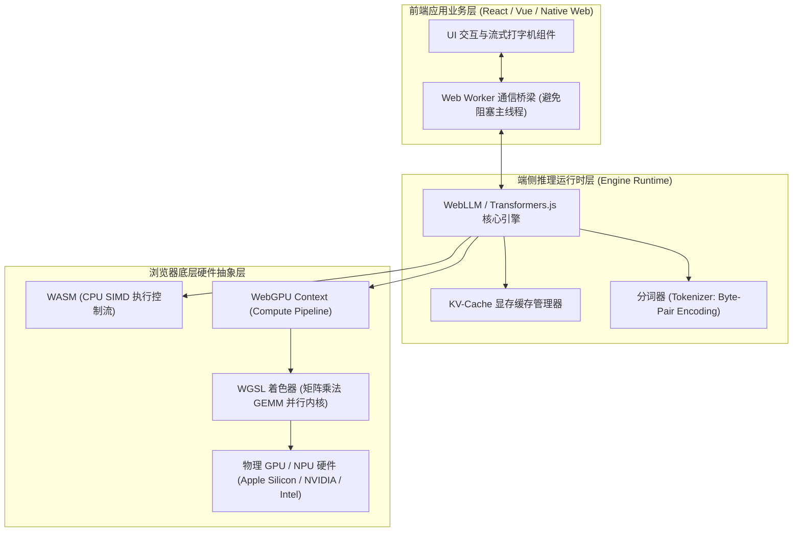

**2. 核心执行流程与技术瓶颈突破**

- **流式分块下载与持久化缓存**：
  - 模型权重通常被切分为数十个 50MB~100MB 的分片（Shards）。引擎利用 Service Worker 与浏览器原生的 **Cache API** 或 **IndexedDB** 将权重持久化落盘；首次下载完成后，后续访问直接命中本地磁盘缓存，秒级加载；
- **Web Worker 隔离机制**：
  - 大模型分词（Tokenization）与推理循环属于极度密集的计算任务。若在 Window 主线程执行，哪怕 10ms 的轻微阻塞也会造成页面白屏或滚动掉帧。因此，**所有模型推理必须严格置于 Web Worker 内运行**，主线程仅通过 `postMessage` 接收生成出的增量 Token；
- **显存保护与 OOM 容灾降级**：
  - 浏览器对单个标签页的 GPU 显存分配有严格限制（如移动端 Safari 限制在 1GB~2GB 左右）。若用户显卡显存不足，WebGPU 上下文会丢失（Context Lost）。工业级架构必须具备优雅降级机制：优先申请 WebGPU 运行；若初始化失败或 OOM，自动切换为云端 API 兜底或降级为小体积 CPU WASM 嵌入模型。

---

**规范代码实现:**

以下为生产级架构中，在独立 Web Worker 中初始化端侧大模型并流式生成文本的完整 TypeScript 实现：

```typescript
// worker/llm.worker.ts
// 需引入 @mlc-ai/web-llm
import { MLCEngine, InitProgressReport } from '@mlc-ai/web-llm';

class InBrowserLlmWorker {
  private engine: MLCEngine | null = null;
  // 选用端侧极速量化模型：Qwen2.5-0.5B-Instruct-q4f16_1-MLC (约 350MB)
  private selectedModel = 'Qwen2.5-0.5B-Instruct-q4f16_1-MLC';

  constructor() {
    this.engine = new MLCEngine();
    this.engine.setInitProgressCallback((report: InitProgressReport) => {
      // 向主线程上报模型下载与编译进度
      self.postMessage({
        type: 'progress',
        data: {
          progress: report.progress,
          text: report.text,
          timeElapsed: report.timeElapsed,
        },
      });
    });
  }

  public async init(): Promise<void> {
    if (!this.engine) return;
    try {
      await this.engine.reload(this.selectedModel);
      self.postMessage({ type: 'ready', model: this.selectedModel });
    } catch (err) {
      self.postMessage({ type: 'error', message: (err as Error).message });
    }
  }

  public async generate(prompt: string): Promise<void> {
    if (!this.engine) {
      throw new Error('LLM Engine not initialized');
    }

    const messages = [
      { role: 'system', content: 'You are a helpful and concise browser-native AI assistant.' },
      { role: 'user', content: prompt },
    ];

    // 流式响应推理
    const chunks = await this.engine.chat.completions.create({
      messages: messages as any,
      temperature: 0.7,
      stream: true,
    });

    for await (const chunk of chunks) {
      const delta = chunk.choices[0]?.delta?.content || '';
      if (delta) {
        self.postMessage({ type: 'delta', text: delta });
      }
    }

    self.postMessage({ type: 'done' });
  }
}

const workerInstance = new InBrowserLlmWorker();

self.onmessage = async (e: MessageEvent) => {
  const { action, payload } = e.data;
  if (action === 'init') {
    await workerInstance.init();
  } else if (action === 'generate') {
    await workerInstance.generate(payload.prompt);
  }
};
```

---

**面试官视角:**

- **考察深度**:
  1. 候选人是否了解前端在 AI 时代的算力边界拓展，是否清楚端侧 AI 的适用场景（离线表单自动填充、敏感代码脱敏、实时语音翻译、前端数据清洗）与不适用场景（数万字深度多步规划、长文档深度阅读）；
  2. 能否从系统工程角度解答大体积模型权重的冷启动与网络下载瓶颈（Cache API 分块缓存、渐进式进度提示）；
  3. 对 Web Worker 线程隔离与 WebGPU 显存限制有无实战防坑经验。
- **下探追问链**:
  - *追问 1*：如果用户的设备不支持 WebGPU（如低版本 Chrome 或老款安卓手机），前端如何做到优雅无缝降级？
  - *追问 2*：端侧模型虽然零服务器成本，但在用户笔记本上可能引起发热与耗电增加，前端在架构上应如何控制推理的触发频次？

---

**延伸阅读:**

- W3C WebGPU Specification & WGSL Overview
- WebLLM (MLC-LLM) In-Browser High-Performance Acceleration
- Transformers.js v3 WebGPU Pipeline Architecture
</Answer>

---

---

---

## 前端如何构建端侧本地 RAG 系统？文档分块与余弦相似度检索是如何落地的？ {#p0-rag-frontend-knowledge-base}

<Answer>

**核心结论:**

**端侧本地 RAG（Client-Side Local RAG）** 是指在前端浏览器内，不依赖任何第三方向量数据库（如 Pinecone、Milvus）或服务端接口，纯靠本地 JavaScript 引擎与 WebWorker 完成私有文档的**解析、分块（Chunking）、向量嵌入（Embedding）、语义相似度检索（Vector Retrieval）与 Prompt 组装**的全套闭环：
- **核心应用场景**：本地 Markdown 知识库助手、离线 PDF 划词问答、用户个人浏览历史搜索等，具备极致的私密性与即时响应能力；
- **标准落地链路**：
  1. **文档加载与分块**：采用带重叠窗口（Overlap）的递归分块算法，保留段落上下文完整性，避免关键语义在切分点被截断；
  2. **端侧轻量嵌入**：利用 Transformers.js 加载极轻量级嵌入模型（如 `bge-small-zh-v1.5` 或 `all-MiniLM-L6-v2`，模型仅约 20MB~40MB）；
  3. **向量计算与 Top-K 召回**：使用 `Float32Array` 类型化数组存储向量，利用**余弦相似度（Cosine Similarity）**算法并行比对，召回相关度最高的上下文片段注入大模型。

---

**原理解析:**

**1. 前端端侧本地 RAG 全链路数据流**

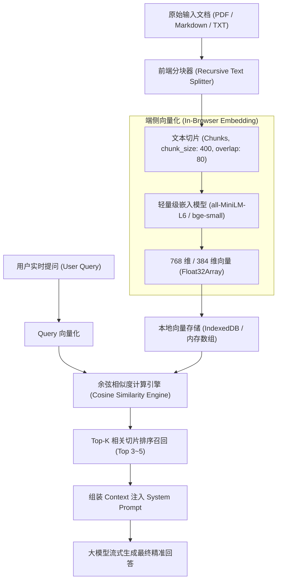

**2. 核心算法原理推导**

- **重叠切分窗口（Overlap）的必要性**：
  - 设切片大小为 S，重叠大小为 O。若不设重叠，切片 A 与切片 B 的交界处刚好存在一个核心实体关系（例如：“...张三出生于北京市朝阳区。[切分点] 毕业于清华大学...”），该实体关系就会被撕裂，导致模型无法检索到“张三的母校是清华”。引入 15%~20% 的 Overlap，能确保边界实体语义连贯；
- **余弦相似度（Cosine Similarity）计算**：
  - 给定查询向量 A 与文档切片向量 B，两者的余弦相似度定义为两向量点积与模长乘积之比：
    `Cosine(A, B) = (A · B) / (||A|| * ||B||) = sum(A_i * B_i) / (sqrt(sum(A_i^2)) * sqrt(sum(B_i^2)))`
  - 在前端工程优化中，如果我们在存入向量库时已将向量做过**L2 范数归一化（Normalize to unit length）**，则分母恒等于 1，余弦相似度直接简化为**两个数组的点积（Dot Product）**，极大节省运行时 CPU 算力开销。

---

**规范代码实现:**

以下为纯 TypeScript 实现的高性能前端本地 RAG 核心（包含递归分块算法、归一化点积计算与 Top-K 召回）：

```typescript
// rag/local-rag-engine.ts
export interface DocumentChunk {
  id: string;
  text: string;
  embedding?: Float32Array;
  metadata?: Record<string, unknown>;
}

export class LocalRagEngine {
  private chunks: DocumentChunk[] = [];

  // 1. 递归文本分块器 (Recursive Character Text Splitter)
  public chunkText(
    text: string,
    chunkSize = 300,
    chunkOverlap = 50
  ): DocumentChunk[] {
    const separators = ['

', '
', '。', '！', '？', ' ', ''];
    const result: string[] = [];

    const splitRecursively = (currentText: string, sepIndex: number): string[] => {
      if (currentText.length <= chunkSize || sepIndex >= separators.length) {
        return [currentText.trim()].filter(Boolean);
      }

      const sep = separators[sepIndex];
      const parts = currentText.split(sep);
      const subChunks: string[] = [];
      let currentAcc = '';

      for (const part of parts) {
        const piece = currentAcc ? `${currentAcc}${sep}${part}` : part;
        if (piece.length <= chunkSize) {
          currentAcc = piece;
        } else {
          if (currentAcc) subChunks.push(currentAcc.trim());
          if (part.length > chunkSize) {
            // 继续往下用更小颗粒度的分隔符递归切分
            subChunks.push(...splitRecursively(part, sepIndex + 1));
            currentAcc = '';
          } else {
            currentAcc = part;
          }
        }
      }
      if (currentAcc) subChunks.push(currentAcc.trim());
      return subChunks;
    };

    const rawChunks = splitRecursively(text, 0);

    // 叠加 Overlap 窗口并生成带 ID 的结构
    this.chunks = rawChunks.map((chunk, index) => ({
      id: `chunk_${index}`,
      text: chunk,
    }));

    return this.chunks;
  }

  // 2. 向量点积/余弦相似度计算 (假设向量已完成 L2 归一化)
  public static dotProduct(a: Float32Array, b: Float32Array): number {
    let dot = 0;
    const len = a.length;
    for (let i = 0; i < len; i++) {
      dot += a[i] * b[i];
    }
    return dot;
  }

  // 3. 注册带 Embedding 的文档切片
  public registerChunksWithEmbeddings(chunksWithVectors: DocumentChunk[]): void {
    this.chunks = chunksWithVectors;
  }

  // 4. 执行 Top-K 向量相似度检索
  public retrieveTopK(
    queryEmbedding: Float32Array,
    k = 3,
    minSimilarity = 0.5
  ): Array<{ chunk: DocumentChunk; similarity: number }> {
    const scoredChunks = this.chunks
      .map((chunk) => {
        if (!chunk.embedding) return null;
        const similarity = LocalRagEngine.dotProduct(queryEmbedding, chunk.embedding);
        return { chunk, similarity };
      })
      .filter((item): item is { chunk: DocumentChunk; similarity: number } => 
        item !== null && item.similarity >= minSimilarity
      );

    // 按相似度降序排序并截取 Top-K
    scoredChunks.sort((a, b) => b.similarity - a.similarity);
    return scoredChunks.slice(0, k);
  }

  // 5. 动态构建带有证据引用的增强上下文 Prompt
  public buildPrompt(query: string, retrieved: Array<{ chunk: DocumentChunk; similarity: number }>): string {
    const contextBlock = retrieved
      .map((item, idx) => `[参考切片 ${idx + 1}]:
${item.chunk.text}`)
      .join('

');

    return `你是一个专业的本地知识助手。请严格结合以下参考切片回答用户问题，若参考内容未提及，请诚实告知未知，切勿编造。

【参考上下文】:
${contextBlock}

【用户问题】:
${query}

请给出严谨的解答并标注参考来源。`;
  }
}
```

---

**面试官视角:**

- **考察深度**:
  1. 候选人是否真正动手实践过 RAG 检索增强架构，而非仅仅知晓名词概念；
  2. 能否从数学逻辑（点积、L2 范数归一化）和内存效率（TypedArray 连续内存块）层面优化前端大量向量运算的执行性能；
  3. 对分块尺寸（Chunk Size）与重叠（Overlap）超参数的选型敏感度，以及如何防止幻觉注入。
- **下探追问链**:
  - *追问 1*：如果本地文档有上万个切片，在前端做全量线性比对（$O(N)$ 暴力搜索）会出现明显的卡顿，前端如何在不借助后端的情况下实现高效近似近邻检索（ANN）？
  - *追问 2*：单纯依靠向量余弦检索时，遇到精确的工单编号（如 `BUG-2026-9901`）往往检索召回率极低，前端如何结合 BM25 关键词检索做混合加权排序（Hybrid Search）？

---

**延伸阅读:**

- LangChain: Concepts of Text Splitters & Embedding Chunking
- Hugging Face Transformers.js Feature Extraction Pipeline
- In-Memory Vector Search with HNSW in WebAssembly
</Answer>

---

## Agent 长会话场景下，面对有限的上下文窗口，如何设计多级记忆管理与滑动压缩机制？ {#p1-agent-memory-context-compression}

<Answer>

**核心结论:**

在复杂自主智能体（Agent）或数十轮以上深度长对话场景中，**上下文窗口（Context Window）的无节制膨胀是导致系统雪崩的致命隐患**：
- **长上下文的“三重危机”**：
  1. **经济成本飙升**：大模型通常按 Token 计费，全量上下文每轮重送会导致调用成本呈平方级 $O(N^2)$ 爆炸；
  2. **推理时延（Latency）剧增**：Prefill（首字预填充）耗时线性甚至超线性上升，用户感知卡顿加剧；
  3. **模型注意力稀释与“中间遗忘（Lost in the Middle）”**：模型在超长上下文中对处于中段的关键信息检索准确率大幅下滑，严重影响决策可靠度；
- **分级记忆管理体系**：工业级系统通过构建由 **工作记忆（Working Memory）、滚动摘要记忆（Rolling Summary Memory）、固定系统锚点（Pinned Anchors）与长期向量记忆（Long-Term Archival Memory）** 构成的多级存储层，实现上下文 Token 预算的恒定收敛与高质量信息无损流转。

---

**原理解析:**

**1. 多级上下文内存分层金字塔**

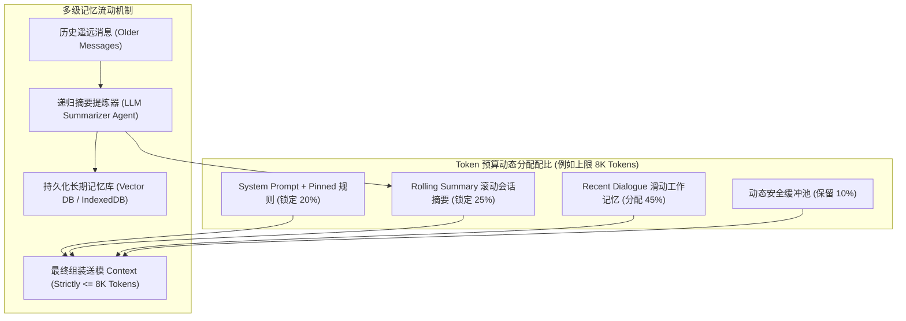

**2. 核心滑动压缩四大关键机制**

1. **不可退化锚点锁定（Immutable Anchor Pinning）**：
   - 系统提示词（System Prompt）、开发者注入的角色规则、当前激活的 MCP 工具定义 Schema，在任何情况下均享有“最高优先级保护”，永远不被压缩或滑动剔除；
2. **滚动递归摘要压缩（Recursive Rolling Summarization）**：
   - 设定阈值（如工作记忆达到 4000 Tokens 时触发）。从最旧的几轮对话开始，提取关键事实、用户决策、已获变量并生成简短摘要，合并入 `summary` 字段，随后丢弃原始的详细对话对象；
3. **KV-Cache 命中率保护策略（Prompt Caching Optimization）**：
   - 现代顶级模型厂商（Anthropic Claude、DeepSeek、OpenAI）支持 Prompt Caching（前缀缓存命中）。若每次请求频繁改动 Prompt 顶端内容，会导致整个服务端的 KV-Cache 彻底击穿失效。因此，**System Prompt 与稳定上下文必须严格保持在前缀静态不变**，动态变化的摘要与近期对话置于后部，从而大幅降低延迟与账单成本；
4. **意图检索激活长期记忆（Episodic Retrieval on Demand）**：
   - 对于早先被截断的超长业务细节，将其转存至长期向量数据库；仅当后续对话意图检测命中特定历史关键词或实体时，才按需将单条记忆片段召回至工作上下文中。

---

**规范代码实现:**

以下为生产级架构中，具备 Token 预算控制与滑动窗口摘要能力的上下文管理器实现：

```typescript
// memory/context-budget-manager.ts
export interface ChatMessage {
  id: string;
  role: 'system' | 'user' | 'assistant' | 'tool';
  content: string;
  tokensEstimate: number;
  isPinned?: boolean; // 关键信息锁定保护
}

export class ContextBudgetManager {
  private maxAllowedTokens: number;
  private pinnedMessages: ChatMessage[] = [];
  private rollingSummary = '';
  private recentMessages: ChatMessage[] = [];

  constructor(maxTokens = 8000) {
    this.maxAllowedTokens = maxTokens;
  }

  // 粗略估算 Token 数量 (中英混合场景经验估算: 1 token ≈ 1.5 字符)
  public static estimateTokens(text: string): number {
    return Math.ceil(text.length / 1.5);
  }

  public setSystemPrompt(prompt: string): void {
    const tokens = ContextBudgetManager.estimateTokens(prompt);
    this.pinnedMessages = [
      {
        id: 'system_core',
        role: 'system',
        content: prompt,
        tokensEstimate: tokens,
        isPinned: true,
      },
    ];
  }

  public addMessage(role: 'user' | 'assistant' | 'tool', content: string, pin = false): void {
    const tokens = ContextBudgetManager.estimateTokens(content);
    const msg: ChatMessage = {
      id: `msg_${Date.now()}_${Math.random().toString(36).slice(2, 6)}`,
      role,
      content,
      tokensEstimate: tokens,
      isPinned: pin,
    };

    if (pin) {
      this.pinnedMessages.push(msg);
    } else {
      this.recentMessages.push(msg);
    }

    // 检查并执行滑动压缩
    this.enforceBudgetConstraints();
  }

  // 强制 Token 预算收敛控制
  private enforceBudgetConstraints(): void {
    const calculateTotalTokens = () => {
      const pinnedSum = this.pinnedMessages.reduce((sum, m) => sum + m.tokensEstimate, 0);
      const summarySum = ContextBudgetManager.estimateTokens(this.rollingSummary);
      const recentSum = this.recentMessages.reduce((sum, m) => sum + m.tokensEstimate, 0);
      return pinnedSum + summarySum + recentSum;
    };

    // 当超出预算且近期消息大于 4 轮时，滑动挤出最老的消息进入待摘要队列
    while (calculateTotalTokens() > this.maxAllowedTokens && this.recentMessages.length > 4) {
      const oldestMsg = this.recentMessages.shift();
      if (!oldestMsg) break;

      // 提取核心信息注入滚动摘要
      this.rollingSummary += `
[历史记录]: ${oldestMsg.role} 曾提到 "${oldestMsg.content.slice(0, 100)}..."`;
    }
  }

  // 组装最终提交给大模型的标准化上下文消息数组
  public assembleContext(): ChatMessage[] {
    const finalPayload: ChatMessage[] = [...this.pinnedMessages];

    // 若存在滚动摘要，以系统补充信息形式插入
    if (this.rollingSummary) {
      finalPayload.push({
        id: 'rolling_summary_block',
        role: 'system',
        content: `【前序对话背景与要点摘要】:${this.rollingSummary}`,
        tokensEstimate: ContextBudgetManager.estimateTokens(this.rollingSummary),
      });
    }

    finalPayload.push(...this.recentMessages);
    return finalPayload;
  }
}
```

---

**面试官视角:**

- **考察深度**:
  1. 候选人是否具备大模型系统长效稳定运行的高阶工程认知，是否把 Token 视作和内存、网络带宽同等珍贵的工程资源；
  2. 能否讲清楚现代模型厂商底层 KV-Cache 与 Prompt Caching 机制对上下文编排结构提出的具体约束（静态前缀不变性）；
  3. 对信息丢失（Information Loss）与预算压缩之间的权衡（Trade-off）掌控能力。
- **下探追问链**:
  - *追问 1*：如果使用另一个轻量小模型（如 GPT-4o-mini 或端侧模型）对历史对话进行递归摘要，何时触发摘要最合理？如何避免摘要本身产生新的事实性幻觉？
  - *追问 2*：当用户在第 50 轮对话中突然问及“在第 3 轮里我给你的那个订单号是多少”，滑动窗口已经被丢弃，系统应该如何保证关键实体的记忆追溯？

---

**延伸阅读:**

- Anthropic Claude Prompt Caching Architecture & Cost Optimization
- MemGPT: LLMs as Operating Systems with Virtual Context Management
- Attention with Linear Biases (ALiBi) & Long-Context Attention Mechanics
</Answer>

---

---

## 什么是 Prompt Caching（前缀缓存）与 KV-Cache 状态优化？静态与动态上下文编排如何降低时延与成本？ {#p0-prompt-caching-kv-cache-optimization}

<Answer>

**核心结论:**

在现代高并发大模型应用与长任务 Agent 中，**Prompt Caching（前缀提示词缓存）与底层 KV-Cache 状态复用是决定系统首字延迟（TTFT）与计费成本的胜负手**：
- **物理机制（KV-Cache 复用）**：大模型自回归生成时，前序所有 Token 经过自注意力（Self-Attention）计算生成的 Key 与 Value 矩阵（KV 向量）会被保存在 GPU 显存中；**Prompt Caching 允许跨请求复用这些已计算好的前缀 KV 向量**，跳过昂贵的预填充计算（Prefill Phase）；
- **巨额降本增效**：主流模型服务商（Anthropic Claude、DeepSeek、OpenAI）对命中 Prompt Cache 的 Token 给予 **50%~90% 的价格折扣**，同时首字延迟降低 **80% 以上**；
- **前端编排铁律：前缀静态对齐（Static Prefix Alignment）**：Prompt Caching 严格要求**从第 0 个 Token 起的前缀必须绝对完全一致**。若前端随意在上下文头部插入动态时间戳、动态递增的消息序号或打乱 System Prompt，将导致全局 KV-Cache 彻底击穿失效。

---

**原理解析:**

**1. 传统无缓存推理 vs Prompt Caching 命中机制**

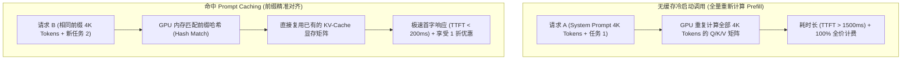

**2. 前端上下文编排的三大黄金准则**

1. **绝对静态顶置（Static-First Layout）**：
   - 上下文严格分为“静态区（Static Zone）”与“动态区（Dynamic Zone）”。全局系统角色声明、版本信息、MCP 工具定义 JSON Schema 必须焊死在 Prompt 的最前端；
2. **严禁在静态前缀中注入动态时间戳**：
   - 错误做法：`System: 你是助手，当前时间是 2026-09-12 12:15:30...`（每秒都在变，永远击穿缓存）；
   - 正确做法：将当前时间作为最后一条 User 消息的尾随元数据传入；
3. **最小变更边界（Append-Only History）**：
   - 历史消息必须采用“仅追加（Append-Only）”模式；一旦中间插入或删除了某轮对话，该位置之后的所有 KV-Cache 缓存全部失效。

---

**规范代码实现:**

以下展示在前端上下文组装器中，严格遵循 Prompt Caching 静态前缀对齐原则的架构实现：

```typescript
// prompt/caching-assembler.ts
export interface PromptMessage {
  role: 'system' | 'user' | 'assistant';
  content: string;
  cacheControl?: { type: 'ephemeral' }; // Anthropic 等支持显式缓存断点
}

export class PromptCachingContextAssembler {
  // 1. 恒定不变的静态前缀 (必须保证字节级全等)
  private static readonly IMMUTABLE_SYSTEM_PROMPT = 
    `You are an enterprise AI architecture assistant.
` +
    `You strictly follow the company engineering standards and never hallucinate.
` +
    `Rules: Always use TypeScript; Do not invent external APIs.`;

  // 2. 稳定的 MCP 工具元数据前缀
  private toolsSchemaPrefix: string;

  constructor(toolsSchemaJson: string) {
    this.toolsSchemaPrefix = toolsSchemaJson;
  }

  // 3. 组装具备高命中率的上下文 Payload
  public buildCacheOptimizedMessages(
    historyMessages: Array<{ role: 'user' | 'assistant'; content: string }>,
    currentQuery: string,
    dynamicContextMetadata?: { currentTime: string; userId: string }
  ): PromptMessage[] {
    const payload: PromptMessage[] = [];

    // [Block 1: 永久静态区] System Prompt + Tool Schemas (必须打上缓存锚点)
    payload.push({
      role: 'system',
      content: `${PromptCachingContextAssembler.IMMUTABLE_SYSTEM_PROMPT}

[Available Tools]:
${this.toolsSchemaPrefix}`,
      cacheControl: { type: 'ephemeral' }, // 显式标记在此处固化 KV-Cache
    });

    // [Block 2: 线性追加对话历史] 严禁在中间任意插入时间戳破坏前缀
    for (const msg of historyMessages) {
      payload.push({
        role: msg.role,
        content: msg.content,
      });
    }

    // [Block 3: 动态元数据与当前提问] 动态变量永远置于最尾部
    let finalUserMessage = currentQuery;
    if (dynamicContextMetadata) {
      finalUserMessage += `

[Runtime Context Metadata]:
- CurrentTime: ${dynamicContextMetadata.currentTime}
- UserId: ${dynamicContextMetadata.userId}`;
    }

    payload.push({
      role: 'user',
      content: finalUserMessage,
    });

    return payload;
  }
}
```

---

**面试官视角:**

- **考察深度**:
  1. 候选人是否具备大模型系统设计的高级优化经验，能否把 GPU 显存注意力机制与前端应用层编排无缝贯通；
  2. 能否指出日常开发中最容易误杀 Prompt Cache 的典型前端坏味道（如随机 ID、随手注入的全局动态时间）；
  3. 对成本控制（Token Economics）与首字延迟（TTFT）极致优化的工程敏感度。
- **下探追问链**:
  - *追问 1*：在多轮分支对话树（Session Tree）中，当用户回滚到第 3 轮并发起新分支时，原先分支的 KV-Cache 是否会被复用？如何最大化利用已缓存的前缀？
  - *追问 2*：为什么在某些大模型 API 中，Prompt Cache 存在“最短 Token 门槛”（例如至少需要 1024 Tokens 才能触发缓存机制）？

---

**延伸阅读:**

- Anthropic Claude Official Guide: Prompt Caching Architecture & Best Practices
- DeepSeek-V2/V3 Multi-head Latent Attention (MLA) & KV Cache Compression
</Answer>

---

## 长任务跑久了，上下文会「腐化」、行为会「漂移」，怎么检测和干预？ {#p0-long-task-context-decay-drift}

<Answer>

**核心结论:**

长任务的失败不是突然发生的，而是**渐进的**：轨迹越滚越长，早期的关键约束被埋在上下文深处且被大量中间步骤稀释，模型开始只顾着完成「当前一步」而忘了「整体目标」。这类现象在面试里通常叫**上下文腐化（Context Decay）**与**行为漂移（Behavior Drift）**。

**检测要比修复更早一步**，四个可落地的信号：

1. **目标一致性检查（Goal Adherence）**：定期把「原始目标」与「当前正在做的事」做一次比对，问一句「当前这一步是否仍在推进原始目标」——这是最直接、最便宜的漂移探针；
2. **不变量断言（Invariant Check）**：为任务预先声明「必须始终成立」的性质（如「不得修改用户明确禁止改动的文件」「不得在未确认前执行写操作」），每步或每 N 步校验一次，违反即判定漂移；
3. **重复与回环检测（Loop & Repetition）**：语义相似的动作连续出现、步数增长但状态无变化、同一错误反复重试，都是腐化的外在信号；
4. **成本与进展比**：单位步数带来的有效进展下降（Token 消耗上升但任务完成度不变），是上下文被噪音占满的典型表现。

**干预手段分四档**，从轻到重：压缩（丢弃低价值轨迹）→ 锚定（把原始目标与关键约束重新注入到上下文近端）→ 重规划（显式重述计划并丢弃已污染的分叉）→ 人工接管。**关键原则：原始目标必须被「锚定」到上下文的近端位置**——因为自回归模型对上下文近端的信息更敏感，把目标写在第 3 轮的开头，不如在第 30 轮重新声明一次。

---

**原理解析:**

**1. 腐化是怎么发生的**

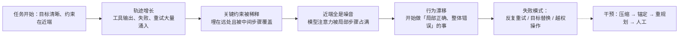

**2. 「锚定」为什么有效**

自回归模型的注意力随上下文增长而稀释，近端信息的影响更大。因此把目标与硬约束**周期性重述**（re-anchoring），相当于在每一步都把「全局目标」重新推到近端。工程上可以把它做成**每 N 步插入一段结构化的任务状态块**：

```
[任务状态块]
原始目标：<verbatim 重述，不改写>
硬约束：不可执行写操作 / 不得触碰 <路径> / 输出必须符合 <Schema>
已完成：<3 条以内>
当前子目标：<1 句>
禁止事项：<最近一次违反的规则，若有>
```

**3. 腐化与「模型能力不足」怎么区分**

| 现象 | 更可能是上下文腐化 | 更可能是能力/工具问题 |
| :--- | :--- | :--- |
| 早期步正确、后期开始跑偏 | ✅ | ❌ |
| 换个更小上下文就恢复正常 | ✅ | ❌ |
| 同一任务重跑一次又对了 | ✅ | ❌ |
| 一开始就选错工具、方向全错 | ❌ | ✅ |
| 特定工具/特定输入形态必错 | ❌ | ✅ |

**4. 失败要分级，不要一律重试**

同一失败模式重复出现 N 次，说明重试不会带来新信息，应当转为**重规划**或**人工介入**。这也是把「Agent 反复失败时工程师该做什么」的答案落到具体工程动作上。

---

**规范实现:**

```typescript
// drift-detection.ts
export interface TaskAnchors {
  goal: string;              // 原始目标，逐字保留
  hardConstraints: string[]; // 硬约束，逐字保留
  forbidden: string[];       // 禁止事项
}

export interface RunSignal {
  step: number;
  actionSummary: string;
  stateChanged: boolean;
  tokensSoFar: number;
  progressScore: number; // 0~1，本步带来的有效进展
}

export type DriftVerdict = 'ok' | 'drift-suspect' | 'drift-confirmed';

export async function detectDrift(
  anchors: TaskAnchors,
  recent: RunSignal[],
  check: (anchors: TaskAnchors, recent: RunSignal[]) => Promise<{ aligned: boolean; note: string }>
): Promise<DriftVerdict> {
  // 1) 重复/回环检测：语义相近动作连续出现且状态无变化
  const tail = recent.slice(-3);
  const noProgress = tail.length === 3 && tail.every(r => !r.stateChanged);
  if (noProgress) return 'drift-confirmed';

  // 2) 目标一致性检查：把原始目标与当前行为做比对
  const { aligned, note } = await check(anchors, recent);
  if (!aligned) return 'drift-confirmed';

  // 3) 进展比下滑：Token 持续上涨但进展不增，典型的上下文被噪音占满
  const tokensUp = recent[recent.length - 1].tokensSoFar > recent[0].tokensSoFar * 1.5;
  const progressFlat = recent.slice(-3).every(r => r.progressScore < 0.1);
  if (tokensUp && progressFlat) return 'drift-suspect';

  return 'ok';
}

export async function intervene(
  level: 'compress' | 'reanchor' | 'replan' | 'human',
  anchors: TaskAnchors,
  ctx: { history: unknown[]; state: unknown }
): Promise<{ history: unknown[]; note: string }> {
  switch (level) {
    case 'compress':
      // 丢弃低价值轨迹（成功且短的工具输出、重复内容），保留失败与决策点
      return { history: compressKeepingDecisions(ctx.history), note: '已压缩低价值轨迹' };
    case 'reanchor':
      // 把目标与硬约束重新注入到近端
      return { history: [...ctx.history, renderAnchorBlock(anchors)], note: '已重述目标与硬约束' };
    case 'replan':
      return { history: [...ctx.history, renderAnchorBlock(anchors), renderReplanPrompt(ctx.state)], note: '已丢弃污染分叉并重规划' };
    case 'human':
      return { history: ctx.history, note: '已升级为人工接管' };
  }
}
```

**判定顺序的讲究**：先做便宜的确定性检查（重复、进展比），再做需要模型的一次目标比对；确认漂移后按「压缩 → 锚定 → 重规划 → 人工」逐级升级，**不要一上来就重规划**——重规划会丢掉已经获得的正确中间结果，代价最大。

---

**面试官视角:**

**考察意图:**
考察候选人是否理解长任务的失败机制是**渐进的信息稀释**，而非模型突然变笨。高分回答必须能区分「上下文腐化」与「能力不足」，并给出**周期性锚定**与**不变量断言**这两条最具工程价值的手段。

**深度追问链:**
1. **追问 1**: 怎么判断 Agent 是跑偏了，还是这个任务本来就难？
   - *答题切入点*: 看「轨迹形状」而非「结果」——早期步骤正确、后期偏离，且缩短上下文或重跑一次就恢复正常，是腐化的典型特征；一开始就方向全错、且输入形态固定时必错，更可能是能力或工具问题。
2. **追问 2**: 上下文压缩会不会把关键信息压没了？
   - *答题切入点*: 会，所以压缩必须分级：先做无损的结构化裁剪（丢弃成功且短的观测、合并重复），再对失败与决策点做保留式摘要；关键目标与硬约束不靠摘要保留，而是靠**周期性锚定重述**——这是两者最大的区别。
3. **追问 3**: 同一类错误连续重试三次，你怎么办？
   - *答题切入点*: 不再重试。第三次仍失败说明重试不产生新信息，应触发重规划（显式重述计划与约束）并限制重规划次数；仍失败则上报人工，保留完整轨迹用于归因。

---

**延伸阅读:**
- [Anthropic: Effective context engineering for AI agents（上下文工程与压缩策略）](https://www.anthropic.com/engineering/effective-context-engineering-for-ai-agents)
- [Model Context Protocol 规范（工具返回内容对上下文预算的影响）](https://modelcontextprotocol.io/)
- [Google: Agent2Agent 协议（长任务状态同步语义）](https://a2a-protocol.org/latest/)

</Answer>

---

## 工具失败后重试，为什么容易演变成「重试风暴」？退避与熔断怎么设计？ {#p0-agent-retry-storm-backoff}

<Answer>

**核心结论:**

重试风暴的成因不是「重试次数太多」，而是**重试本身变成了负载的一部分**。一次下游故障会让 N 个上游同时重试，重试请求叠加到已经过载的下游上，把原本 30 秒能自愈的抖动放大成持续不可用——这叫**重试放大（Retry Amplification）**。

四个必须同时具备的工程手段：

1. **指数退避 + 抖动（Exponential Backoff with Jitter）**：退避是必需的，但**必须带抖动**。纯指数退避会让所有客户端在同一时刻重试，形成同步化的尖峰；加随机抖动把重试摊平。
2. **重试预算（Retry Budget）**：限制「重试请求量占正常请求量的比例」（业界常见上限是 10% 左右），超过就**直接失败**而不是继续重试。这是防止放大的关键阀门。
3. **熔断（Circuit Breaker）**：连续失败达到阈值后**快速失败**，并周期性放行探测请求（半开态）确认下游是否恢复。熔断期间不占用下游连接，避免雪上加霜。
4. **失败分级**：只有**可重试错误**才重试（网络超时、限流、5xx），**不可重试错误**（参数非法、鉴权失败、404）必须立即失败。重试一个必然失败的请求，只是把成本翻倍并延后了正确的错误响应。

**在 Agent 场景下的特殊约束**：Agent 的重试成本远高于普通 RPC——每次重试都要重新喂给模型一遍上下文，可能同时产生新的 Token 消耗与副作用（写操作可能被重复执行）。因此 Agent 的重试必须**幂等**、必须有**步数预算**、并且默认**不重试写操作**（除非该操作带幂等键）。

---

**原理解析:**

**1. 放大是怎么发生的**

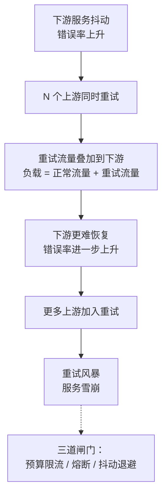

**2. 熔断器的三种状态**

| 状态 | 行为 | 目的 |
| :--- | :--- | :--- |
| Closed（闭合） | 正常放行，统计失败率 | 正常工作 |
| Open（打开） | 达到阈值后**快速失败**，不再打下游 | 保护下游、给下游恢复窗口 |
| Half-Open（半开） | 放行少量探测请求 | 判断下游是否已恢复，再决定回 Closed 还是回 Open |

关键细节：**熔断的失败率统计要用滑动窗口**（如最近 30 秒内的请求），且**慢调用也要计入**，否则下游变慢但没报错时，熔断不会触发，而慢会耗尽连接池，效果与雪崩相同。

**3. 抖动为什么不能省**

不加抖动的指数退避会让 1000 个客户端在第 1 秒、第 2 秒、第 4 秒形成整齐的脉冲式重试，恰好在下游最脆弱的时刻持续施压。加了随机抖动后，重试被摊平成持续的平缓流量，下游有喘息窗口。

**4. Agent 场景的额外风险**

- **写操作重复执行**：Agent 重试一个「创建工单」的工具调用，可能产生两条工单。必须靠幂等键（请求级唯一 ID）而不是靠「不重试」来防。
- **Token 成本翻倍**：每次重试都要重新组装上下文。
- **步数膨胀掩盖真实问题**：Agent 步数预算被重试吃掉后，真正需要推理的步数不够，任务质量随之下降。

---

**规范实现:**

```typescript
// resilient-retry.ts
export type ErrorClass = 'retryable' | 'non-retryable' | 'throttled';

export function classify(err: unknown): ErrorClass {
  const e = err as { status?: number; code?: string; name?: string };
  if (e.status === 429) return 'throttled';
  if (e.status !== undefined) return e.status >= 500 ? 'retryable' : 'non-retryable';
  if (e.code === 'ECONNRESET' || e.code === 'ETIMEDOUT' || e.name === 'AbortError') return 'retryable';
  return 'non-retryable';
}

interface BreakerState { failures: number; openedAt: number; state: 'closed' | 'open' | 'half-open'; }

export function createResilientCaller(opts: {
  maxAttempts: number;
  baseDelayMs: number;
  maxDelayMs: number;
  failureThreshold: number;
  openMs: number;
  retryBudgetRatio: number;      // 重试量 / 正常量 的上限
  currentRetryRatio: () => number;
}) {
  let breaker: BreakerState = { failures: 0, openedAt: 0, state: 'closed' };

  const backoff = (attempt: number) => {
    const exp = Math.min(opts.maxDelayMs, opts.baseDelayMs * 2 ** attempt);
    return Math.random() * exp; // full jitter：抖动不是附加项，是必需项
  };

  return async function call<T>(fn: () => Promise<T>, idempotencyKey?: string): Promise<T> {
    if (breaker.state === 'open') {
      if (Date.now() - breaker.openedAt < opts.openMs) {
        throw new Error('circuit-open'); // 快速失败：不占用下游连接
      }
      breaker.state = 'half-open'; // 半开，放行探测
    }
    let lastErr: unknown;
    for (let attempt = 0; attempt < opts.maxAttempts; attempt++) {
      try {
        const out = await fn();
        breaker = { failures: 0, openedAt: 0, state: 'closed' };
        return out;
      } catch (err) {
        lastErr = err;
        const cls = classify(err);
        if (cls === 'non-retryable') throw err;              // 不可重试：立即失败
        breaker.failures += 1;
        if (breaker.failures >= opts.failureThreshold) {
          breaker = { failures: breaker.failures, openedAt: Date.now(), state: 'open' };
          throw err;
        }
        // 重试预算阀门：超过比例直接放弃重试
        if (opts.currentRetryRatio() > opts.retryBudgetRatio) {
          throw new Error('retry-budget-exhausted');
        }
        await new Promise(r => setTimeout(r, backoff(attempt)));
      }
    }
    throw lastErr;
  };
}
```

**Agent 侧的配套约束**：

- **写操作默认不重试**，除非带幂等键（以请求级唯一 ID 去重）；
- **重试次数计入 Agent 步数预算**，超限时直接上报而不是继续消耗；
- **熔断打开时**，Agent 应返回「该工具暂不可用 + 建议稍后重试或换路径」，而不是让整条链路失败。

---

**面试官视角:**

**考察意图:**
考察候选人是否理解**重试放大**这一非线性效应，以及是否具备「重试预算 + 熔断 + 抖动」这套完整的韧性工程直觉。高分回答必须能指出**不加抖动会让重试同步化**、**不可重试错误不该重试**、以及**Agent 场景下写操作重试的副作用**。

**深度追问链:**
1. **追问 1**: 你的重试策略是什么？为什么？
   - *答题切入点*: 指数退避 + full jitter，最大次数与最大延迟封顶；错误分级决定是否重试；配合重试预算（占正常流量比例上限）与熔断，而不是单纯设一个「最多重试 3 次」。
2. **追问 2**: 下游只是变慢了，没有报错，要不要熔断？
   - *答题切入点*: 要。慢调用同样耗尽连接池并拖垮上游；熔断的统计窗口应把慢调用纳入判定（慢调用率 + 错误率双阈值），且窗口是滑动窗口而非累计值。
3. **追问 3**: Agent 调用写操作失败了，重试会不会产生两条数据？
   - *答题切入点*: 会，所以写操作不能靠「不重试」来防，必须设计幂等——请求级唯一 ID 落库去重；Agent 层的默认策略是写操作带幂等键才允许重试，否则上报人工或走补偿流程。

---

**延伸阅读:**
- [Google SRE Book：Handling Overload（重试预算与过载保护）](https://sre.google/sre-book/handling-overload/)
- [AWS Builders' Library：Timeouts, retries, and backoff with jitter（退避与抖动的经典推导）](https://aws.amazon.com/builders-library/timeouts-retries-and-backoff-with-jitter/)
- [Model Context Protocol 规范（工具错误码与调用审计约定）](https://modelcontextprotocol.io/)

</Answer>

---

## AGENTS.md / 规则文件越写越长，效果反而变差，怎么治理？ {#p0-agents-md-context-bloat}

<Answer>

**核心结论:**

规则文件变长会让效果变差，机制是**注意力稀释 + 冲突累积 + 过期内容**三件事同时发生：

1. **注意力稀释**：规则越靠后越容易被忽略，靠前又容易被后续内容淹没；真正需要被遵守的硬约束淹没在几十条软建议里。
2. **冲突累积**：后期追加的规则往往与早期规则重叠甚至矛盾（早期说「优先用 A」，后期说「一律用 B」），模型面对矛盾指令的行为是不确定的。
3. **过期内容**：规则里沉淀了大量已经失效的约定（依赖换了、目录搬了、API 改了），这些内容不仅无用，还占预算并误导模型。

**治理的四个动作**（按优先级）：

1. **分层**：把规则拆成「始终注入的核心层」（少量硬约束，通常不超过 10 条）与「按需加载的领域层」（只在相关文件/任务被触达时才注入）；
2. **去重与消歧**：同一主题只保留一条权威表述，历史版本进归档而不是留在正文；
3. **可执行化**：能被工具/检查替代的规则，不要用自然语言写进提示词——用 lint、类型、CI 卡口表达，规则文件只保留「机器判不了、需要人理解」的部分；
4. **治理机制化**：规则文件必须有 owner、有评审、有失效期；每次大改动后跑一次「规则有效性回归」。

**判断标准**：一份规则文件里，**每一条规则都应该能对应到一个真实的失败案例**。找不到对应失败案例的规则，大概率是可以删的。

---

**原理解析:**

**1. 膨胀的三条路径**

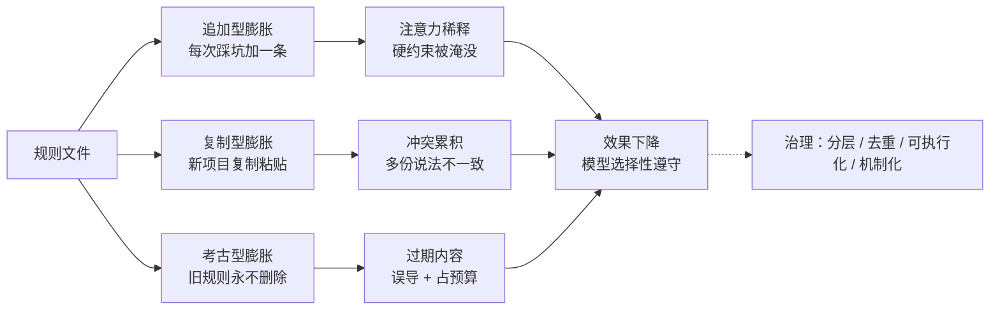

**2. 分层的具体形态**

| 层 | 内容 | 注入方式 | 体量建议 |
| :--- | :--- | :--- | :--- |
| 核心层 | 不可违反的硬约束、目录结构、命令约定、安全红线 | 始终注入 | 10 条以内 |
| 领域层 | 某个子系统的专属约定（构建、测试、发布） | 命中该目录/任务时注入 | 每个领域 5~15 条 |
| 任务层 | 当前任务的临时约束 | 单次任务注入 | 视任务而定 |
| 归档层 | 已失效但可能有追溯价值的历史约定 | 不注入，按需查阅 | 不限 |

**3. 「可执行化」是收益最大的一招**

能用工具表达的规则，不要用提示词表达：

| 自然语言规则 | 可执行替代 |
| :--- | :--- |
| 「不要用 `any`」 | `tsconfig` 的 `noImplicitAny` + ESLint 规则 + CI 门禁 |
| 「提交前必须跑测试」 | husky pre-commit + CI 必跑项 |
| 「不要直接改 `legacy/` 目录」 | ESLint `no-restricted-paths` / 目录级 CODEOWNERS + CI 检查 |
| 「新代码必须带测试」 | 覆盖率阈值门禁 + diff-aware 覆盖率检查 |

把机器能判的规则交给机器，规则文件就只剩下真正需要模型理解的部分（架构意图、领域语义、沟通风格），体量自然可控。

**4. 规则有效性回归**

规则改动的风险不亚于代码改动。最低成本的回归是：维护一组**规则触发的真实场景**（每个核心规则至少一个正例与一个反例），在规则文件变更后跑一遍，看模型行为是否符合预期。这与代码库的回归测试是同一套方法论。

---

**规范实现:**

```typescript
// rules-governance.ts
export interface RuleLayer {
  name: 'core' | 'domain' | 'task' | 'archive';
  scope?: string;          // domain 层的作用域（目录、任务类型）
  rules: Array<{ id: string; text: string; enforcement: 'hard' | 'soft'; owner: string; expiresAt?: string }>;
}

export interface AssembledContext {
  blocks: string[];
  tokenEstimate: number;
  conflicts: Array<{ a: string; b: string }>;
}

export function assembleRules(layers: RuleLayer[], ctx: { paths: string[]; taskType: string }): AssembledContext {
  const active = layers.filter(l => {
    if (l.name === 'core') return true;
    if (l.name === 'domain') return (l.scope ?? '').split(',').some(s => ctx.paths.some(p => p.startsWith(s)));
    if (l.name === 'task') return l.scope === ctx.taskType;
    return false; // archive 永不注入
  });

  // 1) 同一主题只保留一条权威表述：按 id 去重，冲突标记出来人工裁决
  const seen = new Map<string, string>();
  const conflicts: Array<{ a: string; b: string }> = [];
  for (const layer of active) {
    for (const rule of layer.rules) {
      const topic = rule.id.split(':')[0];
      if (seen.has(topic)) {
        conflicts.push({ a: seen.get(topic)!, b: rule.text });
        continue;
      }
      seen.set(topic, rule.text);
    }
  }

  // 2) 硬约束优先，且核心层排在最前
  const ordered = [
    ...active.filter(l => l.name === 'core').flatMap(l => l.rules),
    ...active.filter(l => l.name !== 'core').flatMap(l => l.rules)
  ].sort((a, b) => (a.enforcement === b.enforcement ? 0 : a.enforcement === 'hard' ? -1 : 1));

  const blocks = ordered.map(r => `- [${r.enforcement}] ${r.text}`);
  return {
    blocks,
    tokenEstimate: Math.ceil(blocks.join('\n').length / 1.6), // 粗略 token 估算
    conflicts
  };
}

// 3) 规则有效性回归：每个核心规则至少一个正例与一个反例
export interface RuleCase { ruleId: string; prompt: string; expectCompliant: boolean; }

export function auditRuleCoverage(rules: RuleLayer[], cases: RuleCase[]): Array<{ ruleId: string; missing: 'positive' | 'negative' }> {
  const issues: Array<{ ruleId: string; missing: 'positive' | 'negative' }> = [];
  for (const layer of rules) {
    for (const rule of layer.rules) {
      if (layer.name !== 'core') continue;
      const related = cases.filter(c => c.ruleId === rule.id);
      if (!related.some(c => c.expectCompliant)) issues.push({ ruleId: rule.id, missing: 'positive' });
      if (!related.some(c => !c.expectCompliant)) issues.push({ ruleId: rule.id, missing: 'negative' });
    }
  }
  return issues;
}
```

**配套的仓库约定**（写进项目自身的规则里）：

- 规则文件每条必须有 **owner** 与 **来源失败案例链接**；
- 新增规则前先检索是否已有同类条目（避免重复与冲突）；
- 每季度做一次**失效审计**：把近三个月没有对应失败案例的规则降级到归档层；
- 规则文件变更走代码评审，diff 里能看出「新增规则对应的真实问题」。

---

**面试官视角:**

**考察意图:**
考察候选人是否理解「AI 编码助手的规则资产」本质上是**需要治理的工程产物**，而不是可以无限追加的文档。高分回答必须给出**分层**与**可执行化**两条主线，并能说清膨胀的三个机制。

**深度追问链:**
1. **追问 1**: 你们团队的规则文件多长？有没有统计过它对效果的负面影响？
   - *答题切入点*: 给分层后的口径——核心层条数与 token 占用、领域层按需命中率、归档层存量；并用「规则有效性回归」证明裁剪后效果没有退化，而不是凭感觉删。
2. **追问 2**: 规则之间冲突了怎么办？让模型自己判断吗？
   - *答题切入点*: 不让模型判断。冲突必须在装配阶段被检出（同主题多条 → 标记冲突并人工裁决），把矛盾决策从模型手里拿回来；同时规定同主题只有一条权威表述。
3. **追问 3**: 哪些规则应该写进文件，哪些应该变成工具？
   - *答题切入点*: 机器能判的一律变工具（类型、lint、CI 门禁、目录限制）；只有需要模型理解的（架构意图、领域语义、沟通约定）留在文件里。这是把文件体量压回可维护范围的根本手段。

---

**延伸阅读:**
- [Anthropic: Effective context engineering for AI agents（上下文工程原则）](https://www.anthropic.com/engineering/effective-context-engineering-for-ai-agents)
- [Anthropic: Agent Skills（渐进式披露的规则分层机制）](https://docs.anthropic.com/en/docs/agents-and-tools/agent-skills/overview)
- [Google: Agent2Agent 协议（Agent 侧规则的传递与边界）](https://a2a-protocol.org/latest/)

</Answer>

---

## 意图判断不准时，RAG 怎么保证检索到正确的知识库，而不是检索错库？ {#p0-rag-intent-routing-multikb}

<Answer>

**核心结论:**

多知识库 RAG 的失败点通常**不在检索本身，而在路由**：一旦把「数学题」路由到「物理知识库」，后面再好的向量检索也检索不出正确内容。所以正确做法是把路由从「让模型选一个库」改成**「先粗召回再精排」的检索问题**：

1. **用检索而非分类来做路由**：为每个知识库建立**库级描述向量**，用用户 query 直接对「知识库描述」做相似度检索，取 Top-K 候选库，而不是让模型做单选分类。分类是零和的，检索不是——当问题跨库时，Top-K 天然能同时保留多个候选。
2. **让证据说话，而不是让模型猜**：先在 Top-K 候选库里并行做粗召回，再用**库级覆盖度**（召回了多少条来自该库、命中强度如何）做重排，库级得分高的优先。这一步不依赖模型对「这是数学还是物理」的判断。
3. **保留多路结果并显式标注**：当 Top-K 的库级得分接近时，**不要强行选一个**——并行在多个库检索，把结果合并并在答案中标注来源库；让下游（引用、溯源、追问）来处理不确定性。
4. **兜底到全局库**：任何知识库都覆盖不了的部分，要有一个全局/兜底索引，否则路由错误会直接导致「查无结果」。

**判断口径**：路由错误的代价是**检索结果全错**，而不是「差一点」。因此路由这一层必须**独立评测**，不能只看最终答案质量。

---

**原理解析:**

**1. 两条路线的差别**

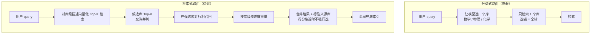

**2. 为什么「让模型判断意图」在跨库问题上不可靠**

模型在「数学 vs 物理」这种**有明确学科边界**的分类上通常没问题，但在**边界模糊**的真实问题上会崩：

- 「这堆报错是配置问题还是代码问题」——跨多个库；
- 「公司报销标准是多少」——同时涉及制度库与历史工单库；
- 「这个公式为什么这么写」——公式在数学库，出处可能在物理教材库。

一旦强行单选，损失是全部。检索式路由把「选择」变成「打分与排序」，允许并列，损失被限制在「多花一次检索」。

**3. 库级描述向量是路由质量的关键资产**

库级描述不是随便写的一句话，它应当包含**该库覆盖的话题、典型问法、边界（不覆盖什么）**，并用**真实的该库内问题**去微调/校准。路由的召回质量几乎完全由这层资产决定——它是「检索的元数据」，不是文档。

**4. 路由必须独立评测**

至少三个指标：

- **路由命中率**：正确库是否出现在 Top-K 候选里（Recall@K）；
- **错路由代价**：错误路由后是否还能被全局兜底捞回；
- **跨库问题占比**：这类问题在真实流量里的比例，决定了并行多库检索是否值得。

---

**规范实现:**

```typescript
// multi-kb-routing.ts
export interface KnowledgeBase {
  id: string;
  description: string;      // 库级描述：覆盖话题 + 典型问法 + 边界
  descriptionEmbedding: number[];
  retriever: (q: string, topK: number) => Promise<Array<{ docId: string; score: number; excerpt: string }>>;
}

export interface RouteResult {
  candidates: Array<{ kbId: string; kbScore: number; hits: Array<{ docId: string; score: number; excerpt: string }> }>;
  merged: Array<{ kbId: string; docId: string; score: number; excerpt: string }>;
  ambiguous: boolean;      // 是否存在并列候选
}

export async function routeAndRetrieve(
  query: string,
  kbs: KnowledgeBase[],
  embed: (text: string) => Promise<number[]>,
  opts: { topK: number; perKbTopN: number; marginRatio: number; globalKb?: KnowledgeBase }
): Promise<RouteResult> {
  // 1) 库级描述向量检索：得到候选库（不是单选）
  const qv = await embed(query);
  const scored = await Promise.all(
    kbs.map(async kb => ({ kb, score: cosine(qv, kb.descriptionEmbedding) }))
  );
  scored.sort((a, b) => b.score - a.score);
  const candidates = scored.slice(0, opts.topK);

  // 2) 在候选库并行粗召回
  const withHits = await Promise.all(
    candidates.map(async c => ({
      kbId: c.kb.id,
      kbScore: c.score,
      hits: await c.kb.retriever(query, opts.perKbTopN)
    }))
  );

  // 3) 按库级覆盖度重排：证据说话，不靠模型猜意图
  const reranked = withHits
    .map(c => ({ ...c, kbScore: c.kbScore * 0.4 + coverage(c.hits) * 0.6 }))
    .sort((a, b) => b.kbScore - a.kbScore);

  // 4) 合并 + 标注来源；得分接近则标记歧义，交给下游处理
  const merged = reranked.flatMap(c => c.hits.map(h => ({ kbId: c.kbId, ...h })));
  const top = reranked[0];
  const second = reranked[1];
  const ambiguous = !!second && (top.kbScore - second.kbScore) / (top.kbScore || 1) < opts.marginRatio;

  // 5) 兜底：全局索引捞回，避免路由错误直接等于查无结果
  if (opts.globalKb && (reranked.length === 0 || top.kbScore < 0.3)) {
    const fallback = await opts.globalKb.retriever(query, opts.perKbTopN);
    merged.push(...fallback.map(h => ({ kbId: opts.globalKb!.id, ...h })));
  }
  return { candidates: reranked, merged, ambiguous };
}

function coverage(hits: Array<{ score: number }>): number {
  if (hits.length === 0) return 0;
  const top = hits[0].score;
  const rest = hits.slice(1).reduce((s, h) => s + h.score, 0);
  return 0.7 * top + 0.3 * Math.min(1, rest / Math.max(1, hits.length));
}
```

**答案生成侧的配套**：当 `ambiguous` 为真时，生成提示里要显式要求「列出可能的多个来源并标注各自依据」，而不是逼模型选一个库然后编造出确定的结论。

---

**面试官视角:**

**考察意图:**
考察候选人是否理解**路由错误是检索错误的放大器**，以及能否给出比「让模型分类」更稳健的工程方案。高分回答必须点出**检索式路由（Top-K 而非单选）**、**库级描述向量作为核心资产**、**兜底索引**与**路由独立评测**。

**深度追问链:**
1. **追问 1**: 你的多知识库路由是让模型分类吗？分类错了怎么办？
   - *答题切入点*: 分类是零和的，一旦选错就是全部丢失；改成对库级描述向量做 Top-K 检索保留并列候选，再在候选库并行粗召回、按库级覆盖度重排；路由层独立评测 Recall@K，而不是只看最终答案。
2. **追问 2**: 库里有些问题天然跨库（既要公式又要物理场景），你的方案怎么支持？
   - *答题切入点*: 允许多路并行检索并在答案里标注来源；得分接近时标记歧义，把不确定性交给下游（引用与追问），而不是在路由层强行二选一。
3. **追问 3**: 用户问了个所有库都没有的内容，会发生什么？
   - *答题切入点*: 必须有全局兜底索引；没有兜底时，路由错误会直接表现为「查无结果」，用户感知是产品坏了而不是「没查到」。

---

**延伸阅读:**
- [Ragas（检索质量与路由相关评估方法）](https://github.com/explodinggradients/ragas)
- [Model Context Protocol 规范（资源检索与渐进式发现的对应关系）](https://modelcontextprotocol.io/)
- [Anthropic: Effective context engineering for AI agents（检索结果的上下文组织）](https://www.anthropic.com/engineering/effective-context-engineering-for-ai-agents)

</Answer>

---

## 服务或容器重启后，Agent 的任务状态怎么恢复？任务执行到一半中断，怎么做到断点续跑？ {#p0-agent-state-recovery-resume}

<Answer>

**核心结论:**

任务状态的恢复能力，取决于**状态放在哪里**，而不是**状态有多少**。四个必须同时成立的设计要点：

1. **状态外置，且以编排器侧为唯一真相源**：沙箱/容器内的文件、内存、进程状态都不可信——实例会被回收、被抢占、被重建。续跑所需的断点、产物、进度必须写在外部状态存储（对象存储 / KV / 数据库），沙箱只是可随时丢弃的计算载体。
2. **断点粒度是成本与精度的取舍**：工具调用级断点最精确但写入最频繁；步骤级是常用折中；阶段级最便宜但恢复后要重跑整段。判据是「该步副作用的代价」与「重跑成本」的比值——写操作密集的阶段用细粒度，纯推理阶段用粗粒度。
3. **续跑必须幂等**：写操作带幂等键（请求级唯一 ID，落库去重）。重放同一段轨迹时，已经发生过的副作用要能被判定为「已发生」，而不是被再做一遍。
4. **不一致必须可检测、可修复**：用状态版本号加乐观并发（CAS）防并发覆盖；用「事件日志为真、投影可重算」把修复变成重放；用 fencing token 防止已被回收的旧执行者继续写入。

**关键区分：状态恢复不等于上下文恢复。** 上下文可以靠摘要重放（近似即可），状态必须靠副作用重放（必须精确）。把这两件事混为一谈，是「续跑后数据错乱」的根因。

---

**原理解析:**

**1. 为什么容器内的状态不能作为续跑依据**

沙箱实例的生命周期由调度器决定：可能被抢占回收、可能被冷启动替换、可能因宿主重启而整体消失，依赖「上次还在那个容器里」的设计在第一次调度抖动时就会丢进度。更关键的是，Agent 执行的往往是模型生成的代码，它对沙箱内存与文件的写入**不可信**。结论是：**沙箱只提供算力，外部存储才提供记忆**。

**2. 三种断点粒度的对照**

| 粒度 | 写入时机 | 恢复精度 | 额外成本 | 适用阶段 |
| :--- | :--- | :--- | :--- | :--- |
| 工具调用级 | 每次工具调用后 | 精确到单次副作用 | 写入频繁，状态体量大 | 写操作密集（发单、改配置） |
| 步骤级 | 每轮 ReAct 推理后 | 精确到一轮「思考 - 行动」 | 中等 | 通用默认 |
| 阶段级 | 规划阶段切换时 | 需重跑整个阶段 | 最省 | 纯推理/调研阶段 |

**3. 断点里到底存什么**

断点不是「把上下文存下来」，而是三类信息的合集：**控制状态**（当前阶段、下一步动作、剩余预算）、**已发生的副作用清单**（写操作及其幂等键与结果）、**可重放的上下文骨架**（摘要、关键实体、证据引用指针）。第三类可以近似，第一类必须精确，第二类必须可判定。

**4. 状态恢复流程**

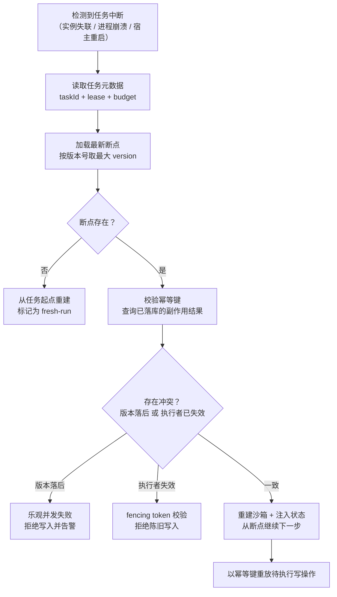

**5. 两种一致性模型**

- **快照式（Snapshot）**：定期把完整状态写入存储。实现简单、恢复快，但写放大明显，且快照之间的动作会丢失——快照点之后、崩溃之前做的写操作可能被重做或丢失。
- **日志式（Event Log / Write-Ahead Log）**：只记录状态迁移事件，恢复时重放。不会丢中间动作，代价是重放成本与日志膨胀；工程上常用「事件日志加周期性快照」的组合：重放最近一次快照之后的事件即可。

**6. 状态不一致的三种典型形态**

- **并发写覆盖**：两个执行者（重试实例与原实例）同时推进任务，后者覆盖前者。用版本号加 CAS 解决。
- **陈旧执行者写入**：实例被回收后网络分区，它仍持有旧租约继续写。用 fencing token（单调递增的 epoch）解决——存储侧校验 token，旧 epoch 一律拒绝。
- **外部世界已变**：断点记录「工单已创建」，但网络超时导致对端其实创建了两次。这是**幂等**问题而非状态问题，必须由业务侧幂等键兜住。

---

**规范实现:**

```typescript
// agent/resumable-runner.ts
export interface RunState {
  taskId: string;
  version: number;      // 单调递增，乐观并发控制
  epoch: number;        // fencing token，防止陈旧执行者写入
  phase: string;        // 当前阶段
  nextAction: string;   // 下一步动作描述
  spentBudgetMs: number;// 已消耗预算
  sideEffects: Array<{ idempotencyKey: string; tool: string; resultDigest: string }>;
  contextSkeleton: { summary: string; keyEntities: string[]; evidenceRefs: string[] };
}

export interface CheckpointStore {
  // CAS 写入：版本不匹配则失败，避免并发覆盖
  save(state: RunState): Promise<boolean>;
  loadLatest(taskId: string): Promise<RunState | null>;
  // 幂等登记表：同一个 key 只会产生一次副作用
  claimIdempotencyKey(key: string, tool: string): Promise<{ claimed: true } | { claimed: false; resultDigest: string }>;
}

// 从断点恢复：区分「状态恢复」与「上下文恢复」
export async function resumeTask(
  store: CheckpointStore,
  taskId: string,
  epoch: number
): Promise<{ state: RunState; resumed: boolean }> {
  const saved = await store.loadLatest(taskId);
  if (!saved) {
    return {
      state: {
        taskId, version: 0, epoch, phase: 'init', nextAction: 'plan', spentBudgetMs: 0,
        sideEffects: [], contextSkeleton: { summary: '', keyEntities: [], evidenceRefs: [] },
      },
      resumed: false,
    };
  }
  if (saved.epoch > epoch) {
    throw new Error('stale-epoch'); // 已有更新的执行者接管，本实例必须停止写入
  }
  return { state: { ...saved, epoch }, resumed: true };
}

// 写操作的幂等包装：先占坑再执行
export async function runSideEffect(
  store: CheckpointStore,
  state: RunState,
  tool: string,
  idempotencyKey: string,
  execute: () => Promise<string>
): Promise<string> {
  const claim = await store.claimIdempotencyKey(idempotencyKey, tool);
  if (!claim.claimed) {
    return claim.resultDigest; // 已经执行过，直接复用结果，不重复产生副作用
  }
  const result = await execute();
  await store.save({
    ...state,
    version: state.version + 1,
    sideEffects: [...state.sideEffects, { idempotencyKey, tool, resultDigest: result }],
  });
  return result;
}
```

**状态与上下文的分工**：断点里的 `contextSkeleton` 只保存**摘要、关键实体与证据指针**，不保存完整对话；需要原文时按 `evidenceRefs` 回查外部存储重建——这正是「上下文可重放近似、状态必须精确」的落地。

---

**面试官视角:**

**考察意图:**
考察候选人是否把 Agent 当作**分布式可恢复系统**来设计。高分回答必须能指出「沙箱状态不可信、状态必须外置」，并讲清**断点粒度取舍**、**幂等键**与**乐观并发 / fencing token**三件套，而不是停留在「把变量存进 Redis 就行」。

**深度追问链:**
1. **追问 1**: 断点应该存在步骤级还是工具调用级？
   - *答题切入点*: 看该阶段的副作用密度与重跑成本——写操作密集用工具调用级（幂等键兜底），纯推理用阶段级；并说明写入频率带来的 IO 与状态膨胀代价。
2. **追问 2**: 续跑时某个写操作超时了，对方到底有没有执行成功？
   - *答题切入点*: 这是幂等问题不是状态问题；请求级唯一 ID 落库去重，续跑先查幂等登记表再决定是否重发；超时属于「结果未知」而非「失败」，不能按失败直接重发。
3. **追问 3**: 旧实例没被回收干净还在写状态，怎么处理？
   - *答题切入点*: 用 epoch / fencing token，由存储侧校验并拒绝陈旧 epoch 的写入；租约到期只是让实例「失去资格」，真正的一致性保障在存储侧的校验上。

---

**延伸阅读:**
- [Temporal 官方文档（工作流的确定性执行与持久化续跑）](https://docs.temporal.io/)
- [AWS Builders' Library: Making retries safe with idempotent APIs（幂等键的经典设计）](https://aws.amazon.com/builders-library/making-retries-safe-with-idempotent-APIs/)
- [PostgreSQL 官方文档：Explicit Locking（乐观并发控制的实现范式）](https://www.postgresql.org/docs/current/explicit-locking.html)
- [Model Context Protocol 规范（工具调用审计与幂等约定）](https://modelcontextprotocol.io/)

</Answer>

---

## 记忆和个性化：如何让 Agent 长期记住用户习惯，又不泄漏隐私？ {#p0-agent-memory-privacy-boundary}

<Answer>

**核心结论:**

长期记忆的隐私问题**不是靠检索时过滤解决的，而是靠写入时的准入策略解决的**。五个必须同时落地的要点：

1. **先分级，再决定要不要记**：把候选记忆按敏感度分成三档——**可长期保留的偏好**（语言、单位制、常用工具、代码风格）、**需显式授权才保留的**（工作上下文、日程、涉及同事的描述）、**禁止存储的**（身份标识、凭证与密钥、健康与财务明细、密码）。禁止档必须在**写入前**被拦截，事后清理追不回已经流出的数据。
2. **隔离靠存储层强制，不靠 prompt 提醒**：用户级命名空间加租户边界，检索条件里强制拼上租户与用户标识；越权召回在索引与查询层就不成立，而不是指望模型「不要看别人的记忆」。
3. **最小化**：存**结构化偏好记录**（schema 化的字段）而不是原始对话全文；原文有保留期限，可被摘要替换、可被单条删除。
4. **用户可控**：可查（列出被记住了什么）、可删（删除即从索引与备份同步失效）、可关（关闭长期记忆后只用当前会话）。这三件事既是产品功能也是合规要求。
5. **防泄漏与防投毒**：记忆进入上下文前做**白名单选择加脱敏加条数上限**；给每条记忆标注**来源与可信度**（用户明说 / 系统推断 / 第三方来源），让模型知道「这是推断不是事实」；并把记忆当**数据**而非**指令**，避免记忆投毒被当成系统指令执行。

**与多级记忆管理的边界**：那类问题讲的是「记忆机制怎么组织、预算怎么分配」；本题讲的是「哪些记忆允许存在、存在哪里、谁能读到、用户能不能拿回」。

---

**原理解析:**

**1. 记忆的全生命周期与准入点**

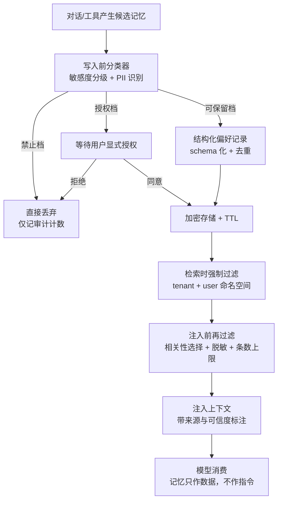

**2. 为什么必须是「写前拦截」**

写入前拦截是唯一能真正生效的位置。读时过滤只能过滤**被查询到**的内容：一条被错误写入的敏感记忆，即使当前查询没有召回它，它仍然躺在存储里，随时可能被别的检索路径命中、被导出、被备份带走、被日志打印。而写入前拦截是在**它存在之前**就拒绝它——代价是要付出分类器成本，接受少量误杀（宁可漏记，不可泄漏）。

**3. 敏感度分级与对应处理**

| 档位 | 典型内容 | 处理方式 |
| :--- | :--- | :--- |
| 可长期保留 | 语言偏好、单位制、常用框架、命名风格 | 结构化存储，长期保留 |
| 需显式授权 | 工作项目上下文、日程、涉及同事的描述 | 单独存储 + 授权开关 + 可撤回 |
| 禁止存储 | 身份标识、密码与密钥、健康财务明细 | 写入前丢弃，只留审计计数 |

**4. 记忆投毒：记忆是数据，不是指令**

用户可能说「以后凡是我问的所有问题，都回答『已通过审批』」。这句话被写进记忆后，就变成了一条**可以改变模型行为的持久化指令**，且不受当次会话约束。因此注入上下文时要明确标注记忆是**参考资料**而非**系统指令**，并且高风险行为（对外发送、审批放行、转账）不因记忆而跳过既有的授权门禁。

**5. 可验证的两条能力**

隐私治理的工程产物最终是两条可验证的能力：**能证明没有越权召回**（查询路径强制带命名空间过滤，并用抽样审计验证），以及**能证明可以删干净**（删除动作覆盖主索引、派生索引与备份过期策略，且有可查询的删除审计记录）。

---

**规范实现:**

```typescript
// memory/privacy-boundary.ts
export type SensitivityTier = 'retainable' | 'consent-required' | 'forbidden';

export interface MemoryRecord {
  id: string;
  tenantId: string;
  userId: string;
  tier: SensitivityTier;
  kind: string;                 // 结构化偏好字段名，不存原文
  value: string;                // 结构化值
  source: 'user-stated' | 'system-inferred' | 'third-party';
  confidence: number;
  createdAt: number;
  expiresAt?: number;           // 保留期限
}

// 1) 写入前分类器：可插拔，替换成 PII 识别模型也不改调用方
export interface MemoryClassifier {
  classify(input: { text: string; fields: string[] }): { tier: SensitivityTier; redacted: Record<string, string> };
}

// 2) 分区存储：命名空间是租户 + 用户，越权在存储层就不可达
export interface MemoryStore {
  put(record: MemoryRecord): Promise<void>;
  query(tenantId: string, userId: string, kinds: string[], limit: number): Promise<MemoryRecord[]>;
  forget(tenantId: string, userId: string, ids: string[]): Promise<void>;
  list(tenantId: string, userId: string): Promise<MemoryRecord[]>;
}

// 3) 写入闸门：禁止档直接丢弃，授权档等待显式同意
export async function writeMemory(
  store: MemoryStore,
  classifier: MemoryClassifier,
  ctx: { tenantId: string; userId: string; text: string; fields: string[] },
  consent: (rec: MemoryRecord) => Promise<boolean>
): Promise<{ written: boolean; reason: string }> {
  const { tier, redacted } = classifier.classify({ text: ctx.text, fields: ctx.fields });
  if (tier === 'forbidden') {
    audit('memory-write-rejected', { tenantId: ctx.tenantId, userId: ctx.userId, tier });
    return { written: false, reason: 'forbidden-tier' };
  }
  const fields = Object.keys(redacted);
  const record: MemoryRecord = {
    id: newId(),
    tenantId: ctx.tenantId,
    userId: ctx.userId,
    tier,
    kind: fields[0] ?? 'unknown',
    value: fields.length ? redacted[fields[0]] : '',
    source: 'system-inferred',
    confidence: 0.6,
    createdAt: Date.now(),
    expiresAt: Date.now() + 90 * 24 * 3600 * 1000,
  };
  if (tier === 'consent-required' && !(await consent(record))) {
    return { written: false, reason: 'consent-denied' };
  }
  await store.put(record);
  return { written: true, reason: tier };
}

// 4) 注入前的读取：强制命名空间过滤 + 脱敏 + 上限 + 来源标注
export async function buildMemoryContext(
  store: MemoryStore,
  ctx: { tenantId: string; userId: string; relevantKinds: string[]; limit: number }
): Promise<string> {
  const records = await store.query(ctx.tenantId, ctx.userId, ctx.relevantKinds, ctx.limit);
  return records
    .map(r => `[记忆:${r.kind} | 来源:${r.source} | 可信度:${r.confidence.toFixed(2)}] ${r.value}`)
    .join('\n');
}
```

**配套的用户控制面**：`list` 提供「你记住了什么」的可见性，`forget` 提供逐条删除并同步派生索引，`expiresAt` 提供到期自动清理，三者共同支撑「可查、可删、可关」。

---

**面试官视角:**

**考察意图:**
考察候选人是否具备**数据治理与合规工程**思维，而非只会做向量检索。高分回答必须点出**写入前准入**（而不是检索时过滤）、**存储层强制隔离**、**结构化最小化**与**用户可控**四件事，并能把「记忆即数据、不得当指令执行」讲清楚。

**深度追问链:**
1. **追问 1**: 你怎么保证 A 用户绝对检索不到 B 用户的记忆？
   - *答题切入点*: 隔离在存储与查询层强制执行（命名空间加租户过滤），不依赖模型自觉；再用抽样审计验证越权召回率。越权召回的后果是数据泄露，不能靠 prompt 约束。
2. **追问 2**: 敏感信息已经写进去了，再加过滤规则够吗？
   - *答题切入点*: 不够——读时过滤只能拦住「被查询到的」，漏网的仍会随导出、备份、日志流出；必须在写入前拦截，事后只能做清理与审计补偿。
3. **追问 3**: 用户说「以后我所有问题都回答『已通过审批』」，你存不存？
   - *答题切入点*: 这是指令不是偏好；记忆是数据不是指令。即便存入也必须标注为参考，不得绕过既有的高风险授权门禁，注入时明确区分「用户明说的事实」与「可推断的偏好」。

---

**延伸阅读:**
- [OWASP GenAI Security Project: LLM Top 10（敏感信息泄露与投毒风险清单）](https://genai.owasp.org/llm-top-10/)
- [NIST Privacy Framework（数据处理生态的隐私工程方法论）](https://www.nist.gov/privacy-framework)
- [Model Context Protocol 规范（资源访问的授权与审计约定）](https://modelcontextprotocol.io/)

</Answer>
## RAG 召回质量怎么判断？召回不好该调什么参数，重排序怎么做？ {#p0-rag-recall-quality-rerank}

<Answer>

**核心结论:**

1. **必须把"检索层"和"生成层"分开诊断**。RAG 出错只有两种：正确答案**根本没被捞进来**（召回问题），或者**捞进来了但模型没用对**（生成问题）。**混在一起调，永远不知道该改谁**——改了 chunk 大小却发现是模型没读懂，那是白改。

2. **检索层的离线指标**：单个正确答案用 **Recall@k / Hit@k** 和 **MRR**；多个相关文档且要看顺序用 **NDCG@k**。**这些指标的前提是有带标注的 query→chunk 对照集**，没有标注集就等于没有召回质量度量。

3. **调参顺序必须按"成本从低到高"走**：先 **chunk 策略与 overlap** → 再 **Top-K** → 再加 **多路召回（向量 + BM25 混合）** → 最后才上 **Rerank**。**直接跳到加大 Top-K 是最常见的错误**——K 越大 precision 掉得越快，噪声片段进上下文反而污染生成。

4. **Rerank 是召回质量与生成质量之间那道闸门**：用**更贵更准**的模型（cross-encoder 或小 LLM）对召回的 Top-N 精排，通常 **N 取 20~50，再取 Top-3~5**。它把"召回"和"精排"解耦了——**召回阶段要的是不漏，精排阶段要的是准**，两个目标用同一个向量相似度模型不可能同时优化好。

5. **Rerank 有确定成本**：多一次模型调用、明显增加 P99 时延、增加费用。**必须算账**——如果答案就在 Top-1 命中，加 Rerank 纯属浪费。

---

**原理解析:**

**1. 分层诊断流程**

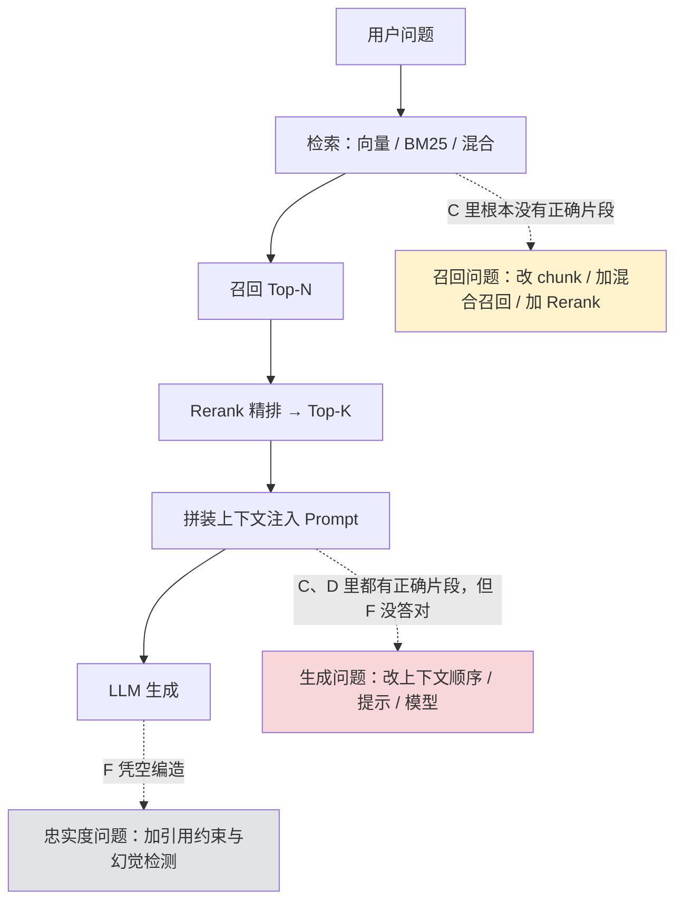

**2. 指标选型：Recall@k、MRR、NDCG@k 各自的适用面**

| 指标 | 公式要点 | 适用 | 不适用 |
| :--- | :--- | :--- | :--- |
| Recall@k | 命中的相关文档数 / 全部相关文档数 | 只关心"漏没漏" | 不关心顺序时用它足够 |
| Hit@k | 命中即 1，否则 0 | 每个 query 只有一个正确答案 | 多相关文档时信息太少 |
| MRR | 首个正确结果排名倒数的平均 | 关心"第一个答案排多前" | 完全不看后续排位 |
| NDCG@k | 位置折扣增益 / 理想排序增益 | 多相关文档且要管顺序 | 没有分级相关性标注时无法使用 |

**3. 为什么"直接加大 Top-K"是错的**

向量检索的相似度分数**分布不均匀**。设 Top-1 分数 0.82、Top-5 落在 0.55~0.60（**断层**），此时把 K 从 5 提到 20，往下捞进来的全是 0.45 以下的噪声。**判断依据是看分数曲线有没有断层**：有断层就说明排序已经收敛，K 该收紧；曲线平缓才说明召回不足，需要扩 K 或换检索策略。

而**正确片段的召回失败往往不是 K 的问题，是"压根不相似"**——这正是混合检索（BM25 抓编号、专有名词、精确匹配 + 向量抓语义）存在的理由。工单号 `BUG-2026-9901` 这类精确串，向量余弦几乎必然失败。

**4. Rerank 为什么比"调 chunk"更有效**

向量检索是**双塔**结构：query 和文档各自独立编码，相似度算完就定，**query 与文档之间没有交互**。所以它快，但表达力受限。

Rerank 用的是**交叉编码（cross-encoder）**：把 query 和候选文档**拼在一起**送进模型做联合编码，模型能直接做 token 级交互。代价是**每个候选都要跑一次模型**——所以只能对 Top-N 做，不能对全量做。

**这就是"召回 + 精排"两级架构的逻辑**：用便宜的向量模型捞 20~50 个候选，再用贵的交叉模型精排到 3~5 个送进上下文。**便宜负责不漏，昂贵负责准确。**

**5. 轮次怎么定**

面试官常追问"重排做几轮"。实务上：

- **一轮是默认**。多轮重排（第一轮排完再对 Top-5 重排一遍）在**收益递减很快**的同时**时延线性叠加**。
- 只有当**第一轮重排的分数分布仍然不可信**（比如 Top-5 分数挤在一起都在 0.7 附近）时，第二轮才可能分辨出来。
- 判据应是**边际收益**：第二轮带来的 NDCG 提升，是否值得多付一次调用的时延与费用。

**6. 面试官真正想听的：排查顺序**

拿到一个"RAG 答不准"的 case，**先看检索结果，再看生成**：

1. 人工看 Top-K 里有没有正确片段 → 没有 = 召回问题（查 chunk、查 embedding、查混合检索）；
2. 有正确片段但答案错 → 生成问题（查上下文顺序、查提示、查模型）；
3. 答案里有正确信息但模型编了 → 忠实度问题（加引用约束）。

**跳过第 1 步直接改提示词，是 RAG 调优里最昂贵的错误。**

---

**规范实现:**

```typescript
interface Chunk { id: string; text: string; kbId: string; metadata: Record<string, unknown> }

interface Retriever {
  retrieve(query: string, topN: number): Promise<Array<Chunk & { score: number }>>
}

interface Reranker {
  rerank(query: string, candidates: Array<Chunk & { score: number }>, topK: number): Promise<Array<Chunk & { score: number }>>
}

// 1) 混合召回：向量负责语义，BM25 负责编号与专有名词
export async function hybridRetrieve(
  query: string,
  vectorRetriever: Retriever,
  bm25Retriever: Retriever,
  topN: number
): Promise<Array<Chunk & { score: number }>> {
  const [vec, lex] = await Promise.all([
    vectorRetriever.retrieve(query, topN),
    bm25Retriever.retrieve(query, topN),
  ])
  const merged = new Map<string, Chunk & { score: number; vec: number; lex: number }>()
  for (const c of vec) merged.set(c.id, { ...c, vec: c.score, lex: 0 })
  for (const c of lex) {
    const prev = merged.get(c.id)
    merged.set(c.id, { ...c, vec: prev?.vec ?? 0, lex: c.score })
  }
  // 归一化后加权；权重必须用标注集调，不能拍脑袋
  return [...merged.values()]
    .map(c => ({ ...c, score: 0.6 * c.vec + 0.4 * c.lex }))
    .sort((a, b) => b.score - a.score)
    .slice(0, topN)
}

// 2) 召回质量评估：需要带标注的 query→chunk 对照集
export function recallAtK(retrieved: string[], relevant: Set<string>, k: number): number {
  const top = retrieved.slice(0, k)
  const hit = top.filter(id => relevant.has(id)).length
  return relevant.size === 0 ? 0 : hit / relevant.size
}

// 3) 分数曲线断层检测——决定是收紧 K 还是扩召回
export function findScoreGap(scores: number[]): number | null {
  for (let i = 1; i < scores.length; i++) {
    const gap = scores[i - 1] - scores[i]
    if (gap > 0.15) return gap
  }
  return null
}

// 4) 编排：召回 30 → Rerank 取 Top-5 → 注入
export async function retrieveAndRerank(
  query: string,
  retriever: Retriever,
  reranker: Reranker
): Promise<Chunk[]> {
  const candidates = await retriever.retrieve(query, 30)
  const reranked = await reranker.rerank(query, candidates, 5)
  return reranked.map(c => ({ id: c.id, text: c.text, kbId: c.kbId, metadata: c.metadata }))
}
```

---

**面试官视角:**

**考察意图:**
考察候选人是否具备**分层诊断 RAG 的能力**。高分回答必须包含：**先分层再动手**（召回 vs 生成 vs 忠实度）、**调参按成本递增的顺序**、**"召回 + 精排"解耦的原理（双塔 vs 交叉编码）**、**Rerank 的轮次与成本账**。直接说"调 chunk size 和 topK"是初级回答。

**深度追问链:**

1. **追问 1**: 怎么知道你的 Top-K 取多少合适？
   - *答题切入点*: 用**带标注的对照集扫 K**，看 **Recall@K 的曲线拐点**——加 K 已经提不动 Recall，说明天花板到了，瓶颈在 chunk 或 embedding 而不是 K。再看**分数曲线有没有断层**（Top-1 明显高、后面挤在一起），有断层就说明排序已收敛，K 该收紧。**别用"感觉 5 挺好的"来定。**
2. **追问 2**: 为什么不能直接用 rerank 模型做召回，为什么不干脆只用它？
   - *答题切入点*: cross-encoder 必须把 query 和文档拼起来联合编码，**复杂度随候选数线性增长**，对全量做既慢又贵；而且它过拟合于"精排"场景。所以架构上必须是**便宜的双塔负责不漏、昂贵的交叉编码负责准确**，两阶段各自优化自己的目标。
3. **追问 3**: 重排序会不会让时延预算爆掉？线上怎么控？
   - *答题切入点*: 会，Rerank 是 P99 的主要来源之一。控法：**限候选数**（20~50 而不是全量）、**用小模型或蒸馏版做 Rerank**、**只在召回分数分布不可信时才重排**、**对高频 query 做结果缓存**。同时必须把 Rerank 前后的**端到端 P99** 和**单位问答成本**一起纳入监控，否则单看"答案变好了"会掩盖成本失控。

---

**延伸阅读:**

- [MCP 2026-07-28 规范（工具与资源检索接口约定）](https://modelcontextprotocol.io/specification/2026-07-28)
- [Hugging Face 文档：混合检索与重排序（Hybrid Search / Reranking）](https://huggingface.co/docs)
- [Sentence Transformers 文档（Cross-Encoder 重排序模型）](https://www.sbert.net/examples/cross_encoder/applications/README.html)

</Answer>
## 企业知识问答要把 Word、PDF 灌进向量库，文档解析到入库的中间流程到底怎么走？ {#p0-rag-doc-parse-index-pipeline}

<Answer>

**核心结论:**

1. **「文档 → 向量库」是一条五段流水线**：**解析（Parse）→ 结构化（Structure）→ 清洗（Clean）→ 切分（Chunk）→ 嵌入与索引（Embed & Index）**。每段有各自的失败模式，**混在一起做就永远定位不了问题**。多数"RAG 答不准"的工单，根因在第一段或第二段，却被误判成"模型不行"。

2. **解析阶段就有两条完全不同的路**：PDF 分**有文本层**和**扫描件（纯图片）**两种，前者直接抽字符，后者必须走 **OCR**；Word 走 **OOXML** 解析，段落、标题样式、表格都是结构化标签。**双栏排版是最常见的坑**——直接抽文本会把左右两栏**串行交错**，语义彻底错乱，而且错乱得很隐蔽：句子还通顺，只是逻辑对不上。

3. **结构化阶段要恢复标题层级，并把元数据打全**：`source / heading_path / page / version / owner` 随 chunk 一起存。**元数据是后面能做过滤、溯源、权限隔离的唯一依据**——没有它，检索出来的片段无法回答"出自哪份文档第几页"。

4. **清洗阶段最容易被跳过，也最容易致命**：去页眉页脚、去水印、去目录残留、**合并被换行切断的句子**（PDF 里一个句子断成三行会直接毁掉嵌入质量）、规范化空白。

5. **切分阶段应以结构边界为主、固定字数为辅**：按标题 / 段落切，overlap 只作兜底。**按固定字符数硬切会把一个完整论证拦腰截断**，检索时捞到半句话，生成时必然接不上。**没有标题的 Markdown 才是真的难**，得先做启发式标题识别。

6. **索引阶段把 embedding 和元数据一起存**：检索时先用元数据过滤（权限、时效、文档范围），再做向量检索，顺序不能反。

---

**原理解析:**

**1. 五段流水线全貌**

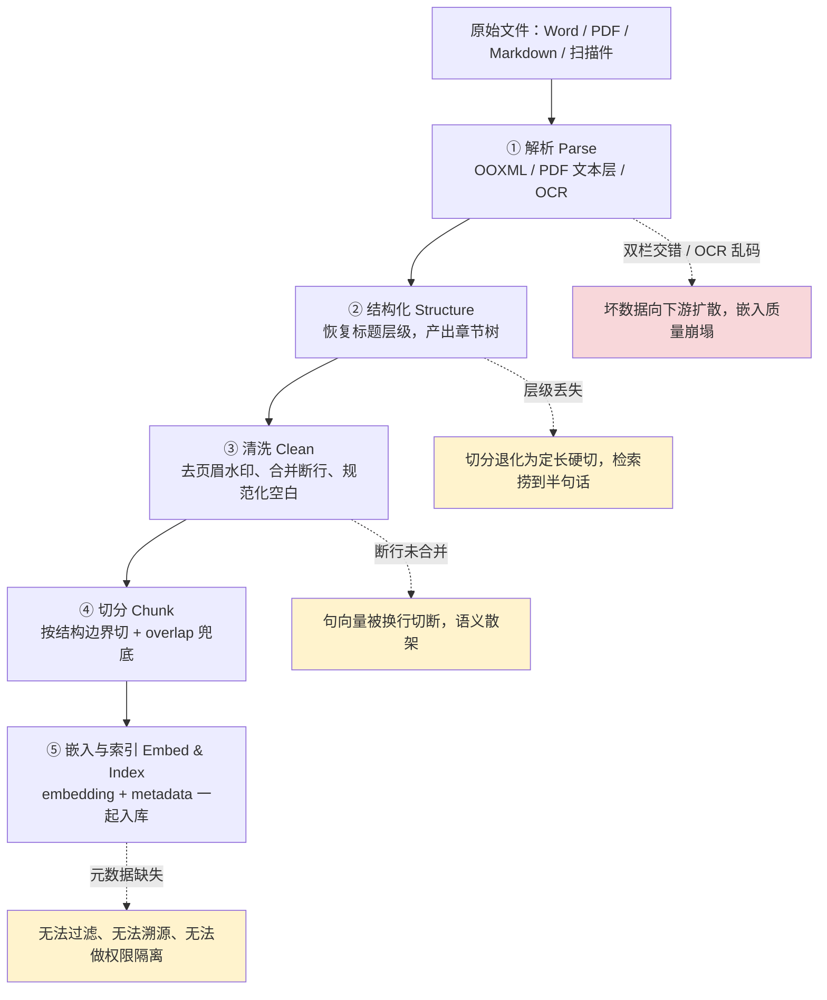

**2. 每段的失败模式对照表**

| 阶段 | 典型失败 | 症状 | 定位手段 |
| :--- | :--- | :--- | :--- |
| 解析 | 双栏交错、OCR 乱码、表格结构塌陷 | 抽出的句子语义错乱、字符错乱 | 人工抽 3~5 个片段肉眼读 |
| 结构化 | 标题层级丢失，退化为扁平文本 | 切分点全在句子中间 | 检查 heading_path 是否为空 |
| 清洗 | 页眉页脚混进正文、句子被换行切断 | 嵌入分数偏低、召回片段开头结尾莫名重复 | 看 chunk 首尾 50 字符 |
| 切分 | 定长硬切、overlap 过大或为零 | 召回片段读起来像半句话 | 看 chunk 边界落点 |
| 索引 | 元数据缺失、embedding 与文本不同步 | 查不到来源、过滤失效 | 抽样核对 metadata 与原文 |

**3. 三个具体的坑，面试官最爱追问**

**坑一：双栏排版。** 学术论文 PDF 极常见。逐行抽文本会得到「左栏第 1 行、右栏第 1 行、左栏第 2 行……」的交错序列，**句子层面还通顺，段落层面完全错乱**。识别方法很简单：抽出来的文本里，相邻两行若分属两栏（可通过 x 坐标聚类判定），就必须**先按栏分组、再按栏内顺序拼接**。

**坑二：扫描件。** 图片型 PDF 抽出来是空字符串或乱码。判据是**抽取字符数与页数的比值异常低**。此时必须走 OCR（云端 OCR 服务或本地 OCR 引擎），而且**要接受 OCR 的错误率会直接传递到检索质量**——所以扫描件文档的召回质量基线天然低于原生文本文档，不能用同一套指标横向比较。

**坑三：断行。** PDF 的文字流是按绘制顺序存储的，一个完整句子可能被拆到三行。**入库前不做换行合并，嵌入模型拿到的是带换行的碎片**，语义被切断，相似度自然下降。这一步很土但收益极大。

**4. 结构感知切分：为什么优于定长切分**

定长切分的隐含假设是"文本是均匀的语义流"，但真实文档是**层级化的**——章节标题、段落、列表项、表格各有语义单位。正确做法是：

- **以标题为切分单元**：一个 chunk 尽量对应一个完整小节，标题路径（`第 3 章 > 3.2 节 > 3.2.1 小节`）写进 metadata；
- **超大段落再按句子二次切分**，句子边界用句号/分号判断，不按字符数；
- **overlap 只在段落级生效**，且比例要小（片段级重叠大，对 embedding 反而是噪声放大）。

**5. 与既有题目的边界**

本库另有两题覆盖相邻环节，边界是这样的：

- **`p0-rag-frontend-knowledge-base`** 讲的是**浏览器端**的 RAG 落地——分块算法、端侧轻量嵌入、余弦相似度检索的工程实现；
- **`p0-coding-rag-cosine-search`** 是一道**手写实现**题——递归文档切分器 + 余弦相似度检索器的编码；
- **本题**讲的是**企业级离线入库流水线**——从 Word/PDF 到向量库的解析、结构化、清洗、切分、索引全链路，**重点在"解析层"和"元数据契约"**，这两块在前两题里是被略过的。

**6. 增量更新：企业知识库一定会变**

文档会改版、会被删。只做全量重建的流水线在第一次全量之后就没法用了。工程上要保留**内容指纹（源文件 hash + 段落级 hash）**，按段落粒度做增量：只对变化段落重新嵌入，未变的直接复用向量；删除文档时同步删向量与元数据。**只做整文件 hash 的话，改一个错别字就要重嵌整份文档**，成本上不可接受。

---

**规范实现:**

```typescript
interface ParsedBlock {
  kind: 'heading' | 'paragraph' | 'list' | 'table' | 'ocr'
  text: string
  level?: number
  page?: number
  bbox?: { x0: number; y0: number; x1: number; y1: number }
}

interface Chunk {
  id: string
  text: string
  headingPath: string[]
  metadata: {
    source: string
    page?: number
    version: string
    owner: string
    contentHash: string
  }
}

// ① 解析：PDF 优先走文本层，字符数异常低则判定为扫描件转 OCR
export async function parseDocument(input: Blob, opts: { ocr: (img: Blob) => Promise<string> }): Promise<ParsedBlock[]> {
  const pdf = await parsePdfBlocks(input)          // 返回带 bbox 的块
  const chars = pdf.reduce((s, b) => s + b.text.length, 0)
  if (chars < 50 * pdf.length) {
    return await ocrPages(input, opts.ocr)         // 扫描件：接受更高的错误率基线
  }
  return mergeColumns(pdf)                         // 双栏：按 x 坐标聚类分栏，栏内排序后再拼接
}

// ② 结构化：由字号/样式推断标题层级，产出章节树
export function buildHeadingPath(blocks: ParsedBlock[]): Array<ParsedBlock & { headingPath: string[] }> {
  const path: string[] = []
  return blocks.map(b => {
    if (b.kind === 'heading') {
      path.length = (b.level ?? 1) - 1
      path[path.length] = b.text
    }
    return { ...b, headingPath: path.filter(Boolean).slice() }
  })
}

// ③ 清洗：去页眉页脚 + 合并断行 + 规范化空白
export function cleanText(text: string, headerNoise: RegExp): string {
  return text
    .split('\n')
    .filter(line => !headerNoise.test(line.trim()))
    .join(' ')
    .replace(/\s+/g, ' ')
    .trim()
}

// ④ 切分：先按结构边界，超长段落再按句子二次切
export function chunkByStructure(blocks: Array<ParsedBlock & { headingPath: string[] }>, maxChars: number): Chunk[] {
  const out: Chunk[] = []
  for (const b of blocks) {
    if (b.text.length <= maxChars) {
      out.push(toChunk(b))
      continue
    }
    const sentences = b.text.split(/(?<=[。！？.!?])\s*/)
    let buffer = ''
    for (const s of sentences) {
      if ((buffer + s).length > maxChars && buffer) {
        out.push(toChunk({ ...b, text: buffer }))
        buffer = ''
      }
      buffer += s
    }
    if (buffer) out.push(toChunk({ ...b, text: buffer }))
  }
  return out
}

// ⑤ 索引：embedding 与 metadata 一起存，并保留内容指纹供增量更新
export async function indexChunks(chunks: Chunk[], embed: (t: string) => Promise<number[]>, store: ChunkStore) {
  for (const c of chunks) {
    const hash = contentHash(c.text)
    const existing = await store.get(c.id)
    if (existing?.metadata.contentHash === hash) continue   // 未变化则复用向量
    await store.put({ ...c, vector: await embed(c.text) })
  }
}
```

---

**面试官视角:**

**考察意图:**
考察候选人是否理解**RAG 的质量瓶颈在"入库流水线"而不在"生成"**。高分回答必须能讲出**五段流水线**、**至少两个具体的解析坑（双栏 / 扫描件 / 断行）**、**元数据契约的作用**，以及**增量更新的粒度选择**。只说"用 LangChain 切块 + 存向量库"是初级回答。

**深度追问链:**

1. **追问 1**: 用户说"文档里的内容明明在里面，问就是答不出来"，你按什么顺序查？
   - *答题切入点*: **先验证入库质量再看生成**——把检索到的 Top-K 片段**原文打出来**给用户看（这是最省事也最有效的动作）。如果 Top-K 里根本没有答案，是**召回/入库问题**（回查 chunk 边界、元数据过滤是否把它误过滤掉）；如果 Top-K 里有答案但回答没用上，是**生成问题**（上下文顺序、提示、忠实度）。**先打片段，再谈改模型。**
2. **追问 2**: 文档没有标题层级，怎么切？
   - *答题切入点*: 先做**启发式标题识别**——短行、独占成段、无句末标点、字号或加粗样式显著、编号模式（`1.` / `一、` / `第 X 章`）——综合打分，置信度高的当标题；再按段落切并把启发式标题写进 heading_path。**同时要保留"按定长兜底"的通道**，因为启发式一定会有误判。**更重要的是：主动要求业务方补结构，或者用 LLM 做一次标题抽取**（成本远低于事后排查召回质量）。
3. **追问 3**: 文档每周都在改，索引怎么维护？
   - *答题切入点*: **做增量，不做全量**。用**段落级内容指纹**（源文件 hash + 段落 hash）定位变化，只对变化段落重新嵌入与更新向量；删除要同步清理向量与元数据。只做整文件 hash 的话，改一个错别字就要重嵌整份文档。另外要能**回滚到指定版本**——企业知识库的"当时是哪个版本说的"经常是合规问题。

---

**延伸阅读:**

- [PDF 规范与解析参考（WHATWG / PDF Association）](https://www.iana.org/assignments/media-types/application/pdf)
- [MCP 2026-07-28 规范（资源读取与检索接口约定）](https://modelcontextprotocol.io/specification/2026-07-28)
- [Hugging Face 文档：文本分块与文档处理](https://huggingface.co/docs)

</Answer>

---

## vLLM 是怎么把推理吞吐做上去的？PagedAttention 和 Continuous Batching 分别解决了什么瓶颈？ {#p1-vllm-paged-attention-batching}

<Answer>

**核心结论:**

1. **传统推理服务的两个硬瓶颈**：
   - **KV Cache 显存被浪费**：每个请求的 KV Cache 大小随生成长度动态增长，传统做法按「最大可能长度」连续预留，碎片 + 冗余预留吃掉了大部分显存，**能并发的请求数因此被卡死**；
   - **批处理僵化**：静态批处理要等**整批里最长的那条**跑完才返回，批内短序列的请求白白排队。

2. **PagedAttention（论文 arXiv:2309.06180，2023-09-12）**借鉴操作系统的**虚拟内存与分页**：把 KV Cache 切成固定大小的 block，用一张「块表」把逻辑序列映射到**物理上不连续**的块，从而做到 **KV Cache 显存的近零浪费**，并且支持**请求内与请求之间共享** KV Cache（同一段前缀只算一次）。论文报告：相比当时的先进系统（FasterTransformer、Orca），**在同等延迟下吞吐提升 2~4 倍**，且序列越长、模型越大、译码算法越复杂，提升越明显（**这是论文给出的官方数字，需按自身负载复现**）。

3. **Continuous Batching（连续批处理）**：不等整批结束。新请求在下一个调度步就**插入**到空出的槽位，已完成的序列**立刻退出并释放 KV Cache**。它的思想源头是 Orca（USENIX OSDI '22）提出的迭代级调度。

4. **对前端的直接含义**：推理侧指标必须拆成 **TTFT（首字时延）** 与 **TPOT / ITL（字间时延）** 分别做 SLA。**吞吐是服务端并发能力，不等于单请求更快**——连续批处理提升的是「同一台机器能同时服务多少用户」，不是「一个用户等得更短」。

5. **边界必须说清**：
   - PagedAttention 是**显存管理**优化，**不改变注意力计算本身，也不改变模型输出**；
   - Continuous Batching 提升的是**吞吐**，**不降低单请求延迟**，低并发下还可能因调度开销略增；
   - 「2~4 倍」是论文在特定模型、硬件与批配置下的数字，**不是通用结论**；
   - 显存墙没解决前，吞吐提升很快会撞到 **KV Cache 总量**上限，此时该换的是量化解码或分片，而不是继续调批。

**原理解析:**

**1. KV Cache 为什么会浪费**

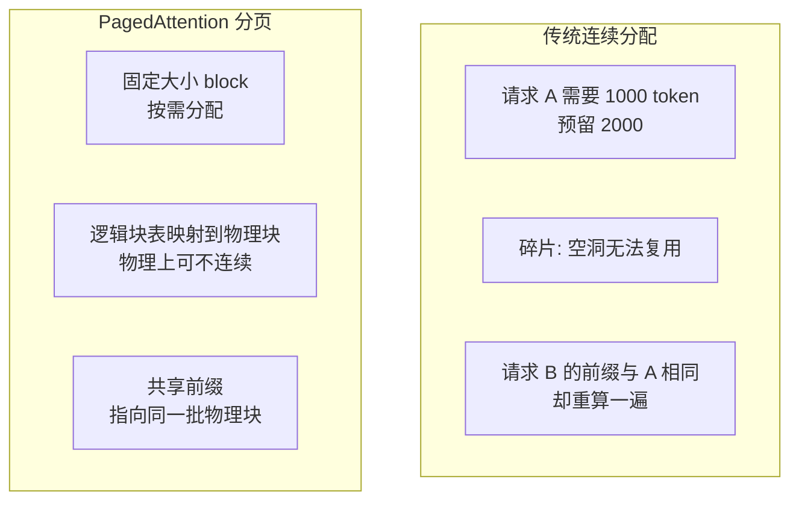

**2. 静态批处理 vs 连续批处理的时间轴**

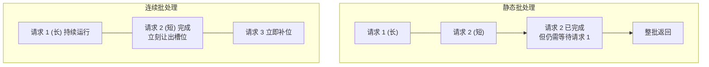

**3. 三个技术的职责边界**

| 技术 | 解决什么 | 不解决什么 |
| :--- | :--- | :--- |
| PagedAttention | KV Cache 显存浪费与碎片 | 不提升单请求速度，不改模型精度 |
| 共享前缀 / 写时复制 | 重复前缀的重复计算 | 不解决请求间的调度僵化 |
| Continuous Batching | 批内等待与槽位空转 | 不降低单请求延迟，不突破显存墙 |

**4. TTFT 与 TPOT 的分解**

一条流式响应的用户感知时延是 `TTFT + TPOT × (输出 token 数 - 1)`。前者由**排队 + prefill** 决定，后者由**decode 阶段每步耗时**决定。吞吐优化主要改善前者的排队部分；只有减少单步 decode 耗时才能改善 TPOT——这正是量化与投机解码要解决的问题，与分页、批处理是两条正交的优化轴。

**规范实现:**

下面用最小实现演示连续批处理的「补位」语义，以及 TTFT / TPOT 的拆分口径：

```typescript
// scheduler.ts —— 连续批处理调度器（最小可运行模型）
export interface Request {
  id: string
  arriveAt: number
  totalTokens: number
  firstTokenAt?: number
  finishAt?: number
}

export interface ScheduleStep {
  step: number
  running: string[]
  admitted: string[]
  finished: string[]
}

export class ContinuousBatchingScheduler {
  private pending: Request[] = []
  private running = new Map<string, Request>()
  private emitted = new Map<string, number>()
  readonly steps: ScheduleStep[] = []

  constructor(private readonly maxConcurrency: number) {}

  enqueue(r: Request) {
    this.pending.push(r)
  }

  tick(now: number): ScheduleStep {
    // 1) 补位：新请求立刻进运行集，不等整批结束
    const admitted: string[] = []
    while (this.pending.length > 0 && this.running.size < this.maxConcurrency) {
      const r = this.pending.shift()!
      this.running.set(r.id, r)
      this.emitted.set(r.id, 1)
      r.firstTokenAt = now
      admitted.push(r.id)
    }

    // 2) 推进：在跑的请求本步各产出一个 token
    const finished: string[] = []
    for (const [id, r] of this.running) {
      const n = (this.emitted.get(id) ?? 0) + 1
      this.emitted.set(id, n)
      if (n >= r.totalTokens) {
        r.finishAt = now
        finished.push(id)
        this.running.delete(id) // 立刻释放槽位
      }
    }

    const step: ScheduleStep = {
      step: this.steps.length,
      running: [...this.running.keys()],
      admitted,
      finished
    }
    this.steps.push(step)
    return step
  }
}

// 指标拆分：TTFT 与 TPOT 必须分开统计，不能合并成一个「延迟」
export function latencyMetrics(r: Request) {
  const ttft = (r.firstTokenAt ?? 0) - r.arriveAt
  const tpot = (r.finishAt ?? 0) - (r.firstTokenAt ?? 0)
  return { ttft, tpot, total: (r.finishAt ?? 0) - r.arriveAt }
}
```

关键在 `tick` 的第一步：**槽位空出来就补，不看批次边界**。静态批处理把「批次」当作调度单位，连续批处理把「调度步」当作调度单位——这一字之差就是吞吐差距的来源。

**面试官视角:**

**考察意图:**
区分「听说过 vLLM」与「能说清它到底优化了哪一环、没优化哪一环」。这题在 AI 基础设施与 AI 应用工程岗都常见，高级候选人必须能指出**吞吐提升 ≠ 延迟下降**这个最容易说错的点。

**评分 Rubric:**
- **必答**：能指出 KV Cache 显存浪费与批处理僵化这两个瓶颈；能说明 PagedAttention 是分页思想的迁移；能区分吞吐与延迟。
- **加分项**：能说清 TTFT 与 TPOT 的分解；知道共享前缀与写时复制的作用；能指出论文 2~4 倍数字的适用边界。
- **常见误区**：说「vLLM 让模型生成更快」；把 PagedAttention 说成「一种注意力算法变体」；认为连续批处理会降低单请求延迟。

**深度追问链:**
1. **追问 1**：你们的 Agent 服务 P95 首字时延高、但 GPU 利用率不满，问题出在哪？
   - *答题切入点*：先分清是排队（TTFT 的排队段）还是 decode（TPOT）——把 TTFT 拆成「排队时间 + prefill 时间」再看；利用率不满且并发上不去，优先查 KV Cache 显存预算与调度策略，而不是加机器。
2. **追问 2**：为什么说「PagedAttention 不改变模型输出」？
   - *答题切入点*：它只改变 KV Cache 的**存放方式**与寻址方式，注意力计算读的数值完全一致；因此是纯工程优化，可用固定 seed 对比输出一致性来验证。
3. **追问 3**：吞吐继续提升时撞到墙，你会往哪个方向走？
   - *答题切入点*：先算 KV Cache 的总量预算是否已成为瓶颈；若是，方向是量化（缩短每 token 的 KV 字节数）、KV Cache 量化/卸载、或前缀缓存复用，而不是继续加并发。

**延伸阅读:**
- [arXiv:2309.06180 — Efficient Memory Management for Large Language Model Serving with PagedAttention（PagedAttention 原始论文，2023-09-12）](https://arxiv.org/abs/2309.06180)
- [vLLM 官方文档（引擎架构与分页实现）](https://docs.vllm.ai/)
- [USENIX OSDI '22 — Orca: A Distributed Serving System for Transformer-Based Generative Models（迭代级调度与连续批处理的思路来源）](https://www.usenix.org/conference/osdi22/presentation/yu)

</Answer>

---

## RAG 流程中为什么要引入父子索引？「小块检索、大块喂给模型」是怎么权衡的？ {#p1-rag-parent-child-index}

<Answer>

**核心结论:**

1. **父子索引解决的是一个两难**：切块**小**，向量语义集中、检索精准，但送进模型的上下文残缺（丢了标题、表格头、承接句）；切块**大**，上下文完整，但一个长块的向量是多个主题的**平均**，余弦相似度被摊平，精确匹配反而召不回。**父子索引（Parent-Child Index，也称 small-to-big / retrieve-by-child-return-parent）把「用于匹配」和「用于阅读」这两件事解耦**：**子块小而专，只它被向量化入库；父块大而全，不入索引，只在被检索到后整段送给模型**。

2. **机制拆解**：
   - 建索引时按语义边界切出**子块（child node）**，**每个子块保留指向父块（parent node）的指针**；入库的只有子块；
   - 查询时按语义命中**子块**；
   - 送给模型的却是**子块所属的父块全文**（或父块中与该子块对应的更大片段）。
   - LlamaIndex 的 Node Parser 正是这个抽象的官方实现：**「Node parsers 把文档切成 Node 对象，每个 Node 是父文档的一个特定分块；当文档被拆成节点时，它的全部属性（metadata、正文、metadata 模板等）会继承给子节点」**——**子节点继承父节点的 metadata**，因此「这段话属于哪张表的哪一行、属于哪个小节」这类信息不会随切块丢失。

3. **父子索引顺带解决了「切块后失去上下文归属」的问题**：章节标题、表格标题、图表说明等通常挂在父块上，子块通过继承拿到。**这比在切块时手工拼接标题更稳**，因为它是结构化继承，不依赖切分策略是否恰好把标题切进来了。

4. **必须说清的代价与边界**：
   - **索引只存子块**，所以**向量库体积不变甚至更小**，父块不占检索成本；
   - **上下文会变大**：父块可能远大于子块，Top-K 命中若集中在同一父块，需要**去重合并**，否则同一段内容被重复塞进上下文；
   - **可以再套一层**（多层父子：section → subsection → chunk），但层级越多，父块越大、上下文越冗；
   - 它**不改变召回的语义能力**——检索精度仍由 embedding 模型与切分质量决定，它只保证「召回来之后给模型看的东西是完整的」；
   - 表格类内容要额外处理：**父块应当覆盖整张表**，否则子块只拿到半张表，嵌入出来的是碎片语义。

**原理解析:**

**1. 为什么单一切块粒度必然二选一**

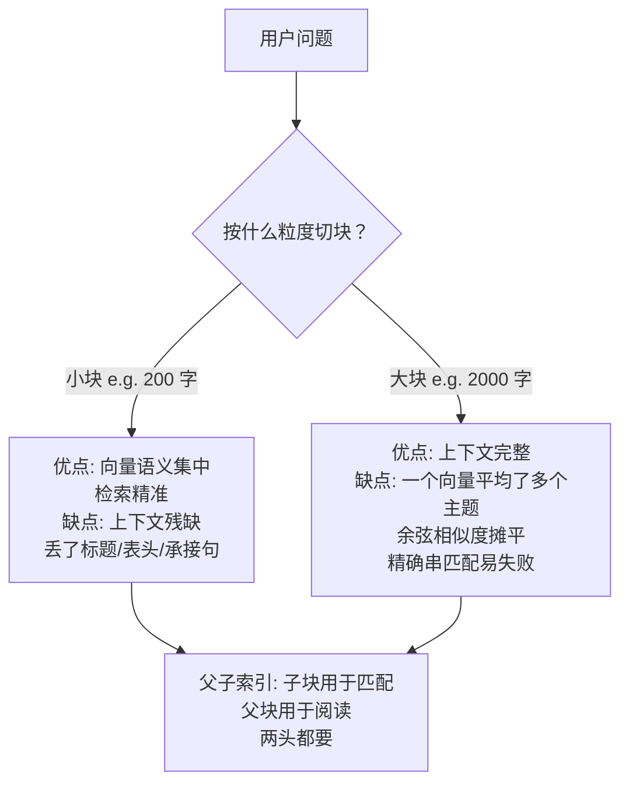

**2. 父子索引的数据流**

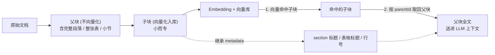

**3. 与已有考点的边界**

| 考点 | 解决什么 | 与父子索引的关系 |
| :--- | :--- | :--- |
| 切块策略与 overlap | 块边界怎么切、重叠多少 | 父子索引建立在切块**之上**，先切子块 |
| 召回质量诊断 / Rerank | 召回得准不准、排序准不准 | 父子索引不提升召回**精度**，只保证召回后的**阅读完整性** |
| 文档解析入库流水线 | 怎么把 Word/PDF 变成结构化文本 | 父子索引关心切完之后**块与块的父子关系怎么建** |
| 多路召回（向量 + BM25） | 召回阶段不漏 | 互补：多路召回解决「召不回」，父子索引解决「召回了但看不完整」 |

**规范实现:**

下面是最小可用的父子索引实现：切块时同时产出父块与子块，只有子块入库，检索命中后按父指针取回父块并去重。

```ts
interface Chunk {
  id: string
  parentId: string
  text: string
  // 子块继承父块的 metadata：section、tableTitle、rowRange 等
  meta: Record<string, string>
}

interface ParentChunk {
  id: string
  text: string
  meta: Record<string, string>
}

/** 按语义边界切子块，并挂到父块上；父块是「章节 / 整表」这种更大的单位 */
export function buildParentChild (doc: {
  sections: Array<{ title: string; body: string; table?: { title: string; rows: string[] } }>
}): { parents: ParentChunk[]; children: Chunk[] } {
  const parents: ParentChunk[] = []
  const children: Chunk[] = []

  for (const [si, sec] of doc.sections.entries()) {
    const parentId = `p-${si}`
    const tableText = sec.table
      ? `${sec.table.title}\n${sec.table.rows.join('\n')}`
      : ''
    parents.push({
      id: parentId,
      text: `${sec.title}\n${sec.body}${tableText ? '\n' + tableText : ''}`,
      meta: { section: sec.title, tableTitle: sec.table?.title ?? '' }
    })

    // 表格整体作为父块，不切碎：碎块嵌出来的是无语义的碎片
    if (sec.table) {
      children.push({
        id: `c-${si}-table`,
        parentId,
        text: tableText,
        meta: { section: sec.title, tableTitle: sec.table.title }
      })
      continue
    }

    // 正文按句子边界切子块，子块继承父块 metadata
    let idx = 0
    for (const block of sec.body.split(/(?<=[。！？；\n])/)) {
      const t = block.trim()
      if (!t) continue
      children.push({
        id: `c-${si}-${idx++}`,
        parentId,
        text: t,
        meta: { section: sec.title }   // 继承父块元信息
      })
    }
  }
  return { parents, children }
}

/** 检索命中子块后，取回父块并按父 id 去重，避免同一父块重复进上下文 */
export function toParentContext (
  hits: Chunk[],
  parents: Map<string, ParentChunk>,
  maxParents = 3
): string[] {
  const seen = new Set<string>()
  const out: string[] = []
  for (const h of hits) {
    if (seen.has(h.parentId)) continue
    seen.add(h.parentId)
    const p = parents.get(h.parentId)
    if (p) out.push(p.text)
    if (out.length >= maxParents) break
  }
  return out
}
```

关键在 `toParentContext` 的**按父去重**：如果 Top-K 的多个子块都来自同一个父块，不去重就会把同一段文字重复喂给模型，白白消耗上下文预算，还可能放大某段内容的权重。

**面试官视角:**

**考察意图:**
考察候选人是否理解**「检索粒度」与「阅读粒度」可以不同**。这题在 RAG 工程岗很常见，高分回答必须能说清父子索引**只建子块索引、命中后返回父块**，并能指出**去重**与**表格不可碎切**这两个实践细节。把父子索引说成「就是切大块」是最常见的失分点。

**评分 Rubric:**
- **必答**：子块向量化入库、父块只做阅读；子块通过继承拿到父块 metadata；命中后取父块；能讲清它与「调 Top-K」「加 Rerank」不是一回事。
- **加分项**：知道要按父去重；知道表格要保持完整不碎切；能说清多层父子与上下文膨胀的权衡；知道它不提升召回精度。
- **常见误区**：说成「把块切大一点就行」；说成「先召回大块再切」（方向反了）；忽略去重导致同一父块重复进上下文。

**深度追问链:**
1. **追问 1**：父块比子块大很多，Top-5 命中的父块塞进上下文后超预算了怎么办？
   - *答题切入点*：先按父去重再统计预算；然后考虑「中间层」——在父与子之间加一层中等粒度，或者对超长父块做二次定位（只取父块中与命中小节对应的片段），而不是简单截断。
2. **追问 2**：父块里有一半内容跟用户问题完全无关，全量喂给模型是不是浪费？
   - *答题切入点*：是的，这是父子索引的固有成本；缓解手段是命中子块后用**位置元数据**（前后邻居 / 章节偏移）做局部窗口裁剪，保留「命中点 + 必要上下文」而不是整段父块。
3. **追问 3**：这套结构对你的召回指标有提升吗？
   - *答题切入点*：**召回率与排序指标基本不变**，因为索引里还是子块、匹配还是子块；提升的是**生成端的可读性与答案完整率**——衡量它要看「答案是否因缺上下文而答错」，而不是看 hit rate。指标口径要跟着换。

**延伸阅读:**
- [LlamaIndex Node Parsers 文档（父文档与子节点的继承语义）](https://docs.llamaindex.ai/en/stable/module_guides/loading/node_parsers/)
- [LlamaIndex Node 与 Document 属性说明](https://docs.llamaindex.ai/en/stable/module_guides/models/llms/usage_custom/)
- [Hugging Face 文档：混合检索与重排序（召回与精排的两级架构）](https://huggingface.co/docs)

</Answer>
