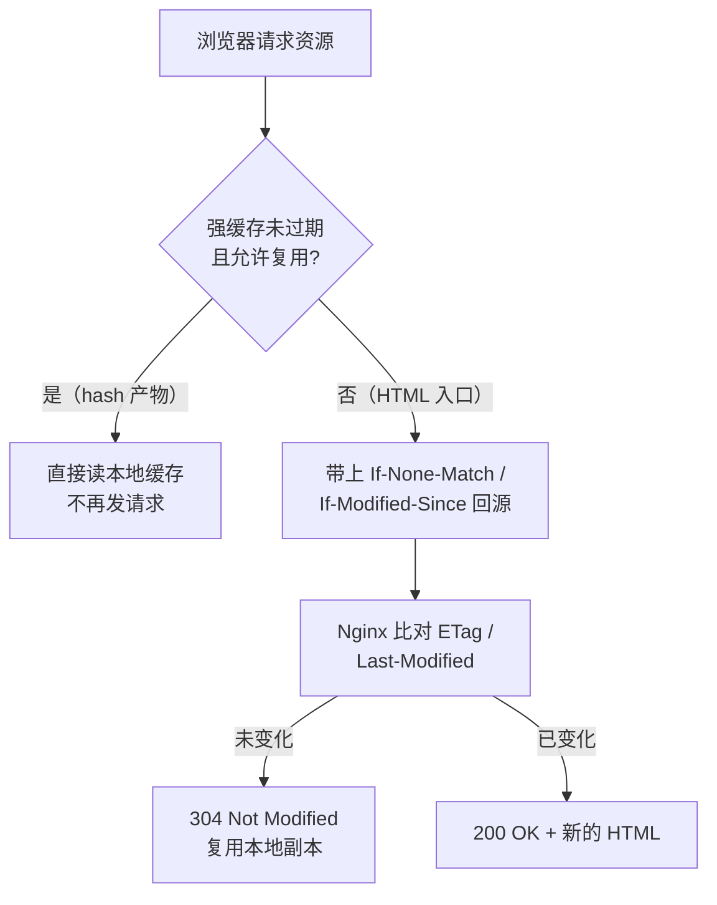

# Nginx 静态资源缓存策略✅

本主题聚焦 Nginx 作为前端静态资源交付层时的缓存策略设计：带内容哈希的构建产物、入口 HTML 与无版本资源的差异化缓存，以及 CDN 回源场景下的一致性保障。

## 用 Nginx 给前端产物设计缓存策略时，带 hash 的 JS/CSS 和 HTML 入口该怎么分别设置？为什么？ {#p1-nginx-static-cache-strategy}

<Answer>

**核心结论:**

1. **缓存策略由"URL 变不变"决定，而不是由文件类型决定**。带内容哈希的产物（`app.8f3b1e7d.js`）URL 一变内容就变，可以放心给长期强缓存；入口 HTML（`index.html`）URL 永远不变、内容可能已更新，必须禁用强缓存、走协商缓存。
2. **强缓存要显式写 `Cache-Control`**。`expires 365d` 负责设置 `Expires`（一年后过期），而 `public` 与 `immutable` 这两个强缓存标识必须用 `add_header` 写出来；`immutable` 明确告诉浏览器"这个资源不会再变，连条件请求都别发"。入口侧则用 `expires -1` 让它立即过期。
3. **`no-cache` 不等于 `no-store`**。`no-cache` 允许浏览器存储副本，但每次复用前必须先回源校验；`no-store` 才是完全不允许存储。入口 HTML 要的是前者（`no-cache, must-revalidate`）配合 `expires -1`，既拿到 304 的省流量收益，又保证拿到的是最新入口。

---

**原理解析:**

**1. 两类资源的缓存语义对照**

| 资源形态 | URL 随内容变化 | 缓存策略 | 关键配置 |
| :--- | :--- | :--- | :--- |
| 带 hash 产物 `app.8f3b1e7d.js` | 是 | 长期强缓存 | `expires 365d` + `add_header Cache-Control "public, max-age=31536000, immutable"` |
| 无 hash 资源 `favicon.ico` | 否 | 短期强缓存 + 过期后协商 | `expires 7d` + `add_header Cache-Control "public, max-age=604800, must-revalidate"` |
| 入口 HTML `index.html` | 否 | 禁用强缓存、只走协商 | `expires -1` + `add_header Cache-Control "no-cache, must-revalidate"` |
| 接口 `/api/...` | 否（数据本身动态） | 不缓存 | `add_header Cache-Control "no-store, no-cache, must-revalidate"` |

**2. 强缓存与协商缓存的请求链路**



**3. 几个必须讲透的细节**

- **HTML 入口为什么不能强缓存**：HTML 里写的是"本次发布包含哪些 hash 文件"。入口被强缓存住，等于用户永远拿着上一版的资源清单去请求上一版的 JS，而这些旧文件通常在发布后被清理，于是变成旧入口 + 资源 404 或白屏。这是缓存策略失效最常见的根因。
- **`try_files` 与 `$uri` 回退**：`try_files $uri $uri/ /index.html` 负责"路由不 404"，它不改变缓存语义——回退返回的 HTML 依然带着当前 location 上的 `Cache-Control`。因此缓存头要挂在正确的 location 上，回退目标也要指向同一份入口文件，否则 `/` 和 `/about` 可能命中两套缓存头。
- **两套协商依据**：`ETag` 配 `If-None-Match`、`Last-Modified` 配 `If-Modified-Since`，命中即返回 304。Nginx 对静态文件默认会带上 `ETag` 与 `Last-Modified`；具体头字段与最终生效值请以 `nginx -T` 查看实际配置、以 `curl -I` 抓取实际响应为准，不要凭记忆写死。
- **CDN 回源一致性**：CDN 同样按 `Cache-Control` 决策。源站改了文件但策略没变，CDN 手里仍是旧的，入口 HTML 一旦被 CDN 缓存住，一致性就彻底断了。入口在 CDN 侧必须不缓存或极短缓存，hash 产物在 CDN 侧缓存一年才安全。
- **顺带的传输效率**：`sendfile on` 走零拷贝减少大文件传输的用户态拷贝，`open_file_cache` 缓存文件描述符降低重复打开的磁盘开销；这与缓存策略互补，一个管"少请求"，一个管"快送达"。

---

**规范实现:**

```nginx
server {
    listen 80;
    server_name example.com;
    root /path/to/frontend/dist;  # 前端打包目录
    index index.html;

    # 1. 带 hash 的构建产物：长期强缓存，不再回源校验
    location ~* \.\w{8,16}\.(js|css|png|jpg|jpeg|gif|webp|svg|ico|woff2?)$ {
        expires 365d;
        add_header Cache-Control "public, max-age=31536000, immutable";
    }

    # 2. 入口 HTML 与 History 路由回退：禁用强缓存，走协商缓存
    location / {
        expires -1;
        add_header Cache-Control "no-cache, must-revalidate";
        # 先命中物理文件，再回退到入口 HTML（与上面的入口保持同一份文件）
        try_files $uri $uri/ /index.html;
    }

    # 3. 无 hash 的小资源：短期强缓存 + 过期后协商
    location = /favicon.ico {
        expires 7d;
        add_header Cache-Control "public, max-age=604800, must-revalidate";
    }
}
```

> 注意：`expires` 与 `add_header Cache-Control` 同时作用在同一资源上时，响应里可能出现重复的 `Cache-Control` 头。生产环境应先用 `curl -I` 确认最终头字段，再决定保留哪一份写法。

---

**面试官视角:**

**考察意图:**
考察候选人是否理解"缓存策略必须由资源的变更模型推导出来"，而不是背 `Cache-Control` 参数表。高分回答能主动区分强缓存与协商缓存、解释 `no-cache` 与 `no-store` 的语义差异，并指出"入口 HTML 禁强缓存"是为了避免用户拿到过期资源清单进而 404。

**深度追问链:**
1. **追问 1**: 发布后老用户刷新拿到旧 HTML，线上出现大面积 404 或白屏，你怎么定位和止血？
   - *答题切入点*: 先用 `curl -I` 分别看 HTML 与 hash 产物的实际 `Cache-Control`、`ETag`，确认入口是不是被强缓存住或被 CDN 缓存住；止血优先用"改 hash / 改版本号 + 清理 CDN 缓存 + 回滚"，而不是让用户手动清缓存。
2. **追问 2**: 为什么不能给所有资源都开一年强缓存？`no-cache` 和 `no-store` 你分别用在哪？
   - *答题切入点*: URL 不变而内容会变的资源（入口 HTML、无 hash 的公共脚本）一旦被强缓存就再也刷不出来；`no-cache` 保留存储但强制校验，`no-store` 连存都不允许，对入口 HTML 属于过度禁用，白白丢掉 304 收益。
3. **追问 3**: 上了 CDN 之后源站改了 HTML，用户为什么还是旧的？源站与 CDN 的策略怎么对齐？
   - *答题切入点*: CDN 按 `Cache-Control` 决策，源站只改文件不改策略不会自动刷新 CDN；入口 HTML 在 CDN 侧必须不缓存或极短缓存，hash 产物在 CDN 侧缓存一年才安全，并把它纳入发布流程（发版即刷新入口缓存）。

---

**延伸阅读:**
- [MDN: HTTP 缓存机制与 Cache-Control](https://developer.mozilla.org/docs/Web/HTTP/Caching)
- [MDN: 条件请求 ETag 与 If-None-Match](https://developer.mozilla.org/docs/Web/HTTP/Conditionals)
- [Nginx 官方文档：ngx_http_headers_module（expires / add_header）](https://nginx.org/en/docs/http/ngx_http_headers_module.html)
- [Nginx 官方文档：ngx_http_core_module（try_files）](https://nginx.org/en/docs/http/ngx_http_core_module.html)

</Answer>
