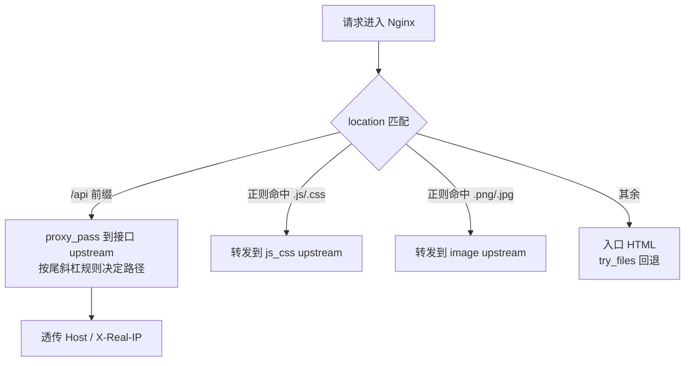

# Nginx 代理分流与跨域配置✅

本主题聚焦 Nginx 作为前端交付网关时的代理与分流配置：接口反代的路径映射规则、静态资源按类型分流到不同 upstream、跨域响应头与预检处理，以及压缩取舍与大文件分片。

## 用同一个 Nginx 既代理接口又发静态资源时，路径怎么映射、跨域怎么放行，才不会出现 404 或被浏览器拦下来？ {#p1-nginx-proxy-and-offload}

<Answer>

**核心结论:**

1. **`proxy_pass` 末尾有没有斜杠，决定路径是"替换"还是"原样拼接"**。`location /api` 配 `proxy_pass http://backend:3000`（不带斜杠）会把 `/api` 原样拼到后端，后端收到的是 `/api/user/list`；写成 `proxy_pass http://backend:3000/`（带斜杠）则用 `/` 替换掉 `/api`，后端收到的是 `/user/list`。要剥掉前缀就带斜杠，要保留就不带。
2. **静态资源与接口要按 `location` 显式分流**：用 `location ~* \.(js|css)$`、`location ~* \.(png|jpg|jpeg|gif|webp)$` 这样的正则把不同类型转发到不同 `upstream`，其余请求留给入口 HTML。Nginx 的匹配优先级是 精确匹配 `=` > 普通前缀匹配 > 正则匹配 `~` / `~*`，所以正则规则会"抢"普通前缀规则，两者不能打架。
3. **跨域头必须写在真正处理该请求的 location 里**：`Access-Control-Allow-Origin`、`Access-Control-Allow-Methods`、`Access-Control-Allow-Headers`、`Access-Control-Max-Age` 四个头，`OPTIONS` 预检直接 `return 204`。带 cookie 的跨域必须回显具体的 `Origin` 并加 `Access-Control-Allow-Credentials true`，写成通配符会被浏览器直接拒绝。

---

**原理解析:**

**1. 路径映射对照表**

| location | proxy_pass | 前端请求 | 转发到后端的路径 |
| :--- | :--- | :--- | :--- |
| `/api` | `http://backend:3000` | `/api/user/list` | `/api/user/list` |
| `/api` | `http://backend:3000/` | `/api/user/list` | `/user/list` |
| `/api` | `http://backend:3000/service` | `/api/user` | `/serviceapi/user`（非预期） |
| `/api` | `http://backend:3000/service/` | `/api/user` | `/service/user` |

带子路径又不带结尾斜杠是最容易踩的坑：location 前缀被原样拼到子路径后面，两段直接粘在一起。

**2. 代理与分流的链路**



**3. 几个必须讲清的细节**

- **`add_header` 是 location 级作用域**：`add_header` 写在哪个 location 就只对该 location 的响应生效。跨域头若只写在 `location /`，而接口实际落在 `location /api`，预检响应就不会带这些头，浏览器直接判定失败。这是"本地能通、线上失败"的高频原因。
- **预检与 `Max-Age`**：`OPTIONS` 预检的响应要带 `Access-Control-Max-Age`，让浏览器在缓存期内不再重复发预检，省掉一次往返；缓存期内的后续请求会直接进入真正的跨域请求阶段。
- **不要重复设置 CORS 头**：若后端服务（Node.js / Java）自己已经加了 CORS 头，Nginx 再用 `add_header` 加一遍会出现重复的 `Access-Control-Allow-Origin`，浏览器按解析冲突拒绝。同一层只能有一个责任方。
- **压缩取舍**：gzip / brotli 只对文本类资源（HTML / CSS / JS / JSON）开启。PNG、JPG、MP4、WOFF2 本身已是压缩格式，再压收益极低甚至体积变大；小于 1KB 的碎片压缩耗时可能超过省下的传输时间。`gzip_static on` 与 `brotli_static on` 直接返回预压缩产物，避免每次请求重复实时压缩。
- **大文件 Range 分片**：Nginx 默认支持 Range 请求，响应带 `Accept-Ranges: bytes`，命中时返回 `206 Partial Content` 与 `Content-Range`。反代场景要把 `Range` / `If-Range` 透传给后端，否则分片与断点续传会失效；本地大文件用 `sendfile on` 提升传输效率，并适当放宽 `send_timeout`。
- **同域名多路径部署**：前缀映射（如 `/app1`）要用 `alias` 而不是 `root`，且 `try_files` 的回退目标必须指向该子应用自己的入口，否则子应用路由刷新会拿到主应用的 HTML。
- **验证方式**：路径映射与跨域头都属于"看配置猜不出结果"的部分，应以 `curl -I` 与 `curl -v` 观察实际请求路径和响应头为准，用 `nginx -T` 确认最终生效的完整配置。

---

**规范实现:**

```nginx
http {
    # 静态资源集群与接口集群分离
    upstream js_css_servers {
        server 192.168.1.101:8080;
        server 192.168.1.102:8080;
    }

    upstream image_servers {
        server 192.168.1.201:8080;
        server 192.168.1.202:8080;
    }

    upstream api_servers {
        server 192.168.1.401:3000;
    }

    upstream file_servers {
        server 192.168.1.501:8080;
    }

    server {
        listen 80;
        server_name example.com;
        root /path/to/frontend/dist;

        # 1. 接口代理：末尾斜杠表示把 location 前缀替换成 /
        location /api {
            # 跨域：带 cookie 时必须回显具体 Origin，不能用通配符
            add_header Access-Control-Allow-Origin https://frontend.com;
            add_header Access-Control-Allow-Credentials true;
            add_header Access-Control-Allow-Methods 'GET, POST, PUT, DELETE, OPTIONS';
            add_header Access-Control-Allow-Headers 'Content-Type, Authorization, X-Token';
            add_header Access-Control-Max-Age 3600;

            # 预检请求直接返回 204，不进入后端
            if ($request_method = 'OPTIONS') {
                return 204;
            }

            proxy_pass http://api_servers/;
            proxy_set_header Host $host;
            proxy_set_header X-Real-IP $remote_addr;
        }

        # 2. JS/CSS 分流到静态资源集群
        location ~* \.(js|css)$ {
            proxy_pass http://js_css_servers;
            proxy_set_header Host $host;
            proxy_set_header X-Real-IP $remote_addr;
            expires 1d;
            add_header Cache-Control "public, max-age=86400";
        }

        # 3. 图片分流到图片集群
        location ~* \.(png|jpg|jpeg|gif|webp)$ {
            proxy_pass http://image_servers;
            proxy_set_header Host $host;
            proxy_set_header X-Real-IP $remote_addr;
            expires 7d;
            add_header Cache-Control "public, max-age=604800";
        }

        # 4. 入口 HTML 与 History 路由回退
        location / {
            try_files $uri $uri/ /index.html;
        }

        # 5. 同域名多路径（微前端）子路径部署：alias 映射 + 指向自身入口的回退
        location /app1 {
            alias /var/www/app1/;
            index index.html;
            try_files $uri $uri/ /app1/index.html;
        }

        # 6. 大文件分片：透传 Range / If-Range，保证断点续传与分片下载
        location /large-files {
            proxy_pass http://file_servers;
            proxy_set_header Range $http_range;
            proxy_set_header If-Range $http_if_range;
            proxy_pass_request_headers on;
            sendfile on;
            send_timeout 300s;
        }
    }
}
```

http 级的压缩配置（合并进上面的 `http` 块）：

```nginx
http {
    # 只对文本类资源开启压缩
    gzip on;
    gzip_comp_level 5;
    gzip_min_length 1024;
    gzip_types
        text/html text/css application/javascript
        application/json application/xml
        text/plain text/javascript;
    gzip_static on;   # 优先返回预压缩的 .gz 文件
    gzip_vary on;     # 返回 Vary: Accept-Encoding，便于 CDN 区分缓存

    # brotli 压缩率更高，但需额外安装 ngx_brotli 模块
    brotli on;
    brotli_comp_level 6;
    brotli_min_length 1024;
    brotli_types
        text/html text/css application/javascript
        application/json application/xml;
    brotli_static on;
    brotli_vary on;
}
```

---

**面试官视角:**

**考察意图:**
考察候选人是否在生产环境真正踩过 Nginx 代理的坑——能否说清 `proxy_pass` 尾斜杠的路径替换语义、`location` 的匹配优先级，以及 CORS 在"带 cookie"场景下的严格约束。高分回答会主动指出 `add_header` 的 location 作用域、重复 CORS 头的冲突、压缩对已压缩资源的负收益。

**深度追问链:**
1. **追问 1**: 前端请求 `/api/user/list` 全部 404，但 Nginx 访问日志里状态码是 404 而不是 502，问题出在哪？
   - *答题切入点*: 404 说明请求确实打到了后端，只是后端没有这条路由——大概率是 `proxy_pass` 尾斜杠把前缀剥掉了（后端收到 `/user/list`），或带子路径时拼成了 `/serviceapi/user`；用 `curl -v` 看实际发往后端的路径。
2. **追问 2**: 跨域在本地能通、上线就失败，最可能的原因是什么？
   - *答题切入点*: 生产前端域名与配置里写死的 `Access-Control-Allow-Origin` 不一致；或带了 cookie 却用通配符（浏览器直接拒绝）；或 CORS 头写在了 `location /` 而接口在 `location /api`，`add_header` 根本没生效；或后端自己也加了 CORS 头导致重复。
3. **追问 3**: 为什么要按资源类型把流量拆到不同 upstream？图片单独走一个集群有什么收益？
   - *答题切入点*: 资源类型决定了缓存时长、压缩收益、并发特征与存储介质；图片是不可变大对象、命中率高、适合独立扩容与独立缓存策略，与动态接口混部会互相挤占连接数与 CPU。
4. **追问 4**: 压缩和 Range 相关的配置要注意什么？
   - *答题切入点*: 只压文本类资源并设最小长度阈值，已压缩的 PNG / MP4 / WOFF2 不压；优先用 `gzip_static` / `brotli_static` 走预压缩产物省 CPU；反代场景必须透传 `Range` / `If-Range`，本地大文件用 `sendfile on` 并放宽 `send_timeout`，否则分片会失效或传输中断。

---

**延伸阅读:**
- [Nginx 官方文档：ngx_http_proxy_module（proxy_pass 路径规则）](https://nginx.org/en/docs/http/ngx_http_proxy_module.html)
- [Nginx 官方文档：ngx_http_core_module（location 匹配顺序与 try_files）](https://nginx.org/en/docs/http/ngx_http_core_module.html)
- [MDN: 跨域资源共享 CORS](https://developer.mozilla.org/docs/Web/HTTP/CORS)
- [Nginx 官方文档：ngx_http_gzip_module（gzip / gzip_static）](https://nginx.org/en/docs/http/ngx_http_gzip_module.html)
- [ngx_brotli 模块仓库（第三方模块，需额外安装）](https://github.com/google/ngx_brotli)

</Answer>
