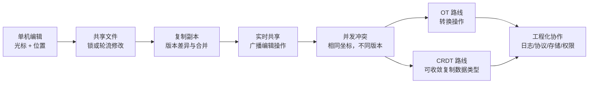
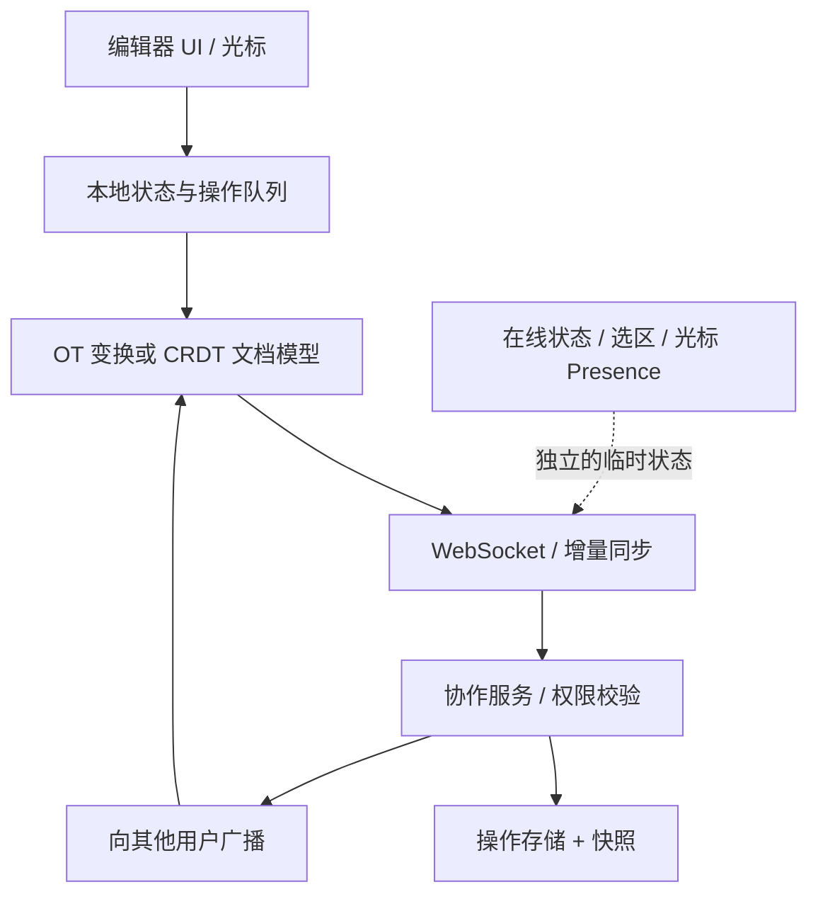

import CollaborationLab from '@site/src/components/CollaborationLab'

# 协同编辑：为什么会出现 OT 与 CRDT？

**学习目标**：从完全没有协同经验，到能解释实时协同编辑的问题、亲手实现最小 OT 变换、画出同步协议，并能在 WPS/飞书类桌面协作产品面试中做出技术选型。

> 核心教学方法：每一段都问 **当时有什么问题 → 人们用了什么办法 → 又出现了什么新问题**。我们不把所有历史路线误写成严格的单一路径：锁、版本合并、OT、CRDT 在今天仍可能同时使用，并没有谁“淘汰”谁。

## 0. 先记住一张地图



## 1. 历史演化时间线

| 时期 | 典型研究或产品 | 当时的问题 | 解决方案 | 新问题 |
| --- | --- | --- | --- | --- |
| 1960s | NLS / Engelbart 团队 | 计算机能否支持共享知识与协作？ | 共享信息、交互编辑、远程协作的早期实践 | 多人写入如何协调？ |
| 1970s | SCCS 等版本管理系统 | 两个人修改同一文件会互相覆盖 | 文件锁、检出与版本记录 | 等锁效率低，离线分支仍会产生冲突 |
| 1980s | 早期实时群组编辑研究 | 提交后合并太慢，无法边输入边看到别人修改 | 本地立即编辑，广播操作 | 不同副本的索引已经变化 |
| **1989** | **Ellis / Gibbs 的 GROVE** | 同时输入导致位置错位、操作路径差异 | **OT（Operational Transformation）操作转换** | 复杂并发下的转换正确性 |
| 1990s | OT 后续研究（GOT 等） | 早期 dOPT 的转换上下文可能不同 | 严格的上下文/因果控制与变换算法 | 控制算法复杂、实现与证明成本高 |
| 2000s | 复制数据结构、WOOT（2006）、Logoot（2009）等研究 | 能否不依赖对索引做 OT 转换？ | 给序列元素稳定身份、规定合并与排序 | 元数据、墓碑、ID 成长与垃圾回收 |
| **2010** | **Google Docs 官方工程博客** | 把实时协同用于大规模办公产品 | OT + 客户端缓冲/确认 + 协作协议 | 离线、多种富文本操作、规模与可靠性 |
| **2011** | **Shapiro 等对 CRDT 的形式化研究** | 分布式副本怎样无需每次同步就能收敛？ | 定义 CRDT、强最终一致性及收敛条件 | 不能替代权限、业务规则、可靠交付 |
| 2010s–今天 | ShareDB、Yjs、Automerge、富文本编辑器集成 | 如何把算法做成真实产品？ | 增量更新、同步状态、离线恢复、Presence、持久化 | 长期维护、性能、可观察性、历史迁移 |

**历史细节**：1968 年 NLS 不是“现代 OT 的实现”；早期加锁与版本合并也不是同一套线性演化产品。OT 的早期标志性论文是 1989 年的 GROVE；CRDT 相关的研究历史独立发展，并不是“OT 升级到 CRDT”。

权威来源：[GROVE / SIGMOD 1989](https://doi.org/10.1145/67544.66963) · [Sun 等 1998 OT 论文](https://www.cs.cityu.edu.hk/~jia/research/reduce98.pdf) · [CRDT 2011 论文](https://perso.lip6.fr/Marc.Shapiro/papers/2011/CRDTs_SSS-2011.pdf) · [Google Docs 2010](https://drive.googleblog.com/2010/09/whats-different-about-new-google-docs_22.html) · [CRDT 论文索引](https://crdt.tech/papers.html)

## 2. 为什么起初用位置（而不是字符身份）？

在普通文本编辑器中，光标天然有位置。文本 `ABC` 可以按数组索引表示：A=0、B=1、C=2。用户在 B 后面输入 F，操作可以简化为 `Insert(2, "F")`（插入位置是 B、C 之间）。Vim 常在 UI 层用行/列定位光标；这里为了算法简洁，使用从 0 开始的单行字符索引。**光标坐标不等于编辑器一定使用字符数组存储**。

单机编辑没有问题：一个操作执行时，引用的就是当前文本。协同编辑不同：两个人可能同时以旧版 `ABC` 为基础产生位置指令。

## 3. 亲手看一次：相同操作，为什么到达顺序会改变结果？

初始 `ABC`。A 在开头插入 `Y`：`Insert(0, "Y")`；B 在 B、C 中间插入 `F`：`Insert(2, "F")`。直接按旧位置处理会产生 `YAFBC`；把 B 的位置转换成 3 才得到 `YABFC`。

<CollaborationLab />

在实验里切换“先 A 后 B / 先 B 后 A”，并按“下一步”观察 **直接执行** 与 **转换执行** 的区别。

## 4. OT 的核心函数是什么？

OT 的最小核心是：

```text
Transform(待执行的操作, 已经应用的并发操作) → 转换后的操作
```

对于最简单的字符操作：

| 待处理 | 已经执行 | 位置如何变 |
| --- | --- | --- |
| 插入 q | 在 p 插入 n 字符 | 若 p 小于 q，q 增加 n；相同位置按固定 ID 规则判定 |
| 插入 q | 删除 p | 若 p 小于 q，q 减 1 |
| 删除 q | 在 p 插入 n 字符 | 若 p 小于或等于 q，q 增加 n |
| 删除 q | 删除 p | 若 p 小于 q，q 减 1；若 p 等于 q，变成 No-op |

**重要边界**：这只是单字符删除、共同基础版本、两个并发操作的教学模型。生产 OT 还必须解决删除区间重叠、操作组合、变换上下文、变换路径、因果与转换性质（TP1、TP2），以及客户端未确认操作的重基。

### 手写算法与自动测试

仓库里有一份**零依赖、可直接用 Node.js 运行**的实现：

- [ot.mjs（算法源码）](https://github.com/zenHeart/web-interview/blob/feat/collaboration-interview-mvp-20261114/docs/collaboration/examples/ot.mjs)
- [ot.test.mjs（六个场景，每个双向执行）](https://github.com/zenHeart/web-interview/blob/feat/collaboration-interview-mvp-20261114/docs/collaboration/examples/ot.test.mjs)

```bash
node docs/collaboration/examples/ot.test.mjs
```

练习：先不看实现，手写 `transform(op, alreadyApplied)`，让测试全部通过；再尝试加入“删除多个字符”的支持，观察为什么区间重叠比单字符难。

## 5. 为什么时间戳不能直接解决问题？

物理时间可以帮助排序，却不能表示**“我生成这条操作时看见了哪些编辑”**。B 比 A 晚一秒输入，不代表 B 的客户端已经收到 A 的消息。为此应区分：

- **总顺序**：服务器选定处理顺序，或者采用确定性 tie-break；
- **因果关系**：操作基于什么版本/哪些已有操作；可用修订号、逻辑时钟、向量等建模；
- **位置/语义转换**：操作的目标在新版文档上怎样定位。

“服务器排队”能实现一种一致的串行编辑，但若要求用户每敲一个字都等服务器返回，交互时延很高；如果本地先执行并允许并发，就必须处理旧位置或采用不同的数据表示。

## 6. CRDT 解决的是另一种问题

OT 的路线是：**保留位置操作，改变它执行前的表示**。

序列 CRDT 的一类路线是：**为元素引入稳定 ID、相对关系与确定性的并发排序，使副本可以独立接受修改并在同步后收敛**。

例如，把“在索引 2 插入 F”进一步表示为“在稳定标识的元素之间插入带唯一 ID 的元素”。算法会管理因果引用与并发顺序，而不只是加减数字索引。注意：不同序列 CRDT 使用不同的内部组织方式，不是所有 CRDT 都“逐字符永久存一个墓碑”。

| 维度 | OT | CRDT |
| --- | --- | --- |
| 最直观的核心 | 转换并发操作 | 设计可收敛的复制数据结构 |
| 典型代表 | ShareDB（OT 引擎） | Yjs、Automerge |
| 常见架构 | 服务器做顺序协调与变换 | 本地优先，可客户端—服务器或 P2P 传输 |
| 离线 | 可做，需要保存未确认操作并重基/同步 | 适合离线多副本操作，但要做缺失更新同步 |
| 代价 | 变换规则、上下文和控制算法 | 元数据、删除信息、压缩与 GC |

**墓碑问题**：删除的可见内容不一定代表底层用于识别历史元素的结构信息也能立即删掉，否则离线副本的迟到操作可能找不到定位依据。现实 CRDT（例如 Yjs）有垃圾回收与压缩机制，但仍需要处理状态向量、历史快照、长离线重连与持久化策略。

参考：[Yjs 内部实现](https://github.com/yjs/yjs/blob/main/INTERNALS.md) · [Yjs 同步协议](https://github.com/yjs/y-protocols/blob/master/PROTOCOL.md) · [ShareDB](https://github.com/share/sharedb/blob/main/docs/index.md) · [Automerge](https://automerge.org/)

## 7. 从算法变成 WPS / 飞书类协作产品，还缺什么？



实现真实协作，至少还要分别设计：

1. **文档模型**：纯文本、段落、富文本 mark、表格单元格、公式、批注、附件不是同一种冲突语义。
2. **同步协议**：操作 ID、base revision、ACK、重试、去重、断线补偿、快照与增量日志。
3. **本地体验**：乐观更新、未确认操作队列、撤销/重做、光标位置维护、输入法（IME）组合输入。
4. **持久化与安全**：权限变化、审核、历史版本、幂等、服务端存储与清理、跨设备重连。
5. **可观测与验证**：随机消息乱序、重复、延迟、丢包、离线半年、并发插删、最终收敛断言。

**不要把同步文档的持久状态和 Presence 混为一谈**：别人光标在哪儿、在线头像等通常是短生命周期的临时状态，不必和文档正文采用同样的持久化策略。

## 8. 行业方案如何学习，避免猜测私有实现？

| 系统/生态 | 有公开证据的技术重点 | 适合学习 |
| --- | --- | --- |
| Google Docs | 2010 官方明确介绍 OT、客户端待发送/待确认状态和协作协议 | 操作转换 + ACK 队列 |
| ShareDB | 官方公开 OT JSON 文档同步服务 | Node 服务端版本管理与 OT |
| Yjs | 公开 CRDT、state vector、增量 update 和 awareness | 本地优先、断线增量同步 |
| Automerge | 开源本地优先协作文档框架 | 离线副本与数据模型 |
| 飞书 / WPS / 腾讯文档 | 用户可观察到实时编辑、共享、权限、历史和 Presence 等产品能力 | 以“如何设计”做系统设计面试，**不能把未公开的内部算法冒充已证实的事实** |

## 9. 从入门到专家：高频面试追问

**基础层**：为什么版本合并不足以实现实时协同？为什么操作用索引会失效？物理时间与因果顺序有何不同？OT 全称是什么？如何用四种操作组合手写 `Transform`？

**算法层**：同位置插入怎样确定先后？两个删除相同字符怎么办？删除区间相交怎么处理？为什么两个操作正确不意味着三条操作转换正确？TP1/TP2 描述什么？本地 pending/buffer 如何对远端操作重基？

**CRDT 层**：序列元素 ID 如何定义？怎样处理同位置并发？为什么删除标记影响内存？墓碑何时能安全回收？快照、state vector、增量更新各自解决什么问题？CRDT 能否替代业务约束（例如余额不能为负）？

**工程层**：WebSocket 断线重连怎么补漏？ACK 超时重试会重复应用吗？文档 100 人同编怎么办？大文档如何按块渲染？输入法拼音未上屏时如何同步？批注绑定段落还是文本区间？权限撤销时离线修改如何处置？

**专家层**：给定纯文本、富文本文档和表格三种需求，如何选 OT / CRDT / 事务服务？对齐正确性（收敛、意图、权限）、时延 P95、内存、长文档加载、误合并率分别怎么测？何时必须用服务器权威校验而不是“最终一致”？

## 10. 下一步 MVP（由浅到深）

**V0（本次已提供）**：纯文本单行 OT 变换；可交互观看错误与正确结果；六个双向并发测试案例。

**V1（下一步目标）**：浏览器两个编辑器 + Node WebSocket 服务 + revision/opId/ACK + 未确认队列；支持断线重连、去重、回放。

**V2（对比研究）**：用 Yjs + Y.Text + Provider 实现同一编辑体验；切换乱序、离线及重复送达，并比较操作日志、状态向量和元数据开销。

建议完成 V0 后，先自己口述“为什么加时间戳不够”，再手写 OT 测试；不需要先背所有 CRDT 名词。
